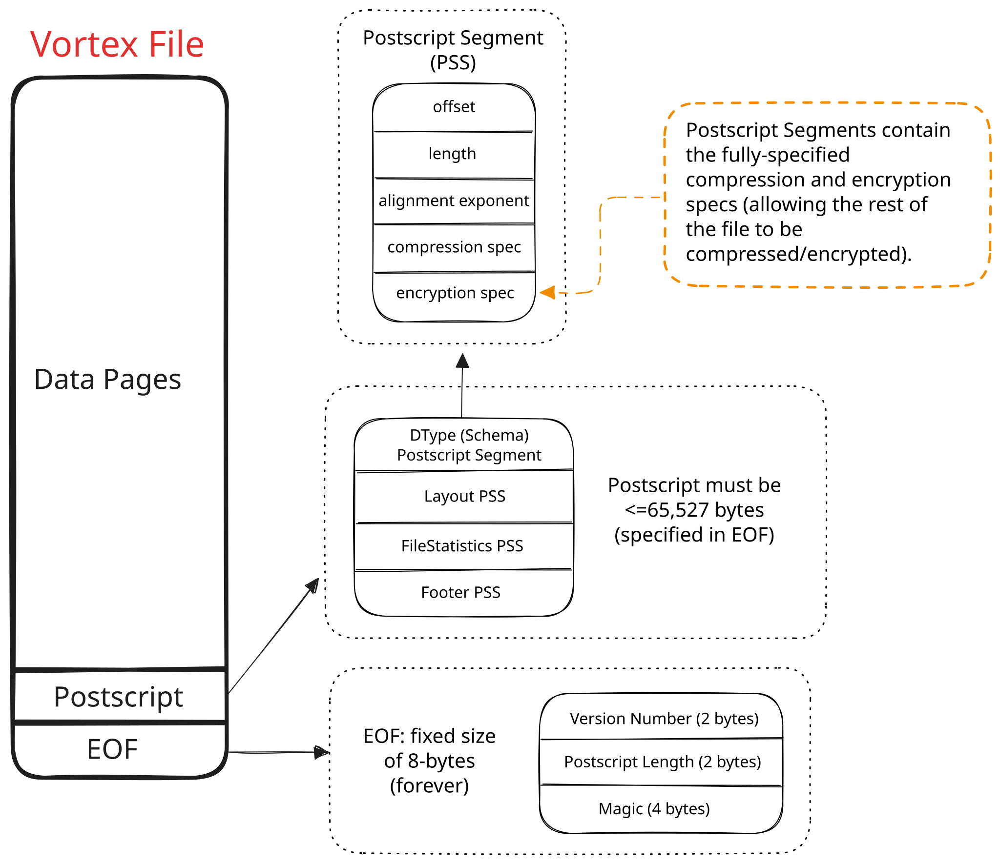
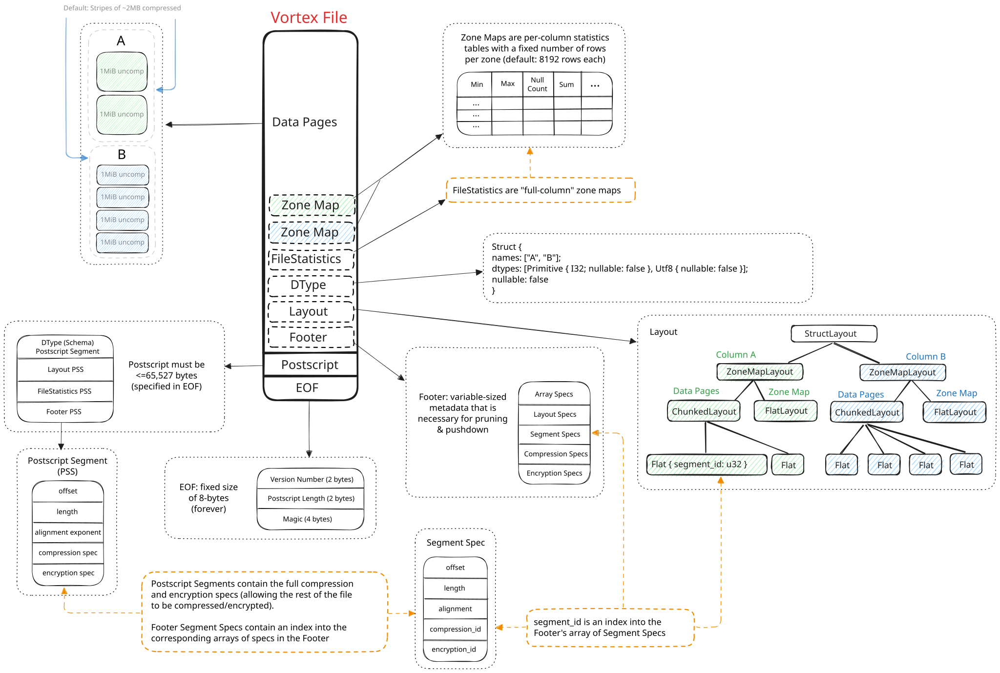

# File Format

:::{important}
The Vortex file format's stability guarantee starts with version `0.36.0` of the Vortex Rust crates
and edition `core2025.05.0`. Later versions of those crates retain read support for the components
in frozen editions.
[Versioning](/specs/versioning) explains the guarantee and the requirements for draft and custom
components.
:::

:::{seealso}
The majority of the complexity of the Vortex file format is encapsulated in [Vortex Layouts](/concepts/layouts).
Unless you are interested in the specific byte layout of the file, you are probably looking for that documentation!
:::

Recall that [Vortex Layouts](/concepts/layouts) provide a mechanism to efficiently query large serialized Vortex
arrays. The _Vortex File Format_ is designed to provide a container for these serialized arrays, as well as footer
definition that allows efficiently querying the layout.

Other considerations for the Vortex file format include:

* File compatibility. Editions constrain which serialized components a writer can use. A writer
  built with newer Vortex crates can target an older edition that its intended readers support.
* Fine-grained encryption.
* Efficient access for both local disk and cloud storage.
* Minimal overhead reading few columns or rows from wide or long arrays.

## File Specification

The Vortex file format has a very small definition, with much of the complexity encapsulated
in [Vortex Layouts](/concepts/layouts).

```
<4 bytes>  magic number 'VTXF'
...        segments of binary data, optionally with inter-segment padding
...        postscript data
<2 bytes>  u16 version tag
<2 bytes>  u16 postscript length
<4 bytes>  magic number 'VTXF'
```

The file format begins and ends with the 4-byte magic number `VTXF`.
Immediately prior to the trailing magic number are two 16-bit integers: the version tag and the length of the postscript.

Notably, this minimal notion of a Vortex file effectively includes only the byte ranges, alignment, encryption, and compression
configurations for other pieces of metadata.



## Postscript

The postscript contains the locations of:

1. a `dtype` segment representing the top-level logical data type (i.e., schema)
2. a `layout` segment containing the root `Layout`
3. a `statistics` segment containing file-level per-field statistics (e.g., minima and maxima of each field/column, for whole-file pruning)
4. a `footer` segment containing a dictionary-encoded _segment map_, and other shared configuration such as compression and encryption schemes
5. up to 16 user-defined `metadata` segments, each identified by a unique, non-empty UTF-8 key of at most 64 bytes

The postscript carries a locator (offset, length, and alignment) for each metadata segment that is
present; a file written without user metadata (and any file predating this feature) carries none.
Readers do not load the opaque metadata values by default. Opt-in metadata reads resolve each
locator separately, allowing values outside the initial file-tail read to be fetched without reading
the intervening file contents.

:::{literalinclude} ../../vortex-file/flatbuffers/vortex-file/footer.fbs
:start-after: [postscript]
:end-before: [postscript]
:::

## Data Type

Both viewed arrays and viewed layouts require an external `DType` to instantiate them. This helps us to avoid
redundancy in the serialized format since it is very common for a child array or layout to inherit or infer its data
type from the parent type.

The root `DType` segment is a flat buffer serialized `DType` object. See [DType Format](/specs/dtype-format) for more
information.

:::{note}
Unlike many columnar formats, the `DType` of a Vortex file is not required to be a `StructDType`. It is perfectly
valid to store a `Float64` array, a `Boolean` array, or any other root data type.
:::

## Footer

The footer is a flat buffer serialized `Footer` object. This object contains all the information required to
load the root `Layout` object into a usable `LayoutReader`.
For example, it contains the locations, compression schemes, encryption schemes, and required alignment of all segments in the file.

:::{literalinclude} ../../vortex-file/flatbuffers/vortex-file/footer.fbs
:start-after: [footer]
:end-before: [footer]
:::

The footer is separated from the Data Type such that large schemas can be omitted from the file if they can be
shared or fetched from an external source.

## Encryption

Vortex files support modular encryption, which operates on whole segments: data segments, and the `DType`, layout,
statistics, footer, and user metadata segments referenced by the postscript. The postscript always remains in plaintext.

- Each `PostscriptSegment` carries its `EncryptionSpec` inline, so the footer can be decrypted without a prior lookup.
  Segments protected by the same key reference a single `EncryptionSpec` table, so key metadata is stored once per key.
- Each `SegmentSpec` stores an index into the footer's `encryption_specs`. Index 0 always denotes a plaintext segment,
  so files written before encryption existed remain valid. Index 1 holds the footer key.
- The postscript itself is not authenticated, so readers configured for decryption reject an encrypted file whose
  `DType`, layout, statistics, or footer segment is not encrypted or signed with the footer key's spec, and whose
  user metadata or encrypted statistics segment uses a spec the footer does not list. Otherwise an attacker could
  strip the protection of these segments and forge their content.
- Keys are never stored in the file. The opaque `key_metadata` of an `EncryptionSpec` identifies the key to the
  reader, for example by a key management service key id.
- AES-128, AES-192, and AES-256 are supported, selected by the length of the key.

### Algorithm

`AesGcm` encrypts every segment with AES-GCM, stored as `ciphertext || nonce || tag`, with a random 12-byte nonce and a
16-byte tag. The ciphertext has the plaintext's length and starts at the segment's offset.

The additional authenticated data is the length of the AAD prefix as a little-endian `uint32`, the AAD
prefix, the spec's random `aad_file_unique` bytes, and an identifier of the segment: its index in the segment map, the
name of a footer segment, or the key of a metadata segment. A segment moved within or between files fails to decrypt.

The identifier of the footer segment also binds the postscript entries that the footer does not list: a byte whose bit
0 is set if the postscript has a `DType` segment and whose bit 1 is set if it has a statistics segment, followed by
the number of metadata segments as a little-endian `uint64` and, for each in postscript order, the length of its key
as a little-endian `uint64` and the key's UTF-8 bytes, then the number of `encrypted_statistics` entries as a
little-endian `uint64` and, for each in postscript order, the number of its fields as a little-endian `uint64` and the
fields as little-endian `uint32` values. An attacker who drops or reorders postscript entries therefore makes the footer
fail to decrypt.

The AAD prefix is optional and application-defined, such as the file's path, and binds the file to an identity the
reader knows, so that it cannot be replaced by another file encrypted with the same key. It is never stored in the
file: the writer sets `requires_aad_prefix`, and readers must supply the prefix to decrypt the file. Without a prefix,
its length is 0.

### Footer modes

- An encrypted footer hides the schema, layout, and statistics. Readers need the footer key to open the file.
- A plaintext footer leaves the `DType`, layout, statistics, and footer segments readable, so that readers without
  encryption support, or without keys, can open the file and read the fields stored in plaintext. Each of these
  segments is signed with the footer key: its `PostscriptSegment` carries the footer key's `EncryptionSpec` and a
  `signature` of `nonce || tag`, computed with AES-GMAC over the segment's additional authenticated data, a `0xFF` byte,
  and the segment's bytes. Readers with the footer key verify the signatures. User metadata segments remain encrypted.
  The layout tree reveals the row count, and the number and sizes of the segments, of encrypted fields too, and the
  footer lists every array encoding used in the file. Readers that skip the verification of the signatures lose the
  integrity protection of the whole file, since the footer records the encryption of every segment.

### Field keys

Fields can be encrypted with their own keys, each recorded as a separate `EncryptionSpec`. Every segment of such a
field, including its zone maps and dictionaries, uses the field's key. A reader without that key can still read every
other field. Fields without their own key are encrypted with the footer key, or stored in plaintext.

File-level statistics are protected like the fields they describe. The `statistics` segment, protected by the footer key
or stored in plaintext like the footer, holds the statistics of the fields whose segments are protected the same way.
The statistics of every other field are stored in a segment per key, listed in the postscript's `encrypted_statistics`
and encrypted with that key, and left empty in the `statistics` segment. The additional authenticated data of such a
segment identifies it by its position in `encrypted_statistics` and by its field indices, as little-endian `uint16` and
`uint32` values, so that its statistics cannot be attributed to other fields. A reader without a field's key therefore
sees neither its data nor its statistics, and a reader without any key still sees the statistics of plaintext fields in
a file with a plaintext footer.

### Key management

Writers may use envelope encryption, where each file uses fresh random data keys that are wrapped by master keys held
in a key management service. The `key_metadata` then holds an `EnvelopeKeyMetadata` flatbuffer, with the wrapped key
material or a reference to key material stored outside of the file. With double wrapping, data keys are wrapped locally
with a key encryption key, which is itself wrapped by the key management service.

:::{literalinclude} ../../vortex-file/flatbuffers/vortex-file/key_material.fbs
:start-after: SPDX-FileCopyrightText
:::

## Reified File Example

Since Vortex files are largely self-describing, many mainstays of other columnar file formats (e.g., whether or not to
have row groups) are decided by the **writer**, rather than being a rigid part of the specification. To build intuition,
consider an example Vortex file with two non-nullable columns, "A" of type i32, and "B" of type UTF-8. Using the defaults
as of June 2025, it might look as follows.



## Backward Compatibility

Later Vortex library versions retain read support for frozen formats, beginning with the formats in
`core2025.05.0`, supported from version `0.36.0`. The reader must retain the required component
implementations, including optional plugins. See [Versioning](versioning.md) for the guarantee and
its boundaries.

## Forward Compatibility

Newer writers can already produce files for older readers by
[selecting editions](versioning/using-editions.md) whose formats those readers support. That allows
applications to upgrade independently while continuing to exchange files in supported formats.

Reading a newly introduced format with an older reader is a separate capability. A proposed approach
embeds WebAssembly decoding logic for new encodings and layouts in the file. An older reader with
the required execution support could then interpret them without a native implementation. This
approach is not implemented and is not part of the edition compatibility guarantee.
