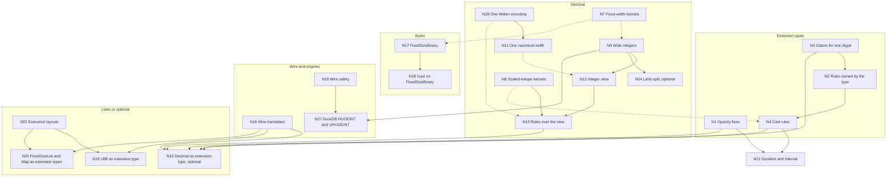

<!--
SPDX-License-Identifier: CC-BY-4.0
SPDX-FileCopyrightText: Copyright the Vortex contributors
-->

# 3. Roadmap

## The type work

Many planned type changes depend on each other. The IDs below match the full graph in section 7
of [`agents/report.md`](agents/report.md), which gives a reason for each edge. There is no N25.
The decision IDs (D1 to D42, X1 to X24, C1 and C2) and the open questions (DQ5 to DQ7, XQ1, XQ8,
CQ1 and CQ2) come from [`decisions.md`](../decisions.md).

| ID | Work | Kind |
| --- | --- | --- |
| N1 | Extension opacity fixes ([part 4](../extension-types/04-urgent-changes.md) of the extension notes) | Urgent |
| N2 | Rewrite rules that the type owns, registered with the type (X4) | Research, then implementation |
| N3 | Claims for one dtype (X2, X13) | Implementation |
| N4 | Cast rules for pairs of dtypes (C1), with cast hooks for extension types ([#8570](https://github.com/vortex-data/vortex/issues/8570)) | Implementation |
| N5 | Value checks in `try_new`, with `new_unchecked` for kernels (X7) | Implementation |
| N6 | Nullability on the extension dtype | Research, optional |
| N7 | Shared fixed-width structural kernels | Implementation |
| N8 | Scaled-integer kernels: `rescale` and `check_range` | Implementation |
| N9 | Wide integers: `I128`, `I256`, `U128` and `U256` (D5) | Implementation |
| N10 | Wire safety: strict enum decoding, and edition gates for core dtypes | Implementation |
| N11 | One canonical width for each decimal dtype (D3) | Urgent |
| N12 | Zero-copy integer view of the decimal leaf | Implementation |
| N13 | Decimal operations as rules over the view | Implementation |
| N14 | Limb split for wide-integer columns | Implementation, optional |
| N15 | `Decimal` as an extension type (D1 keeps it built in) | Optional, later |
| N16 | Wire translation for well-known types | Research, then implementation |
| N17 | FixedSizeBinary core type (D6) | Implementation |
| N18 | `Uuid` on FixedSizeBinary | Implementation |
| N19 | `Utf8` as a well-known extension type | Research, low priority |
| N20 | `FixedSizeList` and `Map` as well-known extension types | Research, low priority |
| N21 | `Duration` and `Interval` extension types ([#10467](https://github.com/vortex-data/vortex/pull/10467), [#10468](https://github.com/vortex-data/vortex/pull/10468)) | In progress |
| N22 | Execution layouts (RFC 0062) | Research |
| N23 | Engine type plugins for DuckDB and DataFusion | Implementation |
| N24 | Refinement types (RFC 0055) | Research |
| N26 | Scalar value model (RFC 0056) | Research, then implementation |
| N27 | DuckDB `HUGEINT` and `UHUGEINT` import and export | Implementation |
| N28 | One `Widen` encoding for integers and decimals (D4) | In progress |

For decimals, N9, N12, N13, N14, N17, N18 and N27 are future work outside the canonical decimal fix
(D20). The decimal part of N5, the value check in `DecimalArray::try_new`, moves into N11 (D14).

## Graph

A solid line is a hard dependency: the later work must not land before the earlier work. A dashed
line is a soft dependency: the earlier work makes the later work cheaper. This graph shows all hard
dependencies and the five most useful soft ones. The report lists every edge.

The nodes N5, N6, N23, N24 and N26 have only soft edges, so the graph leaves them out.

Two edges need a note. N9 to N12 applies only to precision 19 to 76. The view for precision 1 to
18 uses existing types, so it can land at any point. N11 does not depend on N9, because the leaf
uses `DecimalType`, which already has 128-bit and 256-bit widths.

## Independent changes

These changes are small and independent, and they can land in any order. On 2026-10-30, strict
enum decoding (#10755) and WD1 to WD4 of the integer `Widen` are on `develop`. N1 is not, and its
first PRs are open (#11012 to #11016).
[Part 4](04-implementation.md) splits these changes and the canonical form into PRs, with one
brief for each PR.

1. **Strict enum decoding.** The decimal `values_type` decodes with `DecimalType::try_from`, and
   the protobuf `PType` decodes with `PType::try_from`. Both fail on an unknown value instead of a
   silent `I8` or `U8`. Readers must have this change before any writer emits a new value. The
   decimal part must also land before the read plugin converts old nodes, because the detection
   of old nodes reads this field. The same PR fixes eleven `PType` fields of array and layout
   metadata with the same fallback (decided, D34).
2. **The DecimalByteParts nullability guard (dropped).** This step added the
   `Validity::trivially_cast_nullability` guard of PR
   [#10230](https://github.com/vortex-data/vortex/pull/10230) and a cast kernel to the cast rule.
   It closed without a merge as #10746. The rule pushes the cast into the MSP, and the MSP cast
   fails on a null row, so no result was wrong. #10798 documents that form as valid.
3. **Extension opacity fixes (N1).** These are the urgent changes in
   [part 4 of the extension notes](../extension-types/04-urgent-changes.md).
4. **The integer `Widen` in memory.** The draft PRs
   [#10223](https://github.com/vortex-data/vortex/pull/10223),
   [#10332](https://github.com/vortex-data/vortex/pull/10332) and
   [#10333](https://github.com/vortex-data/vortex/pull/10333) closed on 2026-10-23. The new PRs are
   written from scratch, with a local rewrite of #10223 and #10332 as a reference for tests and edge
   cases (decided, D38). `Widen` is in-memory only. It lands as five stacked PRs (decided, D35).
   The first adds `encode` and the deprecated `encode_values`, and a later PR moves the existing
   narrowing call sites to `encode_values` (decided, D28). The last PR of the stack adds the rules
   that move structural encodings above `Widen` (decided, D25). The fix for dictionary fill codes
   is its own PR, before that last PR. Decimal support needs real kernel changes, because some
   kernels assume an integer child. [`decisions.md`](../decisions.md#the-narrow-pull-requests) lists
   the state of these PRs.

## One canonical form

N11 fixes the crashes of issue [#5820](https://github.com/vortex-data/vortex/issues/5820), and
issue [#10701](https://github.com/vortex-data/vortex/issues/10701) tracks it. It lands as two
changes: an in-memory change, then a wire change (decided, D11). A part of a change lands as its
own PR only if it needs no temporary code. Otherwise, it lands together with the parts that it
depends on.

Benchmarks and fixtures come first:

- Benchmarks for decimal compare, filter, sum, min, max and the Arrow and DuckDB exports, on
  DecimalByteParts and on `Widen`. They include a gap column and the decoding of DecimalByteParts
  with a narrow MSP. They land on `develop` before the producers change, so that CodSpeed has a
  base. The existing ones are
  `vortex-array/benches/{compare,binary_ops,cast_decimal,filter_fixed_width}.rs`,
  `encodings/decimal-byte-parts/benches/dbp_assemble.rs` and `vortex-arrow/benches/to_arrow.rs`.
- Compatibility fixtures for narrow, wide and Arrow-style widths, gap values, high scales at
  narrow widths, nonzero values in null slots, and DecimalByteParts with a narrow MSP
  ([part 2](02-design.md#the-file-format)). A release publishes them before the PRs that change
  how files are read, because only the old writer can make narrow leaves (decided, D24 and D31).
  Library changes do not wait for it. The error
  cases, such as a value outside the precision in a narrowing copy, are unit tests, because the
  compat harness expects every read to succeed.

The in-memory change has these steps, in order. Each step is its own PR, because none of them
needs temporary code (decided, D11):

1. Give the width function one owner. `DecimalDType::canonical_values_type()` replaces the 25 direct
   calls to `smallest_decimal_value_type`. Producers and imports take the width from the precision,
   and every import checks its values (decided, D12, D13 and D30).
2. Add `Widen` over decimals (N28). This step holds the child rules of D10, the kernels and casts
   of D15, and the rule that joins a `Widen` over a `Widen`. When `validate_dtypes` opens for
   decimals, the compare kernel and the sum pushdown get decimal code in the same change.
3. Make DecimalByteParts decoding produce the canonical array of its dtype, with the
   `TODO(connor)` of D16. Decoding widens a narrower MSP, and it narrows a wider MSP with the copy
   of D21. Require `u64` lower parts, and reject lower parts that assemble wider than the
   canonical width (decided, D29). Correct the module doc, which allows narrower parts.
4. Make the `vortex.decimal` read plugin convert old nodes (decided, D9 and D21). The plugin scans
   the values, because it cannot use stored statistics.
5. Make the DecimalByteParts scheme take the canonical array, and delete `narrowed_decimal`
   (decided, D17). The MSP narrows with the deprecated `encode_values` (decided, D28). The scheme
   stays after the wire change, for writers whose edition does not permit `vortex.widen`. File
   contents stay the same. The exception is precision 39 to 76 with
   values that need more than 64 bits, which becomes a plain `i256` array.
6. Make `DecimalArray::try_new` accept only the canonical width and check every valid value, with
   `new_unchecked` for kernels (decided, D14). `try_new` takes an `ExecutionCtx` (decided, D30).
   Builders follow, including `DecimalBuilder::extend`, which accepts wider buffers. This step is
   three PRs: the width rule, the value check, and the removal of dead code.

Then the `patch` panic and the "does the constant fit" special cases are unreachable.

The wire change lands in lockstep (decided, D18). If possible, it ships in the same release as the
in-memory change (decided, D11). It holds three parts:

- The `vortex.widen` wire format for integers and decimals (decided, D8). This is the second part
  of PR #10333.
- One new preview edition that permits `vortex.widen` and DecimalByteParts with lower parts.
- A `Narrow` scheme that narrows the decimal type first, for writers that select that edition. It
  runs before the DecimalByteParts scheme, which then compresses the child (decided, D33). Its
  design pass settles which arrays it narrows (decided, D27), its precedence with the
  DecimalByteParts scheme, and its cascade level.

Later, both formats enter `core` together. Two optimizations wait until benchmarks show that they
are needed. One is the max pass in DecimalByteParts decoding (D16). The other is the pushdown of
sum, min and max into the MSP for gap columns (D19).

After the in-memory change, decoding a compressed decimal runs at the full width in memory until
the compressor narrows the decimal type first. This applies to existing files, and to files from
writers that do not select an edition with `vortex.widen`. The maintainer accepts this, because
the bar of no compute regression applies to the final state (decided, D19).

## Order of work

| Wave | Work |
| --- | --- |
| 0, independent | Strict enum decoding, the DecimalByteParts nullability fix, N1, the integer `Widen` in memory followed by the `encode_values` PR, and the decimal benchmarks and fixtures |
| 1, one canonical form | N11 as two changes (D11). The in-memory change holds the width owner, N28 for decimals, DecimalByteParts decoding, the read plugin, the DecimalByteParts scheme on the canonical array and the strict `try_new`, each as its own PR. The wire change holds the `vortex.widen` wire format, the preview edition with DecimalByteParts lower parts, and the decimal `Narrow` scheme |
| 2, foundations | N7 fixed-width kernels. N8 scaled-integer kernels, used first by `Timestamp` unit casts. N3, then N2 and N4, with the decimal rules as acceptance tests. N21 `Duration` and `Interval` after N1 and N4. N23 engine plugins |
| 3, new types | N9 wide integers, user-visible only behind an edition (recommendation DQ5). N10 edition gates and the protobuf `oneof`. N17 FixedSizeBinary, after DQ7. N5 array validation |
| 4, decimal kernels | N12 for precision 19 to 76. N13 rules over the view, which delete most decimal kernels. N14, which is optional. N18 and N27 |
| 5, optional | N16, then N15 if the built-in type and an extension type become identical. N19 and N20 after N22 |

[Part 4](04-implementation.md) gives the order of the PRs inside waves 0 and 1. Waves 1 and 2 can
run in parallel. The decimal fix (N28 and N11) does not wait for the extension
work, because the built-in type owns its rules. Only the optional move to an extension type (N15)
waits for N1 to N4. For decimals, waves 3 and 4 are future work (D20), and their recommendations
are not reviewed.

## Shared work between the tracks

- The scaled-integer kernels (N8) serve decimal rescales and the unit casts of `Timestamp`, `Time`
  and `Duration`.
- The decimal rules are acceptance tests for the rules and claims of extension types (N2 and
  N3). Phase 1 of the extension notes adds a decimal-like extension type over `i64`, and that type
  can run the same tests against the built-in `Decimal`.
- The fixed-width structural kernels (N7) serve wide integers and FixedSizeBinary.
- One `Widen` encoding (N28) with one wire ID serves integers and decimals (D8).
- The placement rule (X5, recommendation XQ1) serves `Decimal` and every extension type.
  Structural encodings sit above, and storage encodings sit below. `DateTimeParts` under the
  `Timestamp` type is the temporal twin of DecimalByteParts under `Decimal`.

## Risks

| Risk | Mitigation |
| --- | --- |
| The `PType` migration touches 36 crates and several languages | Typed sub-enums, compiler-driven steps, and one crate in each PR |
| A leftover `other => panic!` arm panics on a wide type | Retire those macros, and fuzz decimals and wide integers at every width |
| An old reader reads a protobuf wide `PType` as `U8` | A new protobuf `oneof` variant, and strict readers early |
| Rewritten arithmetic makes several passes over the data | Fused scaled-integer kernels, checked with the existing decimal and compare benchmarks |
| D3 without `Widen` forces the full width on every column | `Widen` for decimals lands in the in-memory change, before `try_new` rejects other widths |
| An in-memory `Widen` reaches a writer that cannot write `vortex.widen` | The serializer writes the canonical array (D26). The code documents this as a workaround until `vortex.widen` is in `core` |
| Moving the narrowing call sites to `encode_values` changes the signedness of internal children in new files | Readers on `develop` accept any integer type there, and the PR checks that the latest release reads its files (D28) |
| A narrow buffer does not give a precision | Every producer finds the precision from the values. Readers convert old nodes by their range (D9). DecimalByteParts decoding takes the range of a narrow MSP from `min_max` and returns a `Widen` (D16) |
| Compute on DecimalByteParts regresses when its decoding stops returning narrow leaves | In the final state, the compressor narrows the decimal type first, so decoding reuses the buffer. Until then, the maintainer accepts the cost (D19). The max pass of D16 can come later, and new benchmarks measure the cost |
| Gap columns use the next width in memory in the final state | Accepted (D19). Pushdown of sum, min and max into the MSP can come later |
| The conversion of old `vortex.decimal` nodes scans their buffer, because the plugin cannot use stored statistics | Old narrow nodes are rare, and the speed of this path matters little (D9) |
| Default writers use `core`, so they write precision 39 to 76 with values above 64 bits as plain `i256` arrays until `vortex.widen` and DecimalByteParts with lower parts enter `core` | Accepted (D17). The wire change puts both into one preview edition. If it ships in the same release as the in-memory change, writers that select that edition never pay the cost (D11) |
| Arrow import at another width copies the buffer | Accepted (D12 and D13) |
| The public API breaks: `DecimalArray::new::<T>` with a `T` other than the canonical type | Constructors that convert, and errors that name the canonical width. The in-memory ID stays `vortex.decimal`, which the Python bindings use |
| Wide integers reach users before engines can export them | Edition gates, and an explicit export rule for each engine |
