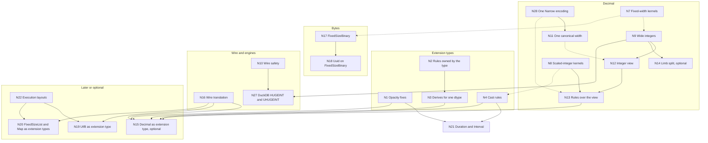

<!--
SPDX-License-Identifier: CC-BY-4.0
SPDX-FileCopyrightText: Copyright the Vortex contributors
-->

# 3. Roadmap

## The type work

Many planned type changes depend on each other. The IDs below match the full graph in section 7
of [`agents/report.md`](agents/report.md), which gives a reason for each edge. There is no N25.
The decision IDs (D1 to D6, X1 to X9, C1) and the open questions (DQ1 to DQ7, XQ1 to XQ6, CQ1)
come from [`decisions.md`](../decisions.md).

| ID | Work | Kind |
| --- | --- | --- |
| N1 | Extension opacity fixes ([part 4](../extension-types/04-urgent-changes.md) of the extension notes) | Urgent |
| N2 | Rewrite rules that the type owns, registered with the type (X4) | Research, then implementation |
| N3 | Derives for one dtype (X2) | Implementation |
| N4 | Cast rules for pairs of dtypes (C1), with cast hooks for extension types ([#8570](https://github.com/vortex-data/vortex/issues/8570)) | Implementation |
| N5 | Value checks in `try_new`, with `new_unchecked` for kernels (X7) | Implementation |
| N6 | Nullability on the extension dtype | Research, optional |
| N7 | Shared fixed-width structural kernels | Implementation |
| N8 | Scaled-integer kernels: `rescale` and `check_range` | Implementation |
| N9 | Wide integers: `I128`, `I256`, `U128` and `U256` (D5) | Implementation |
| N10 | Wire safety: strict enum decoding, and edition gates for core dtypes | Implementation |
| N11 | One canonical width for each decimal dtype (D3) | Urgent |
| N12 | Zero-copy integer view of the decimal leaf | Implementation |
| N13 | Decimal operations as rules over the view | Implementation |
| N14 | Limb split for wide-integer columns | Implementation, optional |
| N15 | `Decimal` as an extension type (D1 keeps it built in) | Optional, later |
| N16 | Wire translation for well-known types | Research, then implementation |
| N17 | FixedSizeBinary core type (D6) | Implementation |
| N18 | `Uuid` on FixedSizeBinary | Implementation |
| N19 | `Utf8` as a well-known extension type | Research, low priority |
| N20 | `FixedSizeList` and `Map` as well-known extension types | Research, low priority |
| N21 | `Duration` and `Interval` extension types ([#10467](https://github.com/vortex-data/vortex/pull/10467), [#10468](https://github.com/vortex-data/vortex/pull/10468)) | In progress |
| N22 | Execution layouts (RFC 0062) | Research |
| N23 | Engine type plugins for DuckDB and DataFusion | Implementation |
| N24 | Refinement types (RFC 0055) | Research |
| N26 | Scalar value model (RFC 0056) | Research, then implementation |
| N27 | DuckDB `HUGEINT` and `UHUGEINT` import and export | Implementation |
| N28 | One `Narrow` encoding for integers and decimals (D4) | In progress |

## Graph

A solid line is a hard dependency: the later work must not land before the earlier work. A dashed
line is a soft dependency: the earlier work makes the later work cheaper. This graph shows all hard
dependencies and the five most useful soft ones. The report lists every edge.

The nodes N5, N6, N23, N24 and N26 have only soft edges, so the graph leaves them out.

Two edges need a note. N9 to N12 applies only to precision 19 to 76. The view for precision 1 to
18 uses existing types, so it can land at any point. N11 does not depend on N9, because the leaf
uses `DecimalType`, which already has 128-bit and 256-bit widths.

## Urgent changes

These changes are small and independent. They are safe to make now:

1. **Strict enum decoding.** The decimal `values_type` decodes with `DecimalType::try_from`, and
   the protobuf `PType` decodes with `PType::try_from`. Both fail on an unknown value instead of a
   silent `I8` or `U8`. Readers must have this change before any writer emits a new value.
2. **The DecimalByteParts nullability fix.** The cast rule of DecimalByteParts declines a
   nullability change that the validity cannot make trivially. This is the first reusable part of
   PR [#10230](https://github.com/vortex-data/vortex/pull/10230).
3. **One owner for the width function.** `DecimalDType::values_type()` replaces the 25 direct
   calls to `smallest_decimal_value_type`, and producers take the width from the precision. This
   is the first step of N11.
4. **Extension opacity fixes (N1).** These are the urgent changes in
   [part 4 of the extension notes](../extension-types/04-urgent-changes.md).
5. **The integer `Narrow` PRs.** PRs [#10223](https://github.com/vortex-data/vortex/pull/10223)
   and [#10332](https://github.com/vortex-data/vortex/pull/10332) can merge as they are. Their only
   integer-only check is the private `validate_dtypes`, so decimal support stays additive.

## One canonical form

N11 fixes the crashes of issue [#5820](https://github.com/vortex-data/vortex/issues/5820). The
decisions file splits the reusable parts of PR #10230 into small PRs. After the urgent changes,
the rest of N11 follows that order:

1. Decide DQ3, then merge PR [#10333](https://github.com/vortex-data/vortex/pull/10333). It adds
   `vortex.narrow` to the draft edition `preview2026.10.0`.
2. Add `Narrow` over decimals (N28). When `validate_dtypes` opens for decimals, the compare kernel
   and the sum pushdown need decimal code in the same change.
3. Make the compressor and DecimalByteParts decoding stop narrowing and return `Narrow` instead.
4. Make readers convert old buffers at other widths. Old narrow leaves of up to 64 bits become
   DecimalByteParts arrays without a copy, with an integer `Narrow` as the most significant part.
   An old I128 leaf at precision 39 to 76 needs a widening copy. The compatibility fixtures for
   narrow, wide and Arrow-style widths come first.
5. Make `DecimalArray::try_new` accept only the canonical width.

Then the `patch` panic and the "does the constant fit" special cases are unreachable. Decimal
kernels can move onto integer kernels through the view (N12) at any point.

## Order of work

| Wave | Work |
| --- | --- |
| 0, urgent | Strict enum decoding, the DecimalByteParts nullability fix, one owner for the width function, N1, and PRs #10223 and #10332 |
| 1, one canonical form | DQ3 and PR #10333. N28 for decimals. The rest of N11. N12 for precision 1 to 18 |
| 2, foundations | N7 fixed-width kernels. N8 scaled-integer kernels, used first by `Timestamp` unit casts. N4 cast rules, then N21 `Duration` and `Interval`. N2 and then N3, with the decimal rules as acceptance tests. N23 engine plugins |
| 3, new types | N9 wide integers, user-visible only behind an edition (recommendation DQ5). N10 edition gates and the protobuf `oneof`. N17 FixedSizeBinary, after DQ7. N5 array validation |
| 4, decimal kernels | N12 for precision 19 to 76. N13 rules over the view, which delete most decimal kernels. N14, which is optional. N18 and N27 |
| 5, optional | N16, then N15 if the built-in type and an extension type become identical. N19 and N20 after N22 |

Waves 1 and 2 can run in parallel. The decimal fix (N28, N11, N12 and N13) does not wait for the
extension work, because the built-in type owns its rules. Only the optional move to an extension
type (N15) waits for N1 to N4.

## Shared work between the tracks

- The scaled-integer kernels (N8) serve decimal rescales and the unit casts of `Timestamp`, `Time`
  and `Duration`.
- The decimal rules are acceptance tests for the rules and derives of extension types (N2 and
  N3). Phase 1 of the extension notes adds a decimal-like extension type over `i64`, and that type
  can run the same tests against the built-in `Decimal`.
- The fixed-width structural kernels (N7) serve wide integers and FixedSizeBinary.
- One `Narrow` encoding (N28, recommendation DQ2) serves integers and decimals.
- The placement rule (X5, recommendation XQ1) serves `Decimal` and every extension type.
  Structural encodings sit above, and storage encodings sit below. `DateTimeParts` under the
  `Timestamp` type is the temporal twin of DecimalByteParts under `Decimal`.

## Risks

| Risk | Mitigation |
| --- | --- |
| The `PType` migration touches 36 crates and several languages | Typed sub-enums, compiler-driven steps, and one crate in each PR |
| A leftover `other => panic!` arm panics on a wide type | Retire those macros, and fuzz decimals and wide integers at every width |
| An old reader reads a protobuf wide `PType` as `U8` | A new protobuf `oneof` variant, and strict readers early |
| Rewritten arithmetic makes several passes over the data | Fused scaled-integer kernels, checked with the existing decimal and compare benchmarks |
| D3 without `Narrow` forces the full width on every column | `Narrow` for decimals lands before `try_new` rejects other widths |
| A narrow buffer does not give a precision | The compressor uses statistics. Old narrow leaves become DecimalByteParts arrays without a scan |
| Arrow import at another width copies the buffer | Accept the copy, or choose another width function in DQ1 |
| The public API breaks: `DecimalArray::new::<T>` with a `T` other than the canonical type | Constructors that convert, and errors that name the canonical width. The in-memory ID stays `vortex.decimal`, which the Python bindings use |
| Wide integers reach users before engines can export them | Edition gates, and an explicit export rule for each engine |
