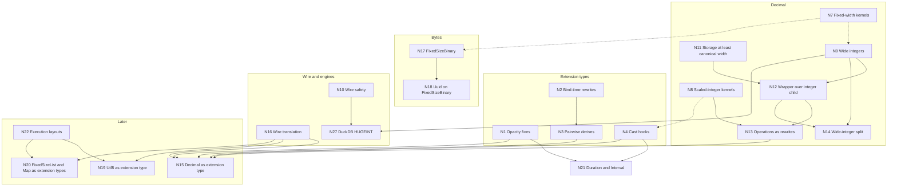

<!--
SPDX-License-Identifier: CC-BY-4.0
SPDX-FileCopyrightText: Copyright the Vortex contributors
-->

# 3. Roadmap

## The type work

Many planned type changes depend on each other. The IDs below match the full graph in section 7
of [`agents/report.md`](agents/report.md), which gives a reason for each edge. There is no N25.

| ID | Work | Kind |
| --- | --- | --- |
| N1 | Extension opacity fixes ([part 4](../extension-types/04-urgent-changes.md) of the extension notes) | Urgent |
| N2 | Bind-time rewrites for extension types | Research, then implementation |
| N3 | Pairwise derives | Implementation |
| N4 | Cast hooks for extension types ([#8570](https://github.com/vortex-data/vortex/issues/8570)) | Implementation |
| N5 | Array validation where data enters | Implementation |
| N6 | Nullability on the extension dtype | Research, optional |
| N7 | Shared fixed-width structural kernels | Implementation |
| N8 | Scaled-integer kernels: `rescale` and `check_range` | Implementation |
| N9 | Wide integers: `I128` and `I256` | Implementation |
| N10 | Wire safety: strict enum decoding, and edition gates for core dtypes | Implementation |
| N11 | Decimal storage at least as wide as the canonical width | Urgent |
| N12 | Decimal wrapper over an integer child | Implementation |
| N13 | Decimal operations as integer rewrites | Implementation |
| N14 | DecimalByteParts as a split of wide integers | Implementation, optional |
| N15 | `Decimal` as a well-known extension type in Rust | Implementation, later |
| N16 | Wire translation for well-known types | Research, then implementation |
| N17 | FixedSizeBinary core type | Implementation |
| N18 | `Uuid` on FixedSizeBinary | Implementation |
| N19 | `Utf8` as a well-known extension type | Research, low priority |
| N20 | `FixedSizeList` and `Map` as well-known extension types | Research, low priority |
| N21 | `Duration` and `Interval` extension types ([#10467](https://github.com/vortex-data/vortex/pull/10467), [#10468](https://github.com/vortex-data/vortex/pull/10468)) | In progress |
| N22 | Execution layouts (RFC 0062) | Research |
| N23 | Engine type plugins for DuckDB and DataFusion | Implementation |
| N24 | Refinement types (RFC 0055) | Research |
| N26 | Scalar value model (RFC 0056) | Research, then implementation |
| N27 | DuckDB `HUGEINT` import and export | Implementation |

## Graph

A solid line is a hard dependency: without the earlier work, the later work is wrong or unsafe. A
dashed line is a soft dependency: the earlier work makes the later work cheaper. This graph shows
all hard dependencies and the three most useful soft ones. The report lists every edge.

The nodes N5, N6, N23, N24 and N26 have only soft edges, so the graph leaves them out.

## Urgent changes

These changes are small and independent. They are safe to make now:

1. **Strict enum decoding.** The decimal `values_type` decodes with `DecimalType::try_from`, and
   the protobuf `PType` decodes with `PType::try_from`. Both fail on an unknown value instead of a
   silent `I8` or `U8`. Readers must have this change before any writer emits a new value.
2. **Decimal storage at least as wide as the canonical width (N11).** `DecimalData::validate`
   rejects narrower storage. DecimalByteParts assembly widens a narrow part, the compressor stops
   writing narrowed `vortex.decimal` nodes, and readers widen old narrow nodes. Then the `patch`
   panic and the "does the constant fit" special cases are unreachable for inputs with the same
   dtype. This is option 3 of issue [#5820](https://github.com/vortex-data/vortex/issues/5820).
   The compatibility fixtures for narrow, wide and Arrow-style widths come first.
3. **One owner for the width function.** `DecimalDType::storage_type()` replaces the 25 direct
   calls to `smallest_decimal_value_type`.
4. **Extension opacity fixes (N1).** These are the urgent changes in
   [part 4 of the extension notes](../extension-types/04-urgent-changes.md).

## Order of work

| Wave | Work |
| --- | --- |
| 0, urgent | Strict enum decoding, N11, one owner for the width function, and N1 |
| 1, foundations | N7 fixed-width kernels. N8 scaled-integer kernels, used first by `Timestamp` unit casts. N4 cast hooks, then N21 `Duration` and `Interval`. N2 and then N3, with the decimal rewrites as acceptance tests. N23 engine plugins |
| 2, new types | N9 wide integers, without user-visible wide columns. N10 edition gates and the protobuf `oneof`. N17 FixedSizeBinary. N5 array validation |
| 3, decimal restructure | N12 wrapper and wire plugin. N13 rewrites, which delete most decimal kernels. N14, which is optional. N18 and N27 |
| 4, API unification | N16, then N15. N19 and N20 after N22 |

The array-level fix for `Decimal` (N11, N12 and N13) does not wait for the extension work, because
the built-in wrapper owns its rewrites. Only the move to an extension type (N15) waits for N1 to N4.

## Shared work between the tracks

- The scaled-integer kernels (N8) serve decimal rescales and the unit casts of `Timestamp`, `Time`
  and `Duration`.
- The decimal rewrites are acceptance tests for the extension binder (N2 and N3). Phase 1 of the
  extension notes adds a decimal-like extension type over `i64`, and that type can run the same
  tests against the built-in `Decimal`.
- The fixed-width structural kernels (N7) serve wide integers and FixedSizeBinary.
- The wrapper normal form and the `StorageWrapper` rules serve `Decimal` and every extension type.
  `DateTimeParts` under the `Timestamp` wrapper is the temporal twin of DecimalByteParts under the
  `Decimal` wrapper.

## Risks

| Risk | Mitigation |
| --- | --- |
| The `PType` migration touches 36 crates and several languages | Typed sub-enums, compiler-driven steps, and one crate in each PR |
| A leftover `other => panic!` arm panics on a wide type | Retire those macros, and fuzz decimals at every width |
| An old reader reads a protobuf wide `PType` as `U8` | A new protobuf `oneof` variant, and strict readers early |
| Rewritten arithmetic makes several passes over the data | Fused scaled-integer kernels, checked with the existing decimal and compare benchmarks |
| The public API breaks: `DecimalArray::buffer::<T>()`, `values_type()` | Deprecation shims. The in-memory ID stays `vortex.decimal`, which the Python bindings use |
| Wide integers reach users before engines can export them | Edition gates, and an explicit export rule for each engine |
