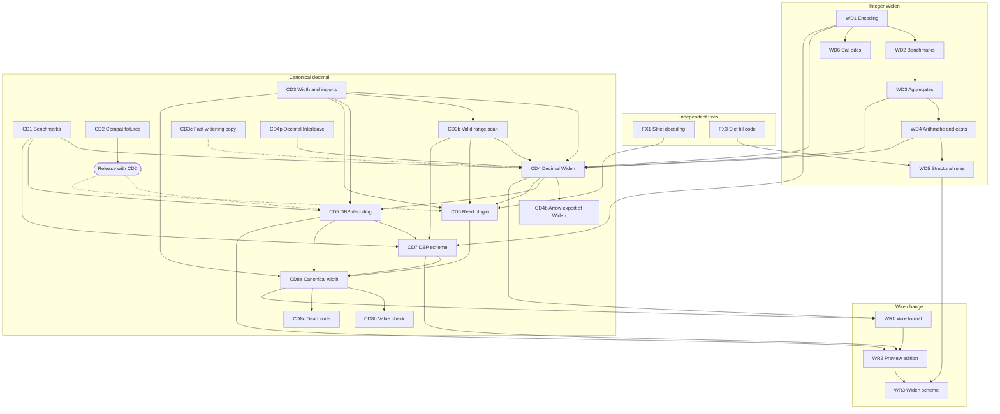

<!--
SPDX-License-Identifier: CC-BY-4.0
SPDX-FileCopyrightText: Copyright the Vortex contributors
-->

# 4. Implementation plan

This part splits the `Widen` encoding (issue
[#10733](https://github.com/vortex-data/vortex/issues/10733)) and the canonical decimal fix (issue
[#10701](https://github.com/vortex-data/vortex/issues/10701)) into PRs. Each PR has a brief in
[`agents/briefs/`](agents/briefs/), written so that a coding agent can implement the PR from the
brief alone. The briefs follow [`decisions.md`](../decisions.md), including D25 to D35 from the
planning review on 2026-10-23.

## How to use the briefs

- Give a coding agent one brief, `decisions.md`, and the repository rules in `AGENTS.md` and
  `STYLE.md`. The brief names the branch, the files, the steps, the tests and the acceptance checks.
- The briefs and `decisions.md` exist only on the `ct/ext-types-research` branch. The agent's own
  worktree branches from `develop` and has no `research/` directory, so the relative links in the
  briefs do not work there. Give the agent absolute paths into the research worktree
  (`/Users/connor/spiral/vortex-data/vortex1/research/`), or tell it to read the files with
  `git show ct/ext-types-research:research/<path>`. Do not change a brief while an agent works from
  it. If a brief must change, tell that agent.
- When a PR opens, merges or changes scope, the agent updates its line in the collapsed PR list of
  [#10701](https://github.com/vortex-data/vortex/issues/10701) or
  [#10733](https://github.com/vortex-data/vortex/issues/10733) with `gh issue edit`. It edits only
  that line, and it reads the issue again just before it writes, so that it keeps the edits of
  others. It does not edit this branch to record progress.
- The briefs cite `develop` at `b70206818f`, except WD1 to WD4, which cite `origin/develop` at
  `afa4bc87cd`. Line numbers move as PRs land, so the agent reads the cited code before it changes
  it. Code from the local integer `Widen` rewrite is cited with its commit, for example
  `f7408481ce:vortex-array/src/arrays/narrow/mod.rs`. That rewrite is a reference for tests and
  edge cases. The PRs are written from scratch, and only FX3 ports a rewrite commit as it is (D38).
- The rewrite commits (`f7408481ce`, `8d548646ee`, `74aa17644e`, `af4b663059` and `7e2e5e4d7a`) are
  not on `origin`. Only the local branches `ct/narrow-pushdown` and `ct/narrow-encoding` hold them,
  and those names also exist on `origin` with the older commits of the closed PRs. Agents in local
  worktrees of this repository can read them. A remote agent or another clone cannot. Before such
  an agent needs the reference, push them to a new backup branch. Do not delete or reset the two
  local branches.
- Agents can run any command that the work needs: builds, tests, the acceptance checks, and the
  generators of committed files, such as golden snapshots (WD6, CD7, WR3) and the edition record
  (WR2). CI fails when a committed file is stale. Use the narrowest command, as `AGENTS.md`
  describes.
- Several PRs form stacks: WD1 to WD5, WR1 to WR3, CD4 with CD4b, CD5 and CD6 on it, CD5 with CD7
  on it (D41), and optionally CD8a and CD8b. `develop` squash-merges PRs. So after the base PR
  merges, a plain `git rebase develop` replays the base commits again and conflicts. Rebase the
  next PR with `git rebase --onto develop <old base tip>`, or with `gh stack`. The WD1 to WD5
  stack follows "Stack and branches" in the NR brief instead: it starts from `origin/develop`,
  runs `gh stack sync` after a merge, and uses no manual `--onto`.
- Every commit carries `Signed-off-by: Connor Tsui <connor.tsui20@gmail.com>` and no AI co-author
  line.
- WR3 needs a design pass before an agent starts it. Its brief lists the open questions.

| Brief | PRs |
| --- | --- |
| [`01-fixes.md`](agents/briefs/01-fixes.md) | FX1 to FX3, independent fixes |
| [`02-integer-widen.md`](agents/briefs/02-integer-widen.md) | WD1 to WD6, the integer `Widen` |
| [`03-canonical-decimal.md`](agents/briefs/03-canonical-decimal.md) | CD1 to CD8c, the canonical decimal fix and decimal `Widen` |
| [`04-wire.md`](agents/briefs/04-wire.md) | WR1 to WR3, the wire change, and LT1 to LT3 |

## The PRs

| ID | PR | Hard dependencies | Size |
| --- | --- | --- | --- |
| FX1 | Strict decoding of stored `DecimalType` and `PType` values, in three commits | None | Medium |
| FX2 | Dropped. #10798 documents the cast-rule contract instead (see the FX2 brief) | None | None |
| FX3 | Dictionary `fill_null` no longer truncates the fill code | None | Small |
| WD1 | In-memory integer `Widen`, with `encode`, the deprecated `encode_values` and a flatten rule | None | Large |
| WD2 | Benchmarks for compute on integer `Widen` | WD1 | Medium |
| WD3 | Aggregates run on the child | WD2 | Medium |
| WD4 | Arithmetic, `between`, `zip` and casts run on the child | WD3 | Large |
| WD5 | Structural encodings move above `Widen`, and dictionary codes use the child | WD4, FX3 | Medium |
| WD6 | The existing narrowing call sites move to `encode_values` | WD1 (D35) | Medium |
| CD1 | Decimal benchmarks | None | Medium |
| CD2 | Compat fixtures for old decimal forms | None | Medium |
| CD3 | One width function, imports that check and copy, and the shared helpers | None | Medium |
| CD3b | One scan for the range of valid decimal values (`valid_range`), shared by CD4, CD6 and CD7 | CD3 | Small |
| CD3c | Speed up the decimal widening copy, with a benchmark of `copy_to_canonical_width`. It merges before CD4 (D41) | None | Small |
| CD4p | Decimal `Interleave` execution, so that CD4 can test its fallbacks | None | Medium |
| CD4 | Decimal `Widen` in memory, `WidenArray::from_stored_decimal` (D40), the decimal `Sum` and `MinMax` kernels (D36), and the serializer lowering (D26) | WD1, WD3, WD4, CD1, CD3, CD3b, CD4p | Large |
| CD4b | Export decimal `Widen` arrays to Arrow with one copy | CD4 | Small |
| CD5 | DecimalByteParts decodes to the canonical array or a decimal `Widen`, and its benchmarks stop at a `Widen` (D16, D42) | CD1, CD3, CD4, the CD2 fixtures in 0.91.0 | Medium |
| CD6 | The `vortex.decimal` read plugin converts old nodes through `WidenArray::from_stored_decimal` | FX1, CD3, CD3b, CD4, the CD2 fixtures in 0.91.0 | Medium |
| CD7 | One DecimalByteParts scheme on the canonical array. It merges right after CD5 | WD1, CD1, CD3b, CD5 | Medium |
| CD8a | Every decimal array has the canonical width | CD3, CD5, CD6, CD7 | Large |
| CD8b | `DecimalArray::try_new` checks every valid value, with an `ExecutionCtx` | CD8a | Large |
| CD8c | Remove the code for mixed decimal widths | CD8a | Medium |
| WR1 | `vortex.widen` wire format for integers and decimals | WD1, CD3, CD4, CD8a | Medium |
| WR2 | One preview edition with `vortex.widen` and DecimalByteParts v2 | WR1, CD5, CD7 | Small |
| WR3 | A `Narrow` scheme in the compressor (needs a design pass) | WR1, WR2, WD1, WD5, CD3, CD4, CD7 | Large |

Later work: LT1 puts both formats into `core` and decides the end of the serialization
workaround. LT2, the range pass in DecimalByteParts decoding that returns a `Widen`, is now part of
CD5 (D16). LT3 is the pushdown of sum, min and max into the MSP (D19). LT3 waits until benchmarks
show that it is needed.

## Progress

The collapsed PR lists in [#10701](https://github.com/vortex-data/vortex/issues/10701) and
[#10733](https://github.com/vortex-data/vortex/issues/10733) track the state of each PR: its link,
whether it merged, and short notes. Agents update those lists. This branch changes only when a
brief or a decision changes.

## Graph

Each solid arrow is a hard dependency. Some arrows also follow from other arrows. The graph keeps
them, so that the direct needs of each PR show. The dashed arrows are order rules, not code
dependencies: the release gate of the compat fixtures (D31), and CD3c merging before CD4, so that
the CodSpeed run of CD4 measures the fast copy (D41). CD7 is stacked on CD5 and merges right after
it, so that the old scheme does not split decimals from their storage width for long (#10905).

## Order of work

A PR can start when its dependencies have merged. The waves group the PRs whose dependencies merge
at about the same time. Two PRs of one wave can run at the same time only when they touch different
files. The column "Shared files" names the pairs that do not, so run those one after the other.

| Wave | PRs | Note | Shared files |
| --- | --- | --- | --- |
| 1 | FX1, FX3, WD1, CD1, CD2, CD3, CD4p, CD3c | No dependencies. Release 0.91.0 publishes the CD2 fixtures. CD3c merges before CD4 (D41) | CD2 calls `smallest_decimal_value_type`, which CD3 removes. The second of the two to merge adapts |
| 2 | WD2, WD6, CD3b | WD6 needs only WD1 (D35) | None |
| 3 | WD3, then WD4 | One stack. Read the CodSpeed reports with the rule in the NR brief ("CodSpeed on stacked PRs") | None |
| 4 | WD5, CD4, then CD4b | FX3 is merged (`dcb4f50ae2`). CD4b is stacked on CD4 and has no release gate | WD5 and CD4 both edit `vortex-array/src/arrays/widen/rules.rs` |
| 5 | CD5, then CD7, and CD6 | CD5 and CD6 are stacked on CD4 and wait for 0.91.0 (D31). CD7 is stacked on CD5 and merges right after it. Aim to ship CD5, CD7 and CD6 in one release | CD5 and CD7 share the crate doc in `encodings/decimal-byte-parts/src/lib.rs`, the tests in `assemble.rs` and `benches/dbp_assemble.rs`, and the stack orders them. CD7 also changes the signature of `split_decimal`. WD6 and CD7: the golden snapshots of `vortex-btrblocks` |
| 6 | CD8a | The last in-memory step that the wire change needs | None |
| 7 | CD8b, CD8c, WR1 | Each needs only CD8a | CD8b adds a `ctx` parameter to `DecimalArray::new` and `try_new`, which CD8c and WR1 call. CD8b and CD8c both edit `vortex-array/src/builders/decimal.rs` and the same tests. Land CD8b first, or rebase the others on it |
| 8 | WR2, then WR3 | WR3 after its design pass. If possible, the wire stack ships in the same release as the in-memory change (D11) | None |

The critical path runs WD1, WD2, WD3, WD4, CD4, CD5, CD7, CD8a, WR1, WR2 and WR3. Release 0.91.0,
which publishes the CD2 fixtures, also gates CD5 and CD6, so CD2 is worth landing in wave 1.

## Rules for every PR

- No PR adds temporary code (D11). The serialization lowering of D26, which CD4 adds, is the one
  documented exception. After WR1 it stays only for contexts that do not permit `vortex.widen`,
  and LT1 decides its end.
- Stored decimal values at any width become the canonical array or a `Widen` only through
  `WidenArray::from_stored_decimal` (D40). No PR adds its own choice of child.
- Benchmarks land before the changes that they cover (D19): WD2 before WD3 to WD5, and CD1 before
  CD4, CD5 and CD7. The dependency table lists these as hard dependencies.
- Every call of the deprecated `encode_values` carries `#[expect(deprecated)]` with a
  `TODO(connor)` reason (D28).
- No `Widen` sits directly above a generic structural encoding after optimization (D25).
- A narrowing copy writes zeros in null slots and fails on a valid value outside the precision
  (D21). Reads without a copy trust the precision and never panic (D14).

## Deferred

- Which arrays the compressor narrows (D27). The WR3 design pass decides it, together with the
  precedence between the `Narrow` scheme and the DecimalByteParts scheme and the cascade level
  (D33).
- Other members of the preview edition. WR2 adds only `vortex.widen` and
  `vortex.decimal_byte_parts.v2`.
- Arrow import options for invalid decimal values (D13). The import fails, and the error names
  arrow-rs `null_if_overflow_precision`.

## Follow-up issues

These problems came up during planning and the first wave of PRs. They are outside the planned
PRs, and each one has its own issue. Two are closed.

| Issue | Problem |
| --- | --- |
| #10748 | Generic structural encodings always sit above other encodings. WD5 does this for `Widen` only |
| #10749 | Decimal `scalar_at` and `min_max` panic on a stored value outside the precision, which a file read can produce. #10767 fixes both and is in review |
| #10750 | Closed as not planned. The push-down cast rules return no wrong result, and #10798 documents them as a valid form |
| #10751 | Closed by #10757. The FoR scheme now declares and refines its bit-packing child |
| #10754 | The compat harness: no CI job runs `--mode all`, one failing fixture stops the whole check, and the README describes `--git-ref` wrongly |
| #10756 | Corrupt ALP-RD, RLE and RunEnd metadata can panic a file read |
| #10908 | `ZipExecuteAdaptor` dispatches only on the `if_true` branch, so a `Widen` in the `if_false` branch of `zip` does not run on the child. Found in the review of WD4 |

The stale versioning docs needed no issue, because #10747 fixes them.

## Risks

| Risk | Mitigation |
| --- | --- |
| CD5 changes the CUDA decoder, which few reviewers know | A minimal change in its own commit, with a CUDA reviewer. It becomes its own PR if it grows |
| A narrow DecimalByteParts decode makes one range pass over the MSP when the MSP has no exact statistics, for example a FoR MSP and the benchmarks. A nullable MSP pays about 5x more, because the nullable primitive `min_max` is slow | Accepted (D16). Statistics survive the executor steps, so file reads of BitPacked or uncompressed MSPs skip the pass. A follow-up can keep MSP statistics through the FoR scheme |
| A gap column decodes to a `Widen` over a copied child, and a later canonicalization copies again | Accepted (D19). CD3c makes the widening copy fast |
| The child label trusts exact MSP statistics from the file, as D14 trusts the precision. Stale statistics give wrong compare shortcuts | Accepted. A narrowing copy still checks every value, and only a reused buffer trusts the statistics |
| The Python decimal subclass mapping (`vortex-python/src/arrays/native.rs`) does not cover `Widen`, and `__vortex_array_metadata__` calls `array_serialize` without the D26 lowering | A follow-up issue |
| After CD6, a CUDA read of an old decimal node copies the buffer to the host and returns a `Widen` or the canonical array, and CUDA has no `Widen` kernel. The plugin also copies a device validity to the host with the crate-private `ArrayRef::try_into_host_sync`, because `from_stored_decimal` executes the validity on the host | Accepted (D37): the host converts old nodes, which are rare. A CUDA reviewer confirms in CD6 that such a scan still works |
| The reference commits of the rewrite exist only on local branches | Keep the local branches. Push a backup branch before a remote agent needs the reference (see "How to use the briefs") |
| WD6 writes signed internal children that earlier releases have not read | Readers on `develop` accept any integer type there. WD6 runs the latest release on its files |
| The `take_map` regressions on #10333 have no known cause | WD6 compares CodSpeed runs on WD1, WD3, WD4 and WD6, and reads the flame graph diff |
| WR3 has open design questions | A design pass before any code. The other wire PRs do not depend on it |
| The decimal critical path is long | Wave 1 holds eight PRs with no dependencies, and WD6 needs only WD1. CD5 and CD6 run in parallel on CD4 |
