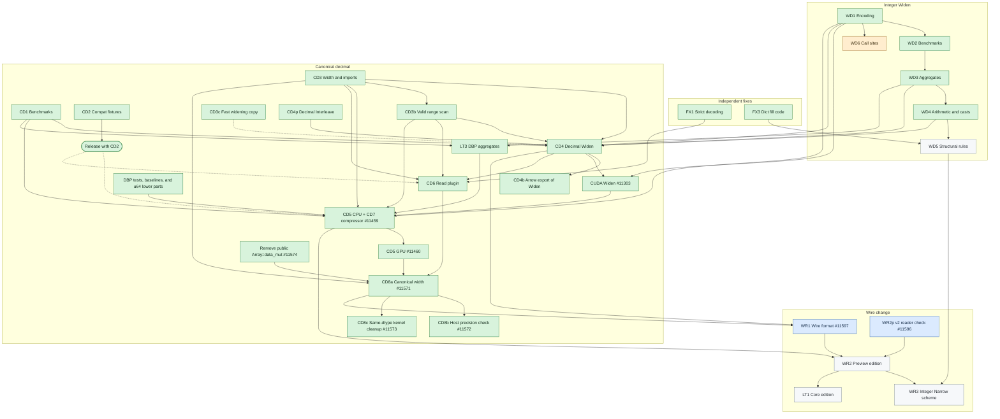

<!--
SPDX-License-Identifier: CC-BY-4.0
SPDX-FileCopyrightText: Copyright the Vortex contributors
-->

# 4. Implementation plan

This plan tracks [canonical decimals](https://github.com/vortex-data/vortex/issues/10701) and the
[`Widen` encoding](https://github.com/vortex-data/vortex/issues/10733). The
[implementation briefs](agents/briefs/) describe the work behind each plan ID.
[`decisions.md`](../decisions.md) records the design and how it changed.

## Progress on 2026-11-18

On [`develop` at `ac62d8d918`](https://github.com/vortex-data/vortex/tree/ac62d8d918),
the in-memory change is complete. Every `DecimalArray` has the canonical width of its precision
([#11571]), checked constructors reject a valid host value outside the precision ([#11572]), and
kernels read same-dtype operands at that one width ([#11573]). A narrower physical form is a
`Widen`, and the host reader still converts legacy `vortex.decimal` nodes.

DecimalByteParts decodes to the canonical width on the CPU and, for arrays with no lower parts, on
the GPU. The compressor keeps a narrow most significant part (MSP) as an integer `Widen` and
writes its integer child in the existing wire form ([#11459]).

The wire change has started. [#11597] adds the `vortex.widen` wire format (WR1), and [#11596]
tightens the DecimalByteParts v2 reader before v2 joins an edition. On 2026-11-18, [#11595]
removed every member except `fastlanes.delta` from the `unstable` edition, so no edition permits
DecimalByteParts v2 today. Its audit found that `between` and aggregates decode the canonical
array when lower parts exist.

🟢 **Done** means the change merged into `develop`. 🔵 **Open** means its implementation PR is open.
🟡 **In progress** means some pieces merged and others are open. ⚪ **Not started** means no
implementation PR was found. 🟠 **Parked** marks an experiment that closed without merging.
➖ **Dropped** marks work removed from the plan.

## The PRs

| ID | Status | Change | Hard dependencies | Size |
| --- | --- | --- | --- | --- |
| FX1 | 🟢 Done | Decode stored `DecimalType` and `PType` strictly. [#10755] | None | Medium |
| FX2 | ➖ Dropped | The cast-rule contract permits the existing rule. [#10746], [#10798] | None | None |
| FX3 | 🟢 Done | Handle dictionary fill codes above the current width. [#10745], [#10806] | None | Small |
| WD1 | 🟢 Done | In-memory integer `Widen`, encoding helpers, and flattening. [#10864] | None | Large |
| WD2 | 🟢 Done | Integer `Widen` compute benchmarks. [#10888] | WD1 | Medium |
| WD3 | 🟢 Done | Run aggregates on the integer child. [#10890] | WD2 | Medium |
| WD4 | 🟢 Done | Forward arithmetic, `between`, `zip`, fills, and casts. [#10891], [#11138] | WD3 | Large |
| WD5 | ⚪ Not started | Lift structural encodings above `Widen` and use the child for dictionary codes. Related issue [#10748]. | WD4, FX3 | Medium |
| WD6 | 🟠 Parked | Migrate internal narrowing calls to `encode_values`. The experiment closed without merging. [#10943] | WD1 | Medium |
| CD1 | 🟢 Done | Decimal compute, cast, and export benchmarks. [#10752] | None | Medium |
| CD2 | 🟢 Done | Compatibility fixtures for old decimal forms. [#10753], [release 0.91.0] | None | Medium |
| CD3 | 🟢 Done | One precision-to-width mapping and checked Arrow and DuckDB import conversions. [#10897] | None | Medium |
| CD3b | 🟢 Done | Share a scan over valid decimal values for stored decimal conversion. [#10939] | CD3 | Small |
| CD3c | 🟢 Done | Benchmark and speed up the widening copy. [#10990], [#10989] | None | Small |
| CD4p | 🟢 Done | Execute interleaved decimals. [#10940] | None | Medium |
| CD4 | 🟢 Done | Decimal `Widen`, its writer, compute, stored-value conversion, and lazy same-scale casts. [#11057], [#10946], [#11003], [#11004], [#11005], [#11006] | WD1, WD3, WD4, CD1, CD3, CD3b, CD4p | Large |
| CD4b | 🟢 Done | Export decimal `Widen` to Arrow with one copy. [#10994] | Decimal support in CD4 | Small |
| CD6 | 🟢 Done | Read legacy `vortex.decimal` nodes through `WidenArray::from_stored_decimal`. [#10995] | FX1, CD3, CD3b, CD4, release 0.91.0 | Medium |
| LT3 | 🟢 Done | Push `min`, `max`, `min_max`, `is_sorted`, and eligible sums into the MSP when there are no lower parts. [#11302] | WD3, CD1 | Medium |
| CUDA `Widen` | 🟢 Done | Execute integer and decimal `Widen` on the device. [#11303] | WD1, CD4 | Unestimated |
| CD5 | 🟢 Done | CPU decoding and the GPU MSP-only decoder produce canonical widths. Lower parts are non-nullable `u64`. [#11456], [#11457], [#11458], [#11510], [#11459], [#11460] | WD1, LT3, CD1, CD3, CD3b, CUDA `Widen`, release 0.91.0 | Large |
| CD7 | 🟢 Done | [#11459] removes `narrowed_decimal`. The scheme narrows the integer MSP, including next to lower parts, and ignores null payloads when choosing parts. | Shares the CPU implementation with CD5 | Medium |
| CD8a | 🟢 Done | Require canonical-width storage for every `DecimalArray`. [#11571] | CD3, CD5 (CPU and GPU), CD6, CD7, [#11574] | Large |
| CD8b | 🟢 Done | Check valid host values against their precision at construction. Device buffers keep only the layout check. [#11572] | CD8a | Large |
| CD8c | 🟢 Done | Remove mixed-width decimal code for operands of the same dtype. [#11573] | CD8a | Medium |
| WR1 | 🔵 Open | Read and write `vortex.widen` for integers and decimals. [#11597] keeps `vortex.decimal` for a decimal leaf. Unlike the brief, a write whose editions do not permit `vortex.widen` returns an error instead of writing the canonical array. | WD1, CD3, CD4, CD8a | Medium |
| WR2p | 🔵 Open | Reject node buffers in the DecimalByteParts v2 reader, so it accepts only what the writer emits before the contract freezes. [#11596] | None | Small |
| WR2 | ⚪ Not started | Admit `vortex.widen` and DecimalByteParts v2 to a preview edition. [#11595] removed v2 from `unstable` because `between` and aggregates decode when lower parts exist. Open question: does WR2 wait for those kernels? | WR1, WR2p, CD5, CD7 | Small |
| WR3 | ⚪ Not started | Design and implement the integer `Narrow` compressor scheme. DecimalByteParts owns decimal narrowing (D33). | WR1, WR2, WD1, WD5 | Large |
| LT1 | ⚪ Not started | Admit both wire formats to `core` and decide how writers targeting older editions handle `Widen`. | WR2 | Unestimated |
| LT2 | ➖ Dropped | Decoding a narrow MSP to a decimal `Widen` required a range scan. CD5 keeps it as an integer child instead (D16). | None | Unestimated |

## Graph

Solid arrows show hard dependencies. Dashed arrows mark release or benchmark ordering.
CD5 and CD7 share one CPU PR, with the GPU decoder stacked on it. The older [#10905], [#10992],
and [#11354] closed without merging.

## Order of work

1. The in-memory change is done: CD5 and CD7 ([#11459], [#11460]), then [#11574], then CD8a to
   CD8c ([#11571], [#11572], [#11573]).
2. WR1 ([#11597]) and WR2p ([#11596]) are open and independent of each other.
3. WR2 admits both wire forms to preview. Before it, decide whether DecimalByteParts v2 first
   needs `between` and aggregate kernels for lower parts, the gaps that [#11595] names.
4. WR3 also needs WD5 and a decision about which integers the compressor narrows and at which
   cascade level. LT1 tracks promotion to `core`.

## How to use the briefs

- Give a coding agent one brief, `decisions.md`, and the repository rules in `AGENTS.md` and
  `STYLE.md`. The brief names the branch, the files, the steps, the tests and the acceptance checks.
- The briefs and `decisions.md` exist only on the `ct/decimal-research` branch. The agent's own
  worktree branches from `develop` and has no `research/` directory, so the relative links in the
  briefs do not work there. Tell the agent to read the files with
  `git show ct/decimal-research:research/<path>`. Do not change a brief while an agent works from
  it. If a brief must change, tell that agent.
- When a PR opens, merges, or changes scope, update its entry in the tracking issue and in the
  [status table](#the-prs). Read the current issue body just before editing it to preserve other edits.
- The briefs cite `develop` at `b70206818f`, except WD1 to WD4, which cite `origin/develop` at
  `afa4bc87cd`. Line numbers move as PRs land, so the agent reads the cited code before it changes
  it. Code from the local integer `Widen` rewrite is cited with its commit, for example
  `f7408481ce:vortex-array/src/arrays/narrow/mod.rs`. That rewrite is a reference for tests and
  edge cases (D38).
- The rewrite commits named in the integer brief were local references. Preserve any local
  branches that still hold them. Use the merged WD1 to WD4 PRs for the implementation on
  `develop`.
- Agents can run any command that the work needs: builds, tests, the acceptance checks, and the
  generators of committed files, such as golden snapshots (WD6, CD7, WR3) and the edition record
  (WR2). CI fails when a committed file is stale. Use the narrowest command, as `AGENTS.md`
  describes.
- `develop` squash-merges PRs. Use the actual PR base when restacking. After a base merges, use
  `git rebase --onto develop <old base tip>` or the stack tooling, so that the base commits are
  not replayed. The WD1 to WD5 stack has its own workflow in the integer brief.
- Every commit carries `Signed-off-by: Connor Tsui <connor.tsui20@gmail.com>` and no AI co-author
  line.
- WR3 needs a design pass before an agent starts it. Its brief lists the open questions.

| Brief | PRs |
| --- | --- |
| [`01-fixes.md`](agents/briefs/01-fixes.md) | FX1 to FX3, independent fixes |
| [`02-integer-widen.md`](agents/briefs/02-integer-widen.md) | WD1 to WD6, the integer `Widen` |
| [`03-canonical-decimal.md`](agents/briefs/03-canonical-decimal.md) | CD1 to CD8c, the canonical decimal fix and decimal `Widen` |
| [`04-wire.md`](agents/briefs/04-wire.md) | WR1 to WR3, the wire change, and LT1 to LT3 |

## Rules for every PR

- Avoid temporary code between PRs (D11).
- The writer-only plugin shipped in CD4 writes a decimal `Widen` over a concrete decimal leaf
  as a narrow `vortex.decimal` node under the parent dtype. It does not execute values or
  validity. WR1 adds the dedicated wire form. LT1 decides the fate of the old writing path.
- Stored decimal values at any width become the canonical array or a `Widen` only through
  `WidenArray::from_stored_decimal` (D40). No PR adds its own choice of child. DecimalByteParts
  decoding does not go through it, because its MSP is an integer (D16).
- Benchmarks land before the changes that they cover (D19): WD2 before WD3 to WD5, and CD1 before
  CD4, CD5 and CD7. The dependency table lists these as hard dependencies.
- Every call of the deprecated `encode_values` carries `#[expect(deprecated)]` with a
  `TODO(connor)` reason (D28).
- No `Widen` sits directly above a generic structural encoding after optimization (D25).
- A narrowing copy writes zeros in null slots and fails on a valid value outside the precision
  (D21). Reads without a copy trust the precision and never panic (D14).

## Deferred

- Which arrays the compressor narrows (D27). The WR3 design pass decides it, together with the
  cascade level (D33).
- Other members of the preview edition. WR2 adds only `vortex.widen` and
  `vortex.decimal_byte_parts.v2`.
- Arrow import options for invalid decimal values (D13). The import fails, and the error names
  arrow-rs `null_if_overflow_precision`.

## Follow-up issues

| Issue | Status | Change |
| --- | --- | --- |
| [#10748] | 🔵 Open issue | Keep structural encodings above other encodings. WD5 covers `Widen` only. |
| [#10749] | 🟢 Closed | [#10767] returns errors from decimal `scalar_at` and `min_max` for out-of-precision values. Cached decimal statistics were tracked separately in [#10807], also closed. |
| [#10750] | ➖ Dropped | Closed as not planned. [#10798] documents the cast-rule contract. |
| [#10751] | 🟢 Closed | [#10757] makes FoR declare and refine its bit-packing child. |
| [#10754] | 🔵 Open issue | Run all compatibility fixture versions in CI, collect failures, and correct the `--git-ref` documentation. |
| [#10756] | 🟢 Closed | [#10760] and [#10852] return read errors for corrupt ALP-RD, RLE, and RunEnd metadata. |
| [#10908] | 🟢 Closed | [#11138] dispatches `zip` on either value branch. |
| [#11284] | 🟡 Closed, partially implemented | [#11303] implements CUDA `Widen`. The ordinary `vortex.decimal` reader still rejects noncanonical buffers in device memory. [Reader on develop]. |
| [#11520] | 🔵 Open issue | Null payloads can prevent compression of nullable decimals. [#11457] pins this case and [#11459] changes part selection. The reporter plans to [rerun the reproducer][#11520 follow-up] on a build containing [#11459]. |

[#10747] updated the versioning documentation.

## Risks

| Risk | Consequence or mitigation |
| --- | --- |
| A legacy DecimalByteParts MSP is wider than its logical width. | [#11459] checks and narrows it on the host. This conversion rejects device buffers. |
| An old decimal value fits its stored width but needs a precision with a wider canonical width. | The legacy reader may copy to construct a correctly typed child, and a later canonicalization may copy again. CD3c speeds up the widening copy. |
| A legacy `vortex.decimal` buffer is already on the device. | The plugin needs host values to select a valid child precision. [#11303] executes an existing `Widen`. It does not implement a device reader for those nodes. |
| A consumer requires wide storage. | [#11459] documents the extra copy from an `i64` MSP to `i128` at precision 38, an extra Arrow export copy for some narrow MSPs, and larger default output for the precision-40 fixture. [#11510] supplies the canonical-width decode baseline. |
| The Python decimal subclass mapping does not cover `Widen`. | A legacy decimal read can return a `Widen`. The Python subclass and metadata exposure need follow-up. |
| WD6 changes the signedness of some internal children. | The parked [#10943] records its old-reader comparison and outstanding performance and CUDA checks. |

[#10745]: https://github.com/vortex-data/vortex/pull/10745
[#10746]: https://github.com/vortex-data/vortex/pull/10746
[#10747]: https://github.com/vortex-data/vortex/pull/10747
[#10748]: https://github.com/vortex-data/vortex/issues/10748
[#10749]: https://github.com/vortex-data/vortex/issues/10749
[#10750]: https://github.com/vortex-data/vortex/issues/10750
[#10751]: https://github.com/vortex-data/vortex/issues/10751
[#10752]: https://github.com/vortex-data/vortex/pull/10752
[#10753]: https://github.com/vortex-data/vortex/pull/10753
[#10754]: https://github.com/vortex-data/vortex/issues/10754
[#10755]: https://github.com/vortex-data/vortex/pull/10755
[#10756]: https://github.com/vortex-data/vortex/issues/10756
[#10757]: https://github.com/vortex-data/vortex/pull/10757
[#10760]: https://github.com/vortex-data/vortex/pull/10760
[#10767]: https://github.com/vortex-data/vortex/pull/10767
[#10798]: https://github.com/vortex-data/vortex/pull/10798
[#10806]: https://github.com/vortex-data/vortex/pull/10806
[#10807]: https://github.com/vortex-data/vortex/issues/10807
[#10852]: https://github.com/vortex-data/vortex/pull/10852
[#10864]: https://github.com/vortex-data/vortex/pull/10864
[#10888]: https://github.com/vortex-data/vortex/pull/10888
[#10890]: https://github.com/vortex-data/vortex/pull/10890
[#10891]: https://github.com/vortex-data/vortex/pull/10891
[#10897]: https://github.com/vortex-data/vortex/pull/10897
[#10905]: https://github.com/vortex-data/vortex/pull/10905
[#10908]: https://github.com/vortex-data/vortex/issues/10908
[#10939]: https://github.com/vortex-data/vortex/pull/10939
[#10940]: https://github.com/vortex-data/vortex/pull/10940
[#10943]: https://github.com/vortex-data/vortex/pull/10943
[#10946]: https://github.com/vortex-data/vortex/pull/10946
[#10989]: https://github.com/vortex-data/vortex/pull/10989
[#10990]: https://github.com/vortex-data/vortex/pull/10990
[#10992]: https://github.com/vortex-data/vortex/pull/10992
[#10994]: https://github.com/vortex-data/vortex/pull/10994
[#10995]: https://github.com/vortex-data/vortex/pull/10995
[#11003]: https://github.com/vortex-data/vortex/pull/11003
[#11004]: https://github.com/vortex-data/vortex/pull/11004
[#11005]: https://github.com/vortex-data/vortex/pull/11005
[#11006]: https://github.com/vortex-data/vortex/pull/11006
[#11057]: https://github.com/vortex-data/vortex/pull/11057
[#11138]: https://github.com/vortex-data/vortex/pull/11138
[#11284]: https://github.com/vortex-data/vortex/issues/11284
[#11302]: https://github.com/vortex-data/vortex/pull/11302
[#11303]: https://github.com/vortex-data/vortex/pull/11303
[#11354]: https://github.com/vortex-data/vortex/pull/11354
[#11456]: https://github.com/vortex-data/vortex/pull/11456
[#11457]: https://github.com/vortex-data/vortex/pull/11457
[#11458]: https://github.com/vortex-data/vortex/pull/11458
[#11459]: https://github.com/vortex-data/vortex/pull/11459
[#11460]: https://github.com/vortex-data/vortex/pull/11460
[#11510]: https://github.com/vortex-data/vortex/pull/11510
[#11520]: https://github.com/vortex-data/vortex/issues/11520
[#11520 follow-up]: https://github.com/vortex-data/vortex/issues/11520#issuecomment-6940576463
[#11571]: https://github.com/vortex-data/vortex/pull/11571
[#11572]: https://github.com/vortex-data/vortex/pull/11572
[#11573]: https://github.com/vortex-data/vortex/pull/11573
[#11574]: https://github.com/vortex-data/vortex/pull/11574
[#11595]: https://github.com/vortex-data/vortex/pull/11595
[#11596]: https://github.com/vortex-data/vortex/pull/11596
[#11597]: https://github.com/vortex-data/vortex/pull/11597
[release 0.91.0]: https://github.com/vortex-data/vortex/releases/tag/0.91.0
[Reader on develop]: https://github.com/vortex-data/vortex/blob/3ebf68d239da461c7bdd4ac6bcda0220727d8d44/vortex-array/src/arrays/decimal/vtable/plugin/mod.rs#L10-L17
