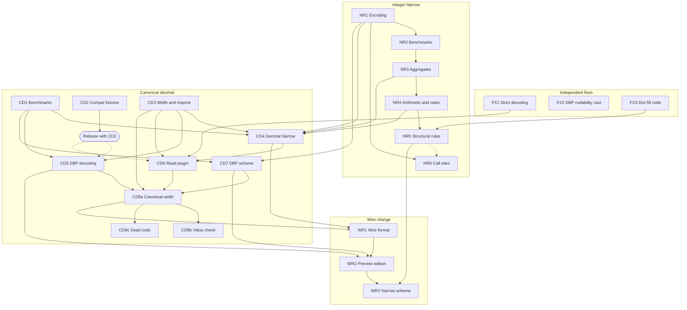

<!--
SPDX-License-Identifier: CC-BY-4.0
SPDX-FileCopyrightText: Copyright the Vortex contributors
-->

# 4. Implementation plan

This part splits the `Narrow` encoding (issue
[#10733](https://github.com/vortex-data/vortex/issues/10733)) and the canonical decimal fix (issue
[#10701](https://github.com/vortex-data/vortex/issues/10701)) into PRs. Each PR has a brief in
[`agents/briefs/`](agents/briefs/), written so that a coding agent can implement the PR from the
brief alone. The briefs follow [`decisions.md`](../decisions.md), including D25 to D35 from the
planning review on 2026-10-23.

## How to use the briefs

- Give a coding agent one brief, `decisions.md`, and the repository rules in `AGENTS.md` and
  `STYLE.md`. The brief names the branch, the files, the steps, the tests and the acceptance checks.
- The briefs and `decisions.md` exist only on the `ct/ext-types-research` branch. The agent's own
  worktree branches from `develop` and has no `research/` directory, so the relative links in the
  briefs do not work there. Give the agent absolute paths into the research worktree
  (`/Users/connor/spiral/vortex-data/vortex1/research/`), or tell it to read the files with
  `git show ct/ext-types-research:research/<path>`. Do not change a brief while an agent works from
  it. If a brief must change, tell that agent.
- The briefs cite `develop` at `b70206818f`. Line numbers move as PRs land, so the agent reads the
  cited code before it changes it. Code from the local integer `Narrow` rewrite is cited with its
  commit, for example `f7408481ce:vortex-array/src/arrays/narrow/mod.rs`. That rewrite is a
  reference for tests and edge cases. The PRs are written from scratch, and only FX3 ports a
  rewrite commit as it is (D38).
- The rewrite commits (`f7408481ce`, `8d548646ee`, `74aa17644e`, `af4b663059` and `7e2e5e4d7a`) are
  not on `origin`. Only the local branches `ct/narrow-pushdown` and `ct/narrow-encoding` hold them,
  and those names also exist on `origin` with the older commits of the closed PRs. Agents in local
  worktrees of this repository can read them. A remote agent or another clone cannot. Before such
  an agent needs the reference, push them to a new backup branch. Do not delete or reset the two
  local branches.
- Agents can run any command that the work needs: builds, tests, the acceptance checks, and the
  generators of committed files, such as golden snapshots (NR6, CD7, WR3) and the edition record
  (WR2). CI fails when a committed file is stale. Use the narrowest command, as `AGENTS.md`
  describes.
- Several PRs form stacks: NR1 to NR5, WR1 to WR3, and optionally CD3 and CD5, CD4 and CD6, and CD8a
  and CD8b. `develop` squash-merges PRs. So after the base PR merges, a plain `git rebase develop`
  replays the base commits again and conflicts. Rebase the next PR with
  `git rebase --onto develop <old base tip>`, or with `gh stack`.
- Every commit carries `Signed-off-by: Connor Tsui <connor.tsui20@gmail.com>` and no AI co-author
  line.
- WR3 needs a design pass before an agent starts it. Its brief lists the open questions.

| Brief | PRs |
| --- | --- |
| [`01-fixes.md`](agents/briefs/01-fixes.md) | FX1 to FX3, independent fixes |
| [`02-integer-narrow.md`](agents/briefs/02-integer-narrow.md) | NR1 to NR6, the integer `Narrow` |
| [`03-canonical-decimal.md`](agents/briefs/03-canonical-decimal.md) | CD1 to CD8c, the canonical decimal fix and decimal `Narrow` |
| [`04-wire.md`](agents/briefs/04-wire.md) | WR1 to WR3, the wire change, and LT1 to LT3 |

## The PRs

| ID | PR | Hard dependencies | Size |
| --- | --- | --- | --- |
| FX1 | Strict decoding of stored `DecimalType` and `PType` values, in three commits | None | Medium |
| FX2 | DecimalByteParts nullability cast follows the cast-rule contract | None | Small |
| FX3 | Dictionary `fill_null` no longer truncates the fill code | None | Small |
| NR1 | In-memory integer `Narrow`, with `encode`, the deprecated `encode_values`, the serialization workaround and a flatten rule | None | Large |
| NR2 | Benchmarks for compute on integer `Narrow` | NR1 | Medium |
| NR3 | Aggregates run on the child | NR2 | Small |
| NR4 | Arithmetic, `between`, `zip` and casts run on the child | NR3 | Large |
| NR5 | Structural encodings move above `Narrow`, and dictionary codes use the child | NR4, FX3 | Medium |
| NR6 | The existing narrowing call sites move to `encode_values` | NR1. It merges after NR5 (D35) | Medium |
| CD1 | Decimal benchmarks | None | Medium |
| CD2 | Compat fixtures for old decimal forms | None | Medium |
| CD3 | One width function, imports that check and copy, and the shared helpers | None | Medium |
| CD4 | Decimal `Narrow` in memory | NR1, NR3, NR4, CD1, CD3 | Large |
| CD5 | DecimalByteParts decodes to the canonical width | CD1, CD3, released CD2 fixtures | Medium |
| CD6 | The `vortex.decimal` read plugin converts old nodes | FX1, CD3, CD4, released CD2 fixtures | Medium |
| CD7 | One DecimalByteParts scheme on the canonical array | NR1, CD1 | Medium |
| CD8a | Every decimal array has the canonical width | CD3, CD5, CD6, CD7 | Large |
| CD8b | `DecimalArray::try_new` checks every valid value, with an `ExecutionCtx` | CD8a | Large |
| CD8c | Remove the code for mixed decimal widths | CD8a | Medium |
| WR1 | `vortex.narrow` wire format for integers and decimals | NR1, CD3, CD4, CD8a | Medium |
| WR2 | One preview edition with `vortex.narrow` and DecimalByteParts v2 | WR1, CD5, CD7 | Small |
| WR3 | A `Narrow` scheme in the compressor (needs a design pass) | WR1, WR2, NR1, NR5, CD3, CD4, CD7 | Large |

Later work: LT1 puts both formats into `core` and decides the end of the serialization
workaround. LT2 is the max pass in DecimalByteParts decoding (D16). LT3 is the pushdown of sum,
min and max into the MSP (D19). LT2 and LT3 wait until benchmarks show that they are needed.

## Graph

Each solid arrow is a hard dependency. Some arrows also follow from other arrows. The graph keeps
them, so that the direct needs of each PR show. The dashed arrows are order rules, not code
dependencies: the release gate of the compat fixtures (D31), and NR6 merging after NR5 (D35).

FX2 has no edge. It can land at any time.

## Order of work

A PR can start when its dependencies have merged. The waves group the PRs whose dependencies merge
at about the same time. Two PRs of one wave can run at the same time only when they touch different
files. The column "Shared files" names the pairs that do not, so run those one after the other.

| Wave | PRs | Note | Shared files |
| --- | --- | --- | --- |
| 1 | FX1, FX2, FX3, NR1, CD1, CD2, CD3 | No dependencies. The next regular release after CD2 publishes the fixtures | CD2 calls `smallest_decimal_value_type`, which CD3 removes. The second of the two to merge adapts |
| 2 | NR2, NR6, CD7, CD5 | NR6 merges after NR5 (D35). CD7 waits for CD1. CD5 waits for the release with CD2 | CD5 and CD7: the crate doc in `encodings/decimal-byte-parts/src/lib.rs`, the tests in `assemble.rs`, and `benches/dbp_assemble.rs`. CD7 also changes the signature of `split_decimal`. NR6 and CD7: the golden snapshots of `vortex-btrblocks` |
| 3 | NR3, then NR4 | One stack. Merge NR1 and NR2 before reading the CodSpeed reports of NR3 and NR4 | None |
| 4 | NR5, CD4 | NR5 waits for FX3 | Both edit `vortex-array/src/arrays/narrow/rules.rs` |
| 5 | CD6 | Waits for FX1, CD4 and the release with CD2 | None |
| 6 | CD8a | The last in-memory step that the wire change needs | None |
| 7 | CD8b, CD8c, WR1 | Each needs only CD8a | CD8b adds a `ctx` parameter to `DecimalArray::new` and `try_new`, which CD8c and WR1 call. CD8b and CD8c both edit `vortex-array/src/builders/decimal.rs` and the same tests. Land CD8b first, or rebase the others on it |
| 8 | WR2, then WR3 | WR3 after its design pass. If possible, the wire stack ships in the same release as the in-memory change (D11) | None |

The critical path runs NR1, NR2, NR3, NR4, CD4, CD6, CD8a, WR1, WR2 and WR3. The release that
publishes the CD2 fixtures also gates CD5 and CD6, so CD2 is worth landing in wave 1.

## Rules for every PR

- No PR adds temporary code (D11). The serialization workaround of D26 is the one documented
  exception. It stays until `vortex.narrow` is in `core`.
- Benchmarks land before the changes that they cover (D19): NR2 before NR3 to NR5, and CD1 before
  CD4, CD5 and CD7. The dependency table lists these as hard dependencies.
- Every call of the deprecated `encode_values` carries `#[expect(deprecated)]` with a
  `TODO(connor)` reason (D28).
- No `Narrow` sits directly above a generic structural encoding after optimization (D25).
- A narrowing copy writes zeros in null slots and fails on a valid value outside the precision
  (D21). Reads without a copy trust the precision and never panic (D14).

## Deferred

- Which arrays the compressor narrows (D27). The WR3 design pass decides it, together with the
  precedence between the `Narrow` scheme and the DecimalByteParts scheme and the cascade level
  (D33).
- Other members of the preview edition. WR2 adds only `vortex.narrow` and
  `vortex.decimal_byte_parts.v2`.
- Arrow import options for invalid decimal values (D13). The import fails, and the error names
  arrow-rs `null_if_overflow_precision`.

## Follow-up issues

These problems came up during planning and are outside the planned PRs. Each one gets its own
issue.

1. Generic structural encodings always sit above other encodings. NR5 does this for `Narrow` only.
2. The decimal `min_max` aggregate panics on a valid value outside the precision, which a file read
   can produce.
3. The cast rules of RunEnd, ZigZag, FoR and RLE push nullability casts down without the
   `trivially_cast_nullability` guard that FX2 adds to DecimalByteParts.
4. The compat harness: no CI job runs `--mode all`, one failing fixture aborts the whole check, and
   the README describes `--git-ref` wrongly.
5. Stale versioning docs about the decimal scheme and per-edition scheme configuration.

## Risks

| Risk | Mitigation |
| --- | --- |
| CD5 changes the CUDA decoder, which few reviewers know | A minimal change in its own commit, with a CUDA reviewer. It becomes its own PR if it grows |
| After CD6, a CUDA read of an old narrow decimal node copies the buffer to the host and returns a `Narrow`, and CUDA has no `Narrow` kernel | Accepted (D37): the host converts old nodes, which are rare. A CUDA reviewer confirms in CD6 that such a scan still works |
| The reference commits of the rewrite exist only on local branches | Keep the local branches. Push a backup branch before a remote agent needs the reference (see "How to use the briefs") |
| NR6 writes signed internal children that earlier releases have not read | Readers on `develop` accept any integer type there. NR6 runs the latest release on its files |
| The `take_map` regressions on #10333 have no known cause | NR6 compares CodSpeed runs on NR1, NR3, NR4 and NR6, and reads the flame graph diff |
| WR3 has open design questions | A design pass before any code. The other wire PRs do not depend on it |
| The decimal critical path is long | Wave 1 holds seven PRs with no dependencies, and CD5, CD7 and NR6 need only early PRs |
