<!--
SPDX-License-Identifier: CC-BY-4.0
SPDX-FileCopyrightText: Copyright the Vortex contributors
-->

# Decimal and the Vortex type roadmap (agent reference)

This file is the detailed report behind the summary in `../README.md`. It is research, not an
accepted design, and it changes no code. Paths and line numbers are for `develop` at `5fc5cb8`
(2026-10-17), the same commit as the extension-type notes in `../../extension-types/`.

Audience: Vortex maintainers and coding agents who implement the type-system work.

Companion files in this directory:

- `ptype-match-inventory.md` lists every PType dispatch macro use, every exhaustive PType match,
  and every place where another language or wire format mirrors the PType enum.
- `decimal-call-sites.md` lists every decimal-specific file with code and test line counts, every
  use of the canonical-width function, and every `Canonical::Decimal` dispatch site.

Conventions:

- Paths are relative to the repository root. A `file:line` reference points at the commit above.
- "Storage" means the integer child of a decimal, or the storage child of an extension array.
- "Canonical width" means `DecimalType::smallest_decimal_value_type`
  (`vortex-array/src/dtype/decimal/types.rs:46-57`). It maps precision 1-2 to I8, 3-4 to I16,
  5-9 to I32, 10-18 to I64, 19-38 to I128, and 39-76 to I256.
- "Lane integer" means U8 to U64 and I8 to I64. "Wide integer" means I128 and I256.
- Issue and pull request numbers refer to `vortex-data/vortex` on GitHub. Section 10 links
  each one.
- Two claims come from running Rust code, with probes R1 and R6 in
  `../../extension-types/agents/probe_followup.rs`. They are the cast in section 1.1 and the
  pushdown rules in section 3.3. The other claims come from reading code, RFC drafts, issues, and
  pull requests. Appendix A holds the one Python script that ran. Section 10 lists what is not
  verified.

## 1. Summary

### 1.1 What is wrong today

`DecimalArray` stores unscaled integers in one typed buffer. The buffer width (`values_type`) is
independent of the precision (`vortex-array/src/arrays/decimal/array.rs:70-75`). One logical
dtype therefore has up to six physical forms. That single fact explains most of the strangeness:

- Kernels must accept mixed widths, widen on the fly, or test whether a constant fits the
  storage. Some paths still panic, for example `DecimalArray::patch`
  (`vortex-array/src/arrays/decimal/array.rs:594-600`). Issue #5820 collects the fuzzer crashes.
- The width that every consumer actually wants is a function of precision. The code computes it
  at 25 call sites, so it is a convention, not a contract (`decimal-call-sites.md`, section 2).
- Decimal duplicates much of Primitive. It has its own canonical variant (51 dispatch sites),
  builder, compare, arithmetic, and aggregates. DecimalByteParts is a wide-integer limb split that
  only decimals can use. Decimal-specific files hold about 7,600 non-test lines.
- Arrays never validate precision (`array.rs:301-319`), while scalars do
  (`vortex-array/src/scalar/validate.rs:159-167`).
- The scalar path and the array path disagree. A decimal scalar casts to `f32` and `f16`
  (`vortex-array/src/scalar/typed_view/decimal/scalar.rs:111-115`). The array kernel only handles
  `f64` (`vortex-array/src/arrays/decimal/compute/cast.rs:104`), so the array cast fails with
  "No CastKernel" (`vortex-array/src/scalar_fn/fns/cast/mod.rs:143`). Probe R1 confirms it: the
  array path fails, and the row path returns `[1f32, 2.5f32]` for `Decimal(10, 2) [1.00, 2.50]`.

### 1.2 Recommendation in short

1. Make the decimal array a zero-data wrapper with exactly one child, the unscaled integers. The
   child dtype is a pure function of the precision: `Primitive(storage_ptype(p), nullability)`.
   Narrow physical storage becomes an encoding of the child, never a property of the canonical
   form.
2. Use an integer child, not a FixedSizeBinary child. Add `PType::I128` and `PType::I256` as a
   distinct "wide integer" tier. The tier opts into a small kernel set: compare, arithmetic, cast,
   sum, min and max, hash, and structural operations. Do not add `U128` or `U256` until a
   consumer needs them. Section 4 gives the full comparison.
3. Keep every decimal wire format. The new in-memory wrapper reads the legacy `vortex.decimal`
   and DecimalByteParts nodes and writes them back. No new array id and no new dtype tag is
   needed for decimals. Wide PTypes never reach the wire for decimal columns.
4. Express decimal semantics as rewrites onto integer kernels plus one shared "scaled integer"
   kernel family. The same family serves temporal unit conversions (Timestamp, Duration, Time).
5. Treat FixedSizeBinary as an independent type for opaque bytes (UUID, hashes). It shares the
   fixed-width structural layer with Primitive, but it never carries integer semantics. Decimal
   does not depend on it, and wide integers do not depend on it.
6. Move Decimal to a well-known extension in the Rust API (RFC 0062) only after the extension work
   lands. That work is the opacity fixes, the cast hooks, and derives for one dtype. The
   array-level wrapper design is the same either way, so the early work carries over.

Section 7 gives the dependency graph. Section 8 gives the recommended order of work.

## 2. Current state of Decimal

### 2.1 Logical dtype

- `DType::Decimal(DecimalDType, Nullability)` (`vortex-array/src/dtype/mod.rs:85`).
- `DecimalDType { precision: NonZero<u8>, scale: i8 }`
  (`vortex-array/src/dtype/decimal/mod.rs:35-40`).
- `MAX_PRECISION` and `MAX_SCALE` both come from the i256 implementation and equal 76
  (`vortex-array/src/dtype/decimal/mod.rs:26-29`, `types.rs:215-218`).
- `DecimalDType::try_new` checks precision in 1..=76, scale at most 76, and a positive scale at
  most the precision (`mod.rs:48-77`). Nothing bounds a negative scale except `i8::MIN`. The doc
  comment names a `MIN_SCALE` that does not exist (`mod.rs:47`). Tests use scale -128
  (`vortex-array/src/arrays/decimal/compute/cast.rs`, case `zero_extreme_scale`).
- Wire: flatbuffer `table Decimal { precision: uint8, scale: int8, nullable: bool }` with union
  tag 4 (`vortex-array/flatbuffers/vortex-dtype/dtype.fbs:29,88`). Protobuf `message Decimal`
  with `uint32 precision`, `int32 scale`, and oneof field 4
  (`vortex-array/proto/dtype.proto:36,96`).

### 2.2 Physical width types

- `DecimalType { I8 = 0, I16, I32, I64, I128, I256 = 5 }` derives `prost::Enumeration`
  (`vortex-array/src/dtype/decimal/types.rs:25-42`).
- `DecimalType::smallest_decimal_value_type` is the canonical width (`types.rs:46-57`).
  `is_compatible_decimal_value_type` accepts any width at least that wide (`types.rs:72-74`).
- `NativeDecimalType` is implemented for `i8` through `i128` and for `i256`. It carries the
  per-precision bound tables `MIN_BY_PRECISION` and `MAX_BY_PRECISION` and visitor hooks
  (`types.rs:80-229`). The i256 tables are a 623-line literal table because the bounds cannot be
  computed in a `const` context (`vortex-array/src/dtype/decimal/max_precision.rs:4-5`).
- `TryFrom<PType> for DecimalType` only covers I8 to I64 (`types.rs:244-262`). There is no
  PType for 128 or 256 bits, so decimals cannot share the Primitive machinery at those widths.
- Dispatch macros: `match_each_decimal_value_type!` (77 uses in 49 files) and
  `match_each_decimal_value!` (9 uses) (`vortex-array/src/dtype/decimal/macros.rs:13-60`).

### 2.3 The i256 type

- `#[repr(transparent)] pub struct i256(arrow_buffer::i256)`
  (`vortex-array/src/dtype/bigint/mod.rs:34-40`). The Arrow type is
  `#[repr(C)] struct i256 { low: u128, high: i128 }`, and its `Ord` compares `high` and then
  `low` (arrow-buffer 59.3.0, `src/bigint/mod.rs:59-66` and `:171-183`).
- Size 32 bytes, alignment equal to `u128` alignment, which is 16 bytes on x86_64 and aarch64
  with the pinned toolchain (`rust-toolchain.toml`: 1.98.0, workspace `rust-version` 1.95).
- It implements the arithmetic operators, `CheckedAdd`, `CheckedSub`, `CheckedMul`, and
  `CheckedDiv`. It also implements wrapping add and sub, `Zero`, `One`, `ToPrimitive` with a
  full-range `to_f64`, and `AsPrimitive` to and from `i8` through `i128`
  (`bigint/mod.rs:153-350`). `BigCast` and `ToI256` give checked conversions up to 256 bits
  (`bigint/bigcast.rs`). It is a CUDA `DeviceRepr` (`bigint/mod.rs:42-43`).
- It does not implement `Num`, `NumCast`, `FromPrimitive`, `Bounded`, or `PrimInt`. Those are
  the traits that `NativePType` and `IntegerPType` require (`vortex-array/src/dtype/ptype.rs:68`
  and `:124-140`).

### 2.4 DecimalArray layout and vtable

- `DecimalData { decimal_dtype, values: BufferHandle, values_type: DecimalType }`
  (`vortex-array/src/arrays/decimal/array.rs:110-115`). One slot holds validity (`:46-51`).
- The docs allow any width for any precision. Precision 39 can be stored in `i8`, and
  precision 2 can be stored in `i256` (`array.rs:70-75`).
- `DecimalData::validate` checks only that the buffer length is a multiple of the width and
  that the buffer is aligned (`array.rs:301-319`). The safety docs of the unchecked
  constructors say values must fit the precision (`array.rs:256-262`), but nothing checks it.
  The arithmetic kernel documents the consequence: out-of-precision values can reach kernels
  (`vortex-array/src/scalar_fn/fns/binary/numeric/decimal.rs:13-16`).
- `DecimalData::buffer::<T>()` panics when `T` is not the stored width (`array.rs:360-369`).
- Encoding id `vortex.decimal` (`vortex-array/src/arrays/decimal/vtable/mod.rs:78-81`). The
  metadata is `DecimalMetadata { values_type }` with the comment "The type of the values can be
  determined by looking at the type info...right?" (`vtable/mod.rs:52-57`).
- `ArrayEq` and `ArrayHash` include `values_type` (`vtable/mod.rs:59-70`). Two arrays with the
  same logical values at different widths are not `ArrayEq`.
- Deserialization reads the width with the prost getter `metadata.values_type()`
  (`vtable/mod.rs:170`). prost-derive 0.14.4 generates that getter as
  `TryFrom::try_from(raw).unwrap_or(default)`, and the default of a prost enumeration is its
  first variant (prost-derive `src/field/scalar.rs:286-300`, `src/lib.rs:308`). An unknown
  width therefore decodes silently as `I8`. No such value exists today, but the pattern blocks
  safe extension of this metadata.
- Take and filter are shared with Primitive through the `FixedWidthArray` adapter
  (`vortex-array/src/arrays/fixed_width/array.rs:20-41`,
  `vortex-array/src/arrays/decimal/compute/fixed_width.rs:14-36`). PR #8864 introduced it. The
  record-width dispatch already covers 1, 2, 4, 8, 16, and 32 bytes
  (`vortex-array/src/arrays/fixed_width/mod.rs:16-47`).

### 2.5 Scalar values

- `DecimalValue { I8(i8), I16, I32, I64, I128, I256(i256) }`
  (`vortex-array/src/scalar/typed_view/decimal/dvalue.rs:48-61`). Its `PartialEq`,
  `PartialOrd`, and `Hash` upcast to i256 (`dvalue.rs:255-281`) because one dtype allows several
  widths. `normalize` and `zero` produce the canonical width (`dvalue.rs:185-216`).
- `ScalarValue::Decimal(DecimalValue)` (`vortex-array/src/scalar/scalar_value.rs:31-32`).
- `DecimalScalar` equality and ordering require equal dtypes apart from nullability
  (`vortex-array/src/scalar/typed_view/decimal/scalar.rs:188-204`).
- Decimal scalars serialize as protobuf `bytes_value` with the byte length of the variant
  (`vortex-array/src/scalar/proto.rs:87-98`). Readers infer the width from the byte length and
  do not check precision, which a TODO notes (`scalar/proto.rs:402-445`, TODO at `:407`).
- Scalar construction validates precision (`vortex-array/src/scalar/validate.rs:58-60`,
  `:159-167`). Array construction does not.

### 2.6 Builders

`DecimalBuilder` holds an enum of six `BufferMut` variants and coerces appended values into the
builder width (`vortex-array/src/builders/decimal.rs:38-56`, `:160-180`). The generic builder
factory picks the canonical width (`vortex-array/src/builders/mod.rs:412-416`).

### 2.7 Compute kernels and aggregates

| Operation | Location | Behavior |
| --- | --- | --- |
| Cast, nullability only | `arrays/decimal/compute/cast.rs:45-80` | Reduce rule, same decimal dtype |
| Cast to integer | `cast.rs:97-103`, `:172-196` | Truncate toward zero. A value outside the target range fails before truncation |
| Cast to float | `cast.rs:104-107`, `:198-245` | `f64` only, one rounding step |
| Cast decimal to decimal | `cast.rs:108-170`, plan at `:348` | Zero-copy when the scale is equal, the precision widens, and the width already fits. Otherwise rescale, exact scale-down only |
| Integer to decimal | `arrays/primitive/compute/cast.rs:87-89`, `:127-173` | Floats rejected. Zero-copy when the width equals the canonical width and the scale is 0 |
| Compare | `scalar_fn/fns/binary/compare/decimal.rs` | Equal dtypes only. Widens mismatched widths (`:114-126`). Sign test for constants that do not fit (`:128-153`) |
| Arithmetic | `scalar_fn/fns/binary/numeric/decimal.rs` | Equal dtypes only (`scalar_fn/fns/binary/mod.rs:146-153`). Arrow result rules (`scalar/typed_view/decimal/arithmetic.rs:49-101`). Checked at a working width, then narrowed (`numeric/decimal.rs:410-430`) |
| Between | `arrays/decimal/compute/between.rs` | Constant bounds only, storage-fit logic |
| Fill null | `arrays/decimal/compute/fill_null.rs:55-72` | Upcasts the whole array when the fill value does not fit |
| Mask | `arrays/decimal/compute/mask.rs` | Metadata-only |
| Patch | `arrays/decimal/array.rs:537-609` | Panics when the width cannot hold the dtype |
| Sum | `aggregate_fn/fns/sum/mod.rs:78-86`, `sum/decimal.rs:49` | Result precision p+10, capped at 76. Overflow gives null |
| Min, max | `aggregate_fn/fns/min_max/decimal.rs` | Per-width |
| is_sorted, is_constant | `aggregate_fn/fns/is_sorted/decimal.rs`, `is_constant/decimal.rs` | Per-width |
| all_non_distinct | `aggregate_fn/fns/all_non_distinct/decimal.rs` | Triple-nested width dispatch |
| Uncompressed size | `aggregate_fn/fns/uncompressed_size_in_bytes/decimal.rs:21` | Reports the canonical width, not the stored width |
| IN list | `array/haystack/mod.rs:118-125` | Converts to the canonical width |

Paths in the table are relative to `vortex-array/src/`. Shared code also has decimal arms:

- The row codec (`vortex-row/src/codec.rs:579-584`, `:822-860`).
- Sparse canonicalization (`encodings/sparse/src/canonical.rs:314-327`).
- Run-end decoding (`encodings/runend/src/compress.rs:358-388`).
- Constant canonicalization (`vortex-array/src/arrays/constant/vtable/canonical.rs:96-125`).
- Dictionary execution (`vortex-array/src/arrays/dict/execute.rs:53`, `:102-111`).
- Masked execution (`vortex-array/src/arrays/masked/execute.rs:54`, `:89-95`).

### 2.8 Encodings and compression

- DecimalByteParts (DBP) stores a signed most significant part (MSP) and up to three unsigned
  64-bit lower parts (`encodings/decimal-byte-parts/src/decimal_byte_parts/mod.rs:6-15`). The
  MSP holds validity (`decimal_byte_parts/array.rs:404-409`). Each part is a normal integer array
  that any integer scheme can compress.
- DBP carries `DType::Decimal` itself (`decimal_byte_parts/array.rs:102-104`). It mixes a
  logical type with a physical layout.
- Two wire ids exist. `vortex.decimal_byte_parts` (v1, MSP only) is in the first core edition.
  `vortex.decimal_byte_parts.v2` (with lower parts) is in no edition yet
  (`decimal_byte_parts/plugin/mod.rs:30-40`,
  `vortex-edition/src/declarations/core/v2025_05.rs:30-31`). The plugin writes v1 whenever there
  are no lower parts (`decimal_byte_parts/plugin/mod.rs:62-79`).
- DBP assembly with no lower parts reuses the MSP buffer, so the result width is the MSP width
  for any precision (`decimal_byte_parts/assemble.rs:82-93`).
- The DBP compare kernel only handles the MSP-only case. A TODO describes the missing limb-wise
  comparison (`decimal_byte_parts/compute/compare.rs`, top of `compare`).
- The btrblocks `DecimalScheme` narrows first (`vortex-btrblocks/src/schemes/decimal.rs:133`).
  In v1 mode it returns the narrowed `vortex.decimal` array unchanged when values still need
  128 or 256 bits (`:134-137`). Files written today can therefore contain `vortex.decimal`
  nodes whose width is smaller than the canonical width.

### 2.9 Statistics and zone maps

- Array statistics store `min`, `max`, and `sum` as serialized `ScalarValue` bytes
  (`vortex-array/flatbuffers/vortex-array/array.fbs`, `table ArrayStats`).
- Sum statistics merge with a precision check (`vortex-array/src/stats/stats_set.rs:480-492`).
- Zone maps use the column dtype, falling back to the extension storage dtype
  (`vortex-layout/src/layouts/zoned/schema.rs:112-121`, `:177-188`).
- The bloom filter aggregate rejects decimals and cites issue #5820
  (`vortex-layout/src/layouts/zoned/aggregates/bloom_filter/canonical/mod.rs:34-49`).

### 2.10 Serialization and editions

- Editions gate four component kinds: array ids, layout ids, extension dtype ids, and
  aggregates (`vortex-edition/src/lib.rs:161-178`).
- Core dtype tags and PType values are not gated. The writer only checks extension ids inside
  the schema (`vortex-file/src/writer.rs:429-475`). Union, Variant, and Map dtype tags reach the
  wire without an edition check, although their array ids are gated.
- An unknown flatbuffer dtype tag or PType is a loud error for old readers
  (`vortex-array/src/dtype/serde/flatbuffers.rs:326`, `:559`). An unknown protobuf oneof is
  also loud ("Unrecognized DType", `vortex-array/src/dtype/serde/proto.rs:32`). An unknown
  protobuf PType value is silent: `p.r#type()` returns `U8` (`proto.rs:36`). Protobuf dtypes are
  persisted on disk in Variant shredding metadata
  (`vortex-array/src/arrays/variant/vtable/mod.rs:54`) and Parquet-variant metadata
  (`encodings/parquet-variant/src/vtable.rs:73`).
- Unknown extension dtype ids read as `ForeignExtDType`, which keeps the storage dtype and the
  raw metadata (`vortex-array/src/dtype/extension/foreign.rs:26-75`). Old readers can read new
  extension types as their storage.
- `ArrayPlugin` separates the in-memory id from the serialized ids. A plugin can read several
  historical ids into one in-memory array. It can also write an older form as a "lossless
  structural downgrade" (`vortex-array/src/array/plugin.rs:26-41`, `:101-157`). DBP uses this
  today.
- Compatibility fixtures exist for decimals, DBP v1, and DBP v2
  (`vortex-test/compat-gen/src/fixtures/arrays/synthetic/`). The decimal fixture only covers
  canonical widths (i32 and i64).

### 2.11 Engine mappings

| Engine | Decimal mapping | Wide integers |
| --- | --- | --- |
| Arrow | Export Decimal128 for p <= 38 and Decimal256 above. Decimal32 and Decimal64 are commented out for DataFusion (`vortex-arrow/src/dtype.rs:333-347`). Import keeps the Arrow width zero-copy (`vortex-arrow/src/convert.rs:204-277`) | Arrow has no Int128 or Int256 |
| DuckDB | DECIMAL both ways (`vortex-duckdb/src/convert/dtype.rs:106-110`, `:237-241`). Widths 16, 32, 64, and 128 bits, zero-copy when equal (`vortex-duckdb/src/exporter/decimal.rs:122-130`). Import narrows i16 to i8 for p <= 2 (`convert/vector.rs:303-330`) | HUGEINT and UHUGEINT are rejected (`convert/dtype.rs:100-101`) |
| DataFusion | Scalars to Decimal32, 64, 128, or 256 by precision (`vortex-datafusion/src/convert/scalars.rs:57-110`) | No Int128 scalar |
| Python | `DecimalDType` class, Python `Decimal` scalars built from the unscaled value and exponent (`vortex-python/src/scalar/into_py.rs:153-171`). `DecimalArray` subclass is keyed by encoding id (`vortex-python/src/arrays/native.rs:174-175`) | NumPy has no 128-bit integer dtype |
| FFI | `DTYPE_DECIMAL = 8`. Scalar constructors and getters for i8 to i64 and 16-byte little-endian i128 (`vortex-ffi/src/scalar.rs:265-330`) | `vx_ptype` is a `#[non_exhaustive]` C enum (`vortex-ffi/src/ptype.rs:6-31`) |
| JNI | Statistics as `java.math.BigDecimal` (`vortex-jni/src/writer.rs:254-270`). Literals from big-endian bytes (`vortex-jni/src/expression.rs:511-545`) | Not applicable |
| CUDA | Arrow device widths 32, 64, 128, 256 (`vortex-cuda/src/arrow/mod.rs:840-849`). Decimal filter and DBP kernels | Separate C `PTypeTag` enum (`vortex-cuda/kernels/src/dynamic_dispatch.h:45-56`) |

Four different width functions exist:

- The Vortex canonical width, with an I8 minimum.
- DuckDB, with an I16 minimum.
- Arrow device export, with an I32 minimum.
- Arrow dtype export, with an I128 minimum below precision 39.

### 2.12 The PType enum and its blast radius

- `PType { U8 = 0, U16, U32, U64, I8, I16, I32, I64, F16, F32, F64 = 10 }`, `#[repr(u8)]`,
  `prost::Enumeration` (`vortex-array/src/dtype/ptype.rs:33-60`).
- `NativePType` requires `Num`, `NumCast`, `FromPrimitiveOrF16`, byte conversions, and a seal
  (`ptype.rs:124-140`). `IntegerPType` adds `PrimInt` and `AsPrimitive<usize>` (`ptype.rs:68`).
- `match_each_native_ptype!` is exhaustive over 11 arms. `match_each_integer_ptype!` and its
  unsigned, signed, and float siblings end with `other => panic!` (`ptype.rs:355-737`).
- Counts at this commit (details in `ptype-match-inventory.md`):

| Item | Count |
| --- | ---: |
| `match_each_native_ptype!` uses | 70 in 54 files |
| `match_each_integer_ptype!` uses | 169 in 94 files |
| `match_each_unsigned_integer_ptype!` uses | 118 in 53 files |
| Other PType macros (signed, float, SIMD) | 17 |
| Exhaustive PType matches outside `ptype.rs` (proxy) | about 45, 10 of them in tests |
| `is_int()` call sites | 53, about 40 of them guard offsets, codes, or indices |
| `NativePType` mentions | 598 in 169 files |
| Mirrors in other languages and formats | flatbuffer, protobuf, C header, C++, Python stub, Python enum, CUDA C enum and mapping, FFI enum, JNI codes, DuckDB, Arrow, DataFusion |

- `is_int()` routes a type into 64-bit-only code in many places. Examples are list, list-view,
  and varbin offsets, dictionary codes, take indices, and every btrblocks integer scheme
  (`vortex-btrblocks/src/schemes/integer/*.rs`, where `matches` uses `is_int()`). If `is_int()`
  returns true for I128, those guards admit wide integers, which then reach a
  `match_each_integer_ptype!` panic.
- Primitive assumes alignment equals byte width in deserialization
  (`vortex-array/src/arrays/primitive/vtable/mod.rs:158`) and in `from_values_byte_buffer`
  (`vortex-array/src/arrays/primitive/array/mod.rs:505`). That is wrong for I256, whose Rust
  alignment is 16, not 32.

### 2.13 What is strange, in one list

1. The canonical form has up to six physical shapes per dtype. The narrowing is compression that
   leaked into the canonical form (issue #5820, Epic #7706).
2. The width that consumers need is a function of precision, but it is a convention repeated at
   25 call sites, not a contract. The row codec says so directly: keys use the declared dtype "so
   keys from differently compressed chunks stay memcmp-comparable"
   (`vortex-row/src/codec.rs:579-584`).
3. Kernels carry storage-fit special cases: constant sign tests in compare and between, the
   fill-null upcast, the patch panic, widening in compare and arithmetic.
4. Arrays skip precision validation, scalars enforce it. Kernels must defend.
5. The scalar and array cast paths disagree for `f32` and `f16` targets.
6. Decimal duplicates Primitive in builders, kernels, aggregates, canonical dispatch, and
   compression. Epic #7706 lists this as an open problem.
7. DBP is a wide-integer limb split that only decimals can use, and it carries a decimal dtype.
8. Decimal metadata decodes with a prost getter that turns unknown values into `I8`.
9. Bloom filters, IN lists, size statistics, and the row codec each have decimal special cases.
10. DuckDB HUGEINT cannot be imported although Vortex already stores i128 decimal lanes.
11. Decimal scalars on the wire carry the width of whatever variant the writer used, and
    readers do not check precision.
12. Sparse canonicalization supports decimals with a dedicated path but rejects all extension
    arrays (`encodings/sparse/src/canonical.rs:361`). The wrapper idea is not applied anywhere
    as a shared rule.

## 3. Target: Decimal as an opaque wrapper over an integer child

### 3.1 Definition

The logical dtype does not change. `DType::Decimal(DecimalDType, Nullability)` keeps its Rust
variant in this phase and keeps its wire tag forever (section 3.8 covers the later move to a
well-known extension).

The storage dtype becomes a pure function of the precision. It reuses the current canonical
width:

```rust
impl DecimalDType {
    /// The integer type that holds every unscaled value of this precision.
    pub const fn storage_ptype(&self) -> PType {
        match self.precision.get() {
            1..=2 => PType::I8,
            3..=4 => PType::I16,
            5..=9 => PType::I32,
            10..=18 => PType::I64,
            19..=38 => PType::I128,
            _ => PType::I256,
        }
    }

    /// The dtype of the unscaled child for this precision and the given nullability.
    pub fn storage_dtype(&self, nullability: Nullability) -> DType {
        DType::Primitive(self.storage_ptype(), nullability)
    }
}
```

The array becomes a zero-data wrapper with one slot:

```rust
#[array_slots(Decimal)]
pub struct DecimalSlots {
    /// The unscaled integers. The dtype is `decimal_dtype.storage_dtype(nullability)`.
    #[slot(0)]
    pub unscaled: ArrayRef,
}

impl VTable for Decimal {
    type TypedArrayData = EmptyArrayData;
    type OperationsVTable = Self; // scalar_at wraps the child scalar
    type ValidityVTable = ValidityVTableFromChild;

    fn id(&self) -> ArrayId {
        // The in-memory id stays `vortex.decimal`. Section 3.5 covers the wire.
        static ID: CachedId = CachedId::new("vortex.decimal");
        *ID
    }

    fn nbuffers(_array: ArrayView<'_, Self>) -> usize {
        0
    }

    // validate: check that the child dtype equals the storage dtype and that lengths match.
    // execute: return the wrapper unchanged. The child stays as it is.
}

impl Array<Decimal> {
    /// Wraps unscaled integers whose dtype is the storage dtype of `decimal_dtype`.
    pub fn try_new(decimal_dtype: DecimalDType, unscaled: ArrayRef) -> VortexResult<Self>;

    /// The unscaled integers. This is the only way to see the storage.
    pub fn unscaled(&self) -> &ArrayRef;
}
```

Invariants:

- **I1, type.** `unscaled.dtype() == decimal_dtype.storage_dtype(nullability)`. `validate`
  checks this. It costs nothing at run time.
- **I2, value.** Every valid unscaled value `v` satisfies `|v| <= 10^p - 1`. Trust boundaries
  establish it (Arrow, DuckDB, FFI, and Python imports, and the array `validate_array` hook of
  node N5). Kernels that produce new values (arithmetic, rescaling casts, sums) check their own
  outputs, as `numeric/decimal.rs` does today with `DecimalValueBounds`.
- **I3, no data.** The wrapper owns no buffer. Validity comes from the child, as for
  `ExtensionArray` (`vortex-array/src/arrays/extension/vtable/mod.rs:85-89`) and DBP
  (`encodings/decimal-byte-parts/src/decimal_byte_parts/array.rs:404-409`).

The value of a row is `unscaled * 10^(-scale)`. Nothing else is stored.

### 3.2 Canonical form

`Canonical::Decimal(DecimalArray)` remains a variant in this phase, but the wrapped child does
not have to be canonical. That matches the existing rule that canonical form is not recursive
(`vortex-array/src/canonical.rs:85-88`) and matches `ExtensionArray`, whose `execute` returns
itself without touching the storage (`vortex-array/src/arrays/extension/vtable/mod.rs:189-191`).
A kernel that needs flat integers executes the child explicitly:

```rust
let unscaled = decimal.unscaled().clone().execute::<PrimitiveArray>(ctx)?;
```

This is the parent and child relation proposed in issue #5820 ("an integer array as a child that
is separately decompressed, like list offsets"). It also answers the objection in the same thread
that the two designs are equivalent. They are not equivalent. With a fixed child dtype, a kernel
never receives a width that it does not expect. Also, the decimal-specific kernels disappear
instead of being duplicated (section 3.4).

### 3.3 Shared wrapper machinery with extensions

Decimal and extensions need the same structural behavior. Today each type implements it
separately, and some cases exist for only one of them. One trait can carry the shared part:

```rust
/// A zero-data logical wrapper over one storage child.
///
/// Structural operations push into the storage child and rewrap the result. Semantic
/// operations never read the storage unless a type-owned rewrite says so.
pub trait StorageWrapper: VTable {
    /// The storage child.
    fn storage(array: ArrayView<'_, Self>) -> &ArrayRef;

    /// The storage dtype implied by a wrapper dtype. It must be a pure function of the dtype.
    fn storage_dtype(dtype: &DType) -> VortexResult<DType>;

    /// Rebuilds a wrapper with the same logical dtype around a new storage child.
    fn rewrap(array: ArrayView<'_, Self>, storage: ArrayRef) -> VortexResult<ArrayRef>;

    /// Wraps a storage scalar into a logical scalar of `dtype`.
    fn wrap_scalar(dtype: &DType, storage: Scalar) -> VortexResult<Scalar>;
}
```

`Extension` implements it with `ExtensionArray::new` and `Scalar::extension_ref`. `Decimal`
implements it with `DecimalArray::try_new` and a decimal scalar built from the storage value.
Generic rules then cover both:

| Behavior | Extension today | Decimal today | Shared rule |
| --- | --- | --- | --- |
| slice, filter, take, mask | Pushdown rules (`arrays/extension/compute/rules.rs:48-79`) | Buffer kernels through `FixedWidthArray` | Push into the child and rewrap |
| Constant child | `ExtensionConstantRule` (`rules.rs:28-46`) turns `Ext(Constant(s))` into `Constant(ext s)` | `Constant(decimal scalar)` | Open. With the wrapper on top, `Constant(wrapper s)` becomes `Wrapper(Constant(storage s))` |
| scalar_at | Wraps the storage scalar | Reads the buffer at the stored width | `wrap_scalar(child.scalar_at(i))` |
| Validity | From the child | Validity slot | From the child |
| Compression | Compress storage and rewrap (`vortex-compressor/src/compressor/cascade.rs:175-205`) | `DecimalScheme` | Compress the child with ordinary schemes and rewrap |
| Sparse, run-end, dictionary, chunked | Sparse bails (`encodings/sparse/src/canonical.rs:361`) | Dedicated decimal paths | Open. With the wrapper on top, `Dict(codes, Wrapper(v))` becomes `Wrapper(Dict(codes, v))`, so the structural encoding sees only storage |

With the wrapper on top, the last row also closes a gap for extensions: a sparse array of an
extension type cannot canonicalize today.

The position of the wrapper is open (section 9, question 13). Section 6 of
`../../extension-types/agents/design-notes.md` compares both placements. It recommends the wrapper
on top, and no maintainer decision exists. The wrapper on top reverses `ExtensionConstantRule`.
The alternative keeps generic encodings above the wrapper, as the current code does for constants.
Then `Masked` and `Sparse` need a pushdown rule for `ext_storage`. Existing rules already push it
into dictionary values and chunks (probe R6 in the extension notes).

On the wire, `vortex.decimal` is a leaf with one buffer. So a generic encoding of decimal data sits
above it. For example, the compressor writes a constant decimal column as a `vortex.constant` node
with a decimal scalar (`vortex-compressor/src/compressor/cascade.rs:272-273`,
`vortex-compressor/src/compressor/constant/mod.rs:80-86`). With the wrapper on top in memory, the
plugin writes these older shapes (section 3.5).

Type-specific encodings move under the wrapper and see only the storage dtype. For decimals that
means DBP stops carrying `DType::Decimal`. It becomes an encoding of `Primitive(I128)` or
`Primitive(I256)` (node N14). The same rule applies to DateTimeParts under temporal wrappers,
which today carries the extension dtype (`encodings/datetime-parts/src/array.rs:294-305`). This
choice does not depend on the position of the wrapper relative to generic encodings.

### 3.4 Decimal semantics as storage rewrites

Every decimal operation is an integer operation plus scale bookkeeping. With a fixed storage
dtype, the rewrites below are exact.

| Operation on `Decimal(p, s)` | Rewrite onto the unscaled child | Notes |
| --- | --- | --- |
| Compare, same `(p, s)` | `compare(unscaled(a), unscaled(b))` | A derive for one dtype. Valid because the unscaled value is unique within one `(p, s)` |
| Compare across `(p1, s1)` and `(p2, s2)` | Rescale both to `s = max(s1, s2)` at a width that holds `max(p1 - s1, p2 - s2) + s` digits, then compare | A rewrite that the type owns, not a derive. Rejected today (`scalar_fn/fns/binary/mod.rs:162-168`) |
| Compare with a constant that has more fractional digits than `s` | Fold the constant and adjust the operator. `x < 1.005` at `s = 2` becomes `unscaled <= 100` | Needs floor and ceiling rounding |
| Add, subtract | Widen to the result width, rescale to the larger scale, checked operation, precision check | Arrow rules (`scalar/typed_view/decimal/arithmetic.rs:49-101`) |
| Multiply | Widen, checked multiply, precision check | Result scale `s1 + s2` |
| Divide | Multiply the dividend by `10^k`, checked divide toward zero, precision check | As today |
| Cast to `Decimal(p2, s2)` | Rescale with exactness, integer width cast, precision check | Replaces `DecimalCastPlan` |
| Cast to an integer | For a positive scale, `check_range` on the unscaled values with the bounds `MIN · 10^s` and `MAX · 10^s` of the target, then divide by `10^s` toward zero. For a negative scale, a checked multiply. Then narrow | Replaces `DecimalToIntegerCast` and keeps its rule: a value outside the range fails before truncation, so `127.1` fails for `i8` (`scalar/typed_view/decimal/integer_cast.rs:14-53`, test `cast_decimal_to_integer_bounds`) |
| Cast to a float | Integer to `f64`, divide by `10^s`, then narrow to `f32` or `f16` | One path for scalars and arrays |
| Cast from an integer | Widen, multiply by `10^s`, precision check | Replaces `cast_to_decimal` |
| Sum | Integer sum with accumulator `storage_ptype(min(p + 10, 76))`, precision check | `sum_decimal_dtype` (`aggregate_fn/fns/sum/mod.rs:81-86`) |
| Min, max | Storage aggregate, then wrap the result | Matches `min_max/extension.rs:17-35` |
| is_sorted, is_constant | Storage aggregate. The `Bool` result stays as it is | Valid within one `(p, s)` |
| Hash, group by, distinct, join keys | Storage hash and equality | Valid within one `(p, s)` |
| Zone-map pruning | Rewrite the predicate onto storage statistics | Old files keep decimal-typed statistics, which hold the same integers |
| IN list | Storage set over rescaled needles | Replaces `haystack/mod.rs:118-125` |
| Row encoding | Storage at the canonical width, big-endian with the sign bit flipped | Already done (`vortex-row/src/codec.rs:19`, `:1466-1480`) |

These rewrites need a small set of integer kernels that do not exist as reusable pieces today.
They are the scaled-integer family (node N8):

```rust
/// Rounding when a rescale divides by a power of ten.
pub enum RescaleRounding {
    /// Fail when a nonzero remainder would be dropped.
    Exact,
    /// Round toward zero. Used by decimal to integer casts and by division.
    TowardZero,
    /// Round toward negative infinity. Used for upper bounds of folded predicates.
    Floor,
    /// Round toward positive infinity. Used for lower bounds of folded predicates.
    Ceil,
}

/// Options of the `vortex.int.rescale` scalar function.
pub struct RescaleOptions {
    /// Positive to multiply by 10^delta, negative to divide by 10^-delta.
    pub delta: i16,
    pub rounding: RescaleRounding,
    /// The integer type of the result. The kernel fails on overflow.
    pub target: PType,
}

/// Options of the `vortex.int.check_range` scalar function, which fails when a valid value
/// falls outside `[min, max]` and otherwise returns its input unchanged.
pub struct CheckRangeOptions {
    pub min: Scalar,
    pub max: Scalar,
}
```

Two points matter for the design:

- **Temporal types need the same kernels.** Timestamp, Time, and Duration units are powers of
  ten apart, except Days. A Timestamp cast from milliseconds to nanoseconds (issue #8570) is
  `rescale(delta = 6)`. A Duration comparison across units (PR #10467) needs the same rescale as
  a decimal comparison across scales. One kernel family serves both.
- **Fusion keeps performance.** The current decimal arithmetic kernel checks the operation and
  the precision bound in one pass (`numeric/decimal.rs`, `DecimalOpConstants`). A chain of
  separate array operations makes several passes. So generalize the fused kernel from
  `DecimalValue` widths to integer PTypes, with optional pre-scale factors and bounds. Plain
  integer arithmetic is then the special case with type bounds and unit factors.

### 3.5 Wire compatibility

No new wire id and no new dtype tag is needed. The `ArrayPlugin` mechanism already lets one
in-memory array read and write several historical wire forms
(`vortex-array/src/array/plugin.rs:102-157`).

Reading:

| Wire node | In-memory result |
| --- | --- |
| `vortex.decimal`, `values_type` equals the canonical width | `Decimal { Primitive(I_w) }`, zero-copy |
| `vortex.decimal`, `values_type` narrower (compressor narrowing) | `Decimal { widen(Primitive(I_v)) }`, zero-copy and lazy |
| `vortex.decimal`, `values_type` wider (Arrow Decimal128 data at p 5, written uncompressed) | `Decimal { checked_narrow(Primitive(I_v)) }`, lazy. Fails at execution only if a value violates the precision |
| `vortex.decimal`, unknown `values_type` | Error. Decode with `DecimalType::try_from(raw)`, not the prost getter |
| `vortex.decimal_byte_parts` (v1) | Phase 2: unchanged DBP that executes into the wrapper. Later: `Decimal { widen(msp) }` |
| `vortex.decimal_byte_parts.v2` | Phase 2: unchanged DBP. Later: `Decimal { WideIntParts { msp, lower } }` |

Writing:

| In-memory shape | Wire node | Readable by old readers |
| --- | --- | --- |
| `Decimal { flat Primitive(I_w) }` | `vortex.decimal`, `values_type = w`, the buffer and validity of the child | Yes |
| `Decimal { widen(flat Primitive(I_v)) }` | `vortex.decimal`, `values_type = v` | Yes, same bytes as today |
| `Decimal { compressed child with a lane-integer ptype }` | `vortex.decimal_byte_parts` v1 with the child as MSP | Yes, core 2025.05 |
| `Decimal { WideIntParts }` | `vortex.decimal_byte_parts.v2` | Only when an edition allows v2 |
| `Decimal { Constant, Dict, RunEnd, Chunked, ... }` | Push the wrapper below the generic encoding, for example `vortex.constant` with a decimal scalar, or `Dict(codes, Decimal { values })` | Yes |
| Any other child | Execute the child to a flat array and write `vortex.decimal` | Yes |

The fifth row applies only if the wrapper sits above generic encodings in memory. With generic
encodings above the wrapper, the memory form already has the wire shape.

Consequences:

- Old readers read every file that a new writer produces, with the same edition rules as today.
- Wide PTypes never appear on the wire for decimal columns. The legacy metadata carries
  `DecimalType`, and DBP carries lane-integer PTypes. Only top-level `Primitive(I128)` columns
  (DuckDB HUGEINT, node N27) need new wire values and edition gating.
- Decimal statistics and zone-map entries keep the `Decimal` dtype tag. They stay readable.
- Writing DBP from the decimal plugin needs one owner for the decimal and DBP serialized ids. In
  phase 2 the simplest path keeps DBP as its own encoding and lets the compressor produce it.
  Moving DBP under the wrapper (node N14) is a later step. Section 9 lists the ownership choice.
- Extend the compat fixtures before the reader changes. Add narrowed widths (I8 at p 10), wide
  widths (I128 at p 20, I256 at p 40), and Arrow-style wider widths (I128 at p 5).

### 3.6 What happens to `values_type` narrowing

Narrowing becomes an encoding of the child:

- **Lane-integer children (p <= 18).** The existing integer schemes (FoR with BitPacking,
  ZigZag, Delta, RLE, Dict) already narrow integers better than a fixed smaller width does. No
  decimal-specific scheme is needed.
- **Wide children (p >= 19).** If every value fits `i64`, the child is `widen(i64 array)` and
  the inner array uses the lane-integer schemes. Otherwise the child is a limb split, which is
  DBP generalized (node N14). It has a signed MSP and unsigned 64-bit lower parts, and the
  lane-integer schemes compress each part.
- **Legacy reads** produce `widen(...)` or `checked_narrow(...)` nodes as shown in section 3.5.

`widen` has two possible representations. One is the existing lazy `Cast` scalar-function array,
which already has reduce and kernel pushdown machinery. The other is a small dedicated in-memory
encoding. Either way, the encoding needs one generic rule that already exists in DBP form
(`encodings/decimal-byte-parts/src/decimal_byte_parts/compute/compare.rs`). A comparison of
`widen(x)` with a constant becomes a comparison of `x` with the constant when the constant fits
the narrow type. Otherwise the result is a constant. The generalized rule helps every widened
integer column, not only decimals.

### 3.7 Builders, scalars, engines, and the public API

- **Builder.** `DecimalBuilder` becomes the decimal dtype plus a `PrimitiveBuilder` of the
  storage type. `append_value::<V>` converts with a checked cast and fails when the value is
  outside the precision. The six-variant buffer enum
  (`vortex-array/src/builders/decimal.rs:38-56`) goes away.
- **Scalars.** `DecimalScalar` keeps its API. `DecimalValue` is normalized to the storage width
  at construction with the existing `normalize` (`dvalue.rs:208-216`). `scalar_at` wraps the
  child scalar.
- **Deprecated accessors.** `DecimalArray::buffer::<T>()` becomes
  `unscaled().execute::<PrimitiveArray>(ctx)?.as_slice::<T>()` with `T` equal to the storage
  type. `values_type()` returns the storage width. `DecimalArray::new::<T>` converts a buffer of
  another width, or wraps it in a lazy `widen` or `checked_narrow` child.
- **Engines.** The Arrow, DuckDB, and CUDA exporters read the child. An Arrow `Decimal128`
  export of a `checked_narrow` child can reuse the original 128-bit buffer without a copy. This
  is a small case of the execution layouts of RFC 0062.
- **Python.** The binding keys its `DecimalArray` subclass on the in-memory encoding id
  (`vortex-python/src/arrays/native.rs:174-175`). Keeping the id `vortex.decimal` keeps it working.

### 3.8 Does Decimal become a well-known extension in Rust?

RFC 0062 (branch `ngates/types`, `rfcs/0062-value-types-and-representations.md`) proposes
`vortex.decimal` as a well-known extension with signed-integer storage, while the existing wire
tag keeps working. It also states the precondition directly: "Moving Decimal requires integer
storage capable of its currently supported precisions, including wide lanes."

The wrapper in sections 3.1 to 3.7 is exactly the array side of that proposal. The remaining
question is only where the Rust type lives:

| Aspect | Keep `DType::Decimal` (phase 2) | Well-known extension (phase 4) |
| --- | --- | --- |
| Array | `DecimalArray` wrapper | `ExtensionArray` with the decimal ext dtype |
| Shared machinery | Through `StorageWrapper` | Directly |
| Semantics | Decimal-owned rewrites | `ExtVTable` hooks: cast (#8570), derives for one dtype, rewrites, validation |
| API change | Small | 269 lines in 97 files mention `DType::Decimal` |
| Wire | Unchanged | Tag translation in both directions, recursively |
| Risk | Low | High until extension semantics are opaque by default |

Today the extension machinery leaks storage semantics. An extension array cast to any other
dtype casts its storage (`vortex-array/src/arrays/extension/compute/cast.rs:17-22`). A scalar cast
into an extension casts to the storage and rewraps (`vortex-array/src/scalar/cast.rs:56-61`). A
comparison with a lone extension side compares raw storage
(`vortex-array/src/scalar_fn/fns/binary/compare/mod.rs:177-194`). If Decimal moves now, a cast
from `decimal(10, 2)` to `i64` returns the unscaled integers, and `price < 5` compares `500`
with `5`. So the move must wait for nodes N1 to N4. Built-in registration is not an
obstacle: Date, Time, and Timestamp are already default extensions
(`vortex-array/src/dtype/session.rs:36-39`).

Recommendation: build the wrapper with `DType::Decimal` first. Use Decimal as the acceptance test
for the extension hooks while they are designed. Decide on the Rust move after node N13, when it
has become a mechanical API change.

## 4. The child representation question

### 4.1 The options

- **(a) Integer child with new PTypes.** The child is `Primitive(I8 .. I256)`. Add `I128` and
  `I256` to `PType`. `U128` and `U256` are a separate decision (section 5.7).
- **(b) FixedSizeBinary child.** The child is `FixedSizeBinary(n)` with `n` in 1, 2, 4, 8, 16, 32,
  or only 16 and 32 for the wide widths. FixedSizeBinary does not exist yet.
- **(c) Hybrid.** `Primitive` child up to 64 bits, `FixedSizeBinary(16)` or `(32)` above.
- **(d) Separate wide-integer family.** A new canonical family for 128 and 256 bits, outside
  `Primitive`. An example is a new dtype variant with a new canonical array.
- **(e) Status quo layout, opaque API.** Keep the typed buffer inside `DecimalArray`, pin the
  width to the canonical width, and hide `values_type`.

### 4.2 Byte order is not integer order

A FixedSizeBinary value orders by byte-wise comparison (memcmp). Arrow, DuckDB, and Vortex store
decimal lanes as little-endian two's complement. Memcmp of those bytes is not integer order:

- `1` and `256` as 16-byte little-endian values: memcmp says `256 < 1`.
- `-1` and `0`: memcmp says `-1 > 0`.
- On 19,999 random pairs of 128-bit values, little-endian memcmp agreed with integer order
  10,060 times, which is chance. Big-endian bytes with the sign bit flipped agreed 19,999 times.
  Appendix A has the script.

Vortex already uses the sign-flip transform where it needs byte order. The row codec writes
"fixed-width integers big-endian, with the sign bit flipped for signed types"
(`vortex-row/src/codec.rs:19`). The DuckDB UUID exporter flips the top bit of a big-endian `u128`
to get the ordered HUGEINT form of DuckDB (`vortex-duckdb/src/exporter/uuid.rs`, export loop).

So a FixedSizeBinary child can reuse memcmp order only if it stores big-endian sign-flipped
bytes. That layout breaks zero-copy exchange with Arrow `Decimal128` and `Decimal256` and with
DuckDB `DECIMAL`. It also forces a conversion before every arithmetic operation. With the native
little-endian layout, every ordered operation on the child needs a decimal-specific
reinterpretation. Either way, the decimal logic stays duplicated.

### 4.3 Comparison

Compute:

| Dimension | (a) Integer child | (b) FSB child | (c) Hybrid | (d) Wide family | (e) Status quo |
| --- | --- | --- | --- | --- | --- |
| Compare | Generic primitive kernel at 128 and 256 bits | Decimal reinterpretation | Integer to 64 bits, reinterpretation above | New kernels, or shared generic code as in (a) | Existing decimal kernel |
| Checked arithmetic | `i128` native. `i256` through num-traits `Checked*` | Reinterpretation | Mixed | As (a) | Existing |
| Sum, min, max, sorted | Integer aggregates with a wider accumulator | Decimal-specific | Mixed | As (a) | Existing |
| Casts | Integer width casts plus rescale | Decimal-specific | Mixed | As (a) | Existing |
| Hash | Native | Byte hash, correct at a fixed width | Both | Native | Upcast to i256 |
| Lane layout | Array of little-endian lanes. A limb split gives a SIMD-friendly layout | Same bytes, no typed lanes | Mixed | As (a) | As today |

Data:

| Dimension | (a) Integer child | (b) FSB child | (c) Hybrid | (d) Wide family | (e) Status quo |
| --- | --- | --- | --- | --- | --- |
| Compression | All lane schemes to 64 bits. Wide: narrow if it fits, limb split, Dict, RLE, run-end, constant, sparse, zstd | Dict, zstd, byte split. No FoR or BitPacking without reinterpretation | Mixed | As (a) | DBP stays decimal-only |
| Statistics | Integer min, max, and sum are meaningful | Memcmp min and max are wrong for numbers | Mixed | As (a) | Existing |
| Ordering | Native | Wrong for little-endian bytes | Wrong above 64 bits | Native | Native |

Interop:

| Dimension | (a) Integer child | (b) FSB child | (c) Hybrid | (d) Wide family | (e) Status quo |
| --- | --- | --- | --- | --- | --- |
| Arrow | Decimal export zero-copy at 128 and 256 bits. A top-level `Primitive(I128)` needs a policy, because Arrow has no Int128 | Decimal export zero-copy | Zero-copy | As (a) | As today |
| DuckDB | DECIMAL as today. HUGEINT becomes possible | DECIMAL needs reinterpretation. No HUGEINT | No HUGEINT | HUGEINT possible | No HUGEINT |
| DataFusion | Decimals as today. No Int128 scalar exists | As today | As today | As today | As today |
| Python, NumPy | Python `int` scalars. NumPy has no 128-bit integer | As today | As today | As (a) | As today |
| Scalar value | `PValue::I128`, `PValue::I256` | Binary payload | Two shapes | New scalar variant | `DecimalValue` |

Cost:

| Dimension | (a) Integer child | (b) FSB child | (c) Hybrid | (d) Wide family | (e) Status quo |
| --- | --- | --- | --- | --- | --- |
| Decimal wire | No change | Needs FSB first | Needs FSB first | No change | No change |
| New wire values | Flatbuffer enum values, a new protobuf oneof, edition gating. Only for top-level wide columns | FSB tag or extension descriptor | As (b) | New dtype tag if user-visible | None |
| Blast radius | Largest: about 380 macro uses, about 45 exhaustive matches, 53 `is_int()` sites, 12 mirrors. The compiler finds most of them | An FSB type: the closed prototype PR #8865 changed 118 files | As (b), plus two decimal paths | A dtype variant and a canonical variant: 51 canonical sites plus dtype matches | Smallest |
| Alignment | 16 bytes for both wide widths. Fix two `byte_width == alignment` assumptions | 1 byte by default. Typed access needs 16 | Mixed | As (a) | Unchanged |
| Duplicated logic | Lowest. Decimal kernels become rewrites | High | Medium | Medium | High, about 7,600 lines stay |

### 4.4 Verdict

Choose (a), built as a distinct wide-integer tier (section 5). The tier keeps the useful part of
(d): wide integers opt into a small, explicit kernel set instead of pretending to be lane
integers.

The suspected dependency in the request does not hold. Wide PTypes do not need FixedSizeBinary:

- Rust stores `i128` natively, and Vortex already has `i256` with checked arithmetic.
- The structural layer that both need already exists. `FixedWidthArray` moves records of 1, 2,
  4, 8, 16, and 32 bytes for take and filter (`vortex-array/src/arrays/fixed_width/mod.rs:16-47`).
- Arrow export of decimals uses the Arrow decimal types. Only a top-level wide-integer column
  needs an export policy, and `FixedSizeBinary(16)` is one possible policy, not a prerequisite.
- Compression of wide integers is a limb split into lane integers, which DBP already implements.

The two share the fixed-width structural layer and, later, the "execution layouts" idea of
RFC 0062. A UUID can use 128-bit lanes for equality and hashing, and a wide integer can use a
limb split for comparisons. Neither type carries the semantics of the other.

Evidence that changes the decision:

- Maintainers can decide that wide integers never become a Vortex type, or that the PType
  migration is too large. Then fall back to (e) for one release. Require storage at least as wide
  as the precision (node N11), and share generic lane kernels at the function level. This fixes
  the crash class of issue #5820, but Decimal stays a separate world.
- Benchmarks can show that the generic integer kernels at 128 and 256 bits are clearly slower
  than the current decimal kernels. Then keep the decimal kernels as specializations behind the
  rewrites. This result is unlikely, because the current decimal kernels already run on `i128`
  and `i256` lanes.
- If a requirement appears for precisions above 76 or arbitrary precision (for example PostgreSQL
  NUMERIC), no fixed-width child works, and a variable-width representation is needed.

## 5. Design of the wide-integer tier

### 5.1 Types

```rust
#[repr(u8)]
pub enum PType {
    U8 = 0, U16 = 1, U32 = 2, U64 = 3,
    I8 = 4, I16 = 5, I32 = 6, I64 = 7,
    F16 = 8, F32 = 9, F64 = 10,
    I128 = 11,
    I256 = 12,
    // 13 and 14 stay reserved for U128 and U256.
}

/// Integers that fit a 64-bit lane. Only these can be offsets, codes, sizes, or take indices,
/// and only these reach FastLanes and other lane kernels.
pub enum LaneIntPType { U8, U16, U32, U64, I8, I16, I32, I64 }

/// Signed integers wider than 64 bits.
pub enum WideIntPType { I128, I256 }

impl PType {
    pub const fn as_lane_int(self) -> Option<LaneIntPType>;
    pub const fn as_wide_int(self) -> Option<WideIntPType>;
    /// True for every integer, lane or wide.
    pub const fn is_integer(self) -> bool;
    /// The required buffer alignment. Equal to the byte width up to 16 bytes, then 16.
    pub const fn alignment(self) -> Alignment;
}
```

Trait plan:

- Implement `NativePType` for `i128` and `i256`. `i128` already has every supertrait. `i256`
  needs `Num`, `NumCast`, `FromPrimitive`, `Bounded`, and the byte conversion traits, about two
  hundred lines over the Arrow type. Most `match_each_native_ptype!` bodies are generic over
  `NativePType`, so they then compile and run correctly at the new widths.
- Keep `IntegerPType` (which requires `PrimInt`) for lane integers only.
- Add one trait for any-width integer kernels, for example `NativeIntPType: NativePType + Ord +
  Hash + CheckedAdd + CheckedSub + CheckedMul + CheckedDiv + BigCast`, implemented for the eight
  lane integers and the two wide ones. Compare, arithmetic, sum, min and max, casts, and the
  scaled-integer family bound on it.
- Fold `NativeDecimalType` into it: the precision bound tables become a `Pow10` trait on the
  signed integers, and `DecimalType` survives only to decode legacy metadata.

### 5.2 Dispatch macros

| Macro | Arms | Use |
| --- | --- | --- |
| `match_each_native_ptype!` | All 13 | Generic code over `NativePType` |
| `match_each_lane_int_ptype!` | 8, takes `LaneIntPType` | Offsets, codes, indices, lane encodings. Exhaustive, no panic arm |
| `match_each_int_ptype!` | 10 | Any-width integer kernels |
| `match_each_wide_int_ptype!` | 2 | Wide-only code, such as the limb split |

Retire `match_each_integer_ptype!` and its siblings after the migration, because their
`other => panic!` arm turns a type mistake into a run-time panic
(`vortex-array/src/dtype/ptype.rs:562`, `:589`, `:616`, `:640`). A caller that holds a `PType`
converts with `as_lane_int()` and returns a typed error.

### 5.3 Migration technique

Let the compiler enumerate the sites:

1. Add `LaneIntPType`, `WideIntPType`, and the new macros while `PType` still has 11 variants.
2. Remove `PType::is_int` and add `is_lane_int` and `is_integer`. Every one of the 53 call sites
   stops compiling and must choose. About 40 of them guard offsets, codes, indices, or lane
   encodings and choose `is_lane_int`.
3. Migrate `match_each_integer_ptype!` uses (169) and `match_each_unsigned_integer_ptype!` uses
   (118) to the typed macros, crate by crate.
4. Add the two variants last. Every exhaustive match (about 45 outside `ptype.rs`) and every
   mirror then fails to compile until it handles them.
5. Teach the fuzzer to generate decimal children at every width before exposing wide columns.

### 5.4 Wire encoding and gating

- **Flatbuffers.** Append `I128` and `I256` to `enum PType: uint8`
  (`vortex-array/flatbuffers/vortex-dtype/dtype.fbs:4-16`). Old readers fail loudly with
  "Unknown PType variant" (`vortex-array/src/dtype/serde/flatbuffers.rs:559`).
- **Protobuf.** Do not append to `enum PType` in `dtype.proto`. Old readers decode an unknown
  value as `U8` without an error (`vortex-array/src/dtype/serde/proto.rs:36`, prost-derive
  getter semantics in section 2.4). Variant shredding and Parquet-variant metadata persist
  protobuf dtypes on disk, so a silent misread corrupts data. Add a new oneof variant
  instead, for example `WideInteger wide_integer = 14`, which old readers reject with
  "Unrecognized DType" (`proto.rs:32`). Also change new readers to decode `PType` with
  `TryFrom<i32>` and fail on unknown values.
- **Editions.** Add a component kind for core dtype features, or treat `vortex.primitive.i128`
  and `vortex.primitive.i256` as dtype members, and check them in `validate_dtype_editions`
  (`vortex-file/src/writer.rs:429-475`). Use the same mechanism for any later core dtype tag,
  including FixedSizeBinary if it gets a tag. Decimal columns do not need it, because their
  storage never reaches the wire (section 3.5).

### 5.5 Scalars

- Add `PValue::I128(i128)` and `PValue::I256(i256)`. `PValue` equality and hashing upcast within
  each signedness family today (`vortex-array/src/scalar/typed_view/primitive/pvalue.rs:122-178`).
  Extend the upcast target to `i256` for signed values.
- Serialize them as protobuf `bytes_value` holding 16 or 32 little-endian bytes, decoded by the
  dtype, the same way decimals work (`vortex-array/src/scalar/proto.rs:402-445`). Old readers
  reject `bytes_value` for a primitive dtype (`proto.rs:442-444`), which is a loud failure.
- Decide later whether `DecimalValue` becomes a storage `PValue` plus the dtype. In phase 2 it
  can stay, normalized to the canonical width at construction.

### 5.6 Engine policy for top-level wide columns

| Engine | `Primitive(I128)` | `Primitive(I256)` |
| --- | --- | --- |
| Arrow | Error by default. Opt-in `Decimal256(39, 0)` (lossless, `i128` needs 39 digits) or `FixedSizeBinary(16)` through an export plugin | Error by default. Opt-in `FixedSizeBinary(32)`. `Decimal256` holds at most 76 digits, and `i256` needs 77 |
| DuckDB | HUGEINT, zero-copy little-endian | No type. Error |
| DataFusion | Error | Error |
| Python | Python `int` scalars. Arrays follow the Arrow policy | Same |
| FFI, C++, Java | New enum values in `vx_ptype` and mirrors | Same |
| CUDA | Not supported in dynamic dispatch at first | Same |

### 5.7 U128 and U256

Defer them. Decimal needs only signed widths. The only current consumer is DuckDB UHUGEINT
(`vortex-duckdb/src/convert/dtype.rs:101`). Reserve the wire values. Until they exist,
`to_unsigned()` and `to_signed()` must not be called on wide types. Audit their 77 call sites
during step 3 of section 5.3, because they reinterpret lane integers for indices and codes.

### 5.8 What wide integers deliberately do not get

- No FastLanes BitPacking, FoR, or Delta on 128-bit lanes. The `fastlanes` lanes stop at 64
  bits. Compression goes through narrowing or the limb split.
- Never offsets, sizes, codes, or take indices.
- No CUDA dynamic dispatch at first. The decimal device kernels keep their own width handling.

## 6. FixedSizeBinary design

### 6.1 Where the discussion stands

- RFC 0055 (branch `ct/types`) and its earlier draft RFC 0029 (branch `ngates/rfc-0029-types`)
  apply a two-step test. The first step asks if the type is semantically distinct, or if a
  refinement predicate gates operations. The second step asks if the type is core or an
  extension. Both drafts leave FixedSizeBinary unresolved.
- RFC 0062 makes `FixedSizeBinary(n)` a core variant with contiguous fixed-width canonical
  storage and whole-value validity, and makes UUID an extension over `FixedSizeBinary(16)`. It
  states that "Any UUID ordering must be specified separately before a byte or integer kernel can
  implement it."
- Issue #9902 asks for first-class support. One user stores trigrams as `FixedSizeBinary(3)`.
  The discussion there raises power-of-two over-alignment and the cost of filtering a contiguous
  layout.
- PR #8865 (closed, not merged) prototyped it in 118 files (+4,021, -2,004), stacked on the
  merged `FixedWidthArray` refactor (PR #8864). It used `DType::FixedSizeBinary(u32, Nullability)`,
  a contiguous buffer with an explicit length for zero-width values, a binary scalar payload,
  byte-lexicographic ordering, and a new flatbuffer tag.
- PR #9886 (closed) shows the current gap: a DataFusion `FixedSizeBinary` literal had to become
  a `FixedSizeList<u8>` scalar to compare against a UUID column.
- UUID today is `vortex.uuid` over `FixedSizeList(Primitive(U8, non-null), 16)`
  (`encodings/uuid/src/vtable.rs:53-78`), frozen in edition core 2026.08.3
  (`vortex-edition/src/declarations/core/v2026_08_3.rs:23`). Its scalar unpacking walks sixteen
  `PValue::U8` list elements (`vtable.rs:78-115`).

### 6.2 Is it justified, and is it core?

Apply the RFC 0055 test:

- **Refinement predicate.** `FixedSizeBinary(n) = { b : Binary | len(b) = n }`. The predicate
  gates a fixed-width canonical layout, constant-time row addressing, and scalar-compatible
  values, exactly as `FixedSizeList` refines `List`, and `FixedSizeList` is already core.
- **Semantic distinctness from `FixedSizeList<u8, n>`.** Opaque bytes have byte-string
  operations (memcmp order, prefix, conversion to `Binary`). A list of bytes has element
  operations. The distinction is real but weak.
- **Core or extension.** Core Vortex owns the operations that matter: the canonical layout,
  equality, hashing, ordering, Arrow and Parquet mapping, and scalar representation. RFC 0056
  (branch `ngates/scalar-values`) keeps `Scalar` only for scalar-compatible values and moves
  nested values, including extensions over nested storage, to arrays. Under that rule a UUID
  over `FixedSizeList` has no cheap scalar, while a UUID over `FixedSizeBinary(16)` does.

Conclusion: make it core, as RFC 0062 proposes.

### 6.3 Canonical layout

- One buffer of `len * n` bytes, whole-value validity, and an explicit length so that `n = 0`
  works. This is the PR #8865 layout.
- Implement `FixedWidthArray` so take and filter come from the shared kernels. Those kernels
  already have typed paths for 1, 2, 4, 8, 16, and 32 bytes and a fallback for other widths.
- Alignment: 1 byte by default. Allow a writer to request power-of-two alignment for
  power-of-two widths. The file format records alignment per buffer
  (`vortex-array/flatbuffers/vortex-array/array.fbs`, `struct Buffer`), so this is free on the wire.

### 6.4 Operations

| Operation | Definition |
| --- | --- |
| Equality, hashing | Bytes |
| Ordering | Byte-lexicographic (memcmp), the same as `Binary` and Arrow |
| Cast to and from `Binary` | Explicit. From `Binary` validates every length |
| Cast to and from `FixedSizeList<u8, n>` | Zero-copy when the elements are a flat non-nullable `u8` array |
| Arithmetic, numeric casts | None. Never implicit |

FixedSizeBinary must never carry integer semantics. A type that wants integer behavior over
fixed bytes uses an integer type, or it asks for an explicit reinterpretation with a declared
byte order. A 128-bit lane can implement equality and hashing for UUID, because those do not
depend on byte order. It must not implement ordering without the big-endian sign-flip transform.

### 6.5 Scalars and compression

- Scalars: `ScalarValue::Binary` with a validated length. The value is scalar-compatible under
  RFC 0056.
- Compression: Dict, constant, run-end, sparse, zstd, and a byte-lane split. The split
  transposes the bytes into `n` lane columns, or into 64-bit words, and integer schemes compress
  the lanes. The limb split for wide integers (node N14) and the lane split for FixedSizeBinary
  can share code at the word level. They keep different dtypes.

### 6.6 Wire representation

| Option | Old readers | Gating |
| --- | --- | --- |
| New core tag (the next free flatbuffer union value and protobuf oneof field) and a new `vortex.fixed_size_binary` array id | Fail loudly on the schema | Needs the core dtype feature gate of section 5.4 |
| Extension descriptor `vortex.fixed_size_binary` over `FixedSizeList<u8, n>` storage, and the array written in that storage form | Read it as a foreign extension over `FixedSizeList`, so the data stays readable (`vortex-array/src/dtype/extension/foreign.rs:26-75`) | The existing dtype edition kind |

The second option is the inverse of the decimal plan: the Rust API has a core variant, and the
wire uses an extension descriptor. The rule behind both is the same: choose the wire form for
reader compatibility and the Rust form for kernels and API. Translate at the serialization
boundary. Section 9 keeps the choice open.

### 6.7 UUID on FixedSizeBinary

- In memory, `vortex.uuid` storage becomes `FixedSizeBinary(16)`.
- `Uuid::validate_dtype` accepts both `FixedSizeBinary(16)` and the frozen
  `FixedSizeList<u8, 16>` storage, and the reader normalizes the second form zero-copy.
- The writer keeps writing the frozen `FixedSizeList` storage until a new edition declares the
  new storage. The conversion is zero-copy for flat data. The existing Arrow plugin already does
  the same conversion (`encodings/uuid/src/arrow.rs`, `try_fsl_to_fsb`).
- The DuckDB exporter keeps its big-endian sign-flip transform.

### 6.8 Relation to decimals and wide integers

None is required. FixedSizeBinary, Primitive (with wide integers), and Decimal storage share only
the fixed-width structural layer. That layer is the right abstraction to grow. PR #8864 started
it, and Epic #7706 suggests it ("a `Flat` encoding that allows for any aligned fixed-size binary
values").

## 7. The type-system dependency graph

### 7.1 Nodes

Kind: **impl** means implementation work with a known shape. **research** means a design decision
must come first. **urgent** means a correctness bug that exists today.

| Id | Node | Kind | Notes |
| --- | --- | --- | --- |
| N1 | Extension opacity fixes | impl, urgent | The urgent changes U1 to U8 of the extension notes: storage casts, lone-side storage compares, errors from reads, nullability, temporal validation, storage checks, zero values, debug output |
| N2 | Bind-time rewrite infrastructure | research, then impl | `ext_storage` and `ext_wrap` nodes, extension declarations on functions, type-owned rewrites, and rules across dtypes |
| N3 | Derives for one dtype | impl | `EQ` and `ORD` declared on one dtype. The binder applies them when every operand in a derived position has that dtype. Operations across dtypes use rewrites (N2) |
| N4 | Cast hooks (#8570) | impl | `cast_to` and `cast_from` on `ExtVTable`, bound `CastFn` |
| N5 | Array validation at trust boundaries | impl | `validate_array` and validated or unvalidated arrays: decimal precision, UTF-8, FixedSizeBinary length |
| N6 | Nullability restructure | research, optional | Remove nullability duplication between wrapper and storage dtypes |
| N7 | Fixed-width structural layer | impl | Extend `FixedWidthArray` (PR #8864) to run-end, sparse, dict, constant, and builders, keyed by record width |
| N8 | Scaled-integer kernels | impl | `rescale`, `check_range`, fused scaled arithmetic and compare |
| N9 | Wide-integer tier (I128, I256) | impl | Section 5 |
| N10 | Wire safety and core dtype gating | impl | Strict enum decoding, protobuf oneof for wide PTypes, edition kind for core dtype features |
| N11 | Decimal storage at least as wide as the precision | impl, urgent | Option 3 of issue #5820. Removes the crash class |
| N12 | Decimal wrapper over an integer child | impl | Section 3, with the legacy wire plugin |
| N13 | Decimal semantics as storage rewrites | impl | Delete the decimal-specific kernels |
| N14 | DBP generalized as a wide-integer limb split | impl, optional | DBP moves under the wrapper and loses its decimal dtype |
| N15 | Decimal as a well-known extension in Rust | impl, later | RFC 0062. Wire tag unchanged |
| N16 | Wire translation layer for well-known types | research, then impl | Rust representation and wire representation chosen separately |
| N17 | FixedSizeBinary core type | impl | Section 6 |
| N18 | UUID on FixedSizeBinary | impl | Accept frozen storage, write frozen storage |
| N19 | Utf8 as a well-known extension | research, low priority | 776 lines in 212 files mention `DType::Utf8` |
| N20 | FixedSizeList and Map as well-known extensions | research, low priority | Needs requested layouts for the offset-free FixedSizeList form |
| N21 | Duration and Interval extensions (PRs #10467, #10468) | impl, in flight | Both PRs leave edition membership open |
| N22 | Execution layouts (RFC 0062) | research | Kernels request acceptable layouts, for example a limb split or 128-bit lanes |
| N23 | Engine type plugins for DuckDB and DataFusion | impl | Arrow already has plugin registries (`vortex-arrow/src/session.rs`) |
| N24 | Refinement types (RFC 0055) | research only | UUID within FixedSizeBinary(16), Utf8 within Binary |
| N26 | Scalar value model (RFC 0056) | research, then impl | Decides which types keep a host `Scalar` |
| N27 | DuckDB HUGEINT import and export | impl | First user-visible wide-integer column |

(There is no N25. The Variant interaction is an edge on N10.)

Not in the graph: Union completion. Union casts and several aggregates are still TODOs
(`vortex-array/src/scalar_fn/fns/cast/mod.rs:223-228`). That work is independent of this graph.
It gains from the shared structural rules of section 3.3.

### 7.2 Graph

```mermaid
flowchart TD
    classDef urgent fill:#f8d7da,stroke:#842029,color:#000
    classDef critical fill:#fff3cd,stroke:#997404,color:#000
    classDef impl fill:#d1e7dd,stroke:#0f5132,color:#000
    classDef research fill:#e2e3e5,stroke:#41464b,color:#000,stroke-dasharray: 4 3

    N1["N1 Extension opacity fixes"]:::urgent
    N11["N11 Decimal storage at least canonical width"]:::urgent
    N2["N2 Bind-time rewrite infrastructure"]:::research
    N3["N3 Derives for one dtype"]:::impl
    N4["N4 Cast hooks #8570"]:::impl
    N5["N5 Array validation"]:::impl
    N6["N6 Nullability restructure"]:::research
    N7["N7 Fixed-width structural layer"]:::critical
    N8["N8 Scaled-integer kernels"]:::impl
    N9["N9 Wide-integer tier I128 I256"]:::critical
    N10["N10 Wire safety and core dtype gating"]:::impl
    N12["N12 Decimal wrapper over integer child"]:::critical
    N13["N13 Decimal semantics as rewrites"]:::critical
    N14["N14 DBP as wide-integer limb split"]:::impl
    N15["N15 Decimal as well-known extension"]:::critical
    N16["N16 Wire translation layer"]:::research
    N17["N17 FixedSizeBinary core type"]:::impl
    N18["N18 UUID on FixedSizeBinary"]:::impl
    N19["N19 Utf8 as extension"]:::research
    N20["N20 FixedSizeList and Map as extensions"]:::research
    N21["N21 Duration and Interval"]:::impl
    N22["N22 Execution layouts"]:::research
    N23["N23 Engine type plugins"]:::impl
    N24["N24 Refinement types"]:::research
    N26["N26 Scalar value model"]:::research
    N27["N27 DuckDB HUGEINT"]:::impl

    N1 --> N15
    N1 --> N21
    N1 -.-> N18
    N2 --> N3
    N2 -.-> N13
    N3 --> N15
    N3 -.-> N21
    N4 --> N15
    N4 --> N21
    N8 -.-> N4
    N8 --> N13
    N7 -.-> N9
    N7 -.-> N17
    N11 --> N12
    N9 --> N12
    N9 --> N14
    N9 --> N27
    N10 --> N27
    N10 -.-> N9
    N10 -.-> N17
    N12 --> N13
    N12 --> N14
    N13 --> N15
    N16 --> N15
    N16 -.-> N18
    N16 --> N19
    N16 --> N20
    N17 --> N18
    N22 --> N19
    N22 --> N20
    N23 -.-> N21
    N23 -.-> N27
    N23 -.-> N18
    N5 -.-> N12
    N5 -.-> N17
    N26 -.-> N17
    N24 -.-> N18
    N24 -.-> N19
    N6 -.-> N15
```



Solid arrows are hard dependencies. Dashed arrows are soft: the target works without the source,
but it is cheaper, safer, or faster with it.

### 7.3 Edges with reasons

1. N1 to N15: as an extension on `develop`, Decimal inherits storage casts and lone-side storage
   compares (`arrays/extension/compute/cast.rs:17-22`,
   `scalar_fn/fns/binary/compare/mod.rs:177-194`).
2. N1 to N21: without N1, a `Duration` cast across units reinterprets the storage on the row path
   (EXT-C1). A comparison with a raw `i64` literal compares storage (EXT-Q1). New types must not
   ship with a known leak that users can come to depend on.
3. N1 to N18 (soft): after N1, a UUID column no longer compares with a storage literal. The
   engine literal paths then change once, before the storage changes. PR #9886 shows the
   current workaround.
4. N2 to N3: the binder applies a derive as a rewrite onto `ext_storage`.
5. N2 to N13 (soft): expression-level rewrites let zone maps and compressed integer kernels
   evaluate decimal predicates on the integer child.
6. N3 to N15: after N1 and N2, a decimal extension type without derives loses compare, hash,
   `min`, `max` and sort within one `(p, s)`. A comparison across scales is a rewrite that the
   type owns (N2), not a derive.
7. N3 to N21 (soft): `Duration` declares `EQ` and `ORD` for one unit. Before N3, the shared storage
   compare kernel gives the same answer for one unit. A comparison across units needs a
   type-owned rewrite in both cases.
8. N4 to N15: rescaling casts and casts to and from integers and floats must be type-owned.
9. N4 to N21: unit conversions are casts.
10. N8 to N4 (soft): Timestamp, Time, and Duration unit casts are powers of ten, except Days.
11. N8 to N13: decimal rewrites need `rescale` and `check_range`.
12. N7 to N9 (soft): width-keyed structural kernels give wide integers take, filter, run-end,
    sparse, dict, and constant support without new per-type code.
13. N7 to N17 (soft): width-keyed structural kernels give FixedSizeBinary run-end, sparse, dict,
    and constant support without new per-type code. Take and filter already come from
    `FixedWidthArray`.
14. N11 to N12: N11 forbids narrow storage, which removes the crash class and the "does not fit"
    special cases. The wrapper refactor then starts from a consistent base.
15. N9 to N12: the wrapper child for precision 19 to 76 is `Primitive(I128)` or `Primitive(I256)`.
16. N9 to N14: the limb split is an encoding of wide integers.
17. N9 to N27: HUGEINT maps to `Primitive(I128)`.
18. N10 to N27: a top-level wide column writes new dtype values. An edition must gate them, and
    the protobuf encoding must fail loudly in old readers.
19. N10 to N9 (soft): ship the strict enum decoding in readers before any writer can emit wide
    PTypes. Variant shredding stores protobuf dtypes on disk
    (`vortex-array/src/arrays/variant/vtable/mod.rs:54`).
20. N10 to N17 (soft): needed only if FixedSizeBinary gets a new core wire tag.
21. N12 to N13: the rewrites rely on the fixed storage dtype.
22. N12 to N14: the limb split lives under the wrapper.
23. N13 to N15: once decimal semantics are storage rewrites, the move to an extension changes
    the API, not the behavior.
24. N16 to N15: the `Decimal` wire tag must translate to and from the extension, recursively.
25. N16 to N18 (soft): UUID storage is `FixedSizeBinary(16)` in memory and `FixedSizeList` on
    the wire.
26. N16 to N19 and N16 to N20: the `Utf8`, `FixedSizeList`, and `Map` tags need the same
    translation.
27. N17 to N18: UUID storage needs FixedSizeBinary.
28. N22 to N19 and N22 to N20: Utf8 views and the offset-free FixedSizeList layout must stay
    available when those types become extensions.
29. N23 to N21, N27, and N18 (soft): with plugins, new types get DuckDB and DataFusion mappings
    without edits to central `match` statements (`vortex-duckdb/src/convert/dtype.rs`,
    `vortex-datafusion/src/convert/scalars.rs`). Edits to the central statements also work.
30. N5 to N12 (soft): import boundaries establish invariant I2 (values within the precision).
31. N5 to N17 (soft): a cast from `Binary` must check every length. FixedSizeBinary can check
    lengths in its own constructors and casts, so the shared hook only avoids a second mechanism.
32. N26 to N17 (soft): a FixedSizeBinary scalar is a binary payload, which RFC 0056 treats as
    scalar-compatible.
33. N24 to N18 and N24 to N19 (soft): a refinement framework can express these types, but
    neither one depends on it.
34. N6 to N15 (soft): a wrapper repeats its nullability in the storage dtype, so every
    nullability change rebuilds the extension dtype
    (`vortex-array/src/dtype/extension/typed.rs:91-99`).

### 7.4 Critical path and parallel work

- **Critical path for fixing Decimal:** N11 runs first and alone. The hard chain is N9, N12,
  N13. N8 must land before N13. N7 is soft, but it shrinks N9, so do it first.
- **Critical path for the RFC 0062 end state:** N9, N12, N13, N15, with N1, N2 then N3, N4, and
  N16 joining at N15.
- **Parallel tracks:**
  - Extension correctness: N1, N2, N3, N4, N5.
  - Decimal: N11, N7, N8, N9, N12, N13, N14.
  - Bytes: N17, N18.
  - Temporal: N21, after N1 and N4.
  - Wire and engines: N10, N16, N23, N27.
- **Research-only nodes:** N6, N22, N24. **Research before implementation:** N2, N16, N26, N19,
  N20.

### 7.5 Mapping to the extension-type research

The extension-type notes in `../../extension-types/` use their own ids for urgent changes (U1 to
U8) and phases (0 to 6). This table maps them onto the graph.

| Extension research item | Node here |
| --- | --- |
| U1 to U8, the urgent changes | N1, in wave 0. U5 and U6 are dtype and storage checks, not the value validation of N5 |
| U4 infallible nullability changes | Part of N1. It also removes the panic in the rebuild that edge 34 describes |
| Phase 1, contract and conformance harness | Not a separate node. Its decimal-like reference type over `i64` is an early acceptance test for N3 and N13 |
| Phase 2, binder and derives | N2 and N3 |
| Phase 3, casts | N4 |
| Phase 4, physical form and storage statistics | The shared rules of section 3.3, used by N12. The position of the wrapper is open (section 9). DateTimeParts under the wrapper is the temporal twin of N14 |
| Phase 5, validation and nullability | N5 and N6 |
| Phase 6, authoring helpers and engine export plugins | N23 |

The array-level decimal fix (N11, N12, N13) does not wait for the extension phases, because the
built-in Decimal wrapper owns its rewrites (section 3.4). The RFC 0062 end state (N15) needs
phases 0, 2 and 3 first (N1, N3 and N4). Part 5 of the extension notes gives the same order.

## 8. Recommendations

### 8.1 Decision

Give Decimal an integer child. Add `I128` and `I256` as a wide-integer tier with typed dispatch.
Keep the decimal wire format and the `DType::Decimal` variant for now. Build FixedSizeBinary on its
own track for opaque bytes. Revisit the Rust-level move to a well-known extension after the
decimal rewrites land.

Reasons, in order of weight:

1. Every decimal operation is an integer operation plus scale bookkeeping. An integer child turns
   the decimal kernels into rewrites over shared integer kernels. A FixedSizeBinary child keeps
   every decimal kernel and adds a reinterpretation step.
2. Byte order is not integer order for the layout that Arrow and DuckDB use (section 4.2).
3. Integer statistics, integer compression, and zero-copy Arrow and DuckDB decimal exchange all
   work unchanged with an integer child.
4. The decimal wire format needs no change, because the wrapper reads and writes the legacy forms.
5. The cost is a large but mechanical PType migration that the compiler can drive.

### 8.2 Risks and mitigations

| Risk | Mitigation |
| --- | --- |
| The PType migration touches 36 crates (counting each encoding crate) and several languages | Typed sub-enums and macros, compiler-driven steps (section 5.3), one crate per PR |
| A leftover `other => panic!` arm panics on a wide type | Retire the panic macros. Fuzz decimals at every width |
| Old readers silently read a protobuf wide PType as `U8` | Use a new protobuf oneof. Ship strict readers early (N10) |
| Rewritten arithmetic makes several passes | Fused scaled-integer kernels (N8). Compare before and after with the existing `vortex-array/benches/binary_ops.rs`, `cast_decimal.rs`, and `compare.rs` |
| Arrow import of `Decimal128` at low precision loses zero-copy | Lazy `checked_narrow` child. The Arrow exporter can reuse the original buffer |
| Public API breaks: `DecimalArray::buffer::<T>()`, `values_type()`, `DecimalBuilder::new::<T>` | Deprecation shims that convert. Keep the in-memory id `vortex.decimal`, which the Python bindings key on (`vortex-python/src/arrays/native.rs:174-175`) |
| Wide integers become visible to users before engines can export them | Writer gating (N10) and an explicit engine policy (section 5.6) |

### 8.3 Sequence

Wave 0, small and independent:

1. Strict decoding: `DecimalType::try_from(raw)` in the decimal deserializer
   (`vortex-array/src/arrays/decimal/vtable/mod.rs:170`) and `PType::try_from(raw)` in the
   protobuf dtype reader (`vortex-array/src/dtype/serde/proto.rs:36`). Part of N10.
2. N11: require `values_type >= canonical width` in `DecimalData::validate`. Make DBP assembly
   widen a narrow MSP. Stop the btrblocks v1 path from writing narrowed `vortex.decimal` nodes.
   Widen legacy narrow nodes on read. Add compat fixtures for narrow, wide, and Arrow-style
   widths first. The `patch` panic, the fill-null upcast, and the "does not fit" constant tests
   become unreachable for same-dtype inputs and can go. Update tests that build narrow arrays
   on purpose, for example `decimal_narrow_storage`
   (`vortex-array/src/arrays/decimal/compute/mod.rs:82-86`).
3. Add `DecimalDType::storage_type()`, returning `DecimalType` until N9 lands, and route the 25
   `smallest_decimal_value_type` calls through it so that the width function has one owner.
4. N1: the urgent extension changes U1 to U8.

Wave 1, foundations:

5. N7: width-keyed structural kernels for run-end, sparse, dict, constant, and builders.
6. N8: `vortex.int.rescale`, `vortex.int.check_range`, and the fused scaled kernels. Use them for
   the Timestamp unit casts of N4.
7. N4: cast hooks (#8570). Land N21 (Duration first, then Interval) on top of N1 and N4.
8. N2, then N3: settle the rewrite design, then add derives for one dtype. This is phase 2 of the
   extension notes. Use the decimal rewrites of section 3.4 as acceptance tests. A checked
   `ext_wrap` in N2 calls the default `validate_array`, which phase 1 of the extension notes adds.
   N5 adds the rest later.
9. N23: plugin registries for DuckDB and DataFusion type mapping.

Wave 2, new types:

10. N9 in the order of section 5.3, without user-visible wide columns.
11. N10: the core dtype edition kind and the protobuf oneof.
12. N17: FixedSizeBinary, after the wire representation decision.
13. N5: `validate_array`, starting with decimal precision at import boundaries.

Wave 3, decimal restructure:

14. N12: the wrapper and the legacy plugin.
15. N13: rewrites. Delete `compare/decimal.rs`, most of `numeric/decimal.rs`, `decimal/utils.rs`,
    the decimal aggregates, and the per-width builder.
16. N14: DBP under the wrapper, optional.
17. N18 and N27.

Wave 4, API unification:

18. N16, then N15. Revisit N19 and N20 with the results of N22.

## 9. Open questions

1. Are `Primitive(I128)` and `Primitive(I256)` user-visible columns from the start, or storage
   only until an engine needs them? DuckDB HUGEINT is the only current consumer.
2. Does `is_int()` mean any integer or a lane integer? Section 5.3 proposes to remove it, so that
   each of the 53 call sites chooses.
3. Are `widen` and `checked_narrow` lazy `Cast` scalar-function arrays, or a dedicated in-memory
   encoding?
4. Which crate owns the decimal and DBP serialized ids once DBP moves under the wrapper:
   `vortex-array` or `encodings/decimal-byte-parts`?
5. Does FixedSizeBinary use a new core wire tag, or an extension descriptor over
   `FixedSizeList<u8, n>` that old readers can still read?
6. After N13, is the move of `DType::Decimal` into a Rust extension still worth its API cost?
7. Does Vortex implement decimal arithmetic and comparison across different `(p, s)` pairs? The
   alternative keeps the rule of equal dtypes, and engines coerce first.
8. Do file reads check decimal precision, or only external imports? Zone-map minimum and maximum
   statistics can make the file check cheap. The extension notes leave the same question open for
   value checks on file reads.
9. What is the lower bound of a negative scale? The docs name a `MIN_SCALE` that does not exist
   (`vortex-array/src/dtype/decimal/mod.rs:47`). Tests use -128. DuckDB rejects negative scales,
   and Arrow allows them.
10. Does the storage width function keep the I8 minimum, or align with an engine? Arrow device
    export uses an I32 minimum, and DuckDB an I16 minimum. The choice is in-memory only, so it
    can change later.
11. PRs #10467 and #10468 leave two decisions open. One is the order of intervals: field-wise as
    in Arrow, or normalized as in DuckDB. The other is the edition membership of
    `vortex.duration` and `vortex.interval`.
12. When do `U128` and `U256` become worth adding?
13. Is the wrapper on top of generic encodings (`Constant`, `Dict`, `Chunked`, `Masked`,
    `Sparse`)? The extension notes recommend it (`design-notes.md`, section 6), but no maintainer
    decision exists. The alternative keeps generic encodings above the wrapper, as
    `ExtensionConstantRule` does today.

## 10. Evidence log and limits

Code read at commit `5fc5cb8`: the files cited in sections 2 to 6, plus the supporting
inventories. Every count in this report comes from `grep` over the workspace, excluding `target`.

RFC drafts read from the `vortex-data/rfcs` repository:

- Branch `ngates/types`: `rfcs/0062-value-types-and-representations.md`, read in full.
- Branch `ct/types`: `rfcs/0055-type-system.md`, read in full.
- Branch `ngates/rfc-0029-types`: `rfcs/0029-types.md`, read in full. It is an earlier draft of
  RFC 0055 with the same decision framework and the same open FixedSizeBinary question. It frames
  `DType` as a quotient type and canonicalization as a section, where RFC 0055 talks about
  canonical execution.
- Branch `ngates/rfc-0005-extension`: `rfcs/0005-extension.md`, read in full.
- Branch `ngates/scalar-values`: `rfcs/0056-scalar-values.md`, read in part: the design sections
  and every mention of decimals, extensions, and binary values.
- Branch `adamg/map-type-rfc`: `rfcs/0063-map-type.md` is an empty template.
- Branch `ngates/execution`: `rfcs/0019-array-execution.md`, skimmed. It is not relevant here.

GitHub, read only:

| Reference | Topic, and the depth of reading where it was recorded |
| --- | --- |
| [Issue #5820](https://github.com/vortex-data/vortex/issues/5820) | Decimal logical and physical mismatch. The body and all five human comments in full, and the 21 automated crash reports at the level of their summaries and errors |
| [Epic #7706](https://github.com/vortex-data/vortex/issues/7706) | Type system |
| [Issue #8570](https://github.com/vortex-data/vortex/issues/8570) | Cast hooks for extension types |
| [Issue #9902](https://github.com/vortex-data/vortex/issues/9902) | FixedSizeBinary, with its five comments |
| [Epic #10171](https://github.com/vortex-data/vortex/issues/10171) | Time series |
| [PR #8864](https://github.com/vortex-data/vortex/pull/8864) | Fixed-width sharing, merged |
| [PR #8865](https://github.com/vortex-data/vortex/pull/8865) | FixedSizeBinary prototype, closed. The description, the comments, and the first 100 of its 118 changed files |
| [PR #9886](https://github.com/vortex-data/vortex/pull/9886) | DataFusion literal for a UUID column, closed |
| [PR #10467](https://github.com/vortex-data/vortex/pull/10467) | Duration extension type. The files and the comments |
| [PR #10468](https://github.com/vortex-data/vortex/pull/10468) | Interval extension type. The file list and the new `interval.rs` |

Verified outside the repository:

- prost-derive 0.14.4 enum getters fall back to the first variant on unknown values
  (`src/field/scalar.rs:286-300`, `src/lib.rs:308` in the cargo registry).
- arrow-buffer 59.3.0 `i256` layout and order (`src/bigint/mod.rs:59-66`, `:171-183`).
- Byte order against integer order, with the script in appendix A.

Verified with a run: `../../extension-types/agents/probe_followup.rs` ran in a debug build of
`vortex-btrblocks` on `5fc5cb8`.

- Probe R1 checks the decimal to `f32` cast of section 1.1. The array path fails with `No
  CastKernel to cast canonical array vortex.decimal from decimal(10,2) to f32`. The row path
  returns `[1f32, 2.5f32]`, and the scalar cast returns `1f32`.
- Probe R6 checks the pushdown rules of section 3.3. Existing rules push `ext_storage` into
  dictionary values and chunks. `ext_storage` decodes a `Masked` input and fails on a `Sparse`
  input with extension values.

A script checked that every `file:line` reference in this report points at an existing range, and
the first line of each range was reviewed. The external crate references above were checked by
hand. A second review checked the main claims of sections 1 and 2 by hand again.

Not verified, because no run covered them:

- Any performance statement, including the cost of 128-bit and 256-bit kernels and the effect of
  rewrites on fused arithmetic.
- The exact set of compile errors from the PType migration. The counts are a `grep` proxy.
- The alignment of `i128` on targets other than x86_64 and aarch64, for example wasm32.
- Whether the fuzzer reports in issue #5820 that end in a null decimal sum come from narrow
  storage. This report does not rely on that.

## Appendix A: byte order script

Run it with `python3 -I byte_order.py`. In this run, little-endian memcmp agreed with integer
order for 10,060 of 19,999 random pairs. Big-endian memcmp with the sign bit flipped agreed for all
19,999 pairs.

```python
"""Compare memcmp order of 128-bit two's complement bytes with integer order."""

import random


def le(v: int) -> bytes:
    return v.to_bytes(16, "little", signed=True)


def be_flip(v: int) -> bytes:
    b = bytearray(v.to_bytes(16, "big", signed=True))
    b[0] ^= 0x80
    return bytes(b)


random.seed(7)
values = [random.randint(-(2**127), 2**127 - 1) for _ in range(20000)]
pairs = list(zip(values, values[1:]))
ok_le = sum((le(a) < le(b)) == (a < b) for a, b in pairs)
ok_flip = sum((be_flip(a) < be_flip(b)) == (a < b) for a, b in pairs)
print(f"little-endian: {ok_le} / {len(pairs)}")
print(f"big-endian, sign bit flipped: {ok_flip} / {len(pairs)}")
for a, b in [(1, 256), (-1, 0)]:
    print(f"{a} < {b}: little-endian memcmp says {le(a) < le(b)}")
```
