<!--
SPDX-License-Identifier: CC-BY-4.0
SPDX-FileCopyrightText: Copyright the Vortex contributors
-->

# Decimal and the Vortex type roadmap (agent reference)

This file is the detailed report behind the summary in `../README.md`. It is research, not an
accepted design, and it changes no code. Paths and line numbers are for `develop` at `5fc5cb8`
(2026-10-17), the same commit as the extension-type notes in `../../extension-types/`.

The maintainer reviewed these notes on 2026-10-19, 2026-10-22 and 2026-10-23.
[`decisions.md`](../../decisions.md) records the decisions (D1 to D20, X1 to X9, C1) and the open
questions (DQ5 to DQ7, XQ1 to XQ6, CQ1, CQ2). This report follows that file. If the two disagree,
the decisions file wins. Issue #10701 tracks the fix of the canonical decimal encoding.

D20 makes the integer view, wide integers, FixedSizeBinary, decimal arithmetic across precisions
and scales, and casts that lose information future work. Sections 3.2, 3.4, 4, 5 and 6 describe
that work. Their recommendations are not reviewed.

Audience: Vortex maintainers and coding agents who implement the type-system work.

Companion files in this directory:

- `ptype-match-inventory.md` lists every PType dispatch macro use, every exhaustive PType match,
  and every place where another language or wire format mirrors the PType enum.
- `decimal-call-sites.md` lists every decimal-specific file with code and test line counts, every
  use of the canonical-width function, and every `Canonical::Decimal` dispatch site.

Conventions:

- Paths are relative to the repository root. A `file:line` reference points at the commit above.
- "Settled" marks a decision of the maintainer in the decisions file. "Recommendation" marks a
  proposal of these notes that the maintainer has not confirmed.
- "Canonical width" means the buffer width that the precision fixes (D3). D12 settles the existing
  function `DecimalType::smallest_decimal_value_type` for it
  (`vortex-array/src/dtype/decimal/types.rs:46-57`). It maps precision 1-2 to I8, 3-4 to I16,
  5-9 to I32, 10-18 to I64, 19-38 to I128, and 39-76 to I256.
- "Gap value" means a value that fits a width but needs a precision whose canonical width is
  wider, for example 2,000,000,000 in an `i32` (section 3.3). A gap column holds such values.
- "Integer view" means a `PrimitiveArray` over the buffer and the validity of a decimal array,
  without a copy (section 3.2).
- "Storage" means the storage child of an extension array.
- "Lane integer" means U8 to U64 and I8 to I64. "Wide integer" means I128, I256, U128 and U256.
- Issue and pull request numbers refer to `vortex-data/vortex` on GitHub. Section 10 links
  each one.
- Two claims come from running Rust code, with probes R1 and R6 in
  `../../extension-types/agents/probe_followup.rs`. They are the cast in section 1.1 and the
  pushdown rules in section 3.3. The other claims come from reading code, RFC drafts, issues, and
  pull requests. Appendix A holds the one Python script that ran. Section 10 lists what is not
  verified.

## 1. Summary

### 1.1 What is wrong today

`DecimalArray` stores unscaled integers in one typed buffer. The buffer width (`values_type`) is
independent of the precision (`vortex-array/src/arrays/decimal/array.rs:70-75`). One logical
dtype therefore has up to six physical forms. That single fact explains most of the strangeness:

- Kernels must accept mixed widths, widen on the fly, or test whether a constant fits the
  storage. Some paths still panic, for example `DecimalArray::patch`
  (`vortex-array/src/arrays/decimal/array.rs:594-600`). Issue #5820 collects the fuzzer crashes.
- The width that every consumer actually wants is a function of precision. The code computes it
  at 25 call sites, so it is a convention, not a contract (`decimal-call-sites.md`, section 2).
- Decimal duplicates much of Primitive. It has its own canonical variant (51 dispatch sites),
  builder, compare, arithmetic, and aggregates. DecimalByteParts is a wide-integer limb split that
  only decimals can use. Decimal-specific files hold about 7,600 non-test lines.
- Arrays never validate precision (`array.rs:301-319`), while scalars do
  (`vortex-array/src/scalar/validate.rs:159-167`).
- The scalar path and the array path disagree. A decimal scalar casts to `f32` and `f16`
  (`vortex-array/src/scalar/typed_view/decimal/scalar.rs:111-115`). The array kernel only handles
  `f64` (`vortex-array/src/arrays/decimal/compute/cast.rs:104`), so the array cast fails with
  "No CastKernel" (`vortex-array/src/scalar_fn/fns/cast/mod.rs:143`). Probe R1 confirms it: the
  array path fails, and the row path returns `[1f32, 2.5f32]` for `Decimal(10, 2) [1.00, 2.50]`.

### 1.2 Recommendation in short

Each point names the settled decision or the open question behind it.

1. Keep `DecimalArray` a leaf: one values buffer and validity, and no data child (D2). Give each
   decimal dtype exactly one canonical encoding, so the precision fixes the buffer width (D3).
   Use the existing smallest-width mapping (D12). `try_new` checks the width and every valid
   value, and imports copy into the canonical width (D13, D14).
2. Store narrow columns with a `Narrow` encoding (D4). A `Decimal(p, s)` column holds one child of
   dtype `Decimal(p', s)` whose canonical width is narrower (D10). One `Narrow` encoding serves
   integers and decimals (D8). An integer child keeps the signedness of its parent (D22). Its
   kernels pass work to the child (D15). The wire form is only for columns with a fixed logical
   dtype (D23).
3. Keep DecimalByteParts (DBP) as the compressed decimal form. Its MSP is any signed integer up to
   64 bits, and its lower parts are `u64` (D16). Operations run on the parts where they can. DBP
   decodes to the canonical array of its own dtype. It widens a narrower MSP, and it narrows a
   wider one (D21).
4. Convert old narrow `vortex.decimal` nodes by their max, found with a scan, into a `Narrow` or a
   copy (D9). Every narrowing copy writes zeros in null slots and fails on a value outside the
   precision (D21).
5. Build DBP with one scheme from the canonical array, with parts as narrow as the values allow,
   so that file contents stay the same (D17). Once an edition permits `vortex.narrow`, a decimal
   `Narrow` scheme narrows the decimal type first.
6. Keep every decimal wire format. Generic structural encodings sit above the decimal storage
   encodings (X5, recommendation XQ1). The wire forms of today already have this shape.
   `vortex.decimal` keeps its wire ID (D7). The only new wire ID is `vortex.narrow`, which serves
   integers and decimals. It enters one preview edition together with DBP v2 (D18).
7. Keep `Decimal` a built-in type that behaves like a hardcoded extension type (D1). A move to an
   extension type is an optional later step.

Future work (D20), with recommendations that are not reviewed:

8. Give decimal kernels a zero-copy integer view: a `PrimitiveArray` over the same buffer and
   validity. Decimal kernels delegate to integer kernels through the view. Rewrite rules that the
   type owns add the bookkeeping for the scale (X4).
9. Add `I128`, `I256`, `U128` and `U256` as primitive integer types (D5). Build them as a separate
   wide-integer tier with typed dispatch. Recommendation (DQ5): user-visible behind an edition,
   with a small kernel set first. The integer view needs `I128` and `I256` for precision 19 to 76.
   The leaf does not need them, because `DecimalType` already has both widths.
10. Add FixedSizeBinary as a core type for opaque bytes (D6). Decimal and wide integers do not
    depend on it. Recommendation (DQ7): a new core dtype tag behind an edition.

Section 7 gives the dependency graph. Section 8 gives the recommended order of work.

## 2. Current state of Decimal

### 2.1 Logical dtype

- `DType::Decimal(DecimalDType, Nullability)` (`vortex-array/src/dtype/mod.rs:85`).
- `DecimalDType { precision: NonZero<u8>, scale: i8 }`
  (`vortex-array/src/dtype/decimal/mod.rs:35-40`).
- `MAX_PRECISION` and `MAX_SCALE` both come from the i256 implementation and equal 76
  (`vortex-array/src/dtype/decimal/mod.rs:26-29`, `types.rs:215-218`).
- `DecimalDType::try_new` checks precision in 1..=76, scale at most 76, and a positive scale at
  most the precision (`mod.rs:48-77`). Nothing bounds a negative scale except `i8::MIN`. The doc
  comment names a `MIN_SCALE` that does not exist (`mod.rs:47`). Tests use scale -128
  (`vortex-array/src/arrays/decimal/compute/cast.rs`, case `zero_extreme_scale`).
- Wire: flatbuffer `table Decimal { precision: uint8, scale: int8, nullable: bool }` with union
  tag 4 (`vortex-array/flatbuffers/vortex-dtype/dtype.fbs:29,88`). Protobuf `message Decimal`
  with `uint32 precision`, `int32 scale`, and oneof field 4
  (`vortex-array/proto/dtype.proto:36,96`).

### 2.2 Physical width types

- `DecimalType { I8 = 0, I16, I32, I64, I128, I256 = 5 }` derives `prost::Enumeration`
  (`vortex-array/src/dtype/decimal/types.rs:25-42`).
- `DecimalType::smallest_decimal_value_type` is the canonical width (`types.rs:46-57`).
  `is_compatible_decimal_value_type` accepts any width at least that wide (`types.rs:72-74`).
- `NativeDecimalType` is implemented for `i8` through `i128` and for `i256`. It carries the
  per-precision bound tables `MIN_BY_PRECISION` and `MAX_BY_PRECISION` and visitor hooks
  (`types.rs:80-229`). The i256 tables are a 623-line literal table because the bounds cannot be
  computed in a `const` context (`vortex-array/src/dtype/decimal/max_precision.rs:4-5`).
- `TryFrom<PType> for DecimalType` only covers I8 to I64 (`types.rs:244-262`). There is no
  PType for 128 or 256 bits, so decimals cannot share the Primitive machinery at those widths.
- Dispatch macros: `match_each_decimal_value_type!` (77 uses in 49 files) and
  `match_each_decimal_value!` (9 uses) (`vortex-array/src/dtype/decimal/macros.rs:13-60`).

### 2.3 The i256 type

- `#[repr(transparent)] pub struct i256(arrow_buffer::i256)`
  (`vortex-array/src/dtype/bigint/mod.rs:34-40`). The Arrow type is
  `#[repr(C)] struct i256 { low: u128, high: i128 }`, and its `Ord` compares `high` and then
  `low` (arrow-buffer 59.3.0, `src/bigint/mod.rs:59-66` and `:171-183`).
- Size 32 bytes, alignment equal to `u128` alignment, which is 16 bytes on x86_64 and aarch64
  with the pinned toolchain (`rust-toolchain.toml`: 1.98.0, workspace `rust-version` 1.95).
- It implements the arithmetic operators, `CheckedAdd`, `CheckedSub`, `CheckedMul`, and
  `CheckedDiv`. It also implements wrapping add and sub, `Zero`, `One`, `ToPrimitive` with a
  full-range `to_f64`, and `AsPrimitive` to and from `i8` through `i128`
  (`bigint/mod.rs:153-350`). `BigCast` and `ToI256` give checked conversions up to 256 bits
  (`bigint/bigcast.rs`). It is a CUDA `DeviceRepr` (`bigint/mod.rs:42-43`).
- It does not implement `Num`, `NumCast`, `FromPrimitive`, `Bounded`, or `PrimInt`. Those are
  the traits that `NativePType` and `IntegerPType` require (`vortex-array/src/dtype/ptype.rs:68`
  and `:124-140`).

### 2.4 DecimalArray layout and vtable

- `DecimalData { decimal_dtype, values: BufferHandle, values_type: DecimalType }`
  (`vortex-array/src/arrays/decimal/array.rs:110-115`). One slot holds validity (`:46-51`).
- The docs allow any width for any precision. Precision 39 can be stored in `i8`, and
  precision 2 can be stored in `i256` (`array.rs:70-75`).
- `DecimalData::validate` checks only that the buffer length is a multiple of the width and
  that the buffer is aligned (`array.rs:301-319`). The safety docs of the unchecked
  constructors say values must fit the precision (`array.rs:256-262`), but nothing checks it.
  The arithmetic kernel documents the consequence: out-of-precision values can reach kernels
  (`vortex-array/src/scalar_fn/fns/binary/numeric/decimal.rs:13-16`).
- `DecimalData::buffer::<T>()` panics when `T` is not the stored width (`array.rs:360-369`).
- Encoding id `vortex.decimal` (`vortex-array/src/arrays/decimal/vtable/mod.rs:78-81`). The
  metadata is `DecimalMetadata { values_type }` with the comment "The type of the values can be
  determined by looking at the type info...right?" (`vtable/mod.rs:52-57`).
- `ArrayEq` and `ArrayHash` include `values_type` (`vtable/mod.rs:59-70`). Two arrays with the
  same logical values at different widths are not `ArrayEq`.
- Deserialization reads the width with the prost getter `metadata.values_type()`
  (`vtable/mod.rs:170`). prost-derive 0.14.4 generates that getter as
  `TryFrom::try_from(raw).unwrap_or(default)`, and the default of a prost enumeration is its
  first variant (prost-derive `src/field/scalar.rs:286-300`, `src/lib.rs:308`). An unknown
  width therefore decodes silently as `I8`. No such value exists today, but the pattern blocks
  safe extension of this metadata.
- Take and filter are shared with Primitive through the `FixedWidthArray` adapter
  (`vortex-array/src/arrays/fixed_width/array.rs:20-41`,
  `vortex-array/src/arrays/decimal/compute/fixed_width.rs:14-36`). PR #8864 introduced it. The
  record-width dispatch already covers 1, 2, 4, 8, 16, and 32 bytes
  (`vortex-array/src/arrays/fixed_width/mod.rs:16-47`).

### 2.5 Scalar values

- `DecimalValue { I8(i8), I16, I32, I64, I128, I256(i256) }`
  (`vortex-array/src/scalar/typed_view/decimal/dvalue.rs:48-61`). Its `PartialEq`,
  `PartialOrd`, and `Hash` upcast to i256 (`dvalue.rs:255-281`) because one dtype allows several
  widths. `normalize` and `zero` produce the canonical width (`dvalue.rs:185-216`).
- `ScalarValue::Decimal(DecimalValue)` (`vortex-array/src/scalar/scalar_value.rs:31-32`).
- `DecimalScalar` equality and ordering require equal dtypes apart from nullability
  (`vortex-array/src/scalar/typed_view/decimal/scalar.rs:188-204`).
- Decimal scalars serialize as protobuf `bytes_value` with the byte length of the variant
  (`vortex-array/src/scalar/proto.rs:87-98`). Readers infer the width from the byte length and
  do not check precision, which a TODO notes (`scalar/proto.rs:402-445`, TODO at `:407`).
- Scalar construction validates precision (`vortex-array/src/scalar/validate.rs:58-60`,
  `:159-167`). Array construction does not.

### 2.6 Builders

`DecimalBuilder` holds an enum of six `BufferMut` variants and coerces appended values into the
builder width (`vortex-array/src/builders/decimal.rs:38-56`, `:160-180`). The generic builder
factory picks the canonical width (`vortex-array/src/builders/mod.rs:412-416`).

### 2.7 Compute kernels and aggregates

| Operation | Location | Behavior |
| --- | --- | --- |
| Cast, nullability only | `arrays/decimal/compute/cast.rs:45-80` | Reduce rule, same decimal dtype |
| Cast to integer | `cast.rs:97-103`, `:172-196` | Truncate toward zero. A value outside the target range fails before truncation |
| Cast to float | `cast.rs:104-107`, `:198-245` | `f64` only, one rounding step |
| Cast decimal to decimal | `cast.rs:108-170`, plan at `:348` | Zero-copy when the scale is equal, the precision widens, and the width already fits. Otherwise rescale, exact scale-down only |
| Integer to decimal | `arrays/primitive/compute/cast.rs:87-89`, `:127-173` | Floats rejected. Zero-copy when the width equals the canonical width and the scale is 0 |
| Compare | `scalar_fn/fns/binary/compare/decimal.rs` | Equal dtypes only. Widens mismatched widths (`:114-126`). Sign test for constants that do not fit (`:128-153`) |
| Arithmetic | `scalar_fn/fns/binary/numeric/decimal.rs` | Equal dtypes only (`scalar_fn/fns/binary/mod.rs:146-153`). Arrow result rules (`scalar/typed_view/decimal/arithmetic.rs:49-101`). Checked at a working width, then narrowed (`numeric/decimal.rs:410-430`) |
| Between | `arrays/decimal/compute/between.rs` | Constant bounds only, storage-fit logic |
| Fill null | `arrays/decimal/compute/fill_null.rs:55-72` | Upcasts the whole array when the fill value does not fit |
| Mask | `arrays/decimal/compute/mask.rs` | Metadata-only |
| Patch | `arrays/decimal/array.rs:537-609` | Panics when the width cannot hold the dtype |
| Sum | `aggregate_fn/fns/sum/mod.rs:78-86`, `sum/decimal.rs:49` | Result precision p+10, capped at 76. Overflow gives null |
| Min, max | `aggregate_fn/fns/min_max/decimal.rs` | Per-width |
| is_sorted, is_constant | `aggregate_fn/fns/is_sorted/decimal.rs`, `is_constant/decimal.rs` | Per-width |
| all_non_distinct | `aggregate_fn/fns/all_non_distinct/decimal.rs` | Triple-nested width dispatch |
| Uncompressed size | `aggregate_fn/fns/uncompressed_size_in_bytes/decimal.rs:21` | Reports the canonical width, not the stored width |
| IN list | `array/haystack/mod.rs:118-125` | Converts to the canonical width |

Paths in the table are relative to `vortex-array/src/`. Shared code also has decimal arms:

- The row codec (`vortex-row/src/codec.rs:579-584`, `:822-860`).
- Sparse canonicalization (`encodings/sparse/src/canonical.rs:314-327`).
- Run-end decoding (`encodings/runend/src/compress.rs:358-388`).
- Constant canonicalization (`vortex-array/src/arrays/constant/vtable/canonical.rs:96-125`).
- Dictionary execution (`vortex-array/src/arrays/dict/execute.rs:53`, `:102-111`).
- Masked execution (`vortex-array/src/arrays/masked/execute.rs:54`, `:89-95`).

### 2.8 Encodings and compression

- DecimalByteParts (DBP) stores a signed most significant part (MSP) and up to three unsigned
  64-bit lower parts (`encodings/decimal-byte-parts/src/decimal_byte_parts/mod.rs:6-15`). The
  MSP holds validity (`decimal_byte_parts/array.rs:404-409`). Each part is a normal integer array
  that any integer scheme can compress.
- DBP carries `DType::Decimal` itself (`decimal_byte_parts/array.rs:102-104`). So it is a decimal
  storage encoding, not an integer encoding.
- Two wire ids exist. `vortex.decimal_byte_parts` (v1, MSP only) is in the first core edition.
  `vortex.decimal_byte_parts.v2` (with lower parts) is in no edition yet
  (`decimal_byte_parts/plugin/mod.rs:30-40`,
  `vortex-edition/src/declarations/core/v2025_05.rs:30-31`). The plugin writes v1 whenever there
  are no lower parts (`decimal_byte_parts/plugin/mod.rs:62-79`).
- DBP assembly with no lower parts reuses the MSP buffer, so the result width is the MSP width
  for any precision (`decimal_byte_parts/assemble.rs:82-93`).
- The DBP compare kernel only handles the MSP-only case. A TODO describes the missing limb-wise
  comparison (`decimal_byte_parts/compute/compare.rs`, top of `compare`).
- The btrblocks `DecimalScheme` narrows first (`vortex-btrblocks/src/schemes/decimal.rs:133`).
  In v1 mode it returns the narrowed `vortex.decimal` array unchanged when values still need
  128 or 256 bits (`:134-137`). Files written today can therefore contain `vortex.decimal`
  nodes whose width is smaller than the canonical width.

### 2.9 Statistics and zone maps

- Array statistics store `min`, `max`, and `sum` as serialized `ScalarValue` bytes
  (`vortex-array/flatbuffers/vortex-array/array.fbs`, `table ArrayStats`).
- Sum statistics merge with a precision check (`vortex-array/src/stats/stats_set.rs:480-492`).
- Zone maps use the column dtype, falling back to the extension storage dtype
  (`vortex-layout/src/layouts/zoned/schema.rs:112-121`, `:177-188`).
- The bloom filter aggregate rejects decimals and cites issue #5820
  (`vortex-layout/src/layouts/zoned/aggregates/bloom_filter/canonical/mod.rs:34-49`).

### 2.10 Serialization and editions

- Editions gate four component kinds: array ids, layout ids, extension dtype ids, and
  aggregates (`vortex-edition/src/lib.rs:161-178`).
- Core dtype tags and PType values are not gated. The writer only checks extension ids inside
  the schema (`vortex-file/src/writer.rs:429-475`). Union, Variant, and Map dtype tags reach the
  wire without an edition check, although their array ids are gated.
- An unknown flatbuffer dtype tag or PType is a loud error for old readers
  (`vortex-array/src/dtype/serde/flatbuffers.rs:326`, `:559`). An unknown protobuf oneof is
  also loud ("Unrecognized DType", `vortex-array/src/dtype/serde/proto.rs:32`). An unknown
  protobuf PType value is silent: `p.r#type()` returns `U8` (`proto.rs:36`). Protobuf dtypes are
  persisted on disk in Variant shredding metadata
  (`vortex-array/src/arrays/variant/vtable/mod.rs:54`) and Parquet-variant metadata
  (`encodings/parquet-variant/src/vtable.rs:73`).
- Unknown extension dtype ids read as `ForeignExtDType`, which keeps the storage dtype and the
  raw metadata (`vortex-array/src/dtype/extension/foreign.rs:26-75`). Old readers can read new
  extension types as their storage.
- `ArrayPlugin` separates the in-memory id from the serialized ids. A plugin can read several
  historical ids into one in-memory array. It can also write an older form as a "lossless
  structural downgrade" (`vortex-array/src/array/plugin.rs:26-41`, `:101-157`). DBP uses this
  today.
- Compatibility fixtures exist for decimals, DBP v1, and DBP v2
  (`vortex-test/compat-gen/src/fixtures/arrays/synthetic/`). The decimal fixture only covers
  canonical widths (i32 and i64).

### 2.11 Engine mappings

| Engine | Decimal mapping | Wide integers |
| --- | --- | --- |
| Arrow | Export Decimal128 for p <= 38 and Decimal256 above. Decimal32 and Decimal64 are commented out for DataFusion (`vortex-arrow/src/dtype.rs:333-347`). Import keeps the Arrow width zero-copy (`vortex-arrow/src/convert.rs:204-277`) | Arrow has no Int128 or Int256 |
| DuckDB | DECIMAL both ways (`vortex-duckdb/src/convert/dtype.rs:106-110`, `:237-241`). Widths 16, 32, 64, and 128 bits, zero-copy when equal (`vortex-duckdb/src/exporter/decimal.rs:122-130`). Import narrows i16 to i8 for p <= 2 (`convert/vector.rs:303-330`) | HUGEINT and UHUGEINT are rejected (`convert/dtype.rs:100-101`) |
| DataFusion | Scalars to Decimal32, 64, 128, or 256 by precision (`vortex-datafusion/src/convert/scalars.rs:57-110`) | No Int128 scalar |
| Python | `DecimalDType` class, Python `Decimal` scalars built from the unscaled value and exponent (`vortex-python/src/scalar/into_py.rs:153-171`). `DecimalArray` subclass is keyed by encoding id (`vortex-python/src/arrays/native.rs:174-175`) | NumPy has no 128-bit integer dtype |
| FFI | `DTYPE_DECIMAL = 8`. Scalar constructors and getters for i8 to i64 and 16-byte little-endian i128 (`vortex-ffi/src/scalar.rs:265-330`) | `vx_ptype` is a `#[non_exhaustive]` C enum (`vortex-ffi/src/ptype.rs:6-31`) |
| JNI | Statistics as `java.math.BigDecimal` (`vortex-jni/src/writer.rs:254-270`). Literals from big-endian bytes (`vortex-jni/src/expression.rs:511-545`) | Not applicable |
| CUDA | Arrow device widths 32, 64, 128, 256 (`vortex-cuda/src/arrow/mod.rs:840-849`). Decimal filter and DBP kernels | Separate C `PTypeTag` enum (`vortex-cuda/kernels/src/dynamic_dispatch.h:45-56`) |

Four different width functions exist:

- The Vortex canonical width, with an I8 minimum.
- DuckDB, with an I16 minimum.
- Arrow device export, with an I32 minimum.
- Arrow dtype export, with an I128 minimum below precision 39.

### 2.12 The PType enum and its blast radius

- `PType { U8 = 0, U16, U32, U64, I8, I16, I32, I64, F16, F32, F64 = 10 }`, `#[repr(u8)]`,
  `prost::Enumeration` (`vortex-array/src/dtype/ptype.rs:33-60`).
- `NativePType` requires `Num`, `NumCast`, `FromPrimitiveOrF16`, byte conversions, and a seal
  (`ptype.rs:124-140`). `IntegerPType` adds `PrimInt` and `AsPrimitive<usize>` (`ptype.rs:68`).
- `match_each_native_ptype!` is exhaustive over 11 arms. `match_each_integer_ptype!` and its
  unsigned, signed, and float siblings end with `other => panic!` (`ptype.rs:355-737`).
- Counts at this commit (details in `ptype-match-inventory.md`):

| Item | Count |
| --- | ---: |
| `match_each_native_ptype!` uses | 70 in 54 files |
| `match_each_integer_ptype!` uses | 169 in 94 files |
| `match_each_unsigned_integer_ptype!` uses | 118 in 53 files |
| Other PType macros (signed, float, SIMD) | 17 |
| Exhaustive PType matches outside `ptype.rs` (proxy) | about 45, 10 of them in tests |
| `is_int()` call sites | 53, about 40 of them guard offsets, codes, or indices |
| `NativePType` mentions | 598 in 169 files |
| Mirrors in other languages and formats | flatbuffer, protobuf, C header, C++, Python stub, Python enum, CUDA C enum and mapping, FFI enum, JNI codes, DuckDB, Arrow, DataFusion |

- `is_int()` routes a type into 64-bit-only code in many places. Examples are list, list-view,
  and varbin offsets, dictionary codes, take indices, and every btrblocks integer scheme
  (`vortex-btrblocks/src/schemes/integer/*.rs`, where `matches` uses `is_int()`). If `is_int()`
  returns true for I128, those guards admit wide integers, which then reach a
  `match_each_integer_ptype!` panic.
- Primitive assumes alignment equals byte width in deserialization
  (`vortex-array/src/arrays/primitive/vtable/mod.rs:158`) and in `from_values_byte_buffer`
  (`vortex-array/src/arrays/primitive/array/mod.rs:505`). That is wrong for I256, whose Rust
  alignment is 16, not 32.

### 2.13 What is strange, in one list

1. The canonical form has up to six physical shapes per dtype. The narrowing is compression that
   leaked into the canonical form (issue #5820, Epic #7706).
2. The width that consumers need is a function of precision, but it is a convention repeated at
   25 call sites, not a contract. The row codec says so directly: keys use the declared dtype "so
   keys from differently compressed chunks stay memcmp-comparable"
   (`vortex-row/src/codec.rs:579-584`).
3. Kernels carry storage-fit special cases: constant sign tests in compare and between, the
   fill-null upcast, the patch panic, widening in compare and arithmetic.
4. Arrays skip precision validation, scalars enforce it. Kernels must defend.
5. The scalar and array cast paths disagree for `f32` and `f16` targets.
6. Decimal duplicates Primitive in builders, kernels, aggregates, canonical dispatch, and
   compression. Epic #7706 lists this as an open problem.
7. DBP is a wide-integer limb split that only decimals can use, and it carries a decimal dtype.
8. Decimal metadata decodes with a prost getter that turns unknown values into `I8`.
9. Bloom filters, IN lists, size statistics, and the row codec each have decimal special cases.
10. DuckDB HUGEINT cannot be imported although Vortex already stores i128 decimal lanes.
11. Decimal scalars on the wire carry the width of whatever variant the writer used, and
    readers do not check precision.
12. Sparse canonicalization supports decimals with a dedicated path but rejects all extension
    arrays (`encodings/sparse/src/canonical.rs:361`). No shared rule decides where structural
    encodings sit relative to a type. X5 and XQ1 address this (section 3.3).

## 3. Target: one canonical decimal leaf

### 3.1 Definition

The logical dtype does not change. `DType::Decimal(DecimalDType, Nullability)` keeps its Rust
variant and its wire tag (D1, section 3.8).

`DecimalArray` stays a leaf (D2). It holds one values buffer and validity, and it has no data
child. This is also the shape of the `vortex.decimal` wire node: one buffer, an optional validity
child, and no data child (`vortex-array/src/arrays/decimal/vtable/mod.rs:155-170`).

The precision fixes the width of the buffer (D3). The width function gets one owner:

```rust
impl DecimalDType {
    /// The width of the values buffer for this precision.
    ///
    /// This is the existing `DecimalType::smallest_decimal_value_type` (D12).
    pub const fn canonical_values_type(&self) -> DecimalType {
        match self.precision.get() {
            1..=2 => DecimalType::I8,
            3..=4 => DecimalType::I16,
            5..=9 => DecimalType::I32,
            10..=18 => DecimalType::I64,
            19..=38 => DecimalType::I128,
            _ => DecimalType::I256,
        }
    }
}

impl Array<Decimal> {
    /// Fails unless `T::DECIMAL_TYPE` equals `decimal_dtype.canonical_values_type()`.
    pub fn try_new<T: NativeDecimalType>(
        buffer: Buffer<T>,
        decimal_dtype: DecimalDType,
        validity: Validity,
    ) -> VortexResult<Self>;

    /// The unscaled integers over the same buffer and validity, without a copy (section 3.2).
    pub fn unscaled(&self) -> PrimitiveArray;
}
```

`try_new` exists today with this signature, but it accepts any width
(`vortex-array/src/arrays/decimal/array.rs:433-443`). `DecimalType` already has `I128` and `I256`
(`vortex-array/src/dtype/decimal/types.rs:25-42`). So the leaf needs no new `PType`, and the
one-canonical-form fix (node N11) does not wait for the wide integers (node N9).

Invariants:

- **I1, width.** The buffer width equals `decimal_dtype.canonical_values_type()`.
  `DecimalData::validate` checks it next to the length and alignment checks of today
  (`vortex-array/src/arrays/decimal/array.rs:301-319`). The check costs nothing for each row.
- **I2, value.** Every valid unscaled value `v` satisfies `|v| <= 10^p - 1`. `try_new` checks
  every valid value, and `new_unchecked` skips that check for kernels that keep values legal
  (D14, the rule of X7 for decimals). The Arrow, DuckDB, FFI, and Python imports use `try_new`
  (D13). File reads trust the precision and never panic. Kernels that produce new values
  (arithmetic, rescaling casts, sums) check their own outputs, as `numeric/decimal.rs` does today
  with `DecimalValueBounds`.
- **I3, leaf.** The array has one buffer and one validity slot
  (`vortex-array/src/arrays/decimal/array.rs:46-51`). It has no data child.

The value of a row is `unscaled * 10^(-scale)`. Nothing else is stored.

D12 keeps the I8 minimum. Section 2.11 lists three other width functions in the engines. A
function with an I128 minimum below precision 39 matches the Arrow export. It keeps Arrow
`Decimal128` imports zero-copy, but it costs up to 16 times the memory at small precisions. With an
engine width, no precision maps to `i8` or `i16`, so decimal `Narrow` children lose those widths.
From precision 5, the D12 width equals the width of the smallest Arrow decimal type
that holds the precision (section 3.7).

### 3.2 Canonical form and the integer view

`Canonical::Decimal(DecimalArray)` stays a variant. With I1, one decimal dtype has one canonical
form. So a kernel never receives a width that it does not expect. The `patch` panic and the "does
the constant fit" special cases go away (section 2.13, items 1 and 3).

Issue #5820 also proposed a decimal array with an integer child "that is separately decompressed,
like list offsets". D2 rejects that shape for the canonical form. The narrow representation lives
in a separate `Narrow` encoding instead (section 3.3).

The rest of this section is future work (D20), and its recommendations are not reviewed. The
`Narrow` work does not need the view, because `Narrow` kernels pass work to the decimal kernels of
the child (D15).

The integer view is a `PrimitiveArray` over the same buffer and validity. It costs no copy. Its
dtype is `Primitive(I_w, nullability)`, where `I_w` is the signed integer type of the canonical
width:

```rust
// Zero-copy. For `Decimal(9, 2)`, the dtype of the view is `Primitive(I32, nullability)`.
let unscaled: PrimitiveArray = decimal.unscaled();
```

Decimal kernels delegate to integer kernels through the view. A result of an integer kernel
becomes a decimal again without a copy, when its buffer has the canonical width of the result
dtype.

The view for precision 1 to 18 uses I8 to I64, which exist today. The view for precision 19 to 76
needs I128 and I256 (D5, node N9). Until N9 lands, the kernels for those precisions stay
decimal-specific. Kernels can move onto the view one at a time, at any point in the order of work.

For extension types, `ext_storage` is the explicit unwrap to the storage, and it stays. For
`Decimal`, the integer view plays the same role.

### 3.3 Storage encodings and the placement rule

#### `Narrow`

A `Narrow` encoding stores a `Decimal(p, s)` column as one child of dtype `Decimal(p', s)` (D4).
The child follows three rules (D10):

- It has the same scale and the same nullability as the parent.
- Its canonical width is strictly narrower than the canonical width of `p`. A `Narrow` from
  `Decimal(76, s)` to `Decimal(75, s)` is not allowed, because both use `i256`. The integer
  `Narrow` has the same rule: its `validate_dtypes` requires a strictly smaller byte width
  (`vortex-array/src/arrays/narrow/mod.rs:81-84` in the local rewrite of #10223). The rule can be
  relaxed later.
- The producer chooses `p'`: the best precision that the values and the scale allow, or a larger
  one.

`DecimalDType::try_new` rejects a positive scale larger than the precision
(`vortex-array/src/dtype/decimal/mod.rs:68`), so `p'` is at least `s`. The narrowest child is `i8`
for a scale up to 2, `i16` for 3 to 4, `i32` for 5 to 9, `i64` for 10 to 18, and `i128` for 19 to
38. This limit matters only for a column whose values all have fewer unscaled digits than the
scale. arrow-rs has the same scale rule (`arrow-array-59.3.0/src/types.rs:1436`).

`Narrow` has three properties:

- It has no buffers. Validity comes from the child.
- It decodes by widening the child buffer to the canonical width of `p`.
- It needs no value check, because a legal `Decimal(p', s)` value is a legal `Decimal(p, s)` value.

One `Narrow` encoding, with one wire ID `vortex.narrow`, serves integers and decimals (D8).
Integers narrow by width (issue #10020), and decimals narrow by precision. An integer child has
the same signedness and nullability as its parent, and a strictly smaller width (D22). This is
the rule of `validate_dtypes` in the local rewrite. `vortex.narrow` stays in memory only until the
maintainer decides to write it to files (D18).

`vortex.narrow` is for arrays with a fixed logical dtype (D23). Which arrays the compressor wraps is
deferred (D27). Internal integer children keep changing their own dtype. Today they use
`PrimitiveArrayExt::narrow`, and NR6 moves them to the deprecated `encode_values` (D28). The
btrblocks schemes call it for internal children of the patch, sparse, RLE, temporal, VarBin, FSST
and OnPair schemes (`vortex-btrblocks/src/schemes/{patches,temporal}.rs`, `integer/{sparse,rle}.rs`,
`float/sparse.rs`, `binary/varbin.rs`, `string/{fsst,onpair,sparse}.rs`). The structural compressor
calls it for list offsets (`vortex-compressor/src/compressor/structural.rs:54`). No call narrows a
DBP part. Issue #10733 keeps open whether `List` and `ListView` offsets get a fixed `I64` dtype with
`Narrow`.

`Narrow` kernels pass work to the child, and the fallback is to canonicalize (D15):

| Operation | Kernel on a decimal `Narrow` |
| --- | --- |
| Compare with a constant | A constant outside the range of the child dtype gives the answer without the values. Otherwise, the child is compared with the constant at the child precision |
| Min and max | The result of the child, as a value of the parent dtype |
| Sum | The sum of the child, with the result dtype of the parent (`sum_decimal_dtype`, `aggregate_fn/fns/sum/mod.rs:81-86`) |
| Filter, take and slice | Run on the child |
| Cast | Passes to the child with the same target dtype. A `Narrow` holds exactly the values of its child, and a cast depends only on the values and the target dtype |

A `Narrow` over a `Narrow` becomes one `Narrow`. Another decimal cast to a precision with the same
scale returns a `Narrow` over its input when the canonical width grows. It changes only the dtype
when the width stays the same, and it checks every value when the precision drops. To widen an
array, for example for an export, Vortex executes a `Narrow` with a wider dtype over it.

Precision and integer width do not line up, because precision limits are powers of ten and widths
are powers of two. The table gives the largest precision for each width:

| Width | Largest precision for the width | Largest unscaled value at that precision | Largest value of the width |
| --- | --- | --- | --- |
| `i8` | 2 | 99 | 127 |
| `i16` | 4 | 9,999 | 32,767 |
| `i32` | 9 | 999,999,999 | 2,147,483,647 |
| `i64` | 18 | 10^18 - 1 | about 9.2 * 10^18 |
| `i128` | 38 | 10^38 - 1 | about 1.7 * 10^38 |

A gap value fits the width but needs a precision of the next width. For example, 2,000,000,000
fits `i32`, but it needs precision 10, whose canonical width is `i64`. The largest value of each
width is always a gap value. So a narrow buffer alone does not give `p'`, and each producer finds
`p'` from the values.

A false label gives wrong results, because the `Narrow` rules trust the child dtype. In the
`Narrow` stack, the compare kernel answers a constant that does not cast to the child dtype
without reading the values (`vortex-array/src/arrays/narrow/compare.rs`). For integers this is
correct, because an `i32` child never holds a value above `i32::MAX`. For a decimal child with a
false label, `x < 15,000,000.00` on a `Decimal(9, 2)` child returns true for the row
20,000,000.00. The cast rule passes a cast to the child when the child fits the target
(`narrow/rules.rs`). So a cast to `Decimal(9, 2)` returns that child unchecked.

In the final state, a gap column uses the next width in memory (D19). For example, a
`Decimal(10, 2)` column with values from 100.00 to 327.67 has unscaled values from 10,000 to
32,767. Today DBP decodes it to an `i16` buffer. In the final state, its child has precision 5 and
an `i32` buffer. Disk size does not change, and exports already widen. Pushdown of sum, min and max
into the MSP can remove the cost for those operations later.

#### Reading old narrow data

Old writers chose the width from the values. `narrowed_decimal`
(`vortex-array/src/arrays/decimal/utils.rs:124-143`) picks the smallest integer type that holds
the minimum and the maximum, not the width of a lower precision.

- **Detection (D7).** A reader compares the stored `values_type` with the canonical width of the
  dtype. This costs nothing for each row, and it does not depend on which writer wrote the node.
  An unknown `values_type` must fail first (section 8.3, P1), or the reader treats it as an old
  `i8` node.
- **Narrower node (D9).** The reader scans the non-null values for their max. It chooses the best
  precision that the values and the scale allow, or a larger one. If the canonical width of that
  precision is narrower than the canonical width of the column, the result is a `Narrow` over a
  child at that width. Otherwise, the result is the canonical array. The result reuses the buffer
  when its width is the stored width, and it copies otherwise. Null slots can hold any value
  (D14), so they do not count.
- **Wider node (D9).** The reader makes a narrowing copy (D21).
- **Narrowing copies (D21).** Every narrowing copy writes zeros in null slots, and it fails on a
  valid value outside the precision of the target dtype. Three paths make one: a wider node, a
  narrower node whose best precision has a smaller width than the stored width, and DBP decoding
  with an MSP wider than the canonical width. The copy reads every value anyway, so the precision
  check costs nothing extra. A read without a copy trusts the precision. A buffer narrower than
  the canonical width cannot hold a value above the precision, because the largest value of each
  narrower width is below `10^p - 1`.

In a gap, the result is a copy. An old `Decimal(4, 2)` node with an `i8` buffer and values up to
1.27 holds unscaled values up to 127, which need precision 3. Precision 3 and precision 4 both use
`i16`, so no legal array keeps the `i8` buffer. The result is a plain `Decimal(4, 2)` array at
`i16`.

The `vortex.decimal` read plugin returns a `Narrow` array. So it overrides `is_supported_encoding`
(`vortex-array/src/array/plugin.rs:154`), as the ALP plugin does for `Patched`
(`encodings/alp/src/alp/plugin.rs:90`). The deserializer asserts this
(`vortex-array/src/serde.rs:413`). `Decimal` and `Narrow` both live in `vortex-array`, so no other
crate needs to replace the plugin.

The plugin does not see stored statistics. The deserializer attaches them after the plugin returns
(`vortex-array/src/serde.rs:419-424`). So the plugin scans the buffer, which is already in memory
(D9). A change that passes the statistics to plugins would change the `ArrayPlugin` trait for
every plugin, and the maintainer rejected it for this rare path.

Such nodes are rare, and the speed of the conversion matters little (D9). The btrblocks
`DecimalScheme` always applies (`vortex-btrblocks/src/schemes/decimal.rs:122`). It narrows first
(`:133`), returns the narrowed leaf only for `I128` and `I256` in v1 mode (`:134-137`), and puts
every other width into DBP. This routing exists since commit `1b89b2f950` (2025-05-28). The compact
compressor did the same from commit `0036b1566d` (2025-09-08). On `develop` it is no longer
separate code. `with_compact` keeps the same `DecimalScheme` and changes only the excluded
schemes: the default mode excludes Pco, and the compact mode allows it
(`vortex-btrblocks/src/builder.rs:46-63`, `:190-193`). So a narrow `vortex.decimal` node is `I128`
at precision 39 to 76, or it comes from a write that skipped the decimal scheme.

#### The integer `Narrow` PRs

The integer `Narrow` was a draft stack: PRs #10223, #10332 and #10333. The maintainer closed all
three on 2026-10-23, and new PRs replace them. Section 8.3 and the decisions file give the state on
2026-10-23. A local rewrite of #10223 and #10332 makes `Narrow` in-memory only. The new PRs are
written from scratch, with that rewrite as a reference for tests and edge cases (D38). The rewrite
assumes integers in more places than `validate_dtypes`, so the new code avoids those assumptions
where that costs little, and CD4 handles the rest.

The closed PR #10333 adds `vortex.narrow` to a new draft edition `preview2026.10.0`, with one
metadata byte that holds the child `PType`. Under D8 and D32, the metadata is a prost message with
a typed `oneof`: the child `PType` for an integer parent, or the child precision for a decimal
parent. A missing variant is an error. Every release that permits an ID must read every valid
instance of it (invariant 6 in `docs/specs/versioning/design.md`). So the decimal reader ships in
the same release as the first edition that permits `vortex.narrow`. The second part of #10333
comes back as a new PR in the wire change, which puts `vortex.narrow` and DBP v2 into one preview
edition (D11, D18).

#### DecimalByteParts

DBP stays the compressed decimal form. Its semantics:

- **Value.** Each unscaled value is its two's complement bits, cut into 64-bit words. The value
  is `msp * 2^(64k) + lower[0] * 2^(64(k-1)) + ... + lower[k-1]`, with `k` from 0 to 3
  (`encodings/decimal-byte-parts/src/decimal_byte_parts/mod.rs:6-16`).
- **Parts.** The most significant part (MSP) is any signed integer up to 64 bits, with the
  nullability of the decimal, and it holds the validity (`array.rs:97-99`). Each lower part is a
  non-nullable `u64` (D16), and `split_decimal` writes zeros in its null rows. Today the
  constructor accepts a lower part of any unsigned width (`array.rs:111-118`), and the module doc
  says that each part can use a narrower dtype (`mod.rs:16`). But `split_decimal` makes only `u64`
  parts (`split.rs:68-71`), and the compressor never narrows the dtype of a part. D16 tightens the
  constructor and the doc. No file has lower parts: no edition permits v2, and the v2 compat
  fixture is disabled (`vortex-test/compat-gen/src/fixtures/arrays/synthetic/encodings/mod.rs:47`).
  So the change breaks no file. Each part can use any integer encoding. The parts are integers, so
  they promise only a width, never a number of digits.
- **Split.** `split_decimal` (`split.rs:98`) keeps a buffer of `i8` to `i64` as the MSP, with no
  lower parts (`split.rs:60`). It splits `i128` into an `i64` MSP and one `u64` part, and `i256`
  into an `i64` MSP and three `u64` parts.
- **Wire.** One in-memory array, whose ID is `vortex.decimal_byte_parts.v2`
  (`plugin/mod.rs:38`), has two wire forms. v1 (`vortex.decimal_byte_parts`, `plugin/mod.rs:32`)
  has exactly one child, and its metadata holds the MSP `PType` (`plugin/v1.rs:28`, `:70`). It is
  in `core2025.05.0`. v2 adds the lower parts and their `PType`s, and no edition permits it yet.
  The serializer picks v1 when there are no lower parts (`plugin/mod.rs:73`).
- **Decoding.** DBP is not canonical. `execute` decodes each part to a primitive array
  (`array.rs:289-301`) and assembles a decimal leaf. With no lower parts, the leaf reuses the MSP
  buffer at the MSP width (`assemble.rs:82-93`). One lower part gives `i128`, and two or three give
  `i256`.
- **Kernels.** Cast (nullability only), filter, mask, slice and take reduce into the parts
  (`rules.rs:14-18`). Compare and between run on the parts (`compute/kernel.rs:16-25`). Every
  other operation, such as sum, min, max and arithmetic, decodes DBP first.

The compressor narrows the values before it splits them. So DBP for `Decimal(18, 2)` often has an
`i32` MSP, and its decoded result is a leaf with an `i32` buffer. D3 removes that form. Under D3:

- **Reading.** No change. A narrow MSP is already correct, because the MSP is an integer (D16).
- **Decoding (D16).** Decoding produces the canonical array of the DBP dtype. It widens an MSP
  that is narrower than that width. For precision up to 18, the MSP rule also allows an MSP wider
  than the canonical width, and decoding narrows it with the copy of D21. The btrblocks scheme
  never writes such an MSP, because it splits the narrowed buffer. A `TODO(connor)` in
  `assemble.rs` marks a later optimization: find the max of the MSP, and return a `Narrow` that
  reuses its buffer. It waits until benchmarks show large regressions.
- **Operations (D16).** They run on the parts wherever they can. Decoding is the fallback.
- **Writing (D17).** The compressor has one DBP scheme. It takes the canonical array, uses the
  value range to choose the number of lower parts (v1 has none), and narrows the MSP dtype as the
  compressor narrows every internal child. The parts get the same widths as today, so file
  contents do not change. The scheme stays after the wire change, for writers whose edition does
  not permit `vortex.narrow`. When an edition permits it, a decimal `Narrow` scheme runs first, and
  the DBP scheme compresses the child. The result is a `Narrow` of dtype `Decimal(p, s)` over a
  DBP child of dtype `Decimal(p', s)`. The MSP of that child usually has the canonical width of
  `p'`, so decoding reuses its buffer. In the gaps, decoding widens it.

The scheme cannot keep `narrowed_decimal`. Today the scheme narrows the canonical array
(`vortex-btrblocks/src/schemes/decimal.rs:133`) and returns the narrowed leaf for `I128` and `I256`
in v1 mode (`:134-137`). Under D3 and D14, that leaf is illegal in memory.

So DBP decoding needs no check of the values, and DBP needs no conversion at read time.

Until the compressor narrows the decimal type first, decoding a compressed decimal runs at the full
width in memory. This applies to existing files, and to files from writers that do not select an
edition with `vortex.narrow`. The maintainer accepts this cost, because the bar of no compute
regression applies to the final state (D19).

The stored statistics of the MSP do not help here. A review on 2026-10-23 traced them, and the
2026-10-22 recommendation DQ8, to always store min and max on the MSP, is dropped (D20):

- The compressor computes min and max on the canonical MSP to estimate the integer schemes
  (`vortex-btrblocks/src/schemes/integer/bitpacking.rs:129`, `for_.rs:155`).
- A BitPacked MSP keeps them (`bitpacking.rs:155`, `:201-206`).
- A FoR MSP has none, because the FoR node copies statistics from a newly built array
  (`for_.rs:233-234`). Its inner BitPacked child holds the min and max of the shifted values only.
- A Pco MSP has none (`vortex-btrblocks/src/schemes/integer/pco.rs:55-69`).
- The layout writer computes statistics on the uncompressed chunk, but it does not pass them to
  the DBP node or its MSP (`vortex-layout/src/layouts/compressed.rs:73`, `:114-127`).
- A read of part of a chunk slices it (`vortex-layout/src/layouts/flat/reader.rs:150-152`), and a
  slice keeps only IsConstant, IsSorted and IsStrictSorted (`vortex-array/src/array/erased.rs:238-249`).
- FastLanes registers no min or max kernel, so `min_max` on a FoR or BitPacked array without
  statistics decompresses it (`encodings/fastlanes/src/lib.rs:77-91`).

The DBP cast rule has a bug that is independent of D3. For a cast that changes only the
nullability, it casts the MSP for every target nullability (`compute/cast.rs:16-35`). The contract
of cast rules in the optimizer asks them to call `Validity::trivially_cast_nullability`, to return
`None` when that call cannot prove the cast safe, and to pair the rule with a cast kernel for
execution (`vortex-array/src/validity.rs:447-500`). DBP has no cast kernel (`rules.rs:14`). PR
#10230 added the guard in 8 lines. The fix lands as its own PR, with a cast kernel and tests, and
it needs no issue (section 8.3, P2). Whether the current rule gives a wrong validity before
execution is not verified.

#### Placement of structural encodings

Rule X5 pulls generic structural arrays out from under the extension wrapper. Recommendation XQ1
names them: `Constant`, `Dict`, `RunEnd`, `Sparse`, `Chunked`, `Masked` and `Interleave`. So
generic structural encodings sit above the type layer. The decimal storage encodings, DBP and
`Narrow`, sit below them. For `Narrow`, reduce rules move these seven encodings above it (D25).
The rewrite's chunked and interleave merge rules, which put `Narrow` on top, are dropped.

For `Decimal`, the wire forms of today already follow this rule:

- The compressor writes a constant decimal column as `vortex.constant` with a decimal scalar
  (`vortex-compressor/src/compressor/cascade.rs:272-273`). When some rows are null, it writes
  `vortex.masked` over that node (`vortex-compressor/src/compressor/constant/mod.rs:175-193`).
- Run-end arrays already decode decimal values (`encodings/runend/src/array.rs:488-494`).
- A dictionary over decimal values works (`vortex-array/src/arrays/dict/execute.rs:102-111`).
- Sparse and masked arrays have decimal paths (`encodings/sparse/src/canonical.rs:314-327`,
  `vortex-array/src/arrays/masked/execute.rs:89-95`).

So `Decimal` needs no write plugin that translates an in-memory form back to the legacy forms. An
earlier version of these notes needed one for a wrapper design.

`DateTimeParts` is the temporal twin of DBP. It is a storage encoding below the structural
encodings, and it carries the extension dtype today
(`encodings/datetime-parts/src/array.rs:294-305`).

Probe R6 in the extension notes checks the related `ext_storage` pushdown rules. Existing rules
push `ext_storage` into dictionary values and chunks. `ext_storage` decodes a `Masked` input and
fails on a `Sparse` input with extension values.

### 3.4 Decimal semantics as rewrite rules

This section is future work (D20), and its recommendations are not reviewed. The casts between
precisions with the same scale are settled in D15 (section 3.3).

`Decimal` implements its semantics as rewrite rules on arrays that the type owns (X4). Each rule
runs integer kernels on the integer view and builds a decimal result. There is no `ext_wrap`
expression, because a rule builds its result array directly.

Three settled rules frame the table. Vortex runs an operation only when the operand dtypes already
match, and engines convert operands to a common dtype (X3). A cast exists only where a rule for the
pair of dtypes exists (C1). `Decimal` ships built-in rules for the common pairs below.

| Operation on `Decimal(p, s)` | Rule over the integer view | Notes |
| --- | --- | --- |
| Compare, same `(p, s)` | `compare(view(a), view(b))` | A derive for one dtype (X2). Valid because the unscaled value is unique within one `(p, s)` after D3 |
| Compare across `(p1, s1)` and `(p2, s2)` | None in Vortex | The engine casts both operands to one dtype first (X3). Rejected today (`scalar_fn/fns/binary/mod.rs:162-168`) |
| Compare a column cast to a larger scale with a constant | Fold the cast into the constant and adjust the operator. `cast(x, s = 3) < 1.005` at `s = 2` becomes `view(x) <= 100` | An optimization for engine casts. Needs floor and ceiling rounding |
| Add, subtract, same dtype | Widen to the result width, checked operation, precision check | Arrow rules (`scalar/typed_view/decimal/arithmetic.rs:49-101`). Equal dtypes only today (`scalar_fn/fns/binary/mod.rs:146-153`) |
| Arithmetic across `(p, s)` | Open (DQ6). Recommendation: accept it, rescale to the larger scale, and use the Arrow rules for the result type | Comparisons keep the rule of equal dtypes |
| Multiply | Widen, checked multiply, precision check | Result scale `s1 + s2` |
| Divide | Multiply the dividend by `10^k`, checked divide toward zero, precision check | As today |
| Cast to `Decimal(p2, s2)` | Rescale with exactness, integer width cast, precision check | Replaces `DecimalCastPlan`. A wider precision with the same scale needs no copy. It relabels the buffer, or returns a `Narrow` over the source when the width grows |
| Cast to an integer | For a positive scale, `check_range` on the unscaled values with the inclusive bounds `MIN · 10^s` and `MAX · 10^s` of the target, then divide by `10^s` toward zero. A bound that does not fit the storage width saturates. For a negative scale, multiply by `10^-s` with a checked multiply at a width that holds the result. Then do a checked narrowing to the target. A zero value needs no factor, so it succeeds even when `10^-s` fits no integer width | Replaces `DecimalToIntegerCast` and keeps its rule: a value outside the range fails before truncation, so `127.1` fails for `i8` (`scalar/typed_view/decimal/integer_cast.rs:14-53`, test `cast_decimal_to_integer_bounds` in `arrays/decimal/compute/cast.rs:651`). The current code computes in `i256` and rejects a factor `10^s` that does not fit (`integer_cast.rs:37-39`). Under recommendation CQ1, truncation becomes a separate `trunc` step |
| Cast to a float | Integer to `f64`, divide by `10^s`, then narrow to `f32` or `f16` | One path for scalars and arrays. CQ1 also decides whether this rounding cast stays a default cast |
| Cast from an integer | Widen, multiply by `10^s`, precision check | Replaces `cast_to_decimal` |
| Sum | Integer sum with accumulator `canonical_values_type(min(p + 10, 76))`, precision check | `sum_decimal_dtype` (`aggregate_fn/fns/sum/mod.rs:81-86`) |
| Min, max, min_max, bounded_min, bounded_max | Integer aggregate on the view, then a decimal of the input dtype for each result value | Matches `min_max/extension.rs:17-35`. `min_max` returns a struct of two values. Truncation applies only to `Utf8` and `Binary`, so the bounded variants return exact values for decimals |
| is_sorted, is_constant | Integer aggregate on the view. The `Bool` result stays as it is | Valid within one `(p, s)` |
| Hash, group by, distinct, join keys | Integer hash and equality on the view | Valid within one `(p, s)` |
| Zone-map pruning | Rewrite the predicate onto the integer statistics | Decimal statistics hold the same integers. Recommendation XQ2 writes rules over `ReduceNode`, so they also rewrite bound expressions for pruning |
| IN list | Integer set over the needles, which have the column dtype (X3) | Replaces `haystack/mod.rs:118-125` |
| Row encoding | The canonical width, big-endian with the sign bit flipped | Already done (`vortex-row/src/codec.rs:19`, `:1466-1480`) |

These rules need a small set of integer kernels that do not exist as reusable pieces today.
They are the scaled-integer family (node N8):

```rust
/// Rounding when a rescale divides by a power of ten.
pub enum RescaleRounding {
    /// Fail when a nonzero remainder would be dropped.
    Exact,
    /// Round toward zero. Used by decimal to integer casts and by division.
    TowardZero,
    /// Round toward negative infinity. Used for upper bounds of folded predicates.
    Floor,
    /// Round toward positive infinity. Used for lower bounds of folded predicates.
    Ceil,
}

/// Options of the `vortex.int.rescale` scalar function.
pub struct RescaleOptions {
    /// Positive to multiply by 10^delta, negative to divide by 10^-delta.
    pub delta: i16,
    pub rounding: RescaleRounding,
    /// The integer type of the result. The kernel fails on overflow.
    pub target: PType,
}

/// Options of the `vortex.int.check_range` scalar function, which fails when a valid value
/// falls outside `[min, max]` and otherwise returns its input unchanged.
pub struct CheckRangeOptions {
    pub min: Scalar,
    pub max: Scalar,
}
```

Two points matter for the design:

- **Temporal types need the same kernels.** Timestamp, Time, and Duration units are powers of
  ten apart, except Days. A Timestamp cast from milliseconds to nanoseconds (issue #8570) is
  `rescale(delta = 6)`. A Duration cast across units (PR #10467) needs the same rescale as a
  decimal cast across scales. One kernel family serves both.
- **Fusion keeps performance.** The current decimal arithmetic kernel checks the operation and
  the precision bound in one pass (`numeric/decimal.rs`, `DecimalOpConstants`). A chain of
  separate array operations makes several passes. So generalize the fused kernel from
  `DecimalValue` widths to integer PTypes, with optional pre-scale factors and bounds. Plain
  integer arithmetic is then the special case with type bounds and unit factors.

### 3.5 Wire compatibility

The leaf is the `vortex.decimal` wire node, so it needs no new wire ID and no new dtype tag
(D7). The versioning spec asks for a new ID only for "a change to what a reader must understand"
(`docs/specs/versioning/design.md`). D3 removes forms and adds none:

- Every canonical leaf is a valid instance of the frozen `vortex.decimal` contract, so old readers
  read new files.
- The format selection rule makes a serializer choose "the oldest supported writable format that
  preserves the array's representation". For a canonical leaf that is always `vortex.decimal`, so
  a writer never selects a v2 ID.
- Invariant 3 keeps readers of frozen formats forever, so a v2 ID removes no reader code.
- The existing v2 IDs each add a shape that old readers cannot parse. `fastlanes.for.v2` stores a
  reference for each chunk as a child, and `fastlanes.bitpacked.v2` gives each block its own bit
  width (`encodings/fastlanes/src/{for_,bitpacking}/plugin/mod.rs`).
  `vortex.decimal_byte_parts.v2` adds lower parts. D3 is the opposite case.

The only new ID is `vortex.narrow` (D8). The `ArrayPlugin` mechanism already lets one plugin read
several historical wire forms, and return an in-memory array of another encoding
(`vortex-array/src/array/plugin.rs:102-157`).

Reading:

| Wire node | In-memory result |
| --- | --- |
| `vortex.decimal`, `values_type` equals the canonical width | The leaf, zero-copy |
| `vortex.decimal`, `values_type` narrower (compressor narrowing) | The conversion of D9: a `Narrow` over a child with the best precision, or the canonical array in a gap (section 3.3) |
| `vortex.decimal`, `values_type` wider (Arrow Decimal128 data at p 5, written uncompressed) | The leaf after the narrowing copy of D21, with zeros in null slots. A value outside the precision is an error, not a panic |
| `vortex.decimal`, unknown `values_type` | Error. Decode with `DecimalType::try_from(raw)`, not the prost getter |
| `vortex.decimal_byte_parts` (v1) and `vortex.decimal_byte_parts.v2` | DBP, unchanged. Decoding widens a narrower MSP (D16) and narrows a wider one (D21) |
| `vortex.narrow`, after the wire change | `Narrow` over its child |

Writing:

| In-memory shape | Wire node | Readable by old readers |
| --- | --- | --- |
| The leaf | `vortex.decimal`, `values_type` equals the canonical width | Yes |
| DBP with an MSP only | `vortex.decimal_byte_parts` v1 | Yes, core 2025.05 |
| DBP with lower parts | `vortex.decimal_byte_parts.v2` | Only when an edition allows v2. It enters one preview edition together with `vortex.narrow` (D18) |
| `Narrow` | `vortex.narrow` | Only when an edition allows it. Otherwise the compressor does not produce it (D17) |
| `Constant`, `Dict`, `RunEnd`, `Sparse`, `Chunked` or `Masked` over decimal values | The same nodes as today | Yes |

Consequences:

- Old readers read every file that a new writer produces, with the same edition rules as today.
- Wide PTypes never appear on the wire for decimal columns. The leaf carries `DecimalType`, and
  DBP carries lane-integer PTypes. Only top-level wide-integer columns (DuckDB HUGEINT and
  UHUGEINT, node N27) need new wire values and edition gating.
- Decimal statistics and zone-map entries keep the `Decimal` dtype tag. They stay readable.
- A writer without an edition for `Narrow` or DBP v2 loses one compact form. Today the v1
  compressor writes `vortex.decimal` at I128 for precision 39 to 76 when the values need more than
  64 bits (`vortex-btrblocks/src/schemes/decimal.rs:133-137`). Under D3, that writer stores I256
  values (D17). The `core` family holds the formats of the default writer
  (`docs/specs/versioning/using-editions.md:47`), so default writers pay this cost until
  `vortex.narrow` and DBP v2 enter `core`. A writer that selects the preview edition of D18 uses
  DBP v2 instead.
- Extend the compat fixtures before the reader changes (D24). The harness publishes fixtures from
  a released version, and the current reader must read all of them
  (`vortex-test/compat-gen/README.md`). Only the old writer can make narrow leaves, so the new
  fixtures are published from a release before the in-memory change. Add narrowed widths (I8 at
  p 10) and wide widths (I128 at p 20, I256 at p 40). Also add Arrow-style wider widths (I128 at
  p 5) and the narrow 128-bit form (I128 at p 40). Add gap values, such as 100 in an I8 buffer at
  p 10, so that the copy path of D9 has a fixture. Add a high scale at a narrow width, such as I8
  at `Decimal(18, 10)`. Add nonzero values in null slots, and DBP with a narrow MSP.
- Test the error cases with unit tests, not compat fixtures, because the harness expects every
  read to succeed. Examples are a value outside the precision in a narrowing copy, and an unknown
  `values_type`.

### 3.6 What happens to `values_type` narrowing

Narrowing leaves the canonical form. Three mechanisms replace it:

- **Parts.** One DBP scheme builds the parts from the canonical array, as narrow as the values
  allow (D17). The parts get the same widths as today, so file contents do not change.
- **Precision.** Once an edition permits `vortex.narrow`, the compressor narrows the decimal type
  first. A `Narrow` stores the column at a lower precision with the same scale (section 3.3). The
  compressor finds `p'` from the values.
- **Bits.** The integer encodings compress the MSP of DBP. FoR with BitPacking, ZigZag, Delta,
  RLE, and Dict already narrow integers better than a fixed smaller width does.

`narrowed_decimal` and the first step of the btrblocks `DecimalScheme` go away (section 8.3).
Legacy reads keep working. A reader converts old narrow leaves into a `Narrow` or a copy (D9). Old
DBP arrays read unchanged, and their decoding widens a narrow MSP (D16).

`Narrow` replaces the lazy `widen` and `checked_narrow` nodes of an earlier version of these notes.
It carries the generic comparison rule that DBP already has
(`encodings/decimal-byte-parts/src/decimal_byte_parts/compute/compare.rs`). A comparison of a
narrow column with a constant compares the child when the constant fits the child. Otherwise the
result is a constant. PR #10223 adds this rule for integers. The rule helps every narrow integer
column, not only decimals. For a decimal child, the rule is correct only when the child dtype is
true. Every producer of a decimal `Narrow` finds the child precision from the values (D9, D10).

### 3.7 Builders, scalars, engines, and the public API

- **Builder.** `DecimalBuilder` takes its width from the dtype and never changes it. The
  six-variant buffer enum (`vortex-array/src/builders/decimal.rs:38-56`) can stay, because the
  width depends on the dtype. `append_value::<V>` converts with a checked cast and fails when the
  value is outside the precision. The generic builder factory already picks the canonical width
  (`vortex-array/src/builders/mod.rs:412-416`).
- **Scalars.** `DecimalScalar` keeps its API. `DecimalValue` is normalized to the canonical width
  at construction with the existing `normalize`
  (`vortex-array/src/scalar/typed_view/decimal/dvalue.rs:208-216`). `scalar_at` reads the buffer
  at the canonical width.
- **Accessors.** `DecimalArray::buffer::<T>()` keeps its signature, and `T` is always the type of
  the canonical width. `values_type()` always returns the canonical width. `unscaled()` is new and
  returns the integer view (future work, D20). `DecimalArray::new::<T>` fails for any other `T`
  (step 6 of the in-memory change in section 8.3).
- **Engines.** The Arrow, DuckDB, and CUDA exporters read the leaf as today. Arrow export already
  widens buffers below 128 bits for `Decimal128` (`vortex-arrow/src/executor/decimal.rs:152-165`).
  It uses `Decimal128` for every precision up to 38, because DataFusion does not fully support
  `Decimal32` and `Decimal64` (`vortex-arrow/src/dtype.rs:337-346`). Arrow import copies when the
  Arrow width differs from the canonical width, for example for `Decimal128` data at precision 18
  or below. Today that import is zero-copy (`vortex-arrow/src/convert.rs:204-277`). D13 accepts
  this cost. The DuckDB export uses `i16` for precision 1 to 4
  (`vortex-duckdb/src/exporter/decimal.rs:124`).
- **Arrow model.** Arrow has the same model as Vortex: a precision, a scale, and unscaled two's
  complement integers. In Arrow, the width is part of the type. `Decimal32`, `Decimal64`,
  `Decimal128` and `Decimal256` hold precision up to 9, 18, 38 and 76
  (`arrow-data-59.3.1/src/decimal.rs:894`, `:820`, `:706`, `:56`). From precision 5, the D12 width
  equals the width of the smallest Arrow type for the precision. Arrow has no 8-bit or 16-bit
  decimal. The format comment that arrow-rs ships still says that only 128-bit and 256-bit values
  are used (`arrow-ipc-59.3.1/src/gen/Schema.rs:3100-3102`).
- **Arrow gap.** Arrow has the same gap at the top of each width. arrow-rs does not check decimal
  values when it builds an array: `with_precision_and_scale` checks only the precision and scale
  (`arrow-array-59.3.0/src/array/primitive_array.rs:1642-1648`). `validate_decimal_precision`
  checks the values (`:1652`), and `null_if_overflow_precision` turns invalid values into nulls
  (`:1671`). So the Vortex import fails on such values by default (D13), and the Arrow import
  logic can be configured to handle them in another way.
- **Python.** The binding keys its `DecimalArray` subclass on the in-memory encoding id
  (`vortex-python/src/arrays/native.rs:174-175`). The id stays `vortex.decimal`.

### 3.8 Decimal stays a built-in type

D1 settles this question. `Decimal` stays a built-in type, and it behaves like a hardcoded
extension type:

- It is opaque by default. No code applies integer semantics to a decimal value unless a rule of
  the type says so, as X1 requires of extension types.
- It derives `eq` and `ord` for one `(p, s)`, as X2 describes. After D3, the unscaled value is
  unique within one dtype, so integer equality and order on the view are value equality and order.
- Its other operations are rewrite rules that the type owns (X4, section 3.4).

A move to an extension type adds no capability. If the built-in type and an extension type become
identical, a later change can remove the built-in type. That step is optional (node N15).

RFC 0062 (branch `ngates/types`, `rfcs/0062-value-types-and-representations.md`) proposes
`vortex.decimal` as a well-known extension with signed-integer storage. It states the precondition
directly: "Moving Decimal requires integer storage capable of its currently supported precisions,
including wide lanes." D1 does not adopt that move.

If the optional move happens, it waits for the extension fixes. Today an extension array cast to
any other dtype casts its storage (`vortex-array/src/arrays/extension/compute/cast.rs:17-22`). A
scalar cast into an extension casts to the storage and rewraps
(`vortex-array/src/scalar/cast.rs:56-61`). A comparison with a lone extension side compares raw
storage (`vortex-array/src/scalar_fn/fns/binary/compare/mod.rs:177-194`). If Decimal moves now, a
cast from `decimal(10, 2)` to `i64` returns the unscaled integers, and `price < 5` compares `500`
with `5`. So the move waits for nodes N1 to N4. The API cost is large: 269 lines in 97 files
mention `DType::Decimal`. Built-in registration is not an obstacle, because Date, Time, and
Timestamp are already default extensions (`vortex-array/src/dtype/session.rs:36-39`).

## 4. The buffer type of the leaf

D2 and D3 fix the shape of the leaf: one buffer, with one width for each precision. This section
keeps the earlier comparison of integer and FixedSizeBinary representations as background. The
verdict now concerns the type of the values in that buffer, and the type of the view over it.

### 4.1 The options

- **(a) Integer lanes with an integer view.** The buffer holds little-endian signed integers, as
  today. The view is `Primitive(I8 .. I256)`, which needs `I128` and `I256` in `PType`.
- **(b) FixedSizeBinary values.** The buffer holds `FixedSizeBinary(n)` values with `n` in 1, 2,
  4, 8, 16, 32, or only 16 and 32 for the wide widths.
- **(c) Hybrid.** Integer lanes up to 64 bits, `FixedSizeBinary(16)` or `(32)` above.
- **(d) Separate wide-integer family.** A new canonical family for 128 and 256 bits, outside
  `Primitive`. An example is a new dtype variant with a new canonical array.
- **(e) Integer lanes without a view.** The buffer of option (a), with the width fixed to the
  canonical width, but with decimal-specific kernels instead of an integer view.

### 4.2 Byte order is not integer order

A FixedSizeBinary value orders by byte-wise comparison (memcmp). Arrow, DuckDB, and Vortex store
decimal lanes as little-endian two's complement. Memcmp of those bytes is not integer order:

- `1` and `256` as 16-byte little-endian values: memcmp says `256 < 1`.
- `-1` and `0`: memcmp says `-1 > 0`.
- On 19,999 random pairs of 128-bit values, little-endian memcmp agreed with integer order
  10,060 times, which is chance. Big-endian bytes with the sign bit flipped agreed 19,999 times.
  Appendix A has the script.

Vortex already uses the sign-flip transform where it needs byte order. The row codec writes
"fixed-width integers big-endian, with the sign bit flipped for signed types"
(`vortex-row/src/codec.rs:19`). The DuckDB UUID exporter flips the top bit of a big-endian `u128`
to get the ordered HUGEINT form of DuckDB (`vortex-duckdb/src/exporter/uuid.rs`, export loop).

So FixedSizeBinary values can reuse memcmp order only if they hold big-endian sign-flipped bytes.
That layout breaks zero-copy exchange with Arrow `Decimal128` and `Decimal256` and with DuckDB
`DECIMAL`. It also forces a conversion before every arithmetic operation. With the native
little-endian layout, every ordered operation on the values needs a decimal-specific
reinterpretation. Either way, the decimal logic stays duplicated.

### 4.3 Comparison

Compute:

| Dimension | (a) Integer lanes | (b) FSB values | (c) Hybrid | (d) Wide family | (e) No view |
| --- | --- | --- | --- | --- | --- |
| Compare | Generic primitive kernel at 128 and 256 bits | Decimal reinterpretation | Integer to 64 bits, reinterpretation above | New kernels, or shared generic code as in (a) | Existing decimal kernel |
| Checked arithmetic | `i128` native. `i256` through num-traits `Checked*` | Reinterpretation | Mixed | As (a) | Existing |
| Sum, min, max, sorted | Integer aggregates with a wider accumulator | Decimal-specific | Mixed | As (a) | Existing |
| Casts | Integer width casts plus rescale | Decimal-specific | Mixed | As (a) | Existing |
| Hash | Native | Byte hash, correct at a fixed width | Both | Native | Decimal-specific |
| Lane layout | Array of little-endian lanes. A limb split gives a SIMD-friendly layout | Same bytes, no typed lanes | Mixed | As (a) | As today |

Data:

| Dimension | (a) Integer lanes | (b) FSB values | (c) Hybrid | (d) Wide family | (e) No view |
| --- | --- | --- | --- | --- | --- |
| Compression | `Narrow`, DBP, and all lane schemes on the MSP. Dict, RLE, run-end, constant, sparse, zstd | Dict, zstd, byte split. No FoR or BitPacking without reinterpretation | Mixed | As (a) | As (a) |
| Statistics | Integer min, max, and sum are meaningful | Memcmp min and max are wrong for numbers | Mixed | As (a) | Existing |
| Ordering | Native | Wrong for little-endian bytes | Wrong above 64 bits | Native | Native |

Interop:

| Dimension | (a) Integer lanes | (b) FSB values | (c) Hybrid | (d) Wide family | (e) No view |
| --- | --- | --- | --- | --- | --- |
| Arrow | Decimal export as today. A top-level `Primitive(I128)` needs a policy, because Arrow has no Int128 | Decimal export as today | As today | As (a) | As today |
| DuckDB | DECIMAL as today. HUGEINT becomes possible | DECIMAL needs reinterpretation. No HUGEINT | No HUGEINT | HUGEINT possible | No HUGEINT |
| DataFusion | Decimals as today. No Int128 scalar exists | As today | As today | As today | As today |
| Python, NumPy | Python `int` scalars. NumPy has no 128-bit integer | As today | As today | As (a) | As today |
| Scalar value | `PValue::I128`, `PValue::I256` | Binary payload | Two shapes | New scalar variant | `DecimalValue` |

Cost:

| Dimension | (a) Integer lanes | (b) FSB values | (c) Hybrid | (d) Wide family | (e) No view |
| --- | --- | --- | --- | --- | --- |
| Decimal wire | No change | Needs FSB first | Needs FSB first | No change | No change |
| New wire values | Flatbuffer enum values, a new protobuf oneof, edition gating. Only for top-level wide columns | FSB tag or extension descriptor | As (b) | New dtype tag if user-visible | None |
| Blast radius | Largest: about 380 macro uses, about 45 exhaustive matches, 53 `is_int()` sites, 12 mirrors. The compiler finds most of them | An FSB type: the closed prototype PR #8865 changed 118 files | As (b), plus two decimal paths | A dtype variant and a canonical variant: 51 canonical sites plus dtype matches | Smallest |
| Alignment | 16 bytes for all wide widths. Fix two `byte_width == alignment` assumptions | 1 byte by default. Typed access needs 16 | Mixed | As (a) | Unchanged |
| Duplicated logic | Lowest. Decimal kernels become rules over the view | High | Medium | Medium | High, about 7,600 lines stay |

### 4.4 Verdict

Choose (a). The leaf keeps little-endian integer lanes, and the integer view gives decimal kernels
the integer kernels. D5 adds the wide `PType` values that the view needs. The wide-integer tier
(section 5) keeps the useful part of (d). Wide integers opt into a small, explicit kernel set
instead of pretending to be lane integers.

Option (e) is the state between nodes N11 and N9. It fixes the crash class of issue #5820. But the
kernels for precision 19 to 76 stay decimal-specific until the wide `PType` values land.

Wide PTypes do not need FixedSizeBinary:

- Rust stores `i128` natively, and Vortex already has `i256` with checked arithmetic.
- The structural layer that both need already exists. `FixedWidthArray` moves records of 1, 2,
  4, 8, 16, and 32 bytes for take and filter (`vortex-array/src/arrays/fixed_width/mod.rs:16-47`).
- Arrow export of decimals uses the Arrow decimal types. Only a top-level wide-integer column
  needs an export policy, and `FixedSizeBinary(16)` is one possible policy, not a prerequisite.
- Compression of wide integers is a limb split into lane integers, which DBP already implements.

The two share the fixed-width structural layer and, later, the "execution layouts" idea of
RFC 0062. A UUID can use 128-bit lanes for equality and hashing, and a wide integer can use a
limb split for comparisons. Neither type carries the semantics of the other.

Evidence that changes the decision:

- Benchmarks can show that the generic integer kernels at 128 and 256 bits are clearly slower
  than the current decimal kernels. Then keep the decimal kernels as specializations behind the
  rules. This result is unlikely, because the current decimal kernels already run on `i128`
  and `i256` lanes.
- If a requirement appears for precisions above 76 or arbitrary precision (for example PostgreSQL
  NUMERIC), no fixed-width buffer works, and a variable-width representation is needed.

## 5. Design of the wide-integer tier

D5 settles that Vortex adds `I128`, `I256`, `U128` and `U256` as primitive integer types. This
section describes how.

### 5.1 Types

```rust
#[repr(u8)]
pub enum PType {
    U8 = 0, U16 = 1, U32 = 2, U64 = 3,
    I8 = 4, I16 = 5, I32 = 6, I64 = 7,
    F16 = 8, F32 = 9, F64 = 10,
    I128 = 11, I256 = 12,
    U128 = 13, U256 = 14,
}

/// Integers that fit a 64-bit lane. Only these can be offsets, codes, sizes, or take indices,
/// and only these reach FastLanes and other lane kernels.
pub enum LaneIntPType { U8, U16, U32, U64, I8, I16, I32, I64 }

/// Integers wider than 64 bits.
pub enum WideIntPType { I128, I256, U128, U256 }

impl PType {
    pub const fn as_lane_int(self) -> Option<LaneIntPType>;
    pub const fn as_wide_int(self) -> Option<WideIntPType>;
    /// True for every integer, lane or wide.
    pub const fn is_integer(self) -> bool;
    /// The required buffer alignment. Equal to the byte width up to 16 bytes, then 16.
    pub const fn alignment(self) -> Alignment;
}
```

Trait plan:

- Implement `NativePType` for `i128`, `u128`, `i256` and a new `u256`. `i128` and `u128` already
  have every supertrait. `i256` needs `Num`, `NumCast`, `FromPrimitive`, `Bounded`, and the byte
  conversion traits, about two hundred lines over the Arrow type. Most
  `match_each_native_ptype!` bodies are generic over `NativePType`, so they then compile and run
  correctly at the new widths.
- Vortex has no native `u256` type. `primitive_types::U256` appears only in the fuzzing support for
  `i256` (`vortex-array/src/dtype/arbitrary/decimal.rs:14-20`). So `U256` needs a new type, built
  like `i256`.
- Keep `IntegerPType` (which requires `PrimInt`) for lane integers only.
- Add one trait for any-width integer kernels, for example `NativeIntPType: NativePType + Ord +
  Hash + CheckedAdd + CheckedSub + CheckedMul + CheckedDiv + BigCast`, implemented for the eight
  lane integers and the four wide ones. Compare, arithmetic, sum, min and max, casts, and the
  scaled-integer family bound on it.
- `DecimalType` stays the width type of the leaf metadata. After N9, each of its values maps onto
  one signed `PType`. `NativeDecimalType` can later fold into the new trait, with the precision
  bound tables as a `Pow10` trait on the signed integers.

### 5.2 Dispatch macros

| Macro | Arms | Use |
| --- | --- | --- |
| `match_each_native_ptype!` | All 15 | Generic code over `NativePType` |
| `match_each_lane_int_ptype!` | 8, takes `LaneIntPType` | Offsets, codes, indices, lane encodings. Exhaustive, no panic arm |
| `match_each_int_ptype!` | 12 | Any-width integer kernels |
| `match_each_wide_int_ptype!` | 4 | Wide-only code, such as the limb split |

Retire `match_each_integer_ptype!` and its siblings after the migration, because their
`other => panic!` arm turns a type mistake into a run-time panic
(`vortex-array/src/dtype/ptype.rs:562`, `:589`, `:616`, `:640`). A caller that holds a `PType`
converts with `as_lane_int()` and returns a typed error.

### 5.3 Migration technique

Let the compiler enumerate the sites:

1. Add `LaneIntPType`, `WideIntPType`, and the new macros while `PType` still has 11 variants.
2. Remove `PType::is_int` and add `is_lane_int` and `is_integer`. Every one of the 53 call sites
   stops compiling and must choose. About 40 of them guard offsets, codes, indices, or lane
   encodings and choose `is_lane_int`.
3. Migrate `match_each_integer_ptype!` uses (169) and `match_each_unsigned_integer_ptype!` uses
   (118) to the typed macros, crate by crate.
4. Add the four variants last. Every exhaustive match (about 45 outside `ptype.rs`) and every
   mirror then fails to compile until it handles them.
5. Teach the fuzzer to generate decimal views and wide-integer columns at every width before
   exposing wide columns.

### 5.4 Wire encoding and gating

- **Flatbuffers.** Append `I128`, `I256`, `U128` and `U256` to `enum PType: uint8`
  (`vortex-array/flatbuffers/vortex-dtype/dtype.fbs:4-16`). Old readers fail loudly with
  "Unknown PType variant" (`vortex-array/src/dtype/serde/flatbuffers.rs:559`).
- **Protobuf.** Do not append to `enum PType` in `dtype.proto`. Old readers decode an unknown
  value as `U8` without an error (`vortex-array/src/dtype/serde/proto.rs:36`, prost-derive
  getter semantics in section 2.4). Variant shredding and Parquet-variant metadata persist
  protobuf dtypes on disk, so a silent misread corrupts data. Add a new oneof variant
  instead, for example `WideInteger wide_integer = 14`, which old readers reject with
  "Unrecognized DType" (`proto.rs:32`). Also change new readers to decode `PType` with
  `TryFrom<i32>` and fail on unknown values.
- **Editions.** Add a component kind for core dtype features, or treat `vortex.primitive.i128`
  and the other wide types as dtype members, and check them in `validate_dtype_editions`
  (`vortex-file/src/writer.rs:429-475`). Use the same mechanism for any later core dtype tag,
  including the FixedSizeBinary tag that DQ7 recommends. Decimal columns do not need it, because
  the leaf carries `DecimalType` (section 3.5).

### 5.5 Scalars

- Add `PValue::I128`, `PValue::I256`, `PValue::U128` and `PValue::U256`. `PValue` equality and
  hashing upcast within each signedness family today
  (`vortex-array/src/scalar/typed_view/primitive/pvalue.rs:122-178`). Extend the upcast targets to
  `i256` for signed values and to `u256` for unsigned values.
- Serialize them as protobuf `bytes_value` holding 16 or 32 little-endian bytes, decoded by the
  dtype, the same way decimals work (`vortex-array/src/scalar/proto.rs:402-445`). Old readers
  reject `bytes_value` for a primitive dtype (`proto.rs:442-444`), which is a loud failure.
- Decide later whether `DecimalValue` becomes a storage `PValue` plus the dtype. Until then it
  stays, normalized to the canonical width at construction.

### 5.6 Engine policy for top-level wide columns

| Engine | `Primitive(I128)` | `Primitive(U128)` | `Primitive(I256)`, `Primitive(U256)` |
| --- | --- | --- | --- |
| Arrow | Error by default. Opt-in `Decimal256(39, 0)` (lossless, `i128` needs 39 digits) or `FixedSizeBinary(16)` through an export plugin | Error by default. Opt-in `Decimal256(39, 0)` (lossless, `u128` needs 39 digits) or `FixedSizeBinary(16)` | Error by default. Opt-in `FixedSizeBinary(32)`. `Decimal256` holds at most 76 digits, `i256` needs 77, and `u256` needs 78 |
| DuckDB | HUGEINT, zero-copy little-endian | UHUGEINT | No type. Error |
| DataFusion | Error | Error | Error |
| Python | Python `int` scalars. Arrays follow the Arrow policy | Same | Same |
| FFI, C++, Java | New enum values in `vx_ptype` and mirrors | Same | Same |
| CUDA | Not supported in dynamic dispatch at first | Same | Same |

### 5.7 U128 and U256

D5 adds them, which overrides the earlier recommendation of these notes to defer them. Decimal
needs only the signed widths. DuckDB UHUGEINT is the first consumer of `U128`
(`vortex-duckdb/src/convert/dtype.rs:101`). `U256` needs a new native type (section 5.1).

With all four types, `to_unsigned()` and `to_signed()` have a target for each wide type. Audit
their 77 call sites during step 3 of section 5.3 anyway, because many of them reinterpret lane
integers for indices and codes.

Recommendation (DQ5): wide integers are user-visible columns behind an edition. They get a small
kernel set first: compare, arithmetic, cast, sum, min, max, hash, and structural operations.

### 5.8 What wide integers deliberately do not get

- No FastLanes BitPacking, FoR, or Delta on 128-bit lanes. The `fastlanes` lanes stop at 64
  bits. Compression goes through `Narrow` or the limb split.
- Never offsets, sizes, codes, or take indices.
- No CUDA dynamic dispatch at first. The decimal device kernels keep their own width handling.

## 6. FixedSizeBinary design

### 6.1 Where the discussion stands

- RFC 0055 (branch `ct/types`) and its earlier draft RFC 0029 (branch `ngates/rfc-0029-types`)
  apply a two-step test. The first step asks if the type is semantically distinct, or if a
  refinement predicate gates operations. The second step asks if the type is core or an
  extension. Both drafts leave FixedSizeBinary unresolved.
- RFC 0062 makes `FixedSizeBinary(n)` a core variant with contiguous fixed-width canonical
  storage and whole-value validity, and makes UUID an extension over `FixedSizeBinary(16)`. It
  states that "Any UUID ordering must be specified separately before a byte or integer kernel can
  implement it."
- Issue #9902 asks for first-class support. One user stores trigrams as `FixedSizeBinary(3)`.
  The discussion there raises power-of-two over-alignment and the cost of filtering a contiguous
  layout.
- PR #8865 (closed, not merged) prototyped it in 118 files (+4,021, -2,004), stacked on the
  merged `FixedWidthArray` refactor (PR #8864). It used `DType::FixedSizeBinary(u32, Nullability)`,
  a contiguous buffer with an explicit length for zero-width values, a binary scalar payload,
  byte-lexicographic ordering, and a new flatbuffer tag.
- PR #9886 (closed) shows the current gap: a DataFusion `FixedSizeBinary` literal had to become
  a `FixedSizeList<u8>` scalar to compare against a UUID column.
- UUID today is `vortex.uuid` over `FixedSizeList(Primitive(U8, non-null), 16)`
  (`encodings/uuid/src/vtable.rs:53-78`), frozen in edition core 2026.08.3
  (`vortex-edition/src/declarations/core/v2026_08_3.rs:23`). Its scalar unpacking walks sixteen
  `PValue::U8` list elements (`vtable.rs:78-115`).

### 6.2 Is it justified, and is it core?

Apply the RFC 0055 test:

- **Refinement predicate.** `FixedSizeBinary(n) = { b : Binary | len(b) = n }`. The predicate
  gates a fixed-width canonical layout, constant-time row addressing, and scalar-compatible
  values, exactly as `FixedSizeList` refines `List`, and `FixedSizeList` is already core.
- **Semantic distinctness from `FixedSizeList<u8, n>`.** Opaque bytes have byte-string
  operations (memcmp order, prefix, conversion to `Binary`). A list of bytes has element
  operations. The distinction is real but weak.
- **Core or extension.** Core Vortex owns the operations that matter: the canonical layout,
  equality, hashing, ordering, Arrow and Parquet mapping, and scalar representation. RFC 0056
  (branch `ngates/scalar-values`) keeps `Scalar` only for scalar-compatible values and moves
  nested values, including extensions over nested storage, to arrays. Under that rule a UUID
  over `FixedSizeList` has no cheap scalar, while a UUID over `FixedSizeBinary(16)` does.

D6 settles the question: FixedSizeBinary is a core type, as RFC 0062 proposes. The test above is
the background for that decision.

### 6.3 Canonical layout

- One buffer of `len * n` bytes, whole-value validity, and an explicit length so that `n = 0`
  works. This is the PR #8865 layout.
- Implement `FixedWidthArray` so take and filter come from the shared kernels. Those kernels
  already have typed paths for 1, 2, 4, 8, 16, and 32 bytes and a fallback for other widths.
- Alignment: 1 byte by default. Allow a writer to request power-of-two alignment for
  power-of-two widths. The file format records alignment per buffer
  (`vortex-array/flatbuffers/vortex-array/array.fbs`, `struct Buffer`), so this is free on the wire.

### 6.4 Operations

| Operation | Definition |
| --- | --- |
| Equality, hashing | Bytes |
| Ordering | Byte-lexicographic (memcmp), the same as `Binary` and Arrow |
| Cast to and from `Binary` | Explicit. From `Binary` validates every length |
| Cast to and from `FixedSizeList<u8, n>` | Zero-copy when the elements are a flat non-nullable `u8` array |
| Arithmetic, numeric casts | None. Never implicit |

FixedSizeBinary must never carry integer semantics. A type that wants integer behavior over
fixed bytes uses an integer type, or it asks for an explicit reinterpretation with a declared
byte order. A 128-bit lane can implement equality and hashing for UUID, because those do not
depend on byte order. It must not implement ordering without the big-endian sign-flip transform.

### 6.5 Scalars and compression

- Scalars: `ScalarValue::Binary` with a validated length. The value is scalar-compatible under
  RFC 0056.
- Compression: Dict, constant, run-end, sparse, zstd, and a byte-lane split. The split
  transposes the bytes into `n` lane columns, or into 64-bit words, and integer schemes compress
  the lanes. The limb split for wide integers (node N14) and the lane split for FixedSizeBinary
  can share code at the word level. They keep different dtypes.

### 6.6 Wire representation

| Option | Old readers | Gating |
| --- | --- | --- |
| New core tag (the next free flatbuffer union value and protobuf oneof field) and a new `vortex.fixed_size_binary` array id | Fail loudly on the schema | Needs the core dtype feature gate of section 5.4 |
| Extension descriptor `vortex.fixed_size_binary` over `FixedSizeList<u8, n>` storage, and the array written in that storage form | Read it as a foreign extension over `FixedSizeList`, so the data stays readable (`vortex-array/src/dtype/extension/foreign.rs:26-75`) | The existing dtype edition kind |

Recommendation (DQ7): a new core dtype tag behind an edition. Then the wire form matches the Rust
form, and no translation is needed. The extension descriptor keeps old readers working. But then
the wire form differs from the Rust form, and node N16 must translate at the serialization
boundary. The question stays open (section 9).

### 6.7 UUID on FixedSizeBinary

- In memory, `vortex.uuid` storage becomes `FixedSizeBinary(16)`.
- `Uuid::validate_dtype` accepts both `FixedSizeBinary(16)` and the frozen
  `FixedSizeList<u8, 16>` storage, and the reader normalizes the second form zero-copy.
- The writer keeps writing the frozen `FixedSizeList` storage until a new edition declares the
  new storage. The conversion is zero-copy for flat data. The existing Arrow plugin already does
  the same conversion (`encodings/uuid/src/arrow.rs`, `try_fsl_to_fsb`).
- The DuckDB exporter keeps its big-endian sign-flip transform.
- XQ6 asks whether `Uuid` orders by its bytes. It is open, and there is no recommendation yet.

### 6.8 Relation to decimals and wide integers

None is required. FixedSizeBinary, Primitive (with wide integers), and Decimal storage share only
the fixed-width structural layer. That layer is the right abstraction to grow. PR #8864 started
it, and Epic #7706 suggests it ("a `Flat` encoding that allows for any aligned fixed-size binary
values").

## 7. The type-system dependency graph

### 7.1 Nodes

Kind: **impl** means implementation work with a known shape. A **research** node needs a design
decision first. An **urgent** node fixes a correctness bug that exists today. No settled decision
needs an **optional** node.

| Id | Node | Kind | Notes |
| --- | --- | --- | --- |
| N1 | Extension opacity fixes | impl, urgent | The urgent changes U1 to U8 of the extension notes. They cover storage casts, lone-side storage compares, errors from reads, nullability, temporal validation, storage checks, zero values and debug output |
| N2 | Rewrite rules that the type owns | research, then impl | X4: a type implements its behavior as rewrite rules on arrays, registered with the type. There is no `ext_wrap`. X5 and X6 add the placement rule and the removal of nested extension layers. Recommendation (XQ2): the rules live on `ExtVTable`, written over `ReduceNode` |
| N3 | Derives for one dtype | impl | X2: `eq` and `ord` are properties of one dtype and never apply across dtypes. Operations across dtypes need a rule of the type (N2) or a cast by the engine (X3) |
| N4 | Cast rules (#8570) | impl | C1: a cast exists only if a rule for the pair exists. Extension types get `cast_to` and `cast_from` hooks. CQ1, the default for inexact values, is open |
| N5 | Value checks in `try_new` | impl | X7: a checked `try_new` and a `new_unchecked` for kernels. `ExtensionArray::try_new` checks every non-null value. Checks: UTF-8 and FixedSizeBinary length. The decimal precision check moves into N11 (D14) |
| N6 | Nullability restructure | research, optional | Remove nullability duplication between wrapper and storage dtypes |
| N7 | Fixed-width structural layer | impl | Extend `FixedWidthArray` (PR #8864) to run-end, sparse, dict, constant, and builders, keyed by record width |
| N8 | Scaled-integer kernels | impl | `rescale`, `check_range`, fused scaled arithmetic and compare |
| N9 | Wide-integer tier (I128, I256, U128, U256) | impl | Section 5 and D5. Recommendation (DQ5): user-visible behind an edition, with a small kernel set first |
| N10 | Wire safety and core dtype gating | impl | Strict enum decoding, protobuf oneof for wide PTypes, edition kind for core dtype features |
| N11 | One canonical width for each decimal dtype | impl, urgent | D3, tracked by issue #10701. An in-memory change and then a wire change (D11). Producers take the width from the precision, readers convert old buffers, DBP decodes to its own canonical width, and `DecimalArray::try_new` accepts only the canonical width and checks every value. Removes the crash class of issue #5820 |
| N12 | Zero-copy integer view | impl, future work (D20) | Section 3.2. Precision 1 to 18 needs no new `PType`, so that part can land at any point. Precision 19 to 76 needs N9 |
| N13 | Decimal semantics as rewrite rules | impl, future work (D20) | Section 3.4. Decimal kernels delegate to integer kernels through the view. Most decimal-specific kernels go away |
| N14 | Limb split for wide-integer columns | impl, optional, future work (D20) | The split of DBP, offered as an encoding of wide-integer columns. DBP itself keeps its decimal dtype (D16) |
| N15 | Decimal as an extension type | impl, optional, later | D1 keeps the built-in type. A later change can remove it if the two become identical. Wire tag unchanged |
| N16 | Wire translation layer for well-known types | research, then impl | Rust representation and wire representation chosen separately |
| N17 | FixedSizeBinary core type | impl | D6 and section 6. Recommendation (DQ7): a new core dtype tag behind an edition |
| N18 | UUID on FixedSizeBinary | impl | Accept frozen storage, write frozen storage. XQ6, the byte order of `Uuid`, is open |
| N19 | Utf8 as a well-known extension | research, low priority | 776 lines in 212 files mention `DType::Utf8` |
| N20 | FixedSizeList and Map as well-known extensions | research, low priority | Needs requested layouts for the offset-free FixedSizeList form |
| N21 | Duration and Interval extensions (PRs #10467, #10468) | impl, in flight | Both PRs leave edition membership open |
| N22 | Execution layouts (RFC 0062) | research | Kernels request acceptable layouts, for example a limb split or 128-bit lanes |
| N23 | Engine type plugins for DuckDB and DataFusion | impl | Arrow already has plugin registries (`vortex-arrow/src/session.rs`) |
| N24 | Refinement types (RFC 0055) | research only | UUID within FixedSizeBinary(16), Utf8 within Binary |
| N26 | Scalar value model (RFC 0056) | research, then impl | Decides which types keep a host `Scalar` |
| N27 | DuckDB HUGEINT and UHUGEINT import and export | impl | First user-visible wide-integer columns |
| N28 | One `Narrow` encoding | impl, in flight | D4. Integers first (PRs #10223, #10332, #10333, issue #10020), then decimals. D8 settles one encoding with one wire ID, `vortex.narrow`. D10 and D15 settle the decimal child and its kernels. The wire format waits for the wire change (D18) |

(There is no N25. The Variant interaction is an edge on N10.)

Not in the graph: Union completion. Union casts and several aggregates are still TODOs
(`vortex-array/src/scalar_fn/fns/cast/mod.rs:223-228`). That work is independent of this graph.

### 7.2 Graph

```mermaid
flowchart TD
    classDef urgent fill:#f8d7da,stroke:#842029,color:#000
    classDef critical fill:#fff3cd,stroke:#997404,color:#000
    classDef impl fill:#d1e7dd,stroke:#0f5132,color:#000
    classDef research fill:#e2e3e5,stroke:#41464b,color:#000,stroke-dasharray: 4 3
    classDef optional fill:#ffffff,stroke:#41464b,color:#000,stroke-dasharray: 2 2

    N1["N1 Extension opacity fixes"]:::urgent
    N11["N11 One canonical decimal width"]:::urgent
    N28["N28 One Narrow encoding"]:::critical
    N2["N2 Rewrite rules owned by the type"]:::research
    N3["N3 Derives for one dtype"]:::impl
    N4["N4 Cast rules #8570"]:::impl
    N5["N5 Value checks in try_new"]:::impl
    N6["N6 Nullability restructure"]:::research
    N7["N7 Fixed-width structural layer"]:::impl
    N8["N8 Scaled-integer kernels"]:::critical
    N9["N9 Wide integers I128 I256 U128 U256"]:::critical
    N10["N10 Wire safety and core dtype gating"]:::impl
    N12["N12 Zero-copy integer view"]:::critical
    N13["N13 Decimal semantics as rewrite rules"]:::critical
    N14["N14 Limb split for wide integers"]:::optional
    N15["N15 Decimal as extension type"]:::optional
    N16["N16 Wire translation layer"]:::research
    N17["N17 FixedSizeBinary core type"]:::impl
    N18["N18 UUID on FixedSizeBinary"]:::impl
    N19["N19 Utf8 as extension"]:::research
    N20["N20 FixedSizeList and Map as extensions"]:::research
    N21["N21 Duration and Interval"]:::impl
    N22["N22 Execution layouts"]:::research
    N23["N23 Engine type plugins"]:::impl
    N24["N24 Refinement types"]:::research
    N26["N26 Scalar value model"]:::research
    N27["N27 DuckDB HUGEINT and UHUGEINT"]:::impl

    N1 --> N15
    N1 --> N21
    N1 -.-> N18
    N2 --> N3
    N2 -.-> N13
    N3 --> N15
    N3 -.-> N21
    N4 --> N15
    N4 --> N21
    N8 -.-> N4
    N8 --> N13
    N7 -.-> N9
    N7 -.-> N17
    N28 --> N11
    N11 -.-> N12
    N9 --> N12
    N9 --> N14
    N9 --> N27
    N10 --> N27
    N10 -.-> N9
    N10 -.-> N17
    N12 --> N13
    N28 -.-> N13
    N13 --> N15
    N16 --> N15
    N16 -.-> N18
    N16 --> N19
    N16 --> N20
    N17 --> N18
    N22 --> N19
    N22 --> N20
    N23 -.-> N21
    N23 -.-> N27
    N23 -.-> N18
    N5 -.-> N13
    N5 -.-> N17
    N26 -.-> N17
    N24 -.-> N18
    N24 -.-> N19
    N6 -.-> N15
```



Solid arrows are hard dependencies: the target must not land before the source. Dashed arrows are
soft: the target works without the source, but it is cheaper, safer, or faster with it.

### 7.3 Edges with reasons

1. N1 to N15: as an extension on `develop`, Decimal inherits storage casts and lone-side storage
   compares (`arrays/extension/compute/cast.rs:17-22`,
   `scalar_fn/fns/binary/compare/mod.rs:177-194`).
2. N1 to N21: without N1, a `Duration` cast across units reinterprets the storage on the row path
   (EXT-C1). On the array path, a comparison with a raw `i64` literal compares storage (EXT-Q1).
   New types must not ship with a known leak that users can come to depend on.
3. N1 to N18 (soft): after N1, a UUID column no longer compares with a storage literal. The
   engine literal paths then change once, before the storage changes. PR #9886 shows the
   current workaround.
4. N2 to N3: a derive is one kind of rule that the type owns. It runs the storage operation for
   operands of one dtype.
5. N2 to N13 (soft): the decimal rules can reuse the rule mechanism of extension types. With
   recommendation XQ2, rules over `ReduceNode` also rewrite bound expressions for pruning. The
   built-in type can own its rules without N2.
6. N3 to N15: after N1 and N2, a decimal extension type without derives loses compare, hash,
   `min`, `max` and sort within one `(p, s)`. Comparisons across scales stay with the engine (X3).
7. N3 to N21 (soft): `Duration` declares `eq` and `ord` for one unit. Before N3, the shared storage
   compare kernel gives the same answer for one unit. Across units, the engine casts first (X3).
8. N4 to N15: rescaling casts and casts to and from integers and floats must be rules of the type
   (C1).
9. N4 to N21: unit conversions are casts.
10. N8 to N4 (soft): Timestamp, Time, and Duration unit casts are powers of ten, except Days.
11. N8 to N13: decimal rules need `rescale` and `check_range`.
12. N7 to N9 (soft): width-keyed structural kernels give wide integers take, filter, run-end,
    sparse, dict, and constant support without new per-type code.
13. N7 to N17 (soft): width-keyed structural kernels give FixedSizeBinary run-end, sparse, dict,
    and constant support without new per-type code. Take and filter already come from
    `FixedWidthArray`.
14. N28 to N11: the last step of N11 makes `DecimalArray::try_new` accept only the canonical
    width. Before that step, the read plugin needs decimal `Narrow` to convert old narrow nodes
    (D9). Without `Narrow`, D3 forces the full width on every column (D4).
15. N11 to N12 (soft): after N11, all arrays of one decimal dtype have one view dtype. Before N11,
    a delegated binary kernel must widen one side first.
16. N9 to N12: the view for precision 19 to 76 is `Primitive(I128)` or `Primitive(I256)`. The
    view for precision 1 to 18 does not wait for N9.
17. N9 to N14: the limb split is an encoding of wide integers.
18. N9 to N27: HUGEINT maps to `Primitive(I128)`, and UHUGEINT maps to `Primitive(U128)`.
19. N10 to N27: a top-level wide column writes new dtype values. An edition must gate them, and
    the protobuf encoding must fail loudly in old readers.
20. N10 to N9 (soft): ship the strict enum decoding in readers before any writer can emit wide
    PTypes. Variant shredding stores protobuf dtypes on disk
    (`vortex-array/src/arrays/variant/vtable/mod.rs:54`).
21. N10 to N17 (soft): needed only if FixedSizeBinary gets a new core wire tag. DQ7 recommends
    one, and then this edge becomes hard.
22. N12 to N13: the rules run over the integer view.
23. N28 to N13 (soft): decimal `Narrow` kernels pass work to the decimal kernels of the child
    (D15). Once N13 moves those kernels onto integer kernels, a decimal `Narrow` gets the speed of
    the integer kernels without its own code.
24. N13 to N15: once decimal semantics are rules over the view, the optional move to an extension
    changes the API, not the behavior.
25. N16 to N15: the `Decimal` wire tag must translate to and from the extension, recursively.
26. N16 to N18 (soft): UUID storage is `FixedSizeBinary(16)` in memory and `FixedSizeList` on
    the wire.
27. N16 to N19 and N16 to N20: the `Utf8`, `FixedSizeList`, and `Map` tags need the same
    translation.
28. N17 to N18: UUID storage needs FixedSizeBinary.
29. N22 to N19 and N22 to N20: Utf8 views and the offset-free FixedSizeList layout must stay
    available when those types become extensions.
30. N23 to N21, N27, and N18 (soft): with plugins, new types get DuckDB and DataFusion mappings
    without edits to central `match` statements (`vortex-duckdb/src/convert/dtype.rs`,
    `vortex-datafusion/src/convert/scalars.rs`). Edits to the central statements also work.
31. N5 to N13 (soft): the places where data enters establish invariant I2 (values within the
    precision). The rules can then trust their inputs.
32. N5 to N17 (soft): a cast from `Binary` must check every length. FixedSizeBinary can check
    lengths in its own constructors and casts, so the shared hook only avoids a second mechanism.
33. N26 to N17 (soft): a FixedSizeBinary scalar is a binary payload, which RFC 0056 treats as
    scalar-compatible.
34. N24 to N18 and N24 to N19 (soft): a refinement framework can express these types, but
    neither one depends on it.
35. N6 to N15 (soft): a wrapper repeats its nullability in the storage dtype, so every
    nullability change rebuilds the extension dtype
    (`vortex-array/src/dtype/extension/typed.rs:91-99`).

### 7.4 Critical path and parallel work

- **Critical path for one canonical form:** strict decoding of the decimal width and the integer
  `Narrow` in memory, then the benchmarks and fixtures, then N11 as two changes (D11). The
  in-memory change holds the width owner, N28 for decimals, DBP decoding, the read plugin, the DBP
  scheme on the canonical array and the strict `try_new`, each as its own PR. The wire change holds
  the `vortex.narrow` wire format, the preview edition with DBP v2, and the decimal `Narrow`
  scheme. N11 does not wait for N9.
- **Critical path for delegated decimal kernels (future work, D20):** N9, N12, N13. N8 must land
  before N13. N7 is soft, but it shrinks N9, so do it first. N12 for precision 1 to 18 can land at
  any point.
- **The optional move (N15):** after N13, with N1, N2 then N3, N4, and N16 joining at N15.
- **Parallel tracks:**
  - Extension correctness: N1, N2, N3, N4, N5.
  - Decimal: N28, N11, N12, N7, N8, N9, N13, N14.
  - Bytes: N17, N18.
  - Temporal: N21, after N1 and N4.
  - Wire and engines: N10, N16, N23, N27.
- **Research-only nodes:** N6, N22, N24. **Research before implementation:** N2, N16, N26, N19,
  N20.

### 7.5 Mapping to the extension-type research

The extension-type notes in `../../extension-types/` use their own ids for urgent changes (U1 to
U8) and phases (0 to 6). The decisions file adds ids X1 to X9 and XQ1 to XQ6. This table maps them
onto the graph.

| Extension research item | Node here |
| --- | --- |
| U1 to U8, the urgent changes | N1, item P3 in section 8.3. U5 and U6 are dtype and storage checks, not the value validation of N5 |
| U4 infallible nullability changes | Part of N1. It also removes the panic in the rebuild that edge 35 describes |
| Phase 1, contract and conformance harness | Not a separate node. Its decimal-like reference type over `i64` is an early acceptance test for N3 and N13 |
| Phase 2, typing, derives and rewrite rules (X2, X4) | N2 and N3. Part 5 of the extension notes lands them after phases 0 and 1, which the graph does not show |
| Phase 3, cast rules that the types own (C1) | N4 |
| Phase 4, the lift rule for structural arrays, and storage statistics (X5, XQ1) | The placement rule of section 3.3. DateTimeParts below the structural encodings is the temporal twin of DBP |
| Phase 5, value checks in `ExtensionArray::try_new`, and nullability (X7) | N5 and N6 |
| Phase 6, authoring and boundaries | N23 |

The decimal fix (N28 and N11) does not wait for the extension phases. The built-in Decimal
owns its rules (D1, section 3.4). The optional move (N15) needs phases 0, 2 and 3 first (N1, N3
and N4).

## 8. Recommendations

### 8.1 Decision

The maintainer settled the main choices on 2026-10-19:

- `DecimalArray` stays a leaf with one buffer and validity (D2).
- Each decimal dtype has one canonical encoding, and the precision fixes the width (D3).
- A `Narrow` encoding stores a column at a lower precision with the same scale (D4).
- Vortex adds `I128`, `I256`, `U128` and `U256` (D5).
- FixedSizeBinary is a core type for opaque bytes (D6).
- `Decimal` stays a built-in type (D1).

On 2026-10-22 the maintainer settled the wire IDs:

- `vortex.decimal` keeps its wire ID (D7).
- One `vortex.narrow` ID serves integers and decimals (D8).

On 2026-10-23 the maintainer settled the rest of the canonical decimal fix, and revised D9 to D11:

- Each precision gets the smallest signed width (D12). Imports copy into it and fail on a value
  outside the precision (D13). `try_new` checks the width and every valid value (D14).
- A reader converts an old narrow `vortex.decimal` node by its max into a `Narrow` or a copy (D9).
- A decimal `Narrow` child has a strictly narrower canonical width, and the producer chooses its
  precision (D10). `Narrow` kernels pass work to the child, and casts of a `Narrow` pass to the
  child (D15).
- In DBP, the MSP is any signed integer up to 64 bits, and the lower parts are `u64`. DBP decodes
  to the canonical array of its own dtype (D16).
- The compressor builds DBP from the canonical array, so file contents stay the same (D17).
- `vortex.narrow` stays in memory until the maintainer decides to write it. Then it enters one
  preview edition together with DBP v2 (D18).
- The bar of no compute regression applies to the final state, and gap columns use the next
  width in memory (D19).
- The work lands as an in-memory change and a wire change. PRs #10305 and #10314 are ignored for
  now (D11).
- The integer view, wide integers, FixedSizeBinary, decimal arithmetic across precisions and
  scales, and casts that lose information are future work. The plan to always store min and max on
  the MSP is dropped (D20).

A second review on 2026-10-23 confirmed these decisions and added four:

- Every narrowing copy writes zeros in null slots and fails on a value outside the precision
  (D21).
- An integer `Narrow` child keeps the signedness of its parent (D22).
- `vortex.narrow` is only for columns with a fixed logical dtype (D23).
- The compat fixtures are published from a release before the in-memory change, and the error
  cases are unit tests (D24).

It also changed five decisions. The read plugin scans instead of using stored statistics (D9).
The `Narrow` metadata stores only the child precision (D8). Each in-memory step is its own PR
(D11). The DBP constructor and module doc require `u64` lower parts (D16). One DBP scheme serves
every edition, and default writers pay the `i256` cost until both formats enter `core` (D17).

A planning review on 2026-10-23 split the work into 22 PRs, with one brief for each PR in
`agents/briefs/` (part 4 of the Decimal notes). It added D25 to D35:

- Generic structural encodings always sit above `Narrow` (D25).
- A writer that cannot write `vortex.narrow` writes the canonical array, as a documented
  workaround until `core` (D26).
- Which arrays the compressor narrows is deferred (D27).
- `encode` builds a `Narrow`, and the deprecated `encode_values` returns only the child. The
  existing narrowing call sites move to `encode_values` (D28).
- The DBP constructor rejects lower parts that assemble wider than the canonical width (D29).
- `try_new` takes an `ExecutionCtx`, and imports check their own values (D30).
- Only the PRs that change how files are read wait for the compat fixtures (D31).
- The `vortex.narrow` metadata is a prost message with a typed `oneof` (D32).
- The compressor uses a `Narrow` scheme at first (D33).
- Strict decoding covers eleven more `PType` fields (D34).
- The integer `Narrow` lands as five stacked PRs, then the call-site PR (D35).
- An operation on a `Narrow` fails only where the parent would fail, and aggregates use the
  accumulator of the parent dtype (D36).
- The host converts old narrow nodes, also on CUDA read paths (D37).
- The integer PRs are written from scratch, with the local rewrite as a reference (D38).

These notes add the integer view of section 3.2, so that decimal kernels delegate to integer
kernels. D20 makes it future work. Section 9 lists the open questions with the recommendations of
these notes.

Reasons for integer lanes and the integer view, in order of weight. They support the future work
of D20, and they are not reviewed:

1. Every decimal operation is an integer operation plus scale bookkeeping. The view turns the
   decimal kernels into rules over shared integer kernels. FixedSizeBinary values keep every
   decimal kernel and add a reinterpretation step.
2. Byte order is not integer order for the layout that Arrow and DuckDB use (section 4.2).
3. Integer statistics and integer compression work unchanged. Exchange with Arrow and DuckDB
   stays zero-copy where the widths match.
4. The decimal wire format needs no change, because the leaf is the `vortex.decimal` node.
5. The cost is a large but mechanical PType migration that the compiler can drive. It does not
   block the one-canonical-form fix.

### 8.2 Risks and mitigations

| Risk | Mitigation |
| --- | --- |
| The PType migration touches 36 crates (counting each encoding crate) and several languages | Typed sub-enums and macros, compiler-driven steps (section 5.3), one crate per PR |
| A leftover `other => panic!` arm panics on a wide type | Retire the panic macros. Fuzz decimals and wide integers at every width |
| Old readers silently read a protobuf wide PType as `U8` | Use a new protobuf oneof. Ship strict readers early (N10) |
| Rewritten arithmetic makes several passes | Fused scaled-integer kernels (N8). Compare before and after with the existing `vortex-array/benches/binary_ops.rs`, `cast_decimal.rs`, and `compare.rs` |
| D3 without `Narrow` forces the full width on every column | Land `Narrow` for decimals in the in-memory change, before `try_new` rejects other widths |
| A narrow buffer does not give a precision, because precision and integer width do not line up | Every producer finds the precision from the values. Readers convert old nodes by their max (D9). DBP decoding widens a narrow MSP (D16) |
| Compute on DBP regresses when its decoding stops returning narrow leaves | In the final state, the compressor narrows the decimal type first, so decoding reuses the buffer. Until then, the maintainer accepts the cost (D19). The max pass of D16 can come later. New benchmarks measure the cost (section 8.3, B1) |
| Gap columns use the next width in memory in the final state | Accepted (D19). Pushdown of sum, min and max into the MSP can come later |
| The conversion of old `vortex.decimal` nodes scans their buffer, because the plugin does not see stored statistics | Old narrow nodes are rare, and the speed of this path matters little (D9) |
| Arrow import at a width other than the canonical width copies the buffer | Accepted (D12, D13). Arrow export already copies for widths below 128 bits |
| A writer without an edition for `Narrow` or DBP v2 stores precision 39 to 76 at 32 bytes, even when values fit 16 bytes. Default writers use `core`, so this lasts until both formats enter `core` | Accepted (D17). The wire change puts `vortex.narrow` and DBP v2 into one preview edition (D18). If it ships in the same release as the in-memory change, writers that select that edition never pay the cost (D11) |
| Public API breaks: `DecimalArray::new::<T>` with a `T` other than the canonical type, and `DecimalBuilder::new::<T>` | Constructors that convert, and errors that name the canonical width. Keep the in-memory id `vortex.decimal`, which the Python bindings key on (`vortex-python/src/arrays/native.rs:174-175`) |
| Wide integers become visible to users before engines can export them | Writer gating (N10) and an explicit engine policy (section 5.6) |

### 8.3 Sequence

[Part 4](../04-implementation.md) of the Decimal notes replaces this sequence with PR IDs, waves and
briefs. The list below keeps the reasons for the order.

PR #10230 gave decimals an integer child, which D2 replaces. It closed on 2026-10-19. Its fix to the
DBP cast rule becomes P2 below. The plan below replaces its other steps.

Independent changes, in any order. On 2026-10-23, none of these is on `develop`:

- **P1.** Strict decoding: `DecimalType::try_from(raw)` in the decimal deserializer
  (`vortex-array/src/arrays/decimal/vtable/mod.rs:170`) and `PType::try_from(raw)` in the
  protobuf dtype reader (`vortex-array/src/dtype/serde/proto.rs:36`). Part of N10. The decimal
  part must land before step 4 of the in-memory change.
- **P2.** The DBP nullability fix (section 3.3). It adds the guard of #10230 to the cast rule
  (`encodings/decimal-byte-parts/src/decimal_byte_parts/compute/cast.rs:16-35`), a cast kernel for
  the case that needs execution, and tests for a nullable-to-non-nullable cast with nulls, without
  nulls, and with only nulls. It is its own PR, with no issue.
- **P3.** N1: the urgent extension changes U1 to U8.
- **P4.** The integer `Narrow` in memory. #10223, #10332 and #10333 closed on 2026-10-23. The
  new PRs are written from scratch, with the local rewrite of #10223 and #10332 as a reference
  (D38). NR1 adds `NarrowArray::encode_values`, and NR6 moves the call sites to it (D28). The fix
  for dictionary fill codes is its own PR, and it ports the rewrite's fix as it is.

Benchmarks and fixtures, before the producers change:

- **B1.** Benchmarks for decimal compare, filter, sum, min, max and the Arrow and DuckDB exports,
  on DBP and on `Narrow`. They include a gap column and the decoding of DBP with a narrow MSP.
  Record a CodSpeed base. The related benchmarks of today are
  `vortex-array/benches/{compare,binary_ops,cast_decimal,filter_fixed_width}.rs`,
  `encodings/decimal-byte-parts/benches/dbp_assemble.rs` and `vortex-arrow/benches/to_arrow.rs`.
- **B2.** The compat fixtures of section 3.5, published from a release before step 1 (D24). The
  error cases are unit tests.

The in-memory change (D11). Each step is its own PR, because none of them needs temporary code:

1. Add `DecimalDType::canonical_values_type()` and route the 25 `smallest_decimal_value_type` calls
   through it, so that the width function has one owner (D12). Producers and imports take the width
   from the precision. Imports copy, write zeros in null slots, and fail on a value outside the
   precision (D13).
2. `Narrow` over decimals (N28): the child rules of D10, the kernels and casts of D15, and the rule
   that joins a `Narrow` over a `Narrow`. When `validate_dtypes` opens for decimals, the compare
   kernel and the sum pushdown get decimal code in the same change.
3. DBP: require `u64` lower parts, and correct the module doc (`mod.rs:16`). Make decoding produce
   the canonical array of the DBP dtype, with the `TODO(connor)` of D16 in `assemble.rs`. Decoding
   widens a narrower MSP, and it narrows a wider one with the copy of D21.
4. The `vortex.decimal` read plugin converts old nodes (D9, D21, section 3.3). It scans the values,
   because it cannot use stored statistics. P1 must be on `develop` first.
5. The DBP scheme takes the canonical array, and `narrowed_decimal` goes away (D17). The scheme
   stays after the wire change, for writers whose edition does not permit `vortex.narrow`. File
   contents stay the same. The exception is precision 39 to 76 with values above 64 bits, which
   becomes a plain `i256` array.
6. `DecimalArray::try_new` accepts only the canonical width and checks every valid value, with
   `new_unchecked` for kernels (D14). The `patch` panic, the fill-null upcast, and the "does not
   fit" constant tests become unreachable and can go. Update tests that build narrow arrays on
   purpose, for example `decimal_narrow_storage`
   (`vortex-array/src/arrays/decimal/compute/mod.rs:82-86`). Builders follow, including
   `DecimalBuilder::extend`, which accepts wider buffers (PR #10155).

The wire change, in lockstep (D18), and if possible in the same release as the in-memory change
(D11):

7. The `vortex.narrow` wire format for integers and decimals (D8), which is the second part of PR
   #10333.
8. One new preview edition that permits `vortex.narrow` and DBP v2, together with the other wire
   improvements.
9. A decimal `Narrow` scheme that narrows the decimal type first, for writers that select that
   edition (D17). It runs before the DBP scheme, which then compresses the child.

Later:

10. `vortex.narrow` and DBP v2 enter `core` together (D18).
11. The max pass in DBP decoding (D16), and the pushdown of sum, min and max into the MSP for gap
    columns (D19), if benchmarks show that they are needed.

The waves below are future work for decimals (D20), and their recommendations are not reviewed.
Wave 2 also holds extension-type work, which D20 does not cover.

Wave 2, foundations, in parallel with the canonical decimal fix:

12. N7: width-keyed structural kernels for run-end, sparse, dict, constant, and builders.
13. N8: `vortex.int.rescale`, `vortex.int.check_range`, and the fused scaled kernels. Use them for
    the Timestamp unit casts of N4.
14. N4: cast rules (#8570). Land N21 (Duration first, then Interval) on top of N1 and N4.
15. N2, then N3: the rewrite rules that types own, then derives for one dtype. Use the decimal
    rules of section 3.4 as acceptance tests.
16. N23: plugin registries for DuckDB and DataFusion type mapping.

Wave 3, new types:

17. N9 in the order of section 5.3, with all four wide types. Recommendation (DQ5): user-visible
    columns only behind an edition.
18. N10: the core dtype edition kind and the protobuf oneof.
19. N17: FixedSizeBinary, after DQ7.
20. N5: the value check in `ExtensionArray::try_new`. The decimal check is step 6 of the in-memory
    change.

Wave 4, decimal kernels:

21. N12 for all precisions. Precision 19 to 76 needs N9.
22. N13: rules over the view. Delete `compare/decimal.rs`, most of `numeric/decimal.rs`,
    `decimal/utils.rs`, and the decimal aggregates.
23. N14, which is optional.
24. N18 and N27.

Wave 5, optional:

25. N16, then N15 if the built-in type and an extension type become identical. Revisit N19 and
    N20 with the results of N22.

## 9. Open questions

### 9.1 Questions in the decisions file

The decisions file lists these questions as open. Each answer below is a recommendation of these
notes, which the maintainer has not confirmed. DQ5, DQ6, DQ7 and CQ1 belong to future work (D20).

| ID | Question | Recommendation |
| --- | --- | --- |
| DQ5 | Are wide integers user-visible columns, and which kernels do they get first? | User-visible behind an edition. First compare, arithmetic, cast, sum, min, max, hash and structural operations |
| DQ6 | Does decimal arithmetic accept operands with different precision and scale? | Yes, with the Arrow rules for the result type. Comparisons keep the rule of equal dtypes (X3) |
| DQ7 | How does FixedSizeBinary appear on the wire? | As a new core dtype tag behind an edition |
| XQ1 | Which arrays does the rule of X5 pull out, and what stays under the wrapper? | `Constant`, `Dict`, `RunEnd`, `Sparse`, `Chunked`, `Masked` and `Interleave`. For `Decimal`, the wire forms already have this shape (section 3.3) |
| XQ2 | Where do the rules of X4 live? | On `ExtVTable`, written over `ReduceNode`. The built-in `Decimal` owns the same kind of rules |
| XQ3 | Do file reads check extension values, or trust the file? | Check only what memory safety needs, and never panic. For decimals, D14 settles this: file reads trust the precision. A read that makes a narrowing copy reads the values anyway, so it checks the precision (D21) |
| XQ6 | Does `Uuid` order by its bytes? | No recommendation yet. The answer affects N18 |
| CQ1 | What does the default cast do with a value that it cannot represent exactly? | It returns an error. Lossy steps such as `trunc` and `round` are separate expressions. The decimal-to-integer rule of section 3.4 keeps the current truncation until CQ1 is settled |

### 9.2 Other open questions

1. What is the lower bound of a negative scale? The docs name a `MIN_SCALE` that does not exist
   (`vortex-array/src/dtype/decimal/mod.rs:47`). Tests use -128. DuckDB rejects negative scales,
   and Arrow allows them. This question is future work (D20).
2. PRs #10467 and #10468 leave two decisions open. One is the order of intervals: field-wise as
   in Arrow, or normalized as in DuckDB. The other is the edition membership of
   `vortex.duration` and `vortex.interval`.
3. Does `is_int()` mean any integer or a lane integer? Section 5.3 proposes to remove it, so that
   each of the 53 call sites chooses.

## 10. Evidence log and limits

Code read at commit `5fc5cb8`: the files cited in sections 2 to 6, plus the supporting
inventories. Every count in this report comes from `grep` over the workspace, excluding `target`.

The maintainer decisions of 2026-10-19, 2026-10-22 and 2026-10-23 are recorded in
[`decisions.md`](../../decisions.md). Sections 1 and 3 to 9 follow them. Section 3 replaced a
wrapper design with one integer child, which D2 rejects.

The review of 2026-10-23 read these files in the worktree of this branch, which has the code of
`5fc5cb8`:

- `vortex-array/src/dtype/decimal/mod.rs:68`: a positive scale larger than the precision is
  rejected, which limits how far a column can narrow (section 3.3).
- `encodings/decimal-byte-parts/src/decimal_byte_parts/compute/cast.rs:16-35`,
  `vortex-array/src/validity.rs:435-511` and `rules.rs:14`: the DBP cast rule and the contract
  that it skips. The diff of PR #10230 for `cast.rs` adds the guard.
- `encodings/decimal-byte-parts/src/decimal_byte_parts/array.rs:111-118` and `split.rs:68-71`:
  the constructor accepts any unsigned lower part, but the split makes only `u64` parts.
- The statistics trace of section 3.3: `vortex-compressor/src/compressor/cascade.rs:82-102` and
  `:302-327`, `vortex-btrblocks/src/schemes/integer/{bitpacking,for_,pco}.rs`,
  `vortex-layout/src/layouts/compressed.rs:73` and `:114-127`,
  `vortex-layout/src/layouts/flat/reader.rs:150-152`, `vortex-array/src/array/erased.rs:238-249`
  and `encodings/fastlanes/src/lib.rs:77-91`. A subagent read them, and the main review checked
  the cited lines.
- `vortex-btrblocks/src/builder.rs:46-63` and `:190-193`: the compact mode reuses the
  `DecimalScheme`.
- `vortex-arrow/src/dtype.rs:337-346` and `vortex-duckdb/src/exporter/decimal.rs:124`: the export
  widths.
- The integer `Narrow` check in the local rewrite of #10223
  (`vortex-array/src/arrays/narrow/mod.rs:73-88` in the worktree `vortex3`).

The second review of 2026-10-23 read these files in the same worktree:

- `vortex-array/src/serde.rs:413-424`: the encoding assertion and the stored statistics come after
  the plugin returns, so the plugin cannot use them (D9).
- `encodings/decimal-byte-parts/src/decimal_byte_parts/mod.rs:16`, `array.rs:97-118` and
  `split.rs:98-118`: the module doc and the constructor allow narrower lower parts, and the split
  keeps a buffer of `i8` to `i64` as the MSP.
- `vortex-btrblocks/src/schemes/decimal.rs:100-166`: the DBP scheme narrows first, and it returns
  the narrowed leaf for `I128` and `I256` in v1 mode.
- Every call of `PrimitiveArrayExt::narrow` in `vortex-btrblocks/src` and
  `vortex-compressor/src`: none narrows a DBP part (D23).
- `vortex-test/compat-gen/README.md`, `src/fixtures/arrays/synthetic/arrays/decimal.rs`,
  `encodings/decimal_byte_parts.rs` and `encodings/mod.rs:47`: how the harness publishes and
  checks fixtures, the decimal fixture at canonical `i32` and `i64` widths, the DBP fixtures with
  `i64` MSPs, and the disabled v2 fixture (D24).
- `docs/specs/versioning/using-editions.md:47`: the `core` family holds the formats of the default
  writer (D17).

The review of 2026-10-22 read these files at `5fc5cb8`. They are the same on `develop` at
`dbaf5f8`, except that the `min_max` short-circuit moved from line 86 to line 89:

- `docs/specs/versioning/design.md` and `docs/specs/versioning/editions.md`: the rule for new
  wire IDs, the format selection rule, the compatibility invariants, and the process for a new
  component.
- `vortex-array/src/array/plugin.rs`, `vortex-array/src/session/mod.rs:68` and
  `encodings/alp/src/alp/plugin.rs:90`: how a plugin reads several wire forms and returns another
  encoding.
- `vortex-array/src/serde.rs:283`, `:413` and `:419-424`: which statistics a node writes, the
  encoding assertion, and when the reader attaches stored statistics.
- `vortex-array/src/aggregate_fn/fns/min_max/mod.rs:86`: `min_max` returns cached statistics
  first.
- Every file under `encodings/decimal-byte-parts/src/decimal_byte_parts/`: the DBP semantics of
  section 3.3.
- `vortex-btrblocks/src/schemes/decimal.rs:122-137`, and the history of `narrowed_decimal`
  (commits `1b89b2f950` and `0036b1566d`): where narrow decimal nodes come from.
- `encodings/fastlanes/src/{for_,bitpacking}/plugin/mod.rs`: what the existing v2 IDs add.
- The `Narrow` compare kernel and cast rule on the `Narrow` stack
  (`vortex-array/src/arrays/narrow/{compare,rules}.rs`): the rules that trust the child dtype.

RFC drafts read from the `vortex-data/rfcs` repository:

- Branch `ngates/types`: `rfcs/0062-value-types-and-representations.md`, read in full.
- Branch `ct/types`: `rfcs/0055-type-system.md`, read in full.
- Branch `ngates/rfc-0029-types`: `rfcs/0029-types.md`, read in full. It is an earlier draft of
  RFC 0055 with the same decision framework and the same open FixedSizeBinary question. It frames
  `DType` as a quotient type and canonicalization as a section, where RFC 0055 talks about
  canonical execution.
- Branch `ngates/rfc-0005-extension`: `rfcs/0005-extension.md`, read in full.
- Branch `ngates/scalar-values`: `rfcs/0056-scalar-values.md`, read in part: the design sections
  and every mention of decimals, extensions, and binary values.
- Branch `adamg/map-type-rfc`: `rfcs/0063-map-type.md` is an empty template.
- Branch `ngates/execution`: `rfcs/0019-array-execution.md`, skimmed. It is not relevant here.

GitHub, read only:

| Reference | Topic, and the depth of reading where it was recorded |
| --- | --- |
| [Issue #5820](https://github.com/vortex-data/vortex/issues/5820) | Decimal logical and physical mismatch. The body and all five human comments in full, and the 21 automated crash reports at the level of their summaries and errors |
| [Epic #7706](https://github.com/vortex-data/vortex/issues/7706) | Type system |
| [Issue #8570](https://github.com/vortex-data/vortex/issues/8570) | Cast hooks for extension types |
| [Issue #9902](https://github.com/vortex-data/vortex/issues/9902) | FixedSizeBinary, with its five comments |
| [Epic #10171](https://github.com/vortex-data/vortex/issues/10171) | Time series |
| [PR #8864](https://github.com/vortex-data/vortex/pull/8864) | Fixed-width sharing, merged |
| [PR #8865](https://github.com/vortex-data/vortex/pull/8865) | FixedSizeBinary prototype, closed. The description, the comments, and the first 100 of its 118 changed files |
| [PR #9886](https://github.com/vortex-data/vortex/pull/9886) | DataFusion literal for a UUID column, closed |
| [PR #10467](https://github.com/vortex-data/vortex/pull/10467) | Duration extension type. The files and the comments |
| [PR #10468](https://github.com/vortex-data/vortex/pull/10468) | Interval extension type. The file list and the new `interval.rs` |
| [PR #10223](https://github.com/vortex-data/vortex/pull/10223) | `Narrow` integer encoding, draft. The description, the diff, and the comments, read on 2026-10-19 |
| [PR #10332](https://github.com/vortex-data/vortex/pull/10332) | Arithmetic and selection through `Narrow`, draft, stacked on #10223. Same depth, same date |
| [PR #10333](https://github.com/vortex-data/vortex/pull/10333) | `Narrow` through compression, and `vortex.narrow` in `preview2026.10.0`, draft, stacked on #10332. Same depth, same date. On 2026-10-22, the review read the CodSpeed reports of #10223, #10332 and #10333, and the diff of #10333 again |
| [PR #10230](https://github.com/vortex-data/vortex/pull/10230) | Canonical decimals with one integer child, stacked on #10333. The description, the diff, and the comments, read on 2026-10-19. It closed on 2026-10-19. On 2026-10-23, the review read its diff of the DBP cast rule again |
| [PR #10305](https://github.com/vortex-data/vortex/pull/10305) | Decimal storage width at most the canonical width, open. The description, read on 2026-10-22 and 2026-10-23 |
| [PR #10314](https://github.com/vortex-data/vortex/pull/10314) | Bounded decimal dispatch macros, draft, stacked on #10305. The description, read on 2026-10-22 and 2026-10-23 |
| [PR #10681](https://github.com/vortex-data/vortex/pull/10681) | Removal of `array_session()`, merged on 2026-10-23. The commit message and its diff of `dict/compute/fill_null.rs`, read on 2026-10-23 |
| [PR #10155](https://github.com/vortex-data/vortex/pull/10155) | `DecimalBuilder::extend` from wider buffers for DuckDB imports, merged. The commit message, read on 2026-10-22 |
| [Issue #10701](https://github.com/vortex-data/vortex/issues/10701) | Tracking issue for the canonical decimal fix, opened by the maintainer on 2026-10-22. The body, read on 2026-10-23. Its question about the gap of section 3.3 was answered on 2026-10-23 |
| [Issue #10733](https://github.com/vortex-data/vortex/issues/10733) | Tracking issue for `Narrow` over integers and decimals, opened by the maintainer on 2026-10-23. The body, read on 2026-10-23. It keeps the question about `List` and `ListView` offsets open |
| [Epic #10730](https://github.com/vortex-data/vortex/issues/10730) | Hardening of the type system, opened by the maintainer on 2026-10-23. The body, read on 2026-10-23 |
| [Epic #10020](https://github.com/vortex-data/vortex/issues/10020) | Narrow integer encoding. The title and the first part of the body, read on 2026-10-19 |

Verified outside the repository:

- prost-derive 0.14.4 enum getters fall back to the first variant on unknown values
  (`src/field/scalar.rs:286-300`, `src/lib.rs:308` in the cargo registry).
- arrow-buffer 59.3.0 `i256` layout and order (`src/bigint/mod.rs:59-66`, `:171-183`).
- arrow-rs 59.3, the version of the workspace: the precision limits of the four decimal types
  (`arrow-data-59.3.1/src/decimal.rs`), the scale rule (`arrow-array-59.3.0/src/types.rs:1436`),
  the construction without a value check (`arrow-array-59.3.0/src/array/primitive_array.rs:1642-1671`),
  and the format comment on decimal widths (`arrow-ipc-59.3.1/src/gen/Schema.rs:3100-3102`).
- A search of the GitHub issues on 2026-10-23 found no issue for the DBP cast rule.
- Byte order against integer order, with the script in appendix A.

Verified with a run: `../../extension-types/agents/probe_followup.rs` ran in a debug build of
`vortex-btrblocks` on `5fc5cb8`.

- Probe R1 checks the decimal to `f32` cast of section 1.1. The array path fails with `No
  CastKernel to cast canonical array vortex.decimal from decimal(10,2) to f32`. The row path
  returns `[1f32, 2.5f32]`, and the scalar cast returns `1f32`.
- Probe R6 checks the `ext_storage` pushdown rules that section 3.3 cites. Existing rules push
  `ext_storage` into dictionary values and chunks. `ext_storage` decodes a `Masked` input and
  fails on a `Sparse` input with extension values.

A script checked that every `file:line` reference in this report points at an existing range, and
the first line of each range was reviewed. The external crate references above were checked by
hand. A second review checked the main claims of sections 1 and 2 by hand again.

Not verified, because no run covered them:

- Any performance statement, including the cost of 128-bit and 256-bit kernels and the effect of
  rewrites on fused arithmetic.
- The exact set of compile errors from the PType migration. The counts are a `grep` proxy.
- The alignment of `i128` on targets other than x86_64 and aarch64, for example wasm32.
- Whether the fuzzer reports in issue #5820 that end in a null decimal sum come from narrow
  storage. This report does not rely on that.
- Whether a decimal `Narrow` reaches the speed of today's narrow leaves. No benchmark covers it.
  The benchmark comment on PR #10230 measures a different design.
- The cost of the copies at Arrow import and in readers that convert old buffers.
- The in-memory cost of the full-width DBP decoding between the in-memory change and the decimal
  `Narrow` scheme (D19).
- The size of the `i256` cost of D17 for default writers. No data shows how many columns have
  precision 39 to 76 and values above 64 bits.
- How often columns hold gap values. The gap is a large part of each integer range, so these notes
  do not assume that it is rare.
- Which integer scheme usually wins for a real MSP, and so how often an MSP has stored min and
  max.
- Whether the DBP cast rule gives a wrong validity before execution. No test covers it.
- The cause of the `take_map` regressions in the CodSpeed report of PR #10333. The benchmark
  does not call the narrowing code that the PR changes.

## Appendix A: byte order script

Run it with `python3 -I byte_order.py`. In this run, little-endian memcmp agreed with integer
order for 10,060 of 19,999 random pairs. Big-endian memcmp with the sign bit flipped agreed for all
19,999 pairs.

```python
"""Compare memcmp order of 128-bit two's complement bytes with integer order."""

import random


def le(v: int) -> bytes:
    return v.to_bytes(16, "little", signed=True)


def be_flip(v: int) -> bytes:
    b = bytearray(v.to_bytes(16, "big", signed=True))
    b[0] ^= 0x80
    return bytes(b)


random.seed(7)
values = [random.randint(-(2**127), 2**127 - 1) for _ in range(20000)]
pairs = list(zip(values, values[1:]))
ok_le = sum((le(a) < le(b)) == (a < b) for a, b in pairs)
ok_flip = sum((be_flip(a) < be_flip(b)) == (a < b) for a, b in pairs)
print(f"little-endian: {ok_le} / {len(pairs)}")
print(f"big-endian, sign bit flipped: {ok_flip} / {len(pairs)}")
for a, b in [(1, 256), (-1, 0)]:
    print(f"{a} < {b}: little-endian memcmp says {le(a) < le(b)}")
```
