<!--
SPDX-License-Identifier: CC-BY-4.0
SPDX-FileCopyrightText: Copyright the Vortex contributors
-->

# 5. Implementation

This plan follows [`../decisions.md`](../decisions.md). IDs such as X4 and XQ1 refer to that file.
The design pass of 2026-10-29 settled the mechanism. The pass of 2026-10-30 put the storage
declaration (X25 to X30) at the start of phase 1. The pass of 2026-11-17 removed the declaration on
each function (`ExtensionUse`), the result mappings and the hardcoded lists of types (X36 to X38).
Each function now checks the claims that it needs in its own `return_dtype`, and runs on storage
itself. So the claims land first, and each function family then switches to them in one PR.
[`06-agent-plan.md`](06-agent-plan.md) turns the open PRs of this plan into tasks for agents.

## Phases

| Phase | Content | Depends on |
| --- | --- | --- |
| 0 | Urgent fixes U1 to U8, the path-consistency test helper, and fixes outside part 4: the `Timestamp` range (#10953), the `Date` display (EXT-V10), the spatial nested nullability (EXT-N2), normalization of nested Arrow nulls (X29, SN2 and SN3), and a dtype error in a lazily parsed struct field (SF) | Nothing |
| 1 | The storage declaration: `storage_dtype`, `validate_metadata`, strict reads, the move of storage facts into the metadata, and `ExtensionArray::new_unchecked` | U4 and U5, both merged, and the spatial validator fix SN1 |
| 2 | Claims: `Claim`, `DType::holds`, `ExtVTable::claims`, the check in `ExtDType::try_new`, the claims of the repository types, and the conformance checks (CL1 to CL3) | 1 (SD, merged) |
| 3 | Typing in each function: compare, `between` and `DynamicComparison` (TY1), the aggregates (TY2), `list_contains` (TY3) and the row encoding (TY4) check their claims in `return_dtype` and run on storage. Then the hardening of `BoundExpression` (TY5) | 2 (CL2) |
| 4 | Statistics: readers ignore min and max of types without `Ord` (ST1), and the bloom filter needs `Eq` (ST2). The writers' part lands with TY2 | 2 (CL2) |
| 5 | Type rules and casts: `ExtVTable::rules` over `ReduceNode`, exact unit casts, and the named lossy unit function | XQ10, and U1 |
| 6 | Value checks: the value check of `try_new` and the strict read mode | 0, 1 |
| 7 | Boundaries: the Arrow default export and import of Vortex IDs, and converters for DataFusion, DuckDB, Python and JNI | Nothing |

The storage declaration, cast fix, and Arrow import changes have merged. The schema decode fix
(SF) is open in [#11578]. The claims API (CL1) is open in [#11579], and draft [#11600] adds the
built-in claims and their use in functions and statistics (CL2, TY1 to TY5, ST1, and ST2).
Draft [#11601] covers the validation hook, constructor and import checks, and optional strict
scan mode (NU, VC1, and VC2). Draft [#11604] checks claim conformance (CL3) and builds on the
claim checks and validation harness. The type-rule and cast work still needs to resolve XQ10.

## Dependency graph

The graph shows every change of the extension type work, grouped by phase, with its state on
2026-11-19. Green nodes merged, yellow nodes have an open PR, and white nodes have no PR yet. A red
node waits for a design decision. A gray node was dropped or closed without a merge. A solid arrow
is a hard dependency: the later change must not land first. A dashed arrow is an order rule or a
soft dependency, and a label such as "item 4" names the rule in "Order constraints". A dotted line
without an arrow links an open PR that changes the same code, so the two need coordination. Each
node is a plan item, and its ID is the ID of that item in the PR plans of
[#11114](https://github.com/vortex-data/vortex/issues/11114) and
[#11115](https://github.com/vortex-data/vortex/issues/11115).

```mermaid
flowchart TD
    subgraph KEY["Color key"]
        direction LR
        K1["Merged"]:::merged
        K2["Open PR"]:::open
        K3["No PR yet"]
        K4["Waits for a design decision"]:::redesign
        K5["Dropped or closed without a merge"]:::dropped
    end

    subgraph PH0["Phase 0"]
        PC["PC path-consistency helper<br/>#11013"]:::merged
        U5["U5 temporal dtype and value errors<br/>#11015"]:::merged
        U4["U4 + U8 nullability without revalidation, debug output<br/>#11012"]:::merged
        U3["U3 + U6 + U7 storage checks and read errors<br/>#11014"]:::merged
        U2["U2 matching dtypes for compares<br/>#11016"]:::merged
        DF["DF DataFusion extension literals<br/>#11067"]:::merged
        AX["AX Arrow export with metadata, from phase 7<br/>#11224, follow-ups #11300, #11301, #11351, #11304"]:::merged
        RT["RT Arrow round-trip fixes and conformance tests<br/>#11360, #11361"]:::merged
        FUZZ["Arrow extension transport fuzzing<br/>#11514"]:::merged
        SF["SF dtype error in a lazily parsed struct field<br/>#11578"]:::open
        U1["U1 no storage casts<br/>#11599"]:::merged
        TS["TS Timestamp accepts every i64, DateTimeParts days<br/>#10953"]:::merged
        V10["V10 Date display fallback<br/>#11187"]:::merged
        SN1["SN1 spatial validators reject nullable nested levels<br/>#11183"]:::merged
        DP["DP dictionary peel before the Arrow importers<br/>#11185"]:::merged
        SN2["SN2 Arrow importers of known types convert or fail<br/>#11223"]:::merged
        SN3["SN3 normalize nulls at non-nullable Arrow levels<br/>#11617"]:::merged
    end
    PC --> U2
    U2 -->|"item 1, lands together"| DF
    PC --> U1
    AX -.->|"item 2"| U1
    AX --> RT
    DP --> SN2
    SN2 --> SN3
    RT --> FUZZ
    SN2 --> FUZZ

    subgraph PH1["Phase 1"]
        SD["SD storage declaration and strict reads<br/>storage_dtype, validate_metadata, facts in metadata<br/>#11184"]:::merged
        NU["NU validate_array, conformance harness<br/>#11601"]:::open
    end
    U4 -->|"item 3"| SD
    U5 --> SD
    SN1 -.->|"item 6"| SD
    SD --> NU

    subgraph PH2["Phase 2: claims"]
        CL1["CL1 Claim, DType::holds, ExtVTable::claims,<br/>require_claim, the Opaque test type<br/>#11579"]:::open
        CL2["CL2 claims of the repository types<br/>#11600"]:::open
        CL3["CL3 claim conformance checks,<br/>DecimalLike and Refined test types<br/>#11604"]:::open
        FD["FD ExtensionUse and hardcoded lists<br/>#11186, replaced by X36"]:::dropped
    end
    SD --> CL1
    CL1 --> CL2
    CL1 --> CL3
    NU --> CL3

    subgraph PH3["Phase 3: typing in each function"]
        TY1["TY1 compare, between, DynamicComparison,<br/>DuckDB filter pushdown decision<br/>#11600"]:::open
        TY2["TY2 aggregates check claims, no storage adapter,<br/>zone map writers, fixes #11243<br/>#11600"]:::open
        TY3["TY3 list_contains needs Eq<br/>#11600"]:::open
        TY4["TY4 row encoding accepts Ord extension types<br/>#11600"]:::open
        TY5["TY5 private BoundExpression variants<br/>#11600"]:::open
        U9["U9 dropped, TY2 fixes EXT-A3<br/>#11243"]:::dropped
    end
    CL2 -->|"item 8"| TY1
    CL2 -->|"item 8"| TY2
    CL2 -->|"item 8"| TY3
    CL2 -->|"item 8"| TY4
    TS -.->|"item 9"| TY1
    TY1 -.-> CL3
    TY2 -.-> CL3
    TY3 -.-> CL3
    TY2 -.->|"item 5"| PO["Any PartialOrd change for Scalar, XQ8"]

    subgraph PH4["Phase 4: statistics"]
        ST1["ST1 readers ignore min and max without Ord,<br/>NaN guard, engine statistics<br/>#11600"]:::open
        ST2["ST2 bloom filter needs Eq<br/>#11600"]:::open
    end
    CL2 --> ST1
    CL2 --> ST2

    subgraph PH5["Phase 5"]
        RU1["RU1 ExtVTable::rules over ReduceNode, XQ10"]:::redesign
        RU2["RU2 exact unit casts and the named coarser-unit function"]
        RU3["RU3 converter audit for literals and SQL casts"]
    end
    U1 --> RU1
    RU1 --> RU2
    RU2 --> RU3

    subgraph PH6["Phase 6"]
        VC1["VC1 value check in try_new<br/>#11601"]:::open
        VC2["VC2 strict read mode and value checks on import<br/>#11601"]:::open
    end
    U3 --> VC1
    NU --> VC1
    VC1 --> VC2

    subgraph PH7["Phase 7"]
        BD1["BD1 converters for DuckDB, Python and JNI"]
        BD3["BD3 typed array view and developer guide"]
        AF["AF Arrow fields instead of Arrow data types<br/>issue #11286"]
        DS["DS DataFusion physical schema for extension dtypes<br/>#11225"]:::merged
        DS2["DS2 reject columns that mix an extension type and plain storage<br/>#11268"]:::merged
    end
    DS --> DS2
    AX --> AF

    subgraph LOW["Low priority"]
        LP1["LP1 lift structural encodings above the wrapper<br/>#10748, X5"]
        LP2["LP2 shared pushdown through Masked and Sparse<br/>X34"]
        LP3["LP3 DateTimeParts under the wrapper"]
        LP4["LP4 registration without silent replacement<br/>EXT-R2"]
    end
    CF["Constant fold of ext_storage<br/>#11056"]:::merged -.-> LP2
    TY1 -.->|"keeps the X32 kernel order"| LP3

    subgraph OTHER["Open PRs to coordinate with"]
        AG["vortex-aggregates move<br/>#10769"]:::open
        FN["Scalar functions move to vortex-functions<br/>#10762"]:::open
        BB["Spatial bounding boxes in file statistics<br/>#10837"]:::open
        CS["IsCompoundSorted<br/>#10661"]:::open
        PT["Comparisons proven true from statistics<br/>#10686"]:::open
        FZ["fill_null and zip kernels for extension arrays<br/>#11415"]:::open
        DI["Duration and Interval, closed as stale<br/>#10467, #10468"]:::dropped
        OS["optimize only with a session<br/>#10793, split into #11090, #11091, #11092"]:::merged
    end
    AG -.- TY2
    FN -.- TY1
    FN -.- TY3
    FN -.- ST1
    BB -.- TY2
    CS -.- TY2
    PT -.- ST1
    OS -.- RU1

    classDef merged fill:#d7f0dc,stroke:#2f7a45,color:#10261a
    classDef open fill:#fbefc7,stroke:#a87c0f,color:#2b2105
    classDef dropped fill:#e6e6e6,stroke:#7a7a7a,color:#333333,stroke-dasharray:4 3
    classDef redesign fill:#f6d5d5,stroke:#a33a3a,color:#2b0a0a
```

## Order constraints

Most PRs can land in any order that the graph allows. In nine places, a change that lands alone
breaks something that works today. Those parts must land together, or in a fixed order. Items 1, 2,
3 and 6 hold already.

1. U2 lands together with the DataFusion literal conversion (EXT-B1), the DataFusion dynamic filter
   path ([#10865](https://github.com/vortex-data/vortex/pull/10865),
   [#10869](https://github.com/vortex-data/vortex/pull/10869),
   [#10895](https://github.com/vortex-data/vortex/pull/10895)), and a check of the DuckDB literal
   conversion. Otherwise a filter that compares a `Uuid` or `Json` column with a storage literal
   fails when it is built, instead of being pushed down. This holds since 2026-11-02. #11067
   merged right after U2, with tests for dynamic filter updates, and U2 has DuckDB SQL logic tests
   for filter pushdown.
2. The Arrow export of phase 7 lands before U1, or together with it. U1 makes a storage-like Arrow
   target type an error, for example `Int64` for a timestamp column in the Python
   `to_arrow_array(arrow_type=...)`. The export with metadata gives those callers a path that loses
   nothing. AX ([#11224](https://github.com/vortex-data/vortex/pull/11224)) merged on 2026-11-05,
   and U1 ([#11599]) merged on 2026-11-19.
3. Phase 1 builds on U4 and U5. U4 ([#11012](https://github.com/vortex-data/vortex/pull/11012),
   merged as `b9b02f6288`) changed `with_nullability` and the documentation of `validate_dtype`,
   which the storage declaration replaced in #11184. U5
   ([#11015](https://github.com/vortex-data/vortex/pull/11015), merged as `5d8429064a`) changed the
   `Date`, `Time` and `Timestamp` vtables, which received their declarations in SD and get their
   claims in CL2. Both merged before SD.
4. TY2 includes the writers' part of phase 4. Once `Min` and `Max` reject types without `Ord`, the
   storage fallback of `aggregate_state_dtype` (`vortex-layout/src/layouts/zoned/schema.rs:177-188`)
   would write a storage-typed state for those columns. No version wrote that form before. So TY2
   removes the fallback from the writer. The legacy reader keeps its own fallback, so old
   `vortex.stats` layouts still read. DuckDB aggregate pushdown needs no change in TY2: it already
   declines when `aggregate.build(dtype)` fails (`vortex-duckdb/src/table_function.rs:582`), and
   DuckDB then aggregates by itself. TY2 adds a test for this. Since a scan of a Vortex `Json`
   column fails in DuckDB before the guard, the test checks the pushdown decision directly.
   TY2 also owns the read side of files written before it (decided on 2026-11-17). A
   `vortex.zoned` layout rebuilds its zones schema from the current aggregates, and on `develop`
   `Min` and `Max` accept every extension type. So when a current aggregate rejects a stored spec
   for the column, the reader disables pruning and reads only the data child, as it does for an
   unresolved aggregate ID. The footer skips a file statistics partial whose aggregate rejects the
   column, with one warning for each file and column. Without these two changes, files with min
   and max of a type without `Ord` would stop opening when TY2 lands.
5. A change of `PartialOrd` for `Scalar` (XQ8) lands with TY2, or after it. Today `min` and `max`
   merge partial results with `vortex_expect`, so an earlier change can panic.
6. The spatial validator fix SN1 (EXT-N2) merged before the storage declaration SD (#11184), which
   merged on 2026-11-13 and makes reads strict (X29). A check on 2026-11-03 found that no Vortex
   producer wrote a spatial dtype with a nullable nested level. The maintainer accepted that such
   files stop reading, so no read plugin is needed. SN1
   ([#11183](https://github.com/vortex-data/vortex/pull/11183)) merged on 2026-11-04 as
   `956c1ea188`, so this order holds.
7. TY1 includes the DuckDB filter pushdown decision. DuckDB decides pushdown from the shape of an
   expression only (`vortex-duckdb/src/convert/expr.rs:454-511`). When Vortex accepts a filter,
   DuckDB drops it from its own plan, and Vortex binds it later (`projection.rs:239-262`). After
   TY1, a bind error then fails the query, for example `WHERE json_a = json_b`. So TY1 makes DuckDB
   check the claims before it accepts a filter. DataFusion needs no change: a `return_dtype` error
   during planning becomes `Unsupported`, and DataFusion keeps the filter
   (`vortex-datafusion/src/convert/exprs/mod.rs:895-899`). TY1 adds a `Json` test for both engines.
   DuckDB builds constant table filters without the `pushdown_expression` hook, and a pushed table
   filter is mandatory. So TY1 also registers DuckDB's `supports_pushdown_type` callback, which
   declines table filters on a column whose dtype does not hold `Ord` (decided on 2026-11-17).
   The callback sees no operator, so the rule is per column: a struct that holds a type without
   `Ord` loses table pushdown for all of its fields. DuckDB cannot scan a Vortex `Json` column
   yet, so the DuckDB tests check the callback directly.
8. CL2 lands before TY1 to TY4. Without the claims of the repository types, every check rejects the
   types that work today, for example a compare of two `Timestamp` columns.
9. TY1 keeps the order in which compare dispatches kernels: the kernels of an encoding run before
   the storage path. So the `DateTimeParts` compare kernel keeps its fast path for `Timestamp`
   columns (X32). TY1 adds a test that a compare over `DateTimeParts` does not decode the column.

Two open PRs by another maintainer move most of the code of phase 3.
[#10762](https://github.com/vortex-data/vortex/pull/10762) moves scalar functions into a new
`vortex-functions` crate (433 files, open for review). [#10769](https://github.com/vortex-data/vortex/pull/10769)
moves the aggregates into a new `vortex-aggregates` crate, and it moves `register_storage_ordered`
there too (619 files, draft, stacked on #10762, with conflicts). Whichever lands second must port
the other's changes. The changes of phase 3 are small in each file, so they port easily.

## Phase 0: urgent fixes

- Write the path-consistency helper first, because U1 and U2 use it. It merged as #11013.
- Land U1 to U8 as separate PRs. U9 was dropped on 2026-11-04 (#11243).
- The maintainer finished [#10953](https://github.com/vortex-data/vortex/pull/10953) with commits
  instead of waiting on its author. It makes `Timestamp` accept every `i64` (X31) and fixes the
  `DateTimeParts` days wrap (EXT-S3). The maintainer commits of 2026-10-30 merge `develop`, update
  the binding tests that expect the old range, and drop the `min_max/extension.rs` change that
  #11014 owns. In place of the days range check, the split keeps `i32` days, and it rebuilds the
  days part as `i64` only when a non-null value does not fit. On 2026-11-02 a maintainer commit
  merged `develop` again and kept the dtype check of U2 in the compare kernel. The PR received a
  review on 2026-11-03. The author's `94c7ead8a0` checks min/max on the widened days, reuses
  `parts.days` in `day_offset`, and converts through jiff before the same-zone `raise` shortcut. The
  overflow reply only covers parts produced by `split`. Review commits `ab81a788e5`,
  `24a7085f84`, and `df5feb4baa` address scalar overflow, the conversion error regression, and
  fixture/benchmark cleanups. With the maintainer's approval, `d6e73bd40e` removes the cached-bounds
  fast path and its duplicate loop variants, test cases, and benchmark inputs. On 2026-11-03 the
  maintainer pushed all four with four cleanup commits. The head is `7943b4e983`, and the PR merged
  that day. The two benchmark runs and default-writer probe are in part 4. They support
  removing the fast path: the millisecond gain is 11 to 13%, but the tested writer passes no exact
  bounds to `split_temporal`. Seconds gain nothing from caching. At `d6e73bd40e`, a comparison
  with the PR's `develop` base `d8e7467f8b` shows a repeatable 12.9% millisecond split slowdown and
  no slowdown in the other units. No run measured the pushed head `7943b4e983`. Part 4 records
  the two runs per revision, the table, and the checks. All requested scoped checks passed.
- SN1 made the five list-based spatial validators require non-null nested levels
  ([#11183](https://github.com/vortex-data/vortex/pull/11183)). SN2 made the importers of known
  extension types normalize supported layouts and reject malformed data (X29).
  [#11223](https://github.com/vortex-data/vortex/pull/11223) merged on 2026-11-17. It builds on DP,
  which peels dictionaries before the importers run so the result stays `Dict(codes, Ext(values))`.
- [#11464](https://github.com/vortex-data/vortex/pull/11464) made a successful plugin import final after checking the dtype and
  length. Map entries import as a plain struct, and their keys and values still use plugins.
- SN3 merged on 2026-11-19 as [#11617], replacing closed [#11602] and
  the ancestor masks of SN2 and [#11497](https://github.com/vortex-data/vortex/pull/11497). Both import paths normalize each level
  according to its declared nullability. A non-nullable leaf fills nulls with the storage zero,
  including visible slots. A non-nullable container drops its validity and keeps its children.
  A non-nullable dictionary redirects null keys to entry zero and supplies an entry if needed.
- U1 merged on 2026-11-19 as [#11599]. Casts involving extension types may change
  nullability or build typed nulls from `Null`. `Cast::try_new` checks this when the expression is
  built. Callers can use `ext_storage` when they want to cast or export the storage itself.
- SF is open in [#11578] and returns an error for a dtype that fails to decode in a lazily parsed struct field. Today
  `StructFields::fields()` calls `vortex_expect` on a fallible decode, so a crafted file panics
  when its footer is read ([#8848](https://github.com/vortex-data/vortex/issues/8848)). The fix
  decodes the whole file schema once when a file opens, in the `vortex-file` footer deserializer
  and before the optional statistics (decided on 2026-11-17). Other users of
  `DType::from_flatbuffer` (IPC, Python, and CUDA) stay lazy, and a dtype or footer that the
  caller supplies skips the check. Lazy field dtypes exist for wide schemas (#1826), so the PR
  states the measured open time of a wide file.
- V10 gives the `Display` of `Date` the fallback that #10953 gives `Timestamp`, in its own PR on
  `develop` (EXT-V10). It merged as #11187 on 2026-11-04.
- U4 is the interim form of the storage declaration: `with_nullability` stops validating again, and
  the documentation of `validate_dtype` states that its result must not depend on the top-level
  nullability. #11012 merged in this form on 2026-11-02. An earlier version validated every dtype
  for both nullabilities, and the maintainer rejected it.
- The DataFusion literal path changed in #11067, which merged right after U2
  ("Order constraints", item 1).

## Phase 1: storage declaration

SD (#11184) merged on 2026-11-13. The final three items below belong to NU. The second one
records the state of `new_unchecked`.

- `fn storage_dtype(metadata: &Self::Metadata) -> DType` replaced `validate_dtype` (X27).
  `ExtDType::try_new(metadata, nullability)` applies the top-level nullability, and
  `with_nullability` rebuilds the dtype from the declaration.
- `validate_metadata(&Metadata) -> VortexResult<()>` defaults to `Ok(())` (X28).
  `ExtDType::try_new` and the read path call it.
- `deserialize_metadata` decodes `StoredMetadata`, and `metadata_from_storage` rebuilds complete
  metadata from it and the stored storage dtype. Reads require that the declared storage equals
  the stored storage exactly, including nested nullability (X29). This check landed with SD.
  Without it, an old form would read silently wrong, because `Extension::deserialize` decodes the
  storage child with the declared dtype.
- The in-memory metadata now holds the facts that lived only in the storage: the element type and
  dimension of `Vector`, the element type of `FixedShapeTensor`, and the dimension of the native
  spatial types. The serialized bytes did not change. `ForeignExtDType` holds the raw bytes and
  the stored storage dtype.
- Metadata-first constructors take these facts and the top-level nullability. Storage-based
  constructors use `try_from_storage` to rebuild the metadata and check the declared storage.
- The generic extension cast changes top-level nullability or builds typed nulls (X30, [#11599]).
- `ExtVTable` documents the storage declaration, metadata validation, and the total-domain rule
  for nested nullability (X26).
- Add `validate_array` to `ExtVTable`, with a default that checks each value through
  `validate_scalar_value`. Phase 6 builds on it.
- `ExtensionArray::new_unchecked` already exists with a storage dtype contract. Phase 6
  extends that contract to cover visible values.
- Add a conformance harness for `ExtVTable` implementations. It checks the metadata round trip
  through the serialized bytes and the stored storage, and that a `validate_array` override agrees
  with the default. CL3 adds the checks for claims.

## Phase 2: claims

[#11115](https://github.com/vortex-data/vortex/issues/11115) tracks this work. Nothing reads the
claims until phase 3, so this phase changes no behavior.

- CL1: add `#[non_exhaustive] pub enum Claim { Eq, Ord }`, the opaque `Claims` value (X13, X14),
  and `DType::holds(Claim)`. Built-in dtypes follow the fixed table of X13. An extension dtype holds
  the claims of its type and the claims that they imply. Add
  `fn claims(metadata: &Self::Metadata) -> Claims` to `ExtVTable`, with the default
  `Claims::none()` (XQ9), and an erased forwarder on `ExtDTypeRef`. `ExtDType::try_new` checks that the
  declared storage dtype holds every claim (X15). Add the shared helper `require_claim`, which
  returns an error that names the function, the dtype and the missing claim. Add the `Opaque` test
  type over `i64`, which claims nothing, so the PRs of phase 3 can test rejection.
- CL2: give each type in the repository its claims (X16). `Date`, `Time`, `Timestamp` and `Uuid`
  claim `Eq` and `Ord`. `Uuid` orders by its bytes. `Vector` and `FixedShapeTensor` claim `Eq`.
  `Json`, WKB, the native geometry types and `ForeignExtDType` claim nothing.
- CL3: add the checks for claims to the conformance harness of NU: the claims ignore the top-level
  nullability, and `Ord` comes with `Eq`. Add two more reference test types:
  - A decimal-like type over `i64` that claims `Eq` and `Ord`. A differential test compares its
    results with the built-in `Decimal`. Write the test after TY1 to TY3, so that the type gets
    every storage path, and after CD8a
    ([#10701](https://github.com/vortex-data/vortex/issues/10701)), because the CD PRs still change
    the behavior of the built-in `Decimal`.
  - A refinement type that claims both and adds a value check.

## Phase 3: typing in each function

Each PR switches one family from today's storage behavior to a claim check in its `return_dtype`
(X36). The storage path of the family stays, and it runs only for calls that typing accepted (X37).
Each PR tests three things: a type with the claim keeps working on the array path, the row path and
constant inputs; the `Opaque` type and `Json` are rejected when the call is bound; and the error
names the function, the dtype and the missing claim.

- TY1: compare, `between` and `DynamicComparison`.
  - `Binary::return_dtype` calls `require_claim` for a comparison: `Eq` for `=` and `!=`, `Ord` for
    the order operators. `Between::return_dtype` requires `Ord`. `DynamicComparison::return_dtype`
    requires the claim of its operator, because it calls `Binary.execute` directly and skips
    `Binary::return_dtype`.
  - `Union` and `Variant` hold no claim (X13). So a compare of two `Union` or `Variant` values now
    fails when it is bound, not at execution.
  - The extension compare kernel and the lone-extension case of `compare_arrays` stay. They now run
    only for accepted calls.
  - DuckDB checks the claims before it accepts a filter ("Order constraints", item 7).
  - The `DateTimeParts` compare kernel keeps its order before the storage path (item 9).
  - Fixes EXT-Q2. Coordinate with #10762.
- TY2: the aggregates.
  - `min`, `max`, `min_max`, `bounded_min`, `bounded_max` and `is_sorted` require `Ord`.
    `is_constant` and `all_non_distinct` require `Eq`. Each also requires that it supports the
    storage dtype of an extension input.
  - Each runs over the storage itself, through a shared helper, and wraps value results in the input
    dtype. Plain `min_max` does this today (`min_max/extension.rs`). Partial states follow X21.
  - Remove `ExtensionStoragePushdown`, its composite IDs, `register_storage_ordered` and the
    registrations in `aggregate_fn/session.rs` and `encodings/uuid/src/lib.rs` (X10, X37).
  - Plain `is_sorted` then works for types with `Ord` (EXT-A1), and the results of the order
    aggregates have the input dtype (EXT-A3, #11243).
  - Remove the writer fallback of `aggregate_state_dtype` ("Order constraints", item 4).
  - Coordinate with #10769, which moves these files, and with #10837 and #10661.
- TY3: `list_contains` requires `Eq` on the element dtype. Its storage path stays.
- TY4: the row encoding accepts an extension column whose dtype holds `Ord`, and encodes its
  storage. Today it rejects every extension dtype (`vortex-row/src/encoder.rs:113`, `:127-150`).
  The encoder runs on raw columns, so it checks `DType::holds` itself (X38). `RowEncode` and
  `RowSize` check the same claim in `return_dtype`.
- TY5: make the variants of `BoundExpression` private, so no code builds a node without
  `return_dtype` (X8). This is hardening, and no other PR depends on it.

`cast` is not part of this phase. Its `return_dtype` must know whether a rule of the type covers a
cast, which phase 5 decides (XQ10). U1 removes the storage reinterpretation first.

## Phase 4: statistics

- ST1: engines ignore stored min and max of an extension type without `Ord` (X22, X38). DuckDB
  column statistics stop exporting byte-ordered WKB bounds from old files. The DataFusion
  `constant_distinct_count` replaces its hardcoded temporal list with `Eq`. DataFusion cannot
  convert UUID scalars yet, so a constant UUID column still reports no count. The pruning NaN
  guard looks through extension dtypes to their storage (EXT-A5). The NaN aggregates accept only
  primitive floats, so a bound rewrite is skipped for an extension type stored as floats. No type
  in the repository is stored as floats and claims `Ord`, so no pruning is lost. The zone map
  reader and the file statistics moved to TY2 ("Order constraints", item 4).
- ST2: the bloom filter accepts an extension column only when its dtype holds `Eq` (EXT-A4).
- The writers' part lands with TY2 ("Order constraints", item 4). Types with `Ord` keep their
  logical `Min` and `Max`, so the format does not change.
- Pruning of types with `Ord` works as it does today. `stat_expr` asks the `return_dtype` of the
  aggregate (`vortex-expr/src/stats/rewrite/builtins.rs:761-789`), so after TY2 it asks for no min
  and max of other types.
- Coordinate with [#10661](https://github.com/vortex-data/vortex/pull/10661) and
  [#10686](https://github.com/vortex-data/vortex/pull/10686). #10661 adds an `IsCompoundSorted`
  aggregate for a compound sort key, and stores its result in the file statistics. It runs
  `is_sorted` on each key field and compares keys with `Scalar::partial_cmp`, so it meets XQ8 too.
  #10686 proves comparisons true from statistics.

## Phase 5: type rules and casts

- Decide XQ10 first. PR [#11091](https://github.com/vortex-data/vortex/pull/11091) deprecated
  `optimize` without a session, and PR [#11092](https://github.com/vortex-data/vortex/pull/11092)
  moved parent-reduce rules into the session registry. The rules must still be reachable from the
  dtype, because the `return_dtype` of `cast` has no session and must know whether a rule covers a
  cast (X36).
- Add `ExtVTable::rules`, written over `ReduceNode` (X20). The optimizer and the executor find the
  rules through the dtype. A rule of the type wins over the storage path of the function.
- Implement the casts of #8570 as rules that the types own (C1). A cast exists only if a rule covers
  it, and every cast is exact (C2). U1 made `Cast::try_new` fallible ([#11599]).
- Add `Timestamp` unit casts to a finer unit with overflow checks, and the same for `Date` and
  `Time`. A unit cast builds its result with `ExtensionArray::new_unchecked`, because legal input
  gives legal output.
- Add a named function that changes the unit to a coarser one with an explicit rounding mode.
- Audit the DuckDB and DataFusion converters: every literal for an extension column must be an
  extension scalar, and a SQL cast that truncates maps to the named function.

## Phase 6: value checks

Draft [#11601] proposes these checks:

- `ExtensionArray::try_new` validates values through `ExtVTable::validate_array`. `Time`, `Uuid`,
  and WKB provide faster implementations.
- Kernels that retain values use `new_unchecked`. Visible values must be legal or carried
  unchanged from an extension array of the same dtype, because ordinary file reads check only
  structure.
- Imports from Arrow, DuckDB, FFI, and Python validate at the root, where they can skip slots
  hidden by null ancestors or unused by visible rows. A visible `Time` value of more than one
  day fails validation. Arrow nullability normalization already runs during structural import
  ([#11617]).
- File reads keep their structural check (X23). The new scan option lets callers check
  extension values as well.

## Phase 7: boundaries

- Arrow and DataFusion: export a type without a plugin as storage with `ARROW:extension:name` and
  `ARROW:extension:metadata`, and import Vortex IDs (X24). U1 later stops the storage leak through
  a storage-like target type. This part can start at any time.
- DS: the DataFusion physical schema rejects extension dtypes inside List, FixedSizeList, Map,
  ListView and Utf8 storage (`vortex-datafusion/src/convert/schema.rs`), which probably breaks
  `Vector` columns. A regression test confirmed the failure, and DS fixed it. It merged as #11225
  on 2026-11-05.
- DS2 merged on 2026-11-17 ([#11268](https://github.com/vortex-data/vortex/pull/11268)). The
  DataFusion scan checks extension identity before copying the table field's metadata, so plain
  storage cannot be labeled as an extension. The check covers nested fields and caller-supplied
  schemas. A file column with dtype `Null` skips the check because it has no values to mislabel.
  The opener still checks the whole schema. [#11270](https://github.com/vortex-data/vortex/issues/11270)
  tracks whether an unread column should be able to fail a scan.
- Add converter traits for DuckDB, Python and JNI, modeled on the Arrow registry. Move the
  hard-coded type lists into converters, and add converters where the implicit conversions of today
  stop.
- Add a typed array view, a native value accessor, and metadata helpers, and write the developer
  guide page for extension types.

## Low priority and out of scope

- Low priority: the lift rule of X5, the extension case of
  [#10748](https://github.com/vortex-data/vortex/issues/10748). Nothing depends on it for
  correctness: without it, fast paths that look only at the root of an array fall back to slower
  paths with the same results. `Widen` needs the same rule (D25), and the set of arrays is open
  (XQ1). Details are in [`agents/design-notes.md`](agents/design-notes.md), section 6.
- Low priority, next to #10748: the shared pushdown of functions through generic encodings (X34).
  `Masked` and `Sparse` get a pushdown rule for elementwise, infallible and strict functions.
  `ScalarFnVTable` gets a constant-fold hook that `Constant` and the `Sparse` fill value use.
  `ext_storage` keeps only its constant hook and the unwrap rule `ext_storage(Extension(s))` to `s`.
  [#11056](https://github.com/vortex-data/vortex/pull/11056) added the constant case. Without the
  rest, `ext_storage` over `Masked` decodes, and over `Sparse` with extension values it fails
  (probe R6).
- Low priority: `DateTimeParts` as an `i64` encoding under the wrapper. Until then, compare keeps
  the kernel order of X32, which TY1 tests. The new form needs an edition.
- Out of scope: the lossy primitive casts (the known issue in `decisions.md`), and the Rust traits
  of `Scalar` (XQ8).

## Findings by phase

Every finding of [`agents/findings.md`](agents/findings.md) has a fix in this plan:

| Finding | Fixed by |
| --- | --- |
| EXT-P1 | U1, and U2 (merged in #11016). Phase 3 keeps the paths consistent, because `return_dtype` runs on every path |
| EXT-C1, EXT-C2, EXT-C3 | U1 |
| EXT-Q1, EXT-Q3 | U2, merged in #11016 |
| EXT-Q2 | CL2 and TY1, and TY3 for `list_contains` |
| EXT-A1 | TY2 for `is_sorted`, and TY4 for the row encoding |
| EXT-A2 | TY2 for the writers, and ST1 for the readers |
| EXT-A3 | TY2, tracked in #11243 (U9 was dropped) |
| EXT-A4 | ST2 |
| EXT-A5 | ST1 |
| EXT-V1 | U3 for the panics, merged in #11014, and phase 6 for the value check of `try_new` |
| EXT-V2, EXT-V7 | U6, merged in #11014 |
| EXT-V3 | U7, merged in #11014 |
| EXT-V4, EXT-V5, EXT-V8 | U5, merged in #11015 |
| EXT-V9 | [#10953](https://github.com/vortex-data/vortex/pull/10953) (X31), merged |
| EXT-V10 | V10, merged in #11187. It gives the `Display` of `Date` the fallback of `Timestamp` |
| EXT-V6 | Phase 6. The trait allows a type without a value check, so a type adds one only where its values have constraints |
| EXT-N1 | U4 (merged in #11012) as the interim fix, and the storage declaration of phase 1 |
| EXT-N2 | SN1 for the validators, before SD ("Order constraints", item 6), and SN2 for the Arrow importers |
| EXT-S1 | The low-priority lift rule and the shared pushdown (X34). Code handles both shapes today, so no result is wrong |
| EXT-S2 | The low-priority move of `DateTimeParts` under the wrapper. U2 fixed its compare kernel in #11016 |
| EXT-S3 | #10953, merged |
| EXT-B1 | U2 and #11067 for literals, both merged, and phase 7 for schema and scalar conversion |
| EXT-B2 | U1 for the storage leak, and phase 7 for the export with metadata |
| EXT-B3 | U1 for `vx.scalar`, and phase 7 for `as_py` |
| EXT-B4 | TY1 for filter pushdown, TY2 for aggregate pushdown, ST1 for column statistics, and phase 7 for the converter hook |
| EXT-B5 | Phase 7 |
| EXT-B6 | U1 removes the casts out of extension types that this lead is about. Check it again after U1 |
| EXT-R1 | U8, merged in #11012 |
| EXT-R2 | Any time, as its own small PR |
| EXT-R3 | Phase 3 rejects semantic operations on `ForeignExtDType`, because CL2 gives it no claims |
| EXT-R4 | Phase 1 for the contract on `ExtVTable`, and phase 7 for the developer guide |

The lossy primitive casts in `decisions.md` are not an extension finding, and they stay out of
scope.

## Test strategy

- **Arrow transport.** [#11360](https://github.com/vortex-data/vortex/pull/11360) fixed
  round trips. [#11361](https://github.com/vortex-data/vortex/pull/11361) checks import
  and export against independent Arrow references to catch matching bugs that would pass a
  round trip. [#11514](https://github.com/vortex-data/vortex/pull/11514) adds scheduled fuzzing
  across container positions and storage encodings. Both suites leave out `Variant` pending
  [#11359](https://github.com/vortex-data/vortex/issues/11359).
- **Path consistency.** Every semantic operation gives the same answer on the whole array, on one
  row, and with constant inputs.
- **Rule coverage.** The same expression gives the same result through `optimize`, `optimize_ctx`,
  execution without optimization, and the row path.
- **Opaque rejection.** Each PR of phase 3 checks that its family rejects the `Opaque` test type and
  `Json` when the call is bound, on every path.
- **Claims.** A type whose storage does not hold its claim fails when its dtype is built.
- **Declaration.** A dtype rebuilds from its serialized metadata and stored storage. A stored
  storage dtype with another nested nullability fails on read, with an error that names both.
- **Results.** The order aggregates return values of the input dtype, on every path. Debug builds
  check the values that a storage path wraps with `new_unchecked`.
- **Differential parity.** The decimal-like reference type matches the built-in `Decimal` for every
  operation that both support, including errors.
- **Statistics.** A file with storage-order min and max for a `Json` column reads without using them
  and logs one warning.
- **Engines.** DuckDB and DataFusion pushdown tests use extension literals for temporal, `Uuid` and
  `Json` columns. A `Json` comparison is not pushed down, and the query still returns the engine's
  own answer. A `max` over a `Json` column in DuckDB is not pushed down either.

## Compatibility

- Phases 0 and 3 and phase 5 change behavior, not the file format. The release notes must list the
  behavior changes from part 4 and from typing: a call on an extension type without the claim that
  it needs fails when it is bound. `Union` and `Variant` compares fail when they are bound, not at
  execution.
- Phase 1 keeps the serialized metadata. Strict reads reject a stored storage dtype that differs
  from the declaration. No Vortex producer wrote a spatial dtype in another form ("Order
  constraints", item 6).
- Phase 2 changes no behavior, because nothing reads the claims before phase 3.
- Phase 4 keeps the format. Writers stop writing min and max for types without `Ord` (TY2), and
  readers ignore such values in old files (ST1).
- Plain `is_sorted` gets a correct result for ordered types (TY2), and the row encoding accepts them
  (TY4). The composite aggregate IDs go away, and only tests used them.
- Phase 6 adds no value check to file reads, except in the strict mode.
- Phase 7 changes the Arrow export of types without a plugin from an error to storage with
  metadata.
- The low-priority lift rule changes the shape of `RunEnd` and `Sparse` over extension values, and
  `DateTimeParts` under the wrapper changes its format. Both need editions.

## Relation to the Decimal and type roadmap

The
[Decimal notes](https://github.com/vortex-data/vortex/blob/ct/decimal-research/research/decimal/README.md)
place these phases in a larger graph of type work. Three points affect the order:

- `Decimal` stays a built-in type (D1). Its fixes do not wait for this plan, but it follows the same
  rules: claims for one dtype, through the built-in table, and rules that the type owns.
- `Decimal`, `Widen` and extension types can share the lift rule through #10748. A constant decimal
  column is already `vortex.constant` with a decimal scalar, so the old decimal wire forms fit it.
- Phase 5 and the Decimal work share one integer kernel family, `rescale` and `check_range`.
  `Timestamp` unit casts and decimal rescales both use it.

The decimal-like reference type of CL3 compares the storage paths of phase 3 with the built-in
`Decimal`.

[#11578]: https://github.com/vortex-data/vortex/pull/11578
[#11579]: https://github.com/vortex-data/vortex/pull/11579
[#11599]: https://github.com/vortex-data/vortex/pull/11599
[#11600]: https://github.com/vortex-data/vortex/pull/11600
[#11601]: https://github.com/vortex-data/vortex/pull/11601
[#11602]: https://github.com/vortex-data/vortex/pull/11602
[#11604]: https://github.com/vortex-data/vortex/pull/11604
[#11617]: https://github.com/vortex-data/vortex/pull/11617
