<!--
SPDX-License-Identifier: CC-BY-4.0
SPDX-FileCopyrightText: Copyright the Vortex contributors
-->

# 5. Implementation

This plan follows [`../decisions.md`](../decisions.md). IDs such as X4 and XQ1 refer to that file.
The design pass of 2026-10-29 settled the mechanism, so no phase waits for an open question. This
plan replaces the phases of the earlier version. The pass of 2026-10-30 put the storage declaration
(X25 to X30) at the start of phase 1. The pass of 2026-11-03 moved the claims and the storage paths
that use them to [#11115](https://github.com/vortex-data/vortex/issues/11115). Until they land,
phases 2 to 4 use hardcoded lists of types (X35).

## Phases

| Phase | Content | Depends on |
| --- | --- | --- |
| 0 | Urgent fixes U1 to U8, the path-consistency test helper, and four fixes outside part 4: the `Timestamp` range (#10953), the `Date` display (EXT-V10), the spatial nested nullability (EXT-N2), and imports that fail on nested nulls (X29) | Nothing |
| 1 | The storage declaration: `storage_dtype`, `validate_metadata`, strict reads, the move of storage facts into the metadata, and `ExtensionArray::new_unchecked` | U4 and U5, both merged, and the spatial validator fix SN1 |
| 2 | Declarations with hardcoded opt-ins: `ExtensionUse` with `None`, `Structural` and `Specific`, `extension_use` on both vtables, and the hardcoded lists of X35. Then the declarations of the built-in functions, by family. Nothing reads them yet, so behavior does not change. U9 was dropped (#11243) | Nothing |
| 3 | Typing: the check that rejects every call that answers `None` | 0 (U1, U2), 2 |
| 4 | Statistics: readers ignore min and max of types outside the order list, and writers drop the storage fallback | 2 for the readers, 3 for the writers |
| 5 | Type rules and casts: `ExtVTable::rules` over `ReduceNode`, exact unit casts, and the named lossy unit function | 3 |
| 6 | Value checks: the value check of `try_new` and the strict read mode | 0, 1 |
| 7 | Boundaries: the Arrow default export and import of Vortex IDs, and converters for DataFusion, DuckDB, Python and JNI | Nothing |
| Claims | [#11115](https://github.com/vortex-data/vortex/issues/11115): `Claim`, `DType::holds`, `ExtVTable::claims` and the claims of the types. Then `ExtensionUse::Storage`, `ResultMapping`, the generic storage rewrite, and the storage paths that replace the hardcoded lists | 1 for the claims, 3 for the storage paths |

Phases 0 and 1 can run in parallel. Phase 1 builds on U4 and U5, which merged on 2026-11-02 and
2026-10-30. Its storage declaration includes the strict reads, so it lands after the spatial
validator fix SN1, which merged on 2026-11-04 (see "Order constraints", items 3 and 6). The Arrow
export with metadata is part of phase 7, but it lands in phase 0, before U1. Phase 2 adds
declarations that nothing reads yet, so it can start at any time. U9 was dropped, and SP4 fixes the
results of the composite aggregates (#11243). Phase 3 is the critical step: it turns on typing,
and from then on extension types are opaque. Phases 4 and 5 build on it. Phase 6 runs in parallel
with phases 2 to 5.

The claims work of #11115 starts after the storage declaration, because `ExtDType::try_new` checks
the claims against the declared storage. Its storage paths start after phase 3. Each one replaces a
hardcoded list and its hand-written path with claims. The lists match the claims of X16, so each
switch allows and rejects the same calls.

The storage paths of #11115 and the rules of phase 5 build their results with
`ExtensionArray::new_unchecked`. So phase 1 adds that constructor, and phase 6 only adds the value
check to `try_new`.

## Dependency graph

The graph shows every change of the extension type work, grouped by phase, with its state on
2026-11-12. Green nodes merged, yellow nodes have an open PR, and white nodes have no PR yet. A
solid arrow is a hard dependency: the later change must not land first. A dashed arrow is an order
rule or a soft dependency, and a label such as "item 3" names the rule in "Order constraints". A
dotted line without an arrow links an open PR that changes the same code, so the two need
coordination. Each node is one PR, and its ID is the ID of that PR in the PR plan of
[#11114](https://github.com/vortex-data/vortex/issues/11114), or of
[#11115](https://github.com/vortex-data/vortex/issues/11115) for the claims (CL) and the storage
paths (SP). A gray node was dropped.

A red node waits for a new design of the function declaration. FD
([#11186](https://github.com/vortex-data/vortex/pull/11186)) closed without a merge on 2026-11-04.
Its review said: "The extension type vtable should declare its properties, not every function that
uses it." So `extension_use` (X17), the function categories that it returns (X18, X19), and the
hardcoded lists (X35) are under review, and the red nodes keep their old content until the
maintainer settles the new form. Every other node is independent of that design. ST1 needs only
the order list of FD, and the `Ord` claim of CL2 gives the same answer.

```mermaid
flowchart TD
    subgraph PH0["Phase 0"]
        PC["PC path-consistency helper<br/>#11013"]:::merged
        U5["U5 temporal dtype and value errors<br/>#11015"]:::merged
        U4["U4 + U8 nullability without revalidation, debug output<br/>#11012"]:::merged
        U3["U3 + U6 + U7 storage checks and read errors<br/>#11014"]:::merged
        U2["U2 matching dtypes for compares<br/>#11016"]:::merged
        DF["DF DataFusion extension literals<br/>#11067"]:::merged
        AX["AX Arrow export with metadata, from phase 7<br/>#11224, follow-ups #11300, #11301, #11351, #11304"]:::merged
        RT["RT Arrow round trip of the types that Vortex owns<br/>#11360 merged, #11361 open"]:::open
        SF["SF dtype error in a lazily parsed struct field"]
        U1["U1 no storage casts"]
        TS["TS Timestamp accepts every i64, DateTimeParts days<br/>#10953"]:::merged
        V10["V10 Date display fallback<br/>#11187"]:::merged
        SN1["SN1 spatial validators reject nullable nested levels<br/>#11183"]:::merged
        DP["DP dictionary peel before the Arrow importers<br/>#11185"]:::merged
        SN2["SN2 Arrow importers of known types convert or fail<br/>#11223"]:::open
        SN3["SN3 Arrow import drops masked nulls below every nested level"]
    end
    PC --> U2
    U2 -->|"item 1, lands together"| DF
    PC --> U1
    AX -.->|"item 2"| U1
    AX --> RT
    DP --> SN2
    SN2 --> SN3

    subgraph PH1["Phase 1"]
        SD["SD storage declaration and strict reads<br/>storage_dtype, validate_metadata, facts in metadata<br/>#11184"]:::open
        NU["NU new_unchecked, validate_array, conformance harness"]
    end
    U4 -->|"item 3"| SD
    U5 --> SD
    SN1 -.->|"item 6"| SD
    SD --> NU

    subgraph PH2["Phase 2"]
        FD["FD ExtensionUse without Storage, hardcoded lists<br/>#11186 closed after review"]:::redesign
        TY1["TY1 compare and between declare Specific"]:::redesign
        TY2["TY2 aggregates declare Specific"]:::redesign
        TY3["TY3 structural functions declare Structural"]:::redesign
        TY4["TY4 list_contains declares Specific"]:::redesign
        TY5["TY5 type-specific functions declare Specific"]:::redesign
        U9["U9 dropped, SP4 fixes EXT-A3<br/>#11243"]:::dropped
    end
    FD --> TY1
    FD --> TY2
    FD --> TY3
    FD --> TY4
    FD --> TY5

    subgraph PH3["Phase 3"]
        TY["TY typing check, with the phase 4 writers and DuckDB pushdown"]:::redesign
    end
    TY1 -->|"item 7"| TY
    TY2 -->|"item 7"| TY
    TY3 -->|"item 7"| TY
    TY4 -->|"item 7"| TY
    TY5 -->|"item 7"| TY
    U1 --> TY
    DF --> TY
    TY -.->|"items 4 and 5"| PO["Any PartialOrd change for Scalar, XQ8"]

    subgraph PH4["Phase 4"]
        ST1["ST1 readers ignore min and max outside the order list"]
    end
    FD --> ST1

    subgraph PH5["Phase 5"]
        RU1["RU1 ExtVTable::rules over ReduceNode"]
        RU2["RU2 exact unit casts and the named coarser-unit function"]
        RU3["RU3 converter audit for literals and SQL casts"]
    end
    TY --> RU1
    RU1 --> RU2
    RU2 --> RU3

    subgraph PH6["Phase 6"]
        VC1["VC1 value check in try_new"]
        VC2["VC2 strict read mode and value checks on import"]
    end
    U3 --> VC1
    NU --> VC1
    VC1 --> VC2

    subgraph PH7["Phase 7"]
        BD1["BD1 converters for DuckDB, Python and JNI"]
        BD3["BD3 typed array view and developer guide"]
        AF["AF Arrow fields instead of Arrow data types<br/>issue #11286"]
        DS["DS DataFusion physical schema for extension dtypes<br/>#11225"]:::merged
        DS2["DS2 reject columns that mix an extension type and plain storage<br/>#11268"]:::open
    end
    DS --> DS2
    AX --> AF

    subgraph CLAIMS["Claims, #11115"]
        CL1["CL1 Claim, DType::holds, ExtVTable::claims"]
        CL2["CL2 claims of the repository types"]
        CL3["CL3 claim conformance checks and reference types"]
        SP1["SP1 ExtensionUse::Storage, ResultMapping, Rewrap guard"]:::redesign
        SP2["SP2 typing of Storage calls and the generic storage rewrite"]:::redesign
        SP3["SP3 compare and between through the claims, with the DateTimeParts rule X32"]:::redesign
        SP4["SP4 aggregates through the claims, with DuckDB pushdown"]:::redesign
        SP5["SP5 list_contains and the row encoding through the claims"]:::redesign
        SP6["SP6 statistics and pruning through the claims"]
        SP7["SP7 engine pushdown through the claims"]
    end
    SD --> CL1
    CL1 --> CL2
    CL1 --> CL3
    CL1 --> SP1
    FD --> SP1
    NU --> SP1
    SP1 --> SP2
    TY --> SP2
    SP2 --> SP3
    SP2 --> SP4
    SP2 --> SP5
    CL2 --> SP3
    CL2 --> SP4
    CL2 --> SP5
    SP4 --> SP6
    ST1 --> SP6
    CL2 --> SP7
    TS -.-> SP3

    subgraph LOW["Low priority"]
        LP1["LP1 lift structural encodings above the wrapper<br/>#10748, X5"]
        LP2["LP2 shared pushdown through Masked and Sparse<br/>X34"]
        LP3["LP3 DateTimeParts under the wrapper"]
        LP4["LP4 registration without silent replacement<br/>EXT-R2"]
    end
    CF["Constant fold of ext_storage<br/>#11056"]:::merged -.-> LP2
    SP3 -.->|"replaces the X32 rule"| LP3

    subgraph OTHER["Open PRs to coordinate with"]
        AG["vortex-aggregates move<br/>#10769"]:::open
        BB["Spatial bounding boxes in file statistics<br/>#10837"]:::open
        DI["Duration and Interval, closed as stale<br/>#10467, #10468"]:::dropped
        CS["IsCompoundSorted<br/>#10661"]:::open
        PT["Comparisons proven true from statistics<br/>#10686"]:::open
        OS["optimize only with a session<br/>#10793, split into #11090, #11091, #11092"]:::merged
        FN["Scalar functions move to vortex-functions<br/>#10762"]:::open
        FZ["fill_null and zip kernels for extension arrays<br/>#11415"]:::open
    end
    AG -.- TY2
    AG -.- SP4
    BB -.- FD
    CS -.- TY2
    PT -.- SP6
    OS -.- RU1
    FN -.- TY1
    FN -.- TY3
    FN -.- SP2
    FZ -.- TY3

    classDef merged fill:#d7f0dc,stroke:#2f7a45,color:#10261a
    classDef open fill:#fbefc7,stroke:#a87c0f,color:#2b2105
    classDef dropped fill:#e6e6e6,stroke:#7a7a7a,color:#333333,stroke-dasharray:4 3
    classDef redesign fill:#f6d5d5,stroke:#a33a3a,color:#2b0a0a
```

## Order constraints

Most PRs can land in any order that the graph allows. In seven places, a change that lands alone
breaks something that works today. Those parts must land together, or in a fixed order:

1. U2 lands together with the DataFusion literal conversion (EXT-B1), the DataFusion dynamic filter
   path ([#10865](https://github.com/vortex-data/vortex/pull/10865),
   [#10869](https://github.com/vortex-data/vortex/pull/10869),
   [#10895](https://github.com/vortex-data/vortex/pull/10895)), and a check of the DuckDB literal
   conversion. Otherwise a filter that compares a `Uuid` or `Json` column with a storage literal
   fails when it is built, instead of being pushed down. This holds since 2026-11-02. #11067
   merged right after U2, with tests for dynamic filter updates, and U2 has DuckDB SQL logic tests
   for filter pushdown.
2. The Arrow export of phase 7 lands before U1, or together with it. U1 makes a storage-like Arrow
   target type an error, for example `Int64` for a timestamp column in the Python
   `to_arrow_array(arrow_type=...)`. The export with metadata gives those callers a path that loses
   nothing. AX ([#11224](https://github.com/vortex-data/vortex/pull/11224)) merged on 2026-11-05,
   so this order holds, and U1 can start.
3. Phase 1 builds on U4 and U5. U4 ([#11012](https://github.com/vortex-data/vortex/pull/11012),
   merged as `b9b02f6288`) changed `with_nullability` and the documentation of `validate_dtype`,
   which the storage declaration replaces. U5
   ([#11015](https://github.com/vortex-data/vortex/pull/11015), merged as `5d8429064a`) changed the
   `Date`, `Time` and `Timestamp` vtables, which get their declarations in phase 1 and their claims
   in CL2. Both merged, so phase 1 starts from `develop`.
4. The typing check of phase 3 includes two more changes:
   - The writers' part of phase 4. Once `Min` and `Max` reject types outside the order list, the
     storage fallback of `aggregate_state_dtype` would write a storage-typed state for those
     columns. No version wrote that form before.
   - DuckDB aggregate pushdown reads the hardcoded order list. Today it excludes only `Uuid`, so
     `max` over a `Json` column would fail in DuckDB. Whether DuckDB falls back to its own
     aggregation when binding fails is not checked. SP4 later switches it to the claims.
5. A change of `PartialOrd` for `Scalar` (XQ8) lands with the typing check of phase 3, or after it.
   Today `min` and `max` merge partial results with `vortex_expect`, so an earlier change can panic.
6. The spatial validator fix SN1 (EXT-N2) lands before the storage declaration SD, which makes
   reads strict (X29). `validate_dtype` runs on every read, so SN1 already makes these spatial
   reads strict. A check on 2026-11-03 found that no Vortex producer wrote a spatial dtype with a
   nullable nested level. Only storage that a user builds by hand through the public Rust API can
   have one. The maintainer accepted that such files stop reading, so no read plugin is needed.
   SN1 ([#11183](https://github.com/vortex-data/vortex/pull/11183)) merged on 2026-11-04 as
   `956c1ea188`, so this order holds.
7. The declarations of phase 2 (TY1 to TY5) land before the typing check of phase 3, or with it.
   The check rejects every call that answers `None`, so a family without its declaration stops
   working. For example, a compare of two `Timestamp` columns would fail when it is built.

TY2 and SP4 also need coordination with
[#10769](https://github.com/vortex-data/vortex/pull/10769), which moves the aggregate
implementations that they change into `vortex-aggregates`.

## Phase 0: urgent fixes

- Write the path-consistency helper first, because U1 and U2 use it. It merged as #11013.
- Land U1 to U8 as separate PRs. U9 was dropped on 2026-11-04 (#11243).
- The maintainer finished [#10953](https://github.com/vortex-data/vortex/pull/10953) with commits
  instead of waiting on its author. It makes `Timestamp` accept every `i64` (X31) and fixes the
  `DateTimeParts` days wrap (EXT-S3). The maintainer commits of 2026-10-30 merge `develop`, update
  the binding tests that expect the old range, and drop the `min_max/extension.rs` change that
  #11014 owns. In place of the days range check, the split keeps `i32` days, and it rebuilds the
  days part as `i64` only when a non-null value does not fit. On 2026-11-02 a maintainer commit
  merged `develop` again and kept the dtype check of U2 in the compare kernel. The PR received a
  review on 2026-11-03. The author's `94c7ead8a0` checks min/max on the widened days, reuses
  `parts.days` in `day_offset`, and converts through jiff before the same-zone `raise` shortcut. The
  overflow reply only covers parts produced by `split`. Review commits `ab81a788e5`,
  `24a7085f84`, and `df5feb4baa` address scalar overflow, the conversion error regression, and
  fixture/benchmark cleanups. With the maintainer's approval, `d6e73bd40e` removes the cached-bounds
  fast path and its duplicate loop variants, test cases, and benchmark inputs. On 2026-11-03 the
  maintainer pushed all four with four cleanup commits. The head is `7943b4e983`, and the PR merged
  that day. The two benchmark runs and default-writer probe are in part 4. They support
  removing the fast path: the millisecond gain is 11 to 13%, but the tested writer passes no exact
  bounds to `split_temporal`. Seconds gain nothing from caching. At `d6e73bd40e`, a comparison
  with the PR's `develop` base `d8e7467f8b` shows a repeatable 12.9% millisecond split slowdown and
  no slowdown in the other units. No run measured the pushed head `7943b4e983`. Part 4 records
  the two runs per revision, the table, and the checks. All requested scoped checks passed.
- Land the spatial fix (EXT-N2) in two PRs. SN1 makes the five list-based spatial validators
  require non-null nested levels. It merged as #11183 on 2026-11-04. SN2 makes every Arrow importer
  of a known type (spatial, `Vector`, `Uuid` and `Json`) convert children that are marked nullable
  but hold no nulls, and fail on data outside the domain instead of declining (X29). On 2026-11-03,
  the maintainer approved a one-pass design: the canonical Arrow import passes the visible rows of
  each level down to its children, so it drops masked nulls (nulls under a null parent) once. The
  importer boundary keeps one rebuild, because `ArrowImportVTable` carries no visibility.
- SN2 builds on DP. Today a dictionary-encoded extension field imports only because its importer
  declines it first, and the session then retries with the value type. DP peels the dictionary
  before the importers run, so importers never see dictionaries and can fail. The result stays
  `Dict(codes, Ext(values))`.
- SN3 builds on SN2, and the import then drops masked nulls below every nested level. SN2 drops
  them through structs, lists, large lists, and fixed-size lists. List views, maps, run-end arrays,
  and dictionaries do not pass their visible rows to their children. So a masked null below one of
  them in a non-nullable level fails the import. A masked dictionary key can also point outside
  the values, and `new_null_array` builds such keys. SN3 gives these keys a valid target. The
  maintainer agreed that the import always drops masked nulls.
- V10 gives the `Display` of `Date` the fallback that #10953 gives `Timestamp`, in its own PR on
  `develop` (EXT-V10). It merged as #11187 on 2026-11-04.
- U4 is the interim form of the storage declaration: `with_nullability` stops validating again, and
  the documentation of `validate_dtype` states that its result must not depend on the top-level
  nullability. #11012 merged in this form on 2026-11-02. An earlier version validated every dtype
  for both nullabilities, and the maintainer rejected it.
- Land the Arrow part of phase 7 before U1 ("Order constraints", item 2). The DataFusion literal
  path changed in #11067, which merged right after U2 (item 1).
- Some existing code depends on a leak, for example a comparison of an extension column with a
  storage literal. The full test suite finds these callers. Fix each one with an explicit
  `ext_storage`.

## Phase 1: storage declaration

- Replace `validate_dtype` with `fn storage_dtype(metadata: &Self::Metadata) -> DType` (X27).
  `ExtDType::try_new(metadata, nullability)` applies the top-level nullability, and
  `with_nullability` rebuilds the dtype from the declaration.
- Add `validate_metadata(&Metadata) -> VortexResult<()>` with the default `Ok(())` (X28).
  `ExtDType::try_new` and the read path call it.
- Change `deserialize_metadata` to take the stored storage dtype. On read, check that the declared
  storage equals the stored storage exactly, including nested nullability (X29). This check lands
  with the declaration in SD. Without it, an old form reads silently wrong, because
  `Extension::deserialize` decodes the storage child with the declared dtype.
- Move the facts that live only in the storage into the in-memory metadata: the element type and
  dimension of `Vector`, the element type of `FixedShapeTensor`, and the dimension of the seven
  native spatial types. The serialized bytes do not change. `ForeignExtDType` holds the raw bytes
  and the stored storage dtype.
- Switch the constructors that take a storage dtype to the facts. The audit of 2026-10-30 found
  these sites at `d197efd007`: `vortex-tensor/src/types/vector/mod.rs:51-53`,
  `vortex-array/src/arrays/extension/array.rs:78-88`, `vortex-spatial/src/extension/mod.rs:264-275`
  (used by `vortex-duckdb/src/convert/expr.rs:185` and `vortex-jni/src/expression.rs:738`),
  `vortex-spatial/src/scalar_fn/make_line.rs:85-89`, `vortex-spatial/src/scalar_fn/collect.rs:70-91`
  and `:191-198`, and `vortex-bench/src/vector_dataset/convert.rs:216-218`.
- Make the generic extension cast change only the top-level nullability (X30). Today it compares
  with a recursive `eq_ignore_nullability` (`vortex-array/src/dtype/dtype_impl.rs:118-141`,
  `vortex-array/src/arrays/extension/compute/cast.rs:18-41`).
- Document the contract on `ExtVTable`: structural and semantic operations, the storage
  declaration, validation, and the total-domain rule for nested nullability (X26).
- Add `validate_array` to `ExtVTable`, with a default that checks each value through
  `validate_scalar_value`. Phase 6 builds on it.
- Add `ExtensionArray::new_unchecked`. Until phase 6, it skips the same checks that
  `ExtensionArray::new` skips today. A debug build checks the promise with `validate_array`.
- Add a conformance harness for `ExtVTable` implementations. It checks the metadata round trip
  through the serialized bytes and the stored storage, and that a `validate_array` override agrees
  with the default. CL3 adds the checks for claims.

## Phase 2: declarations with hardcoded opt-ins

- Add `ExtensionUse` with `None`, `Structural` and `Specific` (X17, X35), and `extension_use` on
  `ScalarFnVTable` and `AggregateFnVTable`, with the default `ExtensionUse::None`. SP1 adds the
  `Storage` variant later. Nothing reads the declarations yet, so behavior does not change.
- Add the hardcoded lists of X35 in one place: the types whose storage gives their equality, and
  the types whose storage gives their order. They match the claims of X16. `Date`, `Time`,
  `Timestamp` and `Uuid` are on both lists, and `Vector` and `FixedShapeTensor` are on the equality
  list. `Duration` joins both lists if #10467 merges first. The lists name the types by extension
  ID, because `Uuid`, `Vector` and `FixedShapeTensor` live in other crates. Claims remove this
  limit.
- Declare the built-in functions by family, each in its own PR with tests of its declarations:
  1. TY1: compare and `between` answer `Specific` when the extension operands are on the list that
     the operator needs.
  2. TY2: the aggregates that read values answer `Specific` for the types on the list that they
     need. For example, `min`, `max`, `min_max` and `is_sorted` need the order list.
  3. TY3: the structural functions answer `Structural`.
  4. TY4: `list_contains` answers `Specific` for elements on the equality list. The row encoding
     rejects extension types today, so it stays as it is until SP5.
  5. TY5: the type-specific functions answer `Specific` (X18). These are `replace_time_zone`, the
     spatial and tensor functions, `json_to_variant`, and the `GeometryAabb` aggregate. Without
     these declarations, the typing check of phase 3 rejects these functions.
- The hand-written paths of today stay, and they do the work for the types on the lists. For
  example, the extension compare kernel still compares storage. After phase 3, typing rejects every
  other call before it reaches them.
- U9 was dropped on 2026-11-04. SP4 gives the results of today's `ExtensionStoragePushdown` their
  extension dtype instead, and #11243 tracks the bug until then. Part 4 has the details.
- Coordinate with [#10769](https://github.com/vortex-data/vortex/pull/10769), which moves the
  aggregate implementations into a new `vortex-aggregates` crate, and with
  [#10837](https://github.com/vortex-data/vortex/pull/10837), which changes
  `aggregate_fn/vtable.rs` and `session.rs`.

## Phase 3: typing

- Add the typing check in its four places: `BoundExpression::try_new_vec`,
  `ScalarFnArray::try_new_from_slots`, `AggregateDTypes::try_new` and `ScalarFn::validate`. It
  calls `extension_use` once for each call with an extension operand, and it rejects the call if
  the answer is `None`. Make the variants of `BoundExpression` private. Make `Cast::new` fallible,
  because typing rejects casts that no rule covers.
- Land the declarations of phase 2 first, or together with the check ("Order constraints", item
  7).
- Cover lambda bodies in the typing check. `Expression::Variable` and `Lambda`
  ([#10502](https://github.com/vortex-data/vortex/pull/10502)) and `list_transform`
  ([#10503](https://github.com/vortex-data/vortex/pull/10503)) give a function a body that runs on
  list elements, and an element can be an extension value.
- `BoundExpression::try_new_vec` and `ScalarFnArray::try_new_from_slots` call `bind_options` before
  `return_dtype`, but `ScalarFn::validate` calls only `return_dtype`. Check whether typing in
  `ScalarFn::validate` must see bound options.
- Include the writers' part of phase 4 and the DuckDB aggregate pushdown ("Order constraints", item
  4).
- Any change of `PartialOrd` for `Scalar` waits for the check, because the check rejects `min` and
  `max` for types outside the order list (XQ8). An earlier change can make `max` panic on a chunked
  `Json` column, or in DuckDB aggregate pushdown. This risk comes from reading the code.

## Phase 4: statistics

- ST1: readers ignore stored min and max of an extension type outside the order list, in pruning
  and in the file statistics that reach engines, and log a warning once for each file and column
  (X22, X35). This needs only the lists of phase 2, so it can land early. SP6 later reads the `Ord`
  claim instead of the list.
- Writers drop the storage fallback of `aggregate_state_dtype`, so types outside the order list get
  no min and max. Types on the list keep their logical `Min` and `Max`, so the format does not
  change. This lands with the typing check of phase 3, because `Min` and `Max` reject the other
  types only after it ("Order constraints", item 4).
- Pruning of the types on the order list works as it does today. SP6 moves it to the claims.
- Coordinate with [#10661](https://github.com/vortex-data/vortex/pull/10661) and
  [#10686](https://github.com/vortex-data/vortex/pull/10686). #10661 adds an `IsCompoundSorted`
  aggregate for a compound sort key, and stores its result in the file statistics. It replaces
  [#10482](https://github.com/vortex-data/vortex/pull/10482), which closed without a merge on
  2026-10-30. At `ad63b14b6f`, it runs `is_sorted` on each key field. It compares the keys at the
  boundaries of batches and of partial results with `Scalar::partial_cmp`, so it meets XQ8 too.
  #10686 proves comparisons true from statistics.

## Phase 5: type rules and casts

- Add `ExtVTable::rules`, written over `ReduceNode` (X20). The static optimizer, the session-aware
  optimizer and the executor find the rules through the dtype. A rule of the type wins over the
  default storage path.
- Implement the casts of #8570 as rules that the types own (C1). A cast exists only if a rule covers
  it, and every cast is exact (C2).
- Add `Timestamp` unit casts to a finer unit with overflow checks, and the same for `Date` and
  `Time`. A unit cast builds its result with `ExtensionArray::new_unchecked`, because legal input
  gives legal output.
- Add a named function that changes the unit to a coarser one with an explicit rounding mode.
- Audit the DuckDB and DataFusion converters: every literal for an extension column must be an
  extension scalar, and a SQL cast that truncates maps to the named function.

## Phase 6: value checks

- Make `ExtensionArray::try_new` check values with `validate_array`. Move kernels, builders and
  rules that keep legal values onto `new_unchecked`, which phase 1 adds
  ([`agents/design-notes.md`](agents/design-notes.md), section 8).
- Imports from Arrow, DuckDB, FFI and Python call `try_new`. File reads run only the structural
  `validate` (X23). Add the optional strict read mode.
- Add faster overrides of `validate_array` where a type has one, for example `Time`. `Timestamp`
  has no value check (X31).
- Building a scalar from an array keeps the check of U3, because file data can hold illegal values.
- The value check reads only non-null slots. The storage encoding decides what a null slot holds.
- Imports of a known type fail on values outside the domain of the type, for example a `Time` of
  more than one day. The structural part of X29 lands earlier, with the spatial fix of phase 0:
  imports convert children that are marked nullable but hold no nulls, and fail on nested nulls.

## Phase 7: boundaries

- Arrow and DataFusion: export a type without a plugin as storage with `ARROW:extension:name` and
  `ARROW:extension:metadata`, and import Vortex IDs (X24). U1 later stops the storage leak through
  a storage-like target type. This part can start at any time.
- DS: the DataFusion physical schema rejects extension dtypes inside List, FixedSizeList, Map,
  ListView and Utf8 storage (`vortex-datafusion/src/convert/schema.rs`), which probably breaks
  `Vector` columns. A regression test confirmed the failure, and DS fixed it. It merged as #11225
  on 2026-11-05.
- DS2: the DataFusion physical schema rejects a table column whose files mix an extension type and
  its plain storage. Today such a table labels the plain rows with the extension type, with no
  error. `Json` and `Vector` columns have this bug, and AX adds every type without a plugin. The
  proposed fix copies the `ARROW:extension:*` metadata onto the physical field of a file only when
  the column in that file has the extension dtype. Otherwise, the schema fails. The final review of
  AX found this bug.
- Add converter traits for DuckDB, Python and JNI, modeled on the Arrow registry. Move the
  hard-coded type lists into converters, and add converters where the implicit conversions of today
  stop.
- Add a typed array view, a native value accessor, and metadata helpers, and write the developer
  guide page for extension types.

## Claims and storage paths (#11115)

[#11115](https://github.com/vortex-data/vortex/issues/11115) tracks this work. It replaces the
hardcoded lists of phases 2 to 4 with claims, so that a type outside the repository can opt in too.

- CL1: add `#[non_exhaustive] pub enum Claim { Eq, Ord }` with `Claim::implies` (X13, X14), and
  `DType::holds(Claim)`. Built-in dtypes follow the fixed table of X13. An extension dtype holds the
  claims of `ExtVTable::claims` and the claims that they imply. Add `ExtVTable::claims(dtype) ->
  &'static [Claim]`, with the default `&[]`, and an erased forwarder on `ExtDTypeRef`. Check the
  claims in `ExtDType::try_new` (X15): the declared storage dtype must hold every claim. This needs
  the storage declaration of phase 1.
- CL2: give each type in the repository its claims (X16). `Uuid` gets `Ord`, ordered by its bytes.
  The claims match the hardcoded lists.
- CL3: add the checks for claims to the conformance harness: the claims ignore the top-level
  nullability, and `Ord` comes with `Eq`. Add three reference test types:
  - An opaque type that claims nothing. Typing must reject every semantic operation on it, so this
    test needs phase 3.
  - A decimal-like type over `i64` that claims `Eq` and `Ord`. A differential test compares its
    results with the built-in `Decimal`. The test needs SP3 to SP5, because a type outside the
    lists gets no storage path before them. Write it after CD8a
    ([#10701](https://github.com/vortex-data/vortex/issues/10701)), because the CD PRs still change
    the behavior of the built-in `Decimal`.
  - A refinement type that claims both and adds a value check.
- SP1: add the `Storage` variant of `ExtensionUse` and `ResultMapping` (X17, X19). Add the `Rewrap`
  guard and the shared wrap and unwrap code for dtypes, scalars and arrays. `Fields` applies it to
  each field of a struct result. The guard ignores only the top-level nullability, and a nested
  mismatch is an error that names both dtypes (X30).
- SP2: typing accepts a `Storage` call when every argument holds its claim, checked with
  `DType::holds`. Add the generic storage rewrite over `ReduceNode`, in the static optimizer and
  before kernel dispatch. It rewrites operands to `ext_storage`, or to the new `ext_storage_deep`
  for nested values, and applies the result mapping. Add the rule `ext_storage(Extension(s))` to
  `s`, so the row path of `ext_storage` reads storage without a value check. #11056 added the
  matching rule for a constant, which folds the literal side of the rewrite, for example
  `lit(5i64)`.
- SP3 to SP5 switch each family from its hardcoded list to a `Storage` declaration, and remove its
  hand-written path:
  1. SP3: compare and `between`. Remove the extension compare kernel, the lone-extension case in
     `compare_arrays`, and the extension branch of the nested comparator. Add the rule that sends
     `ext_storage(DateTimeParts) < lit` to the existing `DateTimeParts` compare kernel (X32).
  2. SP4: the aggregates. Move the body of `ExtensionStoragePushdown` into aggregate binding (X21).
     Remove the composite IDs, `register_storage_ordered` and `min_max/extension.rs`. DuckDB
     aggregate pushdown reads the claims. Plain `is_sorted` then runs on storage for an ordered
     type, so it stops returning `false` for every extension type (EXT-A1).
  3. SP5: `list_contains` and the row encoding. The row encoding accepts extension types whose
     claims cover the sort.
- SP6: readers of statistics read the `Ord` claim instead of the order list. Pruning compares
  logical statistics through the claims, or unwraps them to storage bounds. The stats rewrite rules
  live in `vortex-expr` ([#10734](https://github.com/vortex-data/vortex/pull/10734)).
- SP7: engine pushdown reads the claims, not the storage type.

The hardcoded lists go away when SP3 to SP7 have all landed. #10246 proposed a per-type aggregate
kernel registry, and it closed without a merge.

## Low priority and out of scope

- Low priority: the lift rule of X5, the extension case of
  [#10748](https://github.com/vortex-data/vortex/issues/10748). Nothing depends on it for
  correctness: without it, fast paths that look only at the root of an array fall back to slower
  paths with the same results. `Widen` needs the same rule (D25), and the set of arrays is open
  (XQ1). Details are in [`agents/design-notes.md`](agents/design-notes.md), section 6.
- Low priority, next to #10748: the shared pushdown of functions through generic encodings (X34).
  `Masked` and `Sparse` get a pushdown rule for elementwise, infallible and strict functions.
  `ScalarFnVTable` gets a constant-fold hook that `Constant` and the `Sparse` fill value use.
  `ext_storage` keeps only its constant hook and the unwrap rule of SP2.
  [#11056](https://github.com/vortex-data/vortex/pull/11056) added the constant case. Without the
  rest, `ext_storage` over `Masked` decodes, and over `Sparse` with extension values it fails
  (probe R6).
- Low priority: `DateTimeParts` as an `i64` encoding under the wrapper. Until then, the rule of X32
  keeps its compare kernel after SP3. The new form needs an edition.
- Out of scope: the lossy primitive casts (the known issue in `decisions.md`), and the Rust traits
  of `Scalar` (XQ8).

## Findings by phase

Every finding of [`agents/findings.md`](agents/findings.md) has a fix in this plan:

| Finding | Fixed by |
| --- | --- |
| EXT-P1 | U1, and U2 (merged in #11016). SP2 keeps the paths consistent, because its rewrite runs on every path |
| EXT-C1, EXT-C2, EXT-C3 | U1 |
| EXT-Q1, EXT-Q3 | U2, merged in #11016 |
| EXT-Q2 | TY1 and the typing check of phase 3, with the hardcoded lists, and then SP3 with the claims |
| EXT-A1 | SP4 and SP5 |
| EXT-A2 | Phase 4, and SP6 for the claims |
| EXT-A3 | SP4, tracked in #11243 (U9 was dropped) |
| EXT-V1 | U3 for the panics, merged in #11014, and phase 6 for the value check of `try_new` |
| EXT-V2, EXT-V7 | U6, merged in #11014 |
| EXT-V3 | U7, merged in #11014 |
| EXT-V4, EXT-V5, EXT-V8 | U5, merged in #11015 |
| EXT-V9 | [#10953](https://github.com/vortex-data/vortex/pull/10953) (X31), merged |
| EXT-V10 | V10, merged in #11187. It gives the `Display` of `Date` the fallback of `Timestamp` |
| EXT-V6 | Phase 6. The trait allows a type without a value check, so a type adds one only where its values have constraints |
| EXT-N1 | U4 (merged in #11012) as the interim fix, and the storage declaration of phase 1 |
| EXT-N2 | SN1 for the validators, before SD ("Order constraints", item 6), and SN2 for the Arrow importers |
| EXT-S1 | The low-priority lift rule and the shared pushdown (X34). Code handles both shapes today, so no result is wrong |
| EXT-S2 | The low-priority move of `DateTimeParts` under the wrapper. U2 fixed its compare kernel in #11016 |
| EXT-S3 | #10953, merged |
| EXT-B1 | U2 and #11067 for literals, both merged, and phase 7 for schema and scalar conversion |
| EXT-B2 | U1 for the storage leak, and phase 7 for the export with metadata |
| EXT-B3 | U1 for `vx.scalar`, and phase 7 for `as_py` |
| EXT-B4 | The typing check of phase 3 for aggregate pushdown, SP4 and SP7 for the claims, and phase 7 for the converter hook |
| EXT-B5 | Phase 7 |
| EXT-B6 | U1 removes the casts out of extension types that this lead is about. Check it again after U1 |
| EXT-R1 | U8, merged in #11012 |
| EXT-R2 | Any time, as its own small PR |
| EXT-R3 | Phase 3 rejects semantic operations on `ForeignExtDType`, because it is on no list. CL2 gives it no claims |
| EXT-R4 | Phase 1 for the contract on `ExtVTable`, and phase 7 for the developer guide |

The lossy primitive casts in `decisions.md` are not an extension finding, and they stay out of
scope.

## Test strategy

- **Path consistency.** Every semantic operation gives the same answer on the whole array, on one
  row, and with constant inputs.
- **Rule coverage.** The same expression gives the same result through `optimize`, `optimize_ctx`,
  execution without optimization, and the row path.
- **Opaque rejection.** Typing rejects every semantic operation on the opaque reference type.
- **Claims.** A type whose storage does not hold its claim fails when its dtype is built.
- **Declaration.** A dtype rebuilds from its serialized metadata and stored storage. A stored
  storage dtype with another nested nullability fails on read, with an error that names both.
- **Result mappings.** A wrong `Rewrap` target fails when the call is built. Debug builds catch a
  `Rewrap` that produces an illegal value.
- **Differential parity.** The decimal-like reference type matches the built-in `Decimal` for every
  operation that both support, including errors.
- **Statistics.** A file with storage-order min and max for a `Json` column reads without using them
  and logs one warning.
- **Engines.** DuckDB and DataFusion pushdown tests use extension literals for temporal, `Uuid` and
  `Json` columns. A `Json` comparison is not pushed down.

## Compatibility

- Phases 0 to 3 and phase 5 change behavior, not the file format. The release notes must list the
  behavior changes from part 4 and from typing.
- Phase 1 keeps the serialized metadata. Strict reads reject a stored storage dtype that differs
  from the declaration. No Vortex producer wrote a spatial dtype in another form ("Order
  constraints", item 6).
- Phase 4 keeps the format. Writers stop writing min and max for types outside the order list, and
  readers ignore such values in old files.
- The claims of #11115 allow and reject the same calls as the hardcoded lists for the types in the
  repository, because the lists match their claims. Plain `is_sorted` gets a correct result for
  ordered types (SP4), and the row encoding accepts them (SP5).
- Phase 6 adds no value check to file reads, except in the strict mode.
- Phase 7 changes the Arrow export of types without a plugin from an error to storage with
  metadata.
- The low-priority lift rule changes the shape of `RunEnd` and `Sparse` over extension values, and
  `DateTimeParts` under the wrapper changes its format. Both need editions.

## Relation to the Decimal and type roadmap

The
[Decimal notes](https://github.com/vortex-data/vortex/blob/ct/decimal-research/research/decimal/README.md)
place these phases in a larger graph of type work. Three points affect the order:

- `Decimal` stays a built-in type (D1). Its fixes do not wait for this plan, but it follows the same
  rules: claims for one dtype, through the built-in table, and rules that the type owns.
- `Decimal`, `Widen` and extension types can share the lift rule through #10748. A constant decimal
  column is already `vortex.constant` with a decimal scalar, so the old decimal wire forms fit it.
- Phase 5 and the Decimal work share one integer kernel family, `rescale` and `check_range`.
  `Timestamp` unit casts and decimal rescales both use it.

The decimal-like reference type of CL3 compares the storage paths of #11115 with the built-in
`Decimal`.
