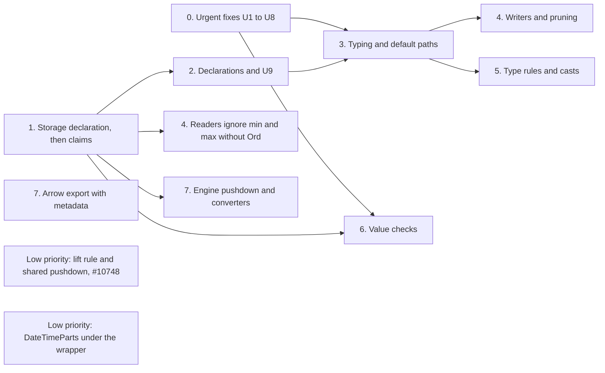

<!--
SPDX-License-Identifier: CC-BY-4.0
SPDX-FileCopyrightText: Copyright the Vortex contributors
-->

# 5. Implementation

This plan follows [`../decisions.md`](../decisions.md). IDs such as X4 and XQ1 refer to that file.
The design pass of 2026-10-29 settled the mechanism, so no phase waits for an open question. This
plan replaces the phases of the earlier version. The pass of 2026-10-30 put the storage declaration
(X25 to X30) at the start of phase 1.

## Phases

| Phase | Content | Depends on |
| --- | --- | --- |
| 0 | Urgent fixes U1 to U8, and the path-consistency test helper | Nothing |
| 1 | The storage declaration first: `storage_dtype`, `validate_metadata`, strict reads and the move of storage facts into the metadata. Then claims: the `Claim` enum, `ExtVTable::claims`, `DType::holds`, the check when a dtype is built, the claims of the repository types, conformance checks, and `ExtensionArray::new_unchecked` | Nothing |
| 2 | Declarations: `ExtensionUse`, `ResultMapping` and `extension_use` on both vtables, with the default `None` and no change of behavior. Then U9 | 1 |
| 3 | Typing and the default storage paths, split into PRs by family | 0 (U1, U2), 2 |
| 4 | Statistics: readers ignore min and max without `Ord`, writers drop the storage fallback, and pruning goes through the claims | 1 for the readers, 3 for the rest |
| 5 | Type rules and casts: `ExtVTable::rules` over `ReduceNode`, exact unit casts, and the named lossy unit function | 3 |
| 6 | Value checks: the value check of `try_new` and the strict read mode | 0, 1 |
| 7 | Boundaries: the Arrow default export and import of Vortex IDs, converters for DataFusion, DuckDB, Python and JNI, and engine pushdown through the claims | Nothing for the Arrow export, 1 for engine pushdown |

Phases 0 and 1 can run in parallel, except that phase 1 builds on U4 (see "Order constraints"). U5
merged on 2026-10-30. The Arrow part of phase 7 can start at any time. Phase 2 adds types and
methods that nothing reads yet, so it is small. U9 ends phase 2, because it needs the result
mappings. It changes only the results of the composite aggregates, which only tests use. Phase 3 is
the critical step: it turns on typing and removes the hand-written extension paths. Phases 4 and 5
build on it. Phase 6 runs in parallel with phases 2 to 5.

The default storage paths of phase 3 and the rules of phase 5 build their results with
`ExtensionArray::new_unchecked`. So phase 1 adds that constructor, and phase 6 only adds the value
check to `try_new`.

## Order constraints

Most PRs can land in any order that the graph allows. In six places, a change that lands alone
breaks something that works today. Those parts must land together, or in a fixed order:

1. U2 lands together with the DataFusion literal conversion (EXT-B1), the DataFusion dynamic filter
   path ([#10865](https://github.com/vortex-data/vortex/pull/10865),
   [#10869](https://github.com/vortex-data/vortex/pull/10869),
   [#10895](https://github.com/vortex-data/vortex/pull/10895)), and a check of the DuckDB literal
   conversion. Otherwise a filter that compares a `Uuid` or `Json` column with a storage literal
   fails when it is built, instead of being pushed down.
2. The Arrow export of phase 7 lands before U1, or together with it. U1 makes a storage-like Arrow
   target type an error, for example `Int64` for a timestamp column in the Python
   `to_arrow_array(arrow_type=...)`. The export with metadata gives those callers a path that loses
   nothing.
3. Phase 1 builds on U4 and U5. U4 ([#11012](https://github.com/vortex-data/vortex/pull/11012))
   changes `with_nullability` and the documentation of `validate_dtype`, which the storage
   declaration replaces. U5 ([#11015](https://github.com/vortex-data/vortex/pull/11015), merged as
   `5d8429064a`) changed the `Date`, `Time` and `Timestamp` vtables, which get their declarations
   and claims in phase 1. So phase 1 waits for #11012 to merge, or it is based on it.
4. The aggregates PR of phase 3 includes two more changes:
   - The writers' part of phase 4. Once `Min` and `Max` reject types without `Ord`, the storage
     fallback of `aggregate_state_dtype` would write a storage-typed state for those columns. No
     version wrote that form before.
   - DuckDB aggregate pushdown reads the claims. Today it excludes only `Uuid`, so `max` over a
     `Json` column would fail in DuckDB. Whether DuckDB falls back to its own aggregation when
     binding fails is not checked.
5. A change of `PartialOrd` for `Scalar` (XQ8) lands with the aggregates PR of phase 3, or after it.
   Today `min` and `max` merge partial results with `vortex_expect`, so an earlier change can panic.
6. The spatial nullability fix (EXT-N2) lands before the strict reads of phase 1 (X29). Its PR first
   checks whether any version of Vortex wrote a spatial dtype with a nullable nested level, for
   example through a GeoArrow import. If one did, phase 1 adds a read plugin for that form, because
   strict reads reject it.

Phase 2 and U9 also need coordination with
[#10769](https://github.com/vortex-data/vortex/pull/10769), which moves the aggregate
implementations that they change into `vortex-aggregates`.

## Phase 0: urgent fixes

- Write the path-consistency helper first, because U1 and U2 use it.
- Land U1 to U8 as separate PRs. U9 needs the declaration types, so it lands in phase 2.
- U4 is the interim form of the storage declaration: `with_nullability` stops validating again, and
  the documentation of `validate_dtype` states that its result must not depend on the top-level
  nullability. #11012 has this form since 2026-10-30. An earlier version validated every dtype for
  both nullabilities, and the maintainer rejected it.
- Land the Arrow part of phase 7 before U1, and change the DataFusion literal path in the PR of U2
  ("Order constraints", items 1 and 2).
- Some existing code depends on a leak, for example a comparison of an extension column with a
  storage literal. The full test suite finds these callers. Fix each one with an explicit
  `ext_storage`.

## Phase 1: storage declaration and claims

The storage declaration comes first, because the check of the claims runs on the declared storage.

- Replace `validate_dtype` with `fn storage_dtype(metadata: &Self::Metadata) -> DType` (X27).
  `ExtDType::try_new(metadata, nullability)` applies the top-level nullability, and
  `with_nullability` rebuilds the dtype from the declaration.
- Add `validate_metadata(&Metadata) -> VortexResult<()>` with the default `Ok(())` (X28).
  `ExtDType::try_new` and the read path call it.
- Change `deserialize_metadata` to take the stored storage dtype. On read, check that the declared
  storage equals the stored storage exactly, including nested nullability (X29).
- Move the facts that live only in the storage into the in-memory metadata: the element type and
  dimension of `Vector`, the element type of `FixedShapeTensor`, and the dimension of `Point` and
  `Rect`. The serialized bytes do not change. `ForeignExtDType` holds the raw bytes and the stored
  storage dtype.
- Switch the constructors that take a storage dtype to the facts. The audit of 2026-10-30 found
  these sites at `d197efd007`: `vortex-tensor/src/types/vector/mod.rs:51-53`,
  `vortex-array/src/arrays/extension/array.rs:78-88`, `vortex-spatial/src/extension/mod.rs:264-275`
  (used by `vortex-duckdb/src/convert/expr.rs:185` and `vortex-jni/src/expression.rs:738`),
  `vortex-spatial/src/scalar_fn/make_line.rs:85-89`, `vortex-spatial/src/scalar_fn/collect.rs:70-91`
  and `:191-198`, and `vortex-bench/src/vector_dataset/convert.rs:216-218`.
- Make the generic extension cast change only the top-level nullability (X30). Today it compares
  with a recursive `eq_ignore_nullability` (`vortex-array/src/dtype/dtype_impl.rs:118-141`,
  `vortex-array/src/arrays/extension/compute/cast.rs:18-41`).

Then the claims:

- Add `#[non_exhaustive] pub enum Claim { Eq, Ord }` with `Claim::implies` (X13, X14).
- Add `DType::holds(Claim)`. Built-in dtypes follow the fixed table of X13. An extension dtype holds
  the claims of `ExtVTable::claims` and the claims that they imply.
- Add `ExtVTable::claims(dtype) -> &'static [Claim]`, with the default `&[]`, and an erased
  forwarder on `ExtDTypeRef`.
- Check the claims in `ExtDType::try_new` (X15). The declared storage dtype must hold every claim.
- Give each type in the repository its claims (X16). `Uuid` gets `Ord`, ordered by its bytes.
- Document the contract on `ExtVTable`: structural and semantic operations, the claims, the storage
  declaration, validation, and the total-domain rule for nested nullability (X26).
- Add `validate_array` to `ExtVTable`, with a default that checks each value through
  `validate_scalar_value`. Phase 6 builds on it.
- Add `ExtensionArray::new_unchecked`. Until phase 6, it skips the same checks that
  `ExtensionArray::new` skips today. A debug build checks the promise with `validate_array`.
- Add a conformance harness for `ExtVTable` implementations. It checks the metadata round trip
  through the serialized bytes and the stored storage, that the claims ignore the top-level
  nullability, that `Ord` comes with `Eq`, and that a `validate_array` override agrees with the
  default.
- Add three reference test types:
  - An opaque type that claims nothing. Typing must reject every semantic operation on it.
  - A decimal-like type over `i64` that claims `Eq` and `Ord`. A differential test compares its
    results with the built-in `Decimal`. Write that test after CD8a
    ([#10701](https://github.com/vortex-data/vortex/issues/10701)), because the CD PRs still change
    the behavior of the built-in `Decimal`.
  - A refinement type that claims both and adds a value check.

## Phase 2: declarations and U9

- Add `ExtensionUse` and `ResultMapping` (X17, X19), and `extension_use` on `ScalarFnVTable` and
  `AggregateFnVTable`, with the default `ExtensionUse::None`. Nothing reads them yet, so behavior
  does not change.
- Add the `Rewrap` guard and the shared wrap and unwrap code for dtypes, scalars and arrays.
  `Fields` applies it to each field of a struct result. The guard ignores only the top-level
  nullability, and a nested mismatch is an error that names both dtypes (X30).
- Then land U9: implement `extension_use` for `MinMax`, `Min`, `Max`, `IsSorted`, `BoundedMin` and
  `BoundedMax`, and use the result mapping in today's `ExtensionStoragePushdown`. Part 4 has the
  details.
- Coordinate with [#10769](https://github.com/vortex-data/vortex/pull/10769), which moves the
  aggregate implementations into a new `vortex-aggregates` crate, and with
  [#10837](https://github.com/vortex-data/vortex/pull/10837), which changes
  `aggregate_fn/vtable.rs` and `session.rs`.

## Phase 3: typing and the default storage paths

- Add the typing check in its four places: `BoundExpression::try_new_vec`,
  `ScalarFnArray::try_new_from_slots`, `AggregateDTypes::try_new` and `ScalarFn::validate`. It
  calls `extension_use` once for each call with an extension operand, and it checks the claims of
  each argument with `DType::holds`. Make the variants of `BoundExpression` private. Make
  `Cast::new` fallible, because typing rejects casts that no rule covers.
- Cover lambda bodies in the typing check. `Expression::Variable` and `Lambda`
  ([#10502](https://github.com/vortex-data/vortex/pull/10502)) and `list_transform`
  ([#10503](https://github.com/vortex-data/vortex/pull/10503)) give a function a body that runs on
  list elements, and an element can be an extension value.
- `BoundExpression::try_new_vec` and `ScalarFnArray::try_new_from_slots` call `bind_options` before
  `return_dtype`, but `ScalarFn::validate` calls only `return_dtype`. Check whether typing in
  `ScalarFn::validate` must see bound options.
- Add the generic storage rewrite over `ReduceNode`, in the static optimizer and before kernel
  dispatch. It rewrites operands to `ext_storage`, or to the new `ext_storage_deep` for nested
  values, and applies the result mapping. Add the rule `ext_storage(Extension(s))` to `s`, so the
  row path of `ext_storage` reads storage without a value check.
- Move the body of `ExtensionStoragePushdown` into aggregate binding (X21). Remove the composite IDs
  and `register_storage_ordered`.
- Declare the built-in functions, and remove the hand-written extension paths: the extension compare
  kernel, the lone-extension case in `compare_arrays`, the extension branch of the nested
  comparator, and `min_max/extension.rs`. If #10408 merges first, its `between` pushdown becomes a
  `Storage` declaration. #10246 closed without a merge.
- Split the work into PRs by family, each with its declarations and tests:
  1. Compare and `between`, with the rule that sends `ext_storage(DateTimeParts) < lit` to the
     existing `DateTimeParts` compare kernel (X32).
  2. The aggregates.
  3. The structural functions.
  4. `list_contains` and the row encoding.
- Any change of `PartialOrd` for `Scalar` waits for the PR that rejects `min` and `max` for types
  without `Ord` (XQ8). An earlier change can make `max` panic on a chunked `Json` column, or in
  DuckDB aggregate pushdown. This risk comes from reading the code.

## Phase 4: statistics

- Readers ignore stored min and max of an extension type without `Ord`, in pruning and in the file
  statistics that reach engines, and log a warning once for each file and column (X22). This needs
  only phase 1, so it can land early.
- Writers drop the storage fallback of `aggregate_state_dtype`, so types without `Ord` get no min
  and max. Types with `Ord` keep their logical `Min` and `Max`, so the format does not change. This
  lands in the aggregates PR of phase 3, because `Min` and `Max` reject types without `Ord` only
  after it ("Order constraints", item 4).
- Pruning compares logical statistics through the claims, or unwraps them to storage bounds. The
  stats rewrite rules live in `vortex-expr`
  ([#10734](https://github.com/vortex-data/vortex/pull/10734)).
- Coordinate with [#10482](https://github.com/vortex-data/vortex/pull/10482), which records file
  `is_sorted` statistics and does not support extension types yet, and with
  [#10686](https://github.com/vortex-data/vortex/pull/10686), which proves comparisons true from
  statistics.

## Phase 5: type rules and casts

- Add `ExtVTable::rules`, written over `ReduceNode` (X20). The static optimizer, the session-aware
  optimizer and the executor find the rules through the dtype. A rule of the type wins over the
  default storage path.
- Implement the casts of #8570 as rules that the types own (C1). A cast exists only if a rule covers
  it, and every cast is exact (C2).
- Add `Timestamp` unit casts to a finer unit with overflow checks, and the same for `Date` and
  `Time`. A unit cast builds its result with `ExtensionArray::new_unchecked`, because legal input
  gives legal output.
- Add a named function that changes the unit to a coarser one with an explicit rounding mode.
- Audit the DuckDB and DataFusion converters: every literal for an extension column must be an
  extension scalar, and a SQL cast that truncates maps to the named function.

## Phase 6: value checks

- Make `ExtensionArray::try_new` check values with `validate_array`. Move kernels, builders and
  rules that keep legal values onto `new_unchecked`, which phase 1 adds
  ([`agents/design-notes.md`](agents/design-notes.md), section 8).
- Imports from Arrow, DuckDB, FFI and Python call `try_new`. File reads run only the structural
  `validate` (X23). Add the optional strict read mode.
- Add faster overrides of `validate_array` where a type has one, for example `Time`. `Timestamp`
  has no value check (X31).
- Building a scalar from an array keeps the check of U3, because file data can hold illegal values.
- The value check reads only non-null slots. The storage encoding decides what a null slot holds.
- Imports of a known type fail on data outside the domain of the type, and they convert children
  that are marked nullable but hold no nulls (X29).

## Phase 7: boundaries

- Arrow and DataFusion: export a type without a plugin as storage with `ARROW:extension:name` and
  `ARROW:extension:metadata`, and import Vortex IDs (X24). A storage-like target type no longer
  leaks storage. This part can start at any time.
- Add converter traits for DuckDB, Python and JNI, modeled on the Arrow registry. Move the
  hard-coded type lists into converters, and add converters where the implicit conversions of today
  stop.
- Engine pushdown reads the claims, not the storage type. This needs phase 1.
- Add a typed array view, a native value accessor, and metadata helpers, and write the developer
  guide page for extension types.

## Low priority and out of scope

- Low priority: the lift rule of X5, the extension case of
  [#10748](https://github.com/vortex-data/vortex/issues/10748). Nothing depends on it for
  correctness: without it, fast paths that look only at the root of an array fall back to slower
  paths with the same results. `Widen` needs the same rule (D25), and the set of arrays is open
  (XQ1). Details are in [`agents/design-notes.md`](agents/design-notes.md), section 6.
- Low priority, next to #10748: the shared pushdown of functions through generic encodings (X34).
  `Masked` and `Sparse` get a pushdown rule for elementwise, infallible and strict functions.
  `ScalarFnVTable` gets a constant-fold hook that `Constant` and the `Sparse` fill value use.
  `ext_storage` keeps only its constant hook and the unwrap rule of phase 3.
  [#11056](https://github.com/vortex-data/vortex/pull/11056) adds the constant case. Without the
  rest, `ext_storage` over `Masked` decodes, and over `Sparse` with extension values it fails
  (probe R6).
- Low priority: `DateTimeParts` as an `i64` encoding under the wrapper. Until then, the rule of X32
  keeps its compare kernel after phase 3. The new form needs an edition.
- Out of scope: the lossy primitive casts (the known issue in `decisions.md`), and the Rust traits
  of `Scalar` (XQ8).

## Findings by phase

Every finding of [`agents/findings.md`](agents/findings.md) has a fix in this plan:

| Finding | Fixed by |
| --- | --- |
| EXT-P1 | U1 and U2. Phase 3 keeps the paths consistent, because its rewrite runs on every path |
| EXT-C1, EXT-C2, EXT-C3 | U1 |
| EXT-Q1, EXT-Q3 | U2 |
| EXT-Q2 | The compare PR of phase 3, with the claims of phase 1 |
| EXT-A1 | The aggregates PR and the row encoding PR of phase 3 |
| EXT-A2 | Phase 4 |
| EXT-A3 | U9, at the end of phase 2 |
| EXT-V1 | U3 for the panics, and phase 6 for the value check of `try_new` |
| EXT-V2, EXT-V7 | U6 |
| EXT-V3 | U7 |
| EXT-V4, EXT-V5, EXT-V8 | U5, merged in #11015 |
| EXT-V9 | [#10953](https://github.com/vortex-data/vortex/pull/10953) (X31) |
| EXT-V6 | Phase 6. The trait allows a type without a value check, so a type adds one only where its values have constraints |
| EXT-N1 | U4 (#11012) as the interim fix, and the storage declaration of phase 1 |
| EXT-N2 | The spatial nullability PR, before the strict reads of phase 1 ("Order constraints", item 6) |
| EXT-S1 | The low-priority lift rule and the shared pushdown (X34). Code handles both shapes today, so no result is wrong |
| EXT-S2 | The low-priority move of `DateTimeParts` under the wrapper. U2 fixes its compare kernel |
| EXT-S3 | #10953 |
| EXT-B1 | U2 for literals, and phase 7 for schema and scalar conversion |
| EXT-B2 | U1 for the storage leak, and phase 7 for the export with metadata |
| EXT-B3 | U1 for `vx.scalar`, and phase 7 for `as_py` |
| EXT-B4 | The aggregates PR of phase 3 for pushdown, and phase 7 for the converter hook |
| EXT-B5 | Phase 7 |
| EXT-B6 | U1 removes the casts out of extension types that this lead is about. Check it again after U1 |
| EXT-R1 | U8 |
| EXT-R2 | Any time, as its own small PR |
| EXT-R3 | Phase 1 gives `ForeignExtDType` no claims, and phase 3 rejects semantic operations on it |
| EXT-R4 | Phase 1 for the contract on `ExtVTable`, and phase 7 for the developer guide |

The lossy primitive casts in `decisions.md` are not an extension finding, and they stay out of
scope.

## Test strategy

- **Path consistency.** Every semantic operation gives the same answer on the whole array, on one
  row, and with constant inputs.
- **Rule coverage.** The same expression gives the same result through `optimize`, `optimize_ctx`,
  execution without optimization, and the row path.
- **Opaque rejection.** Typing rejects every semantic operation on the opaque reference type.
- **Claims.** A type whose storage does not hold its claim fails when its dtype is built.
- **Declaration.** A dtype rebuilds from its serialized metadata and stored storage. A stored
  storage dtype with another nested nullability fails on read, with an error that names both.
- **Result mappings.** A wrong `Rewrap` target fails when the call is built. Debug builds catch a
  `Rewrap` that produces an illegal value.
- **Differential parity.** The decimal-like reference type matches the built-in `Decimal` for every
  operation that both support, including errors.
- **Statistics.** A file with storage-order min and max for a `Json` column reads without using them
  and logs one warning.
- **Engines.** DuckDB and DataFusion pushdown tests use extension literals for temporal, `Uuid` and
  `Json` columns. A `Json` comparison is not pushed down.

## Compatibility

- Phases 0 to 3 and phase 5 change behavior, not the file format. The release notes must list the
  behavior changes from part 4 and from typing.
- Phase 1 keeps the serialized metadata. Strict reads reject a stored storage dtype that differs
  from the declaration, so the spatial fix checks old files first ("Order constraints", item 6).
- Phase 4 keeps the format. Writers stop writing min and max for types without `Ord`, and readers
  ignore such values in old files.
- Phase 6 adds no value check to file reads, except in the strict mode.
- Phase 7 changes the Arrow export of types without a plugin from an error to storage with
  metadata.
- The low-priority lift rule changes the shape of `RunEnd` and `Sparse` over extension values, and
  `DateTimeParts` under the wrapper changes its format. Both need editions.

## Relation to the Decimal and type roadmap

The [Decimal notes](../decimal/README.md) place these phases in a larger graph of type work. Three
points affect the order:

- `Decimal` stays a built-in type (D1). Its fixes do not wait for this plan, but it follows the same
  rules: claims for one dtype, through the built-in table, and rules that the type owns.
- `Decimal`, `Widen` and extension types can share the lift rule through #10748. A constant decimal
  column is already `vortex.constant` with a decimal scalar, so the old decimal wire forms fit it.
- Phase 5 and the Decimal work share one integer kernel family, `rescale` and `check_range`.
  `Timestamp` unit casts and decimal rescales both use it.

The decimal-like reference type of phase 1 compares the default storage paths of phase 3 with the
built-in `Decimal`.
