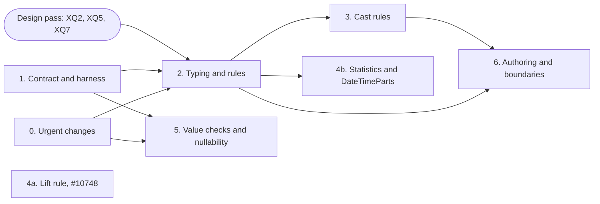

<!--
SPDX-License-Identifier: CC-BY-4.0
SPDX-FileCopyrightText: Copyright the Vortex contributors
-->

# 5. Implementation

This plan follows [`../decisions.md`](../decisions.md). IDs such as X4 and XQ1 refer to that file.

## Phases

| Phase | Content | Depends on |
| --- | --- | --- |
| 0 | The urgent changes in part 4, and the path-consistency test helper | Nothing |
| 1 | The `ExtVTable` contract with the default `validate_array`, `ExtensionArray::new_unchecked`, a conformance harness, and three reference test types | Nothing |
| 2 | Typing, the opt-in of X11 and rewrite rules: the opt-in mechanism (XQ7), the rules for compare, min, max and sort, `ext_storage_deep`, and rules that the type owns | 0, 1, and a design pass that settles XQ2, XQ5 and XQ7 |
| 3 | Cast rules that the types own, and an audit of engine literals | 2 |
| 4a | The lift rule for structural arrays, as the extension case of [#10748](https://github.com/vortex-data/vortex/issues/10748). Low priority | Nothing |
| 4b | Storage statistics for extension columns, and `DateTimeParts` under the wrapper | 2 |
| 5 | Value checks in `ExtensionArray::try_new`, and nullability on the extension dtype | 0, 1 |
| 6 | Authoring helpers, engine export plugins, and documentation | 2, 3 |

Phases 0 and 1 can run in parallel, and neither waits for an open question. Phase 4a can start at
any time, but it has low priority, because nothing depends on it for correctness. Phase 5 can run
in parallel with phase 2. Phase 2 is the critical step, because phases 3, 4b and 6 build on the
rules. It starts with a design pass, like the design pass of WR3 in the Decimal plan, because it
depends on three open questions and is too large for one PR.

The rules of phases 2 and 3 build their results with `ExtensionArray::new_unchecked`. So phase 1
adds that constructor, and phase 5 only adds the value check to `try_new`.

## Phase 0: urgent changes

- Write the path-consistency helper first, because U1 and U2 use it.
- Land U1 to U9 as separate PRs.
- Some existing code depends on a leak, for example a comparison of an extension column with a
  storage literal. The full test suite finds these callers. Fix each one with an explicit
  `ext_storage`.

## Phase 1: contract and harness

- Document the contract on `ExtVTable`: structural and semantic operations, the derive rules,
  validation, and nullability independence.
- Add `validate_array` to `ExtVTable`, with a default that checks each value through
  `validate_scalar_value`. Phase 5 builds on it.
- Add `ExtensionArray::new_unchecked`. Until phase 5, it skips the same checks that
  `ExtensionArray::new` skips today. A debug build checks the promise with `validate_array`.
- Add a conformance harness for `ExtVTable` implementations. It checks the metadata round trip,
  that `validate_dtype` ignores nullability, and that a `validate_array` override agrees with the
  default.
- Add three reference test types:
  - An opaque type that derives nothing. Typing must reject every semantic operation on it.
  - A decimal-like type over `i64` that derives `eq` and `ord` for each dtype. A differential test
    compares its results with the built-in `Decimal`. Write that test after CD8a
    ([#10701](https://github.com/vortex-data/vortex/issues/10701)), because the CD PRs still change
    the behavior of the built-in `Decimal`.
  - A refinement type that derives everything and adds a value check.
- The harness and the reference types grow with later phases. Phase 2 adds the derive rules and
  the derives. Phase 3 adds cast round trips.

## Phase 2: typing, derives and rules

- Add the opt-in mechanism that the design pass chooses (XQ7). The sketch in part 3 is `Derives`,
  `ExtVTable::derives`, and an erased forwarder on `ExtDTypeRef`.
- Add extension declarations to scalar and aggregate functions. An aggregate also declares whether
  its result is a value of its input, a bound, or neither (XQ5).
- Extend the typing check in its four places: `BoundExpression::try_new_vec`,
  `ScalarFnArray::try_new_from_slots`, `AggregateDTypes::try_new` and `ScalarFn::validate`. Make
  the variants of `BoundExpression` private. Make `Cast::new` fallible, because typing rejects
  casts that no rule covers.
- Cover lambda bodies in the typing check. `Expression::Variable` and `Lambda`
  ([#10502](https://github.com/vortex-data/vortex/pull/10502)) and `list_transform`
  ([#10503](https://github.com/vortex-data/vortex/pull/10503)) give a function a body that runs on
  list elements, and an element can be an extension value.
- `BoundExpression::try_new_vec` and `ScalarFnArray::try_new_from_slots` call `bind_options` before
  `return_dtype`, but `ScalarFn::validate` calls only `return_dtype`. Check whether typing in
  `ScalarFn::validate` must see bound options.
- Add the derive rules for compare, `between`, min, max, `is_sorted` and sort keys. They rewrite
  derived operands to `ext_storage`, or to the new `ext_storage_deep` for nested values. A rule
  that returns a value of the input builds the extension scalar itself. There is no `ext_wrap`
  expression (X4).
- Add the mechanism for rules that a type owns, and register them with the type. These notes
  recommend a method on `ExtVTable`, so the static optimizer, the session-aware optimizer and the
  executor all find the rules through the dtype (XQ2). Write the rules over `ReduceNode`, so that
  they also rewrite bound expressions for pruning.
- Add the rule `ext_storage(Extension(s))` to `s`, so the row path of `ext_storage` reads storage
  without a value check.
- Remove the code that applies storage semantics: the extension compare kernel, the extension
  branch of the nested comparator and the extension path of `min_max`. `ExtScalar` keeps the
  storage order only for types with `ord`.
- Change `PartialOrd` for `Scalar` in the same step as `min` and `max`. An earlier change of
  `PartialOrd` can make `max` panic on a chunked `Json` column, or in DuckDB aggregate pushdown.
  This risk comes from reading the code.
- Give each type in the repository its derives (the table in part 3).
- Move the other opt-ins onto the new mechanism. If #10408 merges first, its `between` pushdown
  becomes a derive check. `ExtensionStoragePushdown` stays, but a declaration on the type registers
  it in place of the calls to `register_storage_ordered` (X10). Plain `is_sorted` and `min_max` then
  route to it for those types (XQ7). #10246 closed without a merge.

## Phase 3: cast rules

- Implement the casts of #8570 as rules that the types own (C1). A cast exists only if a rule
  covers it.
- Add `Timestamp` unit casts with overflow checks, and unit casts for `Date` and `Time`. A unit
  cast builds its result with `ExtensionArray::new_unchecked`, because legal input gives legal
  output.
- Audit the DuckDB and DataFusion converters: every literal for an extension column must be an
  extension scalar.

## Phase 4a: lift rule

The lift rule needs no typing and no rules, so it can start at any time. It is the extension case
of [#10748](https://github.com/vortex-data/vortex/issues/10748), and `Widen` needs the same rule
(D25). Nothing depends on it for correctness: without it, fast paths that look only at the root of
an array fall back to slower paths with the same results. So this phase has low priority.

- Add the static rule that pulls structural arrays out from under the extension wrapper (X5). The
  set of arrays is open (XQ1). These notes recommend `Constant`, `Dict`, `RunEnd`, `Sparse`,
  `Chunked`, `Masked` and `Interleave`, which is also the set of D25.
- Give each structural encoding one method that rebuilds it with its value children passed through
  a function. Use it for the lift rule, for the pushdown of `ext_storage`, and to decode structural
  encodings that hold extension values. `RunEnd` and `Sparse` get extension support this way.
- Remove the extension take rule, which builds `Extension(Dict(indices, storage))`.
- Make the canonical form of an extension array a wrapper over canonical storage, if maintainers
  accept that recommendation (XQ1).
- Keep the old wire shape for `RunEnd` and `Sparse` over extension values until an edition allows
  the new one. Readers convert old shapes with the lift rule.

## Phase 4b: statistics and type-specific encodings

- Store storage statistics for extension columns. Readers convert existing extension-typed
  statistics to storage values. The stats rewrite rules now live in `vortex-expr`
  ([#10734](https://github.com/vortex-data/vortex/pull/10734)).
- Move `DateTimeParts` under the wrapper as an `i64` encoding. An edition gates the new form, and
  readers keep the old form.

## Phase 5: value checks and nullability

- Make `ExtensionArray::try_new` check values with `validate_array`. Move kernels, builders and
  rules that keep legal values onto `new_unchecked`, which phase 1 adds
  ([`agents/design-notes.md`](agents/design-notes.md), section 8).
- Imports from Arrow, DuckDB, FFI and Python call `try_new`. File reads follow the answer to XQ3.
- Add faster overrides of `validate_array` where a type has one, for example `Timestamp`.
- Building a scalar from an array keeps the check of U3, because file data can hold illegal values
  under the recommendation of XQ3.
- Apply the answer to XQ4 to the rows under a null parent. These notes recommend that any value is
  allowed there, and that accessors that take a child out of its parent mask it.
- Optionally move nullability onto the extension dtype.

## Phase 6: authoring and boundaries

- Add a typed array view, a native value accessor, and metadata helpers.
- Add export plugin traits for DuckDB, DataFusion and Python, modeled on the Arrow registry. Move
  the hard-coded type lists into plugins.
- Write the developer guide page for extension types.

## Test strategy

- **Path consistency.** Every semantic operation gives the same answer on the whole array, on one
  row, and with constant inputs.
- **Rule coverage.** The same expression gives the same result through `optimize`, `optimize_ctx`,
  execution without optimization, and the row path.
- **Opaque rejection.** Typing rejects every semantic operation on the opaque reference type.
- **Scalar contract.** For generated scalars, `a == b` holds exactly when `partial_cmp(a, b)`
  returns `Some(Equal)`, and equal scalars have equal hashes.
- **Differential parity.** The decimal-like reference type matches the built-in `Decimal` for every
  operation that both support, including errors.
- **Engines.** DuckDB and DataFusion pushdown tests use extension literals for temporal, `Uuid` and
  `Json` columns.

## Compatibility

- Phases 0 to 3 change behavior, not the file format. The release notes must list the behavior
  changes from part 4.
- Phase 4a changes the shape of `RunEnd` and `Sparse` over extension values. Phase 4b changes the
  `DateTimeParts` format and the statistics dtype of extension columns. All three need editions and
  read compatibility.
- Phase 5 can add a value check when a file is read, depending on XQ3. It does not change the
  format.

## Relation to the Decimal and type roadmap

The [Decimal notes](../decimal/README.md) place these phases in a larger graph of type work. Three
points affect the order:

- `Decimal` stays a built-in type (D1). Its fixes do not wait for this plan, but it follows the same
  rules: derives for one dtype and rules that the type owns.
- `Decimal`, `Widen` and extension types can share the lift rule of phase 4a through #10748. A
  constant decimal column is already `vortex.constant` with a decimal scalar, so the old decimal
  wire forms fit it.
- Phase 3 and the Decimal work share one integer kernel family, `rescale` and `check_range`.
  `Timestamp` unit casts and decimal rescales both use it.

The decimal-like reference type of phase 1 compares the rules of phase 2 with the built-in
`Decimal`.
