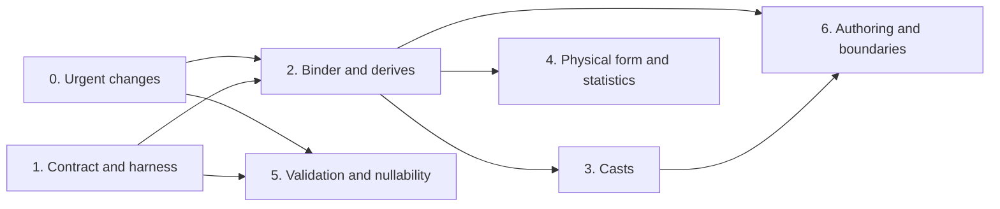

<!--
SPDX-License-Identifier: CC-BY-4.0
SPDX-FileCopyrightText: Copyright the Vortex contributors
-->

# 5. Implementation

## Phases

| Phase | Content | Depends on |
| --- | --- | --- |
| 0 | The urgent changes in part 4, and the path-consistency test helper | Nothing |
| 1 | The `ExtVTable` contract with the default `validate_array`, a conformance harness, and three reference test types | Nothing |
| 2 | The binder and derives: `Derives`, `ext_wrap`, and rewrites for compare, min, max and sort | 0, 1 |
| 3 | Casts through type-owned hooks, and an audit of engine literals | 2 |
| 4 | The physical form, and storage statistics for extension columns | 2 |
| 5 | Array validation, and nullability on the extension dtype | 0, 1 |
| 6 | Authoring helpers, engine export plugins, and documentation | 2, 3 |

Phases 0 and 1 can run in parallel. Phase 5 can run in parallel with phase 2. Phase 2 is the
critical step, because phases 3, 4 and 6 build on the binder.

## Phase 0: urgent changes

- Write the path-consistency helper first, because U1 and U2 use it.
- Land U1 to U8 as separate PRs.
- Some existing code depends on a leak, for example a comparison of an extension column with a
  storage literal. The full test suite finds these callers. Fix each one with an explicit
  `ext_storage`.

## Phase 1: contract and harness

- Document the contract on `ExtVTable`: structural and semantic operations, the derive rules,
  validation, and nullability independence.
- Add `validate_array` to `ExtVTable`, with a default that checks each value through
  `validate_scalar_value`. Phase 2 needs it for a checked `ext_wrap`, and phase 5 builds on it.
- Add a conformance harness for `ExtVTable` implementations. It checks the metadata round trip,
  that `validate_dtype` ignores nullability, the derive rules, cast round trips, and path
  consistency. It also checks that a `validate_array` override agrees with the default.
- Add three reference test types:
  - An opaque type that derives nothing. Every semantic operation on it must fail at bind time.
  - A decimal-like type over `i64` that derives `EQ` and `ORD` for each dtype, with a rescale
    rewrite across scales. A differential test compares its results with the built-in `Decimal`.
  - A refinement type that derives everything and adds a value check.

## Phase 2: binder and derives

- Add `Derives`, `ExtVTable::derives`, and the erased forwarder on `ExtDTypeRef`.
- Add extension declarations to scalar and aggregate functions. Bind aggregates wherever code builds
  them, including zone-map statistics.
- Add the `ext_wrap` expression. A checked `ext_wrap` calls `validate_array` from phase 1.
- Rewrite compare, `between`, min, max, `is_sorted` and sort keys at bind time.
- Make the row path of `ext_storage` read storage without a value check.
- Remove the code that applies storage semantics. That code is the extension compare kernel, the
  extension branch of the nested comparator, the extension path of `min_max`, and storage order in
  `ExtScalar`.
- Change `PartialOrd` for `Scalar` and the operators of `scalar_cmp` in the same step as `min` and
  `max`. An earlier change of `PartialOrd` can make zone maps of `Json` columns panic. This risk
  comes from reading the code.
- Give each type in the repository its derives (the table in part 3).
- Move the open PRs onto derives. #10408 becomes a derive check. #10246 and #10566 become aggregate
  rewrites.

## Phase 3: casts

- Implement the hooks from #8570 as rewrites.
- Add `Timestamp` unit casts with overflow checks, and unit casts for `Date` and `Time`.
- Audit the DuckDB and DataFusion converters: every literal for an extension column must be an
  extension scalar.

## Phase 4: physical form and statistics

- Implement the physical form that maintainers choose (part 3):
  - With the wrapper on top, reverse `ExtensionConstantRule` and add rules that lift the wrapper
    above `Constant`, `Dict`, `Chunked`, `Masked` and `Sparse`. Constant detection then looks
    through the wrapper.
  - With generic encodings on top, push `ext_storage` through `Masked` and `Sparse`. `Dict` and
    `Chunked` already push it down.
- Store storage statistics for extension columns. Readers convert existing extension-typed
  statistics to storage values.
- Move `DateTimeParts` under the wrapper as an `i64` encoding. An edition gates the new form, and
  readers keep the old form.

## Phase 5: validation and nullability

- Record whether each array is validated. Only a successful check, or a structural operation on
  validated input, makes an array validated.
- Run value validation in checked constructors and imports. File reads validate when a read
  option asks for it.
- Add faster overrides of `validate_array` where a type has one, for example `Timestamp`.
- Row reads from unvalidated arrays check each value. Row reads from validated arrays skip the
  check.
- Optionally move nullability onto the extension dtype.

## Phase 6: authoring and boundaries

- Add a typed array view, a native value accessor, and metadata helpers.
- Add export plugin traits for DuckDB, DataFusion and Python, modeled on the Arrow registry. Move
  the hard-coded type lists into plugins.
- Write the developer guide page for extension types.

## Test strategy

- **Path consistency.** Every semantic operation gives the same answer on the whole array, on one
  row, and with constant inputs. This also holds for unvalidated arrays with invalid values.
- **Opaque rejection.** The opaque reference type fails at bind time for every semantic operation.
- **Scalar contract.** For generated scalars, `a == b` holds exactly when `partial_cmp(a, b)`
  returns `Some(Equal)`, and equal scalars have equal hashes.
- **Differential parity.** The decimal-like reference type matches the built-in `Decimal` for every
  operation that both support, including errors.
- **Engines.** DuckDB and DataFusion pushdown tests use extension literals for temporal, `Uuid` and
  `Json` columns.

## Compatibility

- Phases 0 to 3 change behavior, not the file format. The release notes must list the behavior
  changes from part 4.
- Phase 4 changes the `DateTimeParts` format and the statistics dtype of extension columns. Both
  need editions and read compatibility.
- Phase 5 adds an optional check when a file is read. It does not change the format.

## Relation to the Decimal and type roadmap

The [Decimal notes](../decimal/README.md) place these phases in a larger graph of type work. Three
points affect the order:

- The array-level fix for `Decimal` does not wait for this plan. The built-in `Decimal` wrapper
  owns its rewrites, so it does not need the `ExtVTable` hooks.
- A move of `Decimal` into an extension type needs phases 0, 2 and 3 first. Without them, a cast
  from a decimal to an integer returns the unscaled values.
- Phase 3 and the Decimal work share one integer kernel family, `rescale` and `check_range`.
  `Timestamp` unit casts and decimal rescales both use it.

The Decimal rewrites are also good acceptance tests for the binder of phase 2. The decimal-like
reference type of phase 1 can run them against the built-in `Decimal`. Phase 4 and the Decimal
wrapper share the decision on the physical form.
